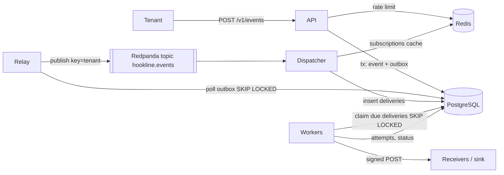

# Final project: Hookline — a webhook delivery platform

Written 2026-10-05 (Stage 1b). Source of truth for `exercises/project-hookline/` and chapters 37–39. Targets in this
file are **targets to be measured by the reader**, never results; the reference implementation ships the means to
measure them (k6 thresholds, Prometheus histograms, sink counters), and `docs/EVALUATION.md` in the project has
placeholders, not numbers.

## 1. User story
"I run a SaaS product. My customers want to be notified when things happen in their accounts (an invoice is paid, a
shipment moves). I want to send each event once from my code and know that every subscribed customer endpoint will
receive it, signed, at least once, even when their servers are slow or down, without one bad customer slowing
everyone else, and with a way to see and replay what failed."

Actors: the **tenant** (the SaaS product, calls the API with an API key), the **receiver** (a tenant's customer
endpoint that gets webhooks), the **operator** (runs Hookline, watches dashboards, is on call).

## 2. Functional requirements (each with its check)
| ID | Requirement | Check |
| --- | --- | --- |
| F1 | A tenant registers endpoints (HTTPS URL in production, HTTP allowed in dev mode, for the compose sink) with a generated signing secret shown once | API test: create, list with cursor, disable |
| F2 | A tenant subscribes an endpoint to event types (exact type or `*`) | API test |
| F3 | `POST /v1/events` accepts an event with an `Idempotency-Key`; the same key with the same body returns the original result (a concurrent duplicate waits on the unique index and gets the same result, so no 409 is needed); the same key with a different body returns 422 | Integration test against PostgreSQL |
| F4 | Every event is delivered to every matching, enabled endpoint **at least once**, as an HTTP POST with JSON body and headers `Hookline-Event-Id`, `Hookline-Delivery-Id`, `Hookline-Attempt`, `Hookline-Signature` | End-to-end test with the sink: sink unique count equals expected deliveries |
| F5 | Signature: `t=<unix seconds>,v1=<hex HMAC-SHA256(secret, "<t>.<raw body>")>`; receivers reject when outside a 5-minute tolerance | Unit tests in Go (signer) and Python (sink verifier) on shared test vectors |
| F6 | Failed deliveries (timeout, connection error, 5xx, 429) are retried with exponential backoff and full jitter, capped, up to a maximum attempt count; 4xx other than 408/429 is not retried | Property test on the backoff; worker tests with an `httptest` server |
| F7 | After the last attempt a delivery becomes `dead`; `POST /v1/deliveries/{id}/replay` re-queues it; listing dead deliveries is paginated | Integration test |
| F8 | Every attempt is recorded (start time, duration, status code or error) and visible via `GET /v1/events/{id}/deliveries` | Integration test |
| F9 | A tenant can only see and act on its own resources | BOLA tests (tenant B gets 404 on tenant A's ids) |

## 3. Non-functional requirements (targets, each with its check)
| ID | Target | How it is checked |
| --- | --- | --- |
| N1 | Ingest SLO: 99% of `POST /v1/events` return 2xx in under 200 ms at the `loadtest/ingest.js` profile on the reader's laptop | k6 thresholds; `http_server_request_duration_seconds` |
| N2 | Delivery SLO: 99% of deliveries to healthy endpoints arrive within 30 s of ingest | `hookline_delivery_lag_seconds` histogram; burn-rate alerts |
| N3 | Isolation: a receiver that times out on every request does not raise delivery lag for healthy receivers above N2 | Chaos test: one sink in `timeout` mode, others healthy |
| N4 | No loss on crash: killing the relay, a dispatcher or a worker at any moment loses no delivery | Chaos test: kill pods during load, compare sink unique counts to the expected set |
| N5 | Fairness: one tenant above its rate limit receives 429 with `Retry-After`; other tenants are unaffected | Integration test + k6 two-tenant scenario |
| N6 | Overload: when the in-flight request limit is reached, ingest sheds with 503 and `Retry-After` instead of queueing without bound | Load test above capacity |
| N7 | Security: API keys stored hashed; signing secrets never logged; endpoint URLs resolving to private, loopback or link-local addresses are rejected (outside dev mode) | Unit tests on the SSRF guard; log scan test |
| N8 | Operability: every request and delivery carries a trace; RED dashboards for API and workers; runbooks for every alert | Manual check in Grafana (M8 completion criterion) |
| N9 | Cost: runs on one laptop (kind, single-node Redpanda, one PostgreSQL) | Recorded resource usage in `docs/EVALUATION.md` |

## 4. Architecture

Components (one Go module, four binaries, one Python service):
- **api** (`cmd/api`): HTTP API, authentication, per-tenant rate limit, load shedding, idempotent ingest
  (event row and outbox row in one transaction).
- **relay** (`cmd/relay`): one active instance (PostgreSQL session advisory lock); publishes outbox rows to Redpanda in
  order and marks them published. Crash between publish and mark means a duplicate publish, never a loss.
- **dispatcher** (`cmd/dispatcher`): consumer group on `hookline.events`; fans each event out into one `deliveries` row
  per matching subscription (unique `(event_id, endpoint_id)` makes reprocessing harmless); commits offsets after the
  insert.
- **worker** (`cmd/worker`): claims due deliveries with `FOR UPDATE SKIP LOCKED` and a lease, sends them through a
  per-endpoint circuit breaker and bulkhead, records the attempt, schedules the retry (`next_attempt_at`) or marks
  `delivered` or `dead`.
- **sink** (`sink/`, Python FastAPI): the receiver simulator from chapter 8. Verifies signatures, dedupes, counts, and
  misbehaves on command (`POST /control`: failure rate, latency, status code, timeout mode).
- Infrastructure: PostgreSQL 18, Redpanda, Redis 8, the OpenTelemetry Collector, Prometheus, Grafana, Loki, Tempo.

## 5. Data model (PostgreSQL, goose migrations in `migrations/`)
| Table | Key columns | Notes |
| --- | --- | --- |
| `tenants` | `id`, `name`, `api_key_hash` (unique), `rate_per_sec`, `burst` | key shown once at creation (`hookline-admin`) |
| `endpoints` | `id`, `tenant_id`, `url`, `secret`, `enabled`, `created_at` | secret encrypted at rest is an extension, not M-scope |
| `subscriptions` | `id`, `tenant_id`, `endpoint_id`, `event_type`, `created_at` | unique `(tenant_id, endpoint_id, event_type)` and a composite FK to `endpoints (tenant_id, id)`: with `(endpoint_id, event_type)` alone, tenant B probing A's endpoint got 409 instead of 404 (the unique check runs before the FK), leaking existence (found in M2, 2026-10-05) |
| `events` | `id` (uuid), `tenant_id`, `type`, `payload` (jsonb), `idempotency_key`, `body_hash`, `created_at` | unique `(tenant_id, idempotency_key)` |
| `outbox` | `id` (bigserial), `event_id`, `created_at`, `published_at` | partial index on unpublished rows |
| `deliveries` | `id`, `event_id`, `endpoint_id`, `status` (`pending`, `in_flight`, `delivered`, `dead`), `attempts`, `next_attempt_at`, `lease_until`, `last_error`, `delivered_at`, `tenant_id` | unique `(event_id, endpoint_id)`; partial indexes on due rows and on dead rows per tenant |
| `attempts` | `id`, `delivery_id`, `n`, `started_at`, `duration_ms`, `status_code`, `error` | append-only |

## 6. Decisions (with the simpler alternative and what would change the decision)
| Decision | Simpler alternative | Why not the alternative here | What would change my mind |
| --- | --- | --- | --- |
| Transactional outbox + relay to Redpanda | Publish to Kafka directly from the API | Dual write: event committed but publish lost (or the reverse) | A database with built-in CDC already in place (Debezium) |
| Kafka between relay and dispatcher, PostgreSQL queue for deliveries | Kafka for everything, with retry topics | Per-delivery scheduled retries and replay are natural as rows with `next_attempt_at`; retry topics multiply topics and lose per-row visibility | Delivery volume beyond what one PostgreSQL can index and vacuum comfortably |
| Single active relay via advisory lock | Many relays with `SKIP LOCKED` | Preserves publish order per tenant simply | Relay throughput becomes the bottleneck (then partition the outbox by tenant hash) |
| At-least-once + receiver dedupe by `Hookline-Event-Id` | Promise exactly-once | Exactly-once over HTTP to third parties is impossible to guarantee; a clear contract is honest | Never, for third-party HTTP |
| Per-endpoint breaker and bulkhead in each worker process | A global shared breaker in Redis | Local state is simpler and fails safe; each worker learns quickly | Many workers hammering a dead endpoint before their local breakers open |
| Redis token bucket per tenant | In-process limiter per API replica | Replicas would multiply the effective limit | Single-replica deployment |
| API keys hashed with SHA-256 | bcrypt/argon2 | Keys are 32 random bytes; a slow hash protects low-entropy passwords, not random keys | Keys chosen by humans |
| Go for services, Python for the sink | One language | The book teaches both; the sink is a tool, not the product | A team that only knows one |

## 7. Failure modes and handling
| Failure | Effect without handling | Handling | Proof |
| --- | --- | --- | --- |
| API crashes after commit, before response | Tenant retries | Idempotency key returns the original result | F3 test |
| Relay crashes after publish, before mark | Duplicate event on topic | Dispatcher insert is idempotent (unique constraint) | Test with forced crash point |
| Two relays start | Out-of-order or doubled publishing | Advisory lock: only one holds it; the other waits | Leader test (kill one) |
| Dispatcher crashes before offset commit | Event reprocessed | Unique `(event_id, endpoint_id)` | Consumer test |
| Worker dies holding a delivery | Delivery stuck `in_flight` | Lease expiry returns it to `pending` | Lease test |
| Receiver down for hours | Retries pile up, workers busy | Breaker opens, attempts paused, backoff capped, dead after max attempts, replay later | Chaos test N3 |
| Receiver slow (timeouts) | Workers blocked, others starve | Per-attempt timeout + per-endpoint bulkhead | Chaos test N3 |
| Ingest flood from one tenant | Everyone slows | Rate limit per tenant, shedding globally | N5, N6 |
| Redis down | Rate limit and cache unavailable | Rate limiter fails open with a metric and a log (documented choice); cache falls back to PostgreSQL | Test with Redis stopped |
| Redpanda down | Events wait in the outbox | Relay retries with backoff; ingest keeps working; outbox age alert | Test with broker stopped |

## 8. How success is measured
- Functional: `go test ./...` (unit + integration with testcontainers) and the Python sink tests are green in CI.
- Guarantees: `scripts/verify-delivery.sh` compares the expected `(event, endpoint)` set with the sink's unique
  receipts after a chaos run; the result must be "0 missing" (duplicates are allowed and counted).
- SLOs: k6 thresholds pass for N1; the delivery lag histogram meets N2 over the run; both recorded with the date and
  machine in `docs/EVALUATION.md` by the reader.
- Operations: every alert has a runbook; one postmortem written for the deliberately broken release (M8).

## 9. Milestones
| M | Name | Builds on | Packages / files | Completion criterion | Days |
| --- | --- | --- | --- | --- | --- |
| M1 | API skeleton | ch 6, 9 | `internal/platform`, `internal/api`, `internal/domain`, `api/openapi.yaml`, memory store | API tests green for endpoints, subscriptions, events (memory) | 22–23 |
| M2 | PostgreSQL and idempotent ingest | ch 10, 11 | `migrations/`, `internal/store`, `internal/api/ingest.go` | Ingest idempotency tests green against PostgreSQL | 29–30 |
| M3 | Cache and the receiver simulator | ch 8, 12 | `internal/cache`, `sink/`, `deploy/compose.yaml` | Cache tests incl. stampede; sink tests; compose up | 33–34 |
| M4 | Outbox and Redpanda | ch 13 | `internal/outbox`, `internal/dispatch`, `cmd/relay`, `cmd/dispatcher` | Crash-point tests; event reaches `deliveries` | 39–40 |
| M5 | Delivery, signing, retries | ch 14 | `internal/delivery` (signer, backoff, worker), replay API | End-to-end: events reach the sink signed; dead + replay work | 43–44 |
| M6 | Resilience and load | ch 15–18 | `internal/delivery/breaker.go`, `bulkhead.go`, `internal/ratelimit`, `internal/leader`, shedding middleware | Breaker, limiter, leader tests; N3 lab passes locally | 54–55 |
| M7 | Containers, Kubernetes, CI | ch 19–23 | `Dockerfile`, `sink/Dockerfile`, `deploy/helm/hookline`, `deploy/terraform`, `.github/workflows` | `helm install` on kind; actionlint clean; Terraform apply on kind | 68–70 |
| M8 | Observability and SLOs | ch 24–25 | `internal/telemetry`, dashboards, `deploy/observability/rules`, `docs/runbooks`, `docs/postmortem-*.md` | Traces across Kafka visible; promtool rule tests green; postmortem written | 77–79 |
| M9 | Testing and security | ch 26–28 | `internal/security`, integration tests, `loadtest/`, `docs/threat-model.md` | SSRF/BOLA/auth tests; k6 thresholds; govulncheck clean; SBOM | 85–86 |
| M10 | Evaluation and demo | ch 39 | `scripts/chaos.sh`, `scripts/verify-delivery.sh`, `docs/EVALUATION.md`, `docs/DEMO.md` | 0 missing deliveries after chaos; SLO results recorded by the reader | 98–99 |

## 10. Starter
`hookline-starter/` is generated by `tools/make_project_starter.py`: same tree, tests kept as the specification,
function bodies replaced by `panic("TODO: see chapter 38")` (Go) and `raise NotImplementedError` (Python),
scaffolding (config, server, middleware, domain types, telemetry setup, `main` functions) kept whole. The starter
compiles from day one; `go test ./...` turns green package by package.
