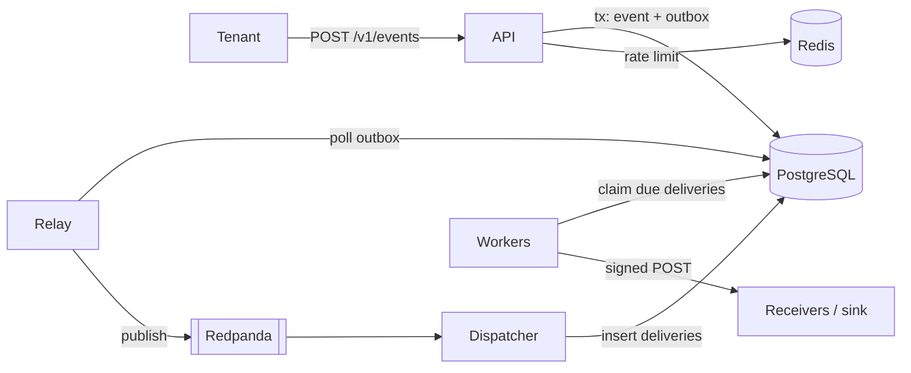

<div dir="rtl" lang="he">

# פרק 1: מה זה „בכירה” ב־2026

לפני שלומדים כלי אחד, כדאי לדעת מה המעסיקים באמת מבקשים. הפרק הזה קורא מודעות דרושים אמיתיות למשרות בכירות
בפיתוח שרתים (backend) ובתשתיות בישראל, ומפרק אותן: אילו שנות ניסיון, אילו כלים, אילו אחריויות, ואיזה תהליך
גיוס. בסופו תדעי איפה את עומדת, איזה מסלול מתאים לרקע שלך, ולמה הספר בנוי כמו שהוא בנוי.

## מה נלמד בפרק

- מה מודעות למשרות בכירות בישראל מבקשות, נכון לאוקטובר 2026, ועד כמה אפשר לסמוך על המספרים.
- ארבעת המסלולים, ובמה הם נבדלים.
- איך קוראים מודעה: מה חובה, מה יתרון, ומה מסתתר מאחורי הניסוח.
- שלושת הסימנים של בכירות: היקף, בעלות ושיקול דעת.
- איפה הרקע שלך ב־Rust וב־C++ שווה הכי הרבה.
- איך נראה תהליך הגיוס הבכיר, ומה הוא Hookline, פרויקט הגמר.

## ידע מקדים

פרק 0. לתרגיל: uv ו־Python 3.14 מותקנים, לפי פרק 2 (ביום 0).

**על המקור.** כל טענה על השוק בפרק הזה מבוססת על מחקר שוק שנעשה לספר ב־5 באוקטובר 2026, והוא נמצא בקובץ
[`00-stage1/01-market-research.md`](../00-stage1/01-market-research.md). ההפניות בפרק נראות כך: (מחקר השוק,
סעיף 1.4). שם תמצאי את המודעות עצמן, את המקורות, ואת רמת הביטחון של כל ממצא. טענה שלא מופיעה במחקר לא מופיעה
כאן.

## 1.1 מה המודעות אומרות

### 1.1.1 על מה המספרים מבוססים

המחקר נשען על שני מדגמים, ושניהם קטנים ולא אקראיים. חשוב להבין את זה לפני שקוראים מספר אחד:

| מדגם | גודל | איך נבדק | מגבלה |
| --- | --- | --- | --- |
| מודעות בכירות שנקראו ביד | 30 מודעות, 18 מעסיקים | ספירת מילים, ואחריה קריאה ידנית | נוטה לחברות גדולות ומוכרות, ובעיקר לחברות סייבר |
| מדגם רחב יותר | 178 מודעות, מתוכן 84 בכירות | ספירת מילים בלבד | כולל מעסיקי חומרה, ולכן מנפח את C++ |

שני המדגמים נאספו מאתר שמרכז מודעות מדפי הקריירה של החברות. אתרי דרושים בעברית לא נדגמו, ולכן גם סטארט־אפים
קטנים ותעשיות ביטחוניות מיוצגים פחות (מחקר השוק, סעיפים 1.1 ו־8). המספרים שלמטה הם **כיוון, לא נתח שוק**.

### 1.1.2 שנות ניסיון

ב־28 מתוך 30 המודעות מופיע מינימום של שנות ניסיון. השכיח והחציון: **5 שנים**, בטווח של 3 עד 7 (מחקר השוק, סעיף
1.2). משרות שמוגדרות Principal מבקשות 7 ומעלה. הביטחון בממצא הזה גבוה למדגם עצמו, ובינוני כטענה על השוק כולו.

### 1.1.3 מה האחריויות מבקשות

כשקוראים את סעיפי האחריות, ולא רק את רשימות הכלים, חוזרים חמישה נושאים (מחקר השוק, סעיף 1.3):

| נושא | מה כתוב, בקיצור | כמה נפוץ במדגם |
| --- | --- | --- |
| הובלה טכנית בידיים | „hands-on technical leader”, הובלת תכנון טכני | נפוץ |
| בעלות על הייצור ותורנות | „Own production from day one”, תורנות (on-call) כולל סופי שבוע | תורנות מפורשת ב־8 מתוך 30 |
| תכנון טכני | „lead technical design”, תוכניות ביצוע | נפוץ; המילים „design doc” לא הופיעו באף מודעה |
| חניכה (mentoring) | הנחיה של מהנדסות ומהנדסים צעירים יותר | מפורש רק ב־4 מתוך 30 |
| אחריות מקצה לקצה | מהבנת הבעיה ועד ניטור אחרי ההשקה | נפוץ |

שתי הערות על הטבלה. ראשית, המודעות מתארות את **הפעילות** (לתכנן, להוביל החלטות) ולא את **המסמך** (מסמך תכנון),
ולכן אל תחפשי את המילה; חפשי את הפועל. שנית, חניכה מופיעה פחות ממה שסולמות קריירה גלובליים מרמזים: בסולם הציבורי
של GitLab, למשל, חניכה היא חלק מוגדר של התפקיד הבכיר (מחקר השוק, סעיף 1.3).

### 1.1.4 אילו כלים

אלה הספירות במדגם של 30 המודעות. מודעה נספרת פעם אחת לכל פריט (מחקר השוק, סעיף 1.4):

| פריט | מודעות מתוך 30 | הערה |
| --- | --- | --- |
| Python | 21 | כולל רשימות מהסוג „אחת מ־Python, Go או Java” |
| Kubernetes | 19 | |
| AWS | 18 | GCP ב־13, Azure ב־11 |
| Docker או קונטיינרים | 16 | |
| Go | 13 | רק בכ־4 היא השפה הראשית או חובה |
| TypeScript או Node.js | 12 | |
| Terraform או תשתית כקוד | 12 | ב־7 מתוך 8 משרות ה־DevOps וה־SRE |
| כלי פיתוח בעזרת AI | 11 | נבדק ידנית; סעיף 1.4 |
| CI/CD | 10 | GitHub Actions נזכר במפורש רק פעמיים |
| תורנות מפורשת | 8 | |
| בדיקות (יחידה, אינטגרציה, TDD) | 8 | |
| MongoDB | 7 | יותר מ־PostgreSQL (4) |
| Kafka | 5 | ועוד 4 של תורים אחרים |
| Redis | 5 | |
| Rust | 2 | סעיף 1.5 |

ובמדגם הרחב, של 84 המודעות הבכירות (מחקר השוק, סעיף 1.6):

| פריט | שיעור המודעות |
| --- | --- |
| Python | 63% |
| Kubernetes | 43% |
| Go | 32% |
| Rust | 2% |

הביטחון בשני המדגמים בינוני.

> **שימי לב:** ספירת מילים מוטה לפי המילה. „Observability” או „monitoring” הופיעו ב־22 מודעות, אבל ספירה
> מחמירה, של כלים בשמם, מוצאת 7 בלבד (מחקר השוק, סעיף 1.4). אותו פער יופיע בתרגיל שלך. לכן ספירה תמיד מלווה
> בקריאה ידנית של כמה התאמות.

### 1.1.5 השוק עצמו

התמונה של סוף 2026 מפוצלת (מחקר השוק, סעיפים 0 ו־6):

- **שכר בשיא, תעסוקה בתוכנה מתכווצת.** השכר הממוצע בהייטק הגיע לשיא, אבל חברות תוכנה צמצמו עובדים, והתעסוקה
  במחקר ופיתוח ירדה לראשונה מזה עשור. הביטחון גבוה.
- **הצעירים נפגעים ראשונים.** מעט מאוד משרות פתוחות מיועדות למי שאין לה ניסיון.
- **בכירות עם הפרופיל הנכון מבוקשות.** ניסיון בהפעלת ייצור, במערכות מבוזרות, ושימוש מושכל בכלי AI.
- **השורה התחתונה:** שוק סלקטיבי, לא סגור. פחות מקומות, תהליכים ארוכים יותר, ויותר בדיקה שאת באמת יודעת.

השכר בפירוט שייך לפרק 34, סעיף 34.6. בקצרה, ולפי המחקר: הטווח המרכזי למשרה בכירה בפיתוח שרתים או בתשתיות, עם 6
עד 10 שנות ניסיון, הוא בערך 35 עד 45 אלף ₪ ברוטו לחודש, שכר בסיס, בביטחון בינוני. המקורות חלוקים בקצוות, והמחקר
עצמו מזהיר מלצטט מספר יחיד: מיקום, תחום ומניות משנים את התמונה (מחקר השוק, סעיף 5).

## 1.2 המסלולים: backend, platform, SRE, תשתיות נתונים

המחקר מיין את 30 המודעות לארבעה מסלולים (מחקר השוק, סעיף 2):

| מסלול | מודעות | מה שולט | מה מבדיל אותו |
| --- | --- | --- | --- |
| backend מוצרי | 15 | Python, TypeScript, Java, Go; מיקרו־שירותים | בעלות על תחום במוצר, ממשקי API, מידול נתונים, עבודה מול מוצר |
| platform ותשתיות backend | 5 | Kubernetes בכל החמש; ענן; Python ו־Go | שירותים פנימיים משותפים, מערכות מרובות לקוחות, אמינות ללקוחות פנימיים |
| DevOps, SRE ותפעול פלטפורמה | 8 | Kubernetes, Terraform, Docker, Python, Go, Prometheus | תורנות, תקריות ותחקירים, תשתית כקוד, CI/CD, עלויות |
| תשתיות נתונים | 2 | Spark, Flink, Airflow, AWS | צינורות נתונים בקנה מידה; המדגם קטן מכדי להכליל |

שתי תצפיות מהמחקר, שחשובות לבחירה שלך:

- **הגבול בין backend לבין platform מטושטש.** משרות platform עדיין נקראות כמו משרות תוכנה (תכנון, ממשקים, מידול
  נתונים) שנוסף להן Kubernetes. משרות SRE ו־DevOps נקראות כמו משרות תפעול שנוסף להן קוד.
- **מי שבאה מ־Rust ומעבודת מערכות קרובה במיוחד לשני מסלולים:** תשתיות ופלטפורמה, ופיתוח שרתים למוצרי אבטחה.
  אבטחת מידע מיוצגת בישראל בכבדות.

הספר מכוון למסלול backend ותשתיות: פרויקט הגמר הוא שירות backend שנפרס, נמדד ומתופעל כמו מערכת פלטפורמה. כך את
מתאמנת לשני הצדדים של הגבול המטושטש, בלי לבחור עכשיו.

## 1.3 איך קוראים מודעה

מודעה היא מסמך שיווקי שנכתב בלחץ, לעיתים בידי כמה אנשים. כדאי לקרוא אותה בשכבות, ולא כרשימת קניות:

| שכבה | מה מחפשים | מה זה אומר לך |
| --- | --- | --- |
| כותרת ושנים | Senior, Staff או Principal; מספר השנים | הרמה שאליה ימדדו אותך |
| אחריות | הפעלים: לבנות, להוביל, להחזיק, להיות בתורנות | מה תעשי ביום רגיל; זה החלק החשוב |
| דרישות | מה מסומן חובה | מה יסננו לפיו בשלב הראשון |
| „יתרון” | מה מסומן יתרון או nice to have | איפה את יכולה לבלוט, לא איפה תיפסלי |
| רשימות „אחת מ” | „Go, Python, Java או דומה” | השפה פחות חשובה מהיכולת לעבוד בשפה של הצוות |
| מה חסר | אין תורנות, אין תכנון, אין בדיקות | שאלות לשלב הראיון, לא סיבה לוותר |

שלוש מלכודות קריאה:

- **לספור דרישות ולהיבהל.** מודעה עם 15 כלים לא מצפה ל־15 מומחיות. היא מתארת את הסביבה. מה שנבדק בראיון הוא
  מה שכתוב בסעיף האחריות.
- **לקרוא שפה כחובה.** במדגם, Go הופיעה ב־13 מודעות, אבל רק בכ־4 היא השפה הראשית או חובה (מחקר השוק, סעיף 1.4).
  ברוב האחרות היא פריט ברשימה.
- **לסמוך על ספירה בלי לקרוא.** בדיוק הפער שבין ספירה רחבה לספירה מחמירה, מסעיף 1.1.4.

**לספור בעצמך.** התרגיל של הפרק נותן לך כלי קטן, `skilltally`, שעושה למודעות שלך את מה שהמחקר עשה למדגם שלו:
סופר אילו מיומנויות מוזכרות, ומשווה לרשימה של מה שכבר יש לך. טבלת המיומנויות היא קובץ שאת עורכת. זו הרשומה
של Go, מתוך `data/skills.toml`:

<div dir="ltr" align="left">

```toml
name = "Go"
area = "languages"
chapter = 3
keywords = ["golang"]
exact = ["Go"]
```

</div>

למה שתי רשימות? כי באותיות קטנות, „go” הוא פועל באנגלית, ושם השפה נכתב תמיד באות גדולה. מילות
מפתח רגילות מותאמות בכל רישיות, ומילים „מדויקות” רק כפי שנכתבו. החלק העדין הוא גבולות המילה, והוא נמצא
בפונקציה `keyword_pattern`, מתוך `src/skilltally/tally.py`:

<div dir="ltr" align="left">

```python
# A keyword must not touch another Latin letter, digit or underscore, so "java" does not
# match inside "JavaScript". Hebrew letters do not count as touching: postings write
# "בKubernetes" and "ב־Kubernetes", and both should count.
_WORD = "A-Za-z0-9_"


@cache
def keyword_pattern(keyword: str, ignore_case: bool) -> re.Pattern[str]:
    """Compile one keyword into a regular expression.

    - Spaces inside the keyword match any run of whitespace, line breaks included.
    - The boundary on each side applies only when the keyword starts or ends with a
      word character, so "C++" still matches in "C++17" and ".NET" in "ASP.NET".
    """
    body = r"\s+".join(re.escape(part) for part in keyword.split())
    before = f"(?<![{_WORD}])" if re.match(f"[{_WORD}]", keyword) else ""
    after = f"(?![{_WORD}])" if re.search(f"[{_WORD}]$", keyword) else ""
    return re.compile(before + body + after, re.IGNORECASE if ignore_case else 0)
```

</div>

למה לא פשוט `\b`, גבול המילה הרגיל של ביטויים רגולריים? משתי סיבות, ושתיהן מופיעות במודעות אמיתיות:

| מקרה | מה קורה עם `\b` | מה קורה כאן |
| --- | --- | --- |
| `c++ or Rust` | אחרי `+` ולפני רווח אין גבול מילה, ולכן אין התאמה | הגבול נבדק רק בצד שבו המילה נגמרת באות, ולכן יש התאמה |
| `בKubernetes` | אותיות עבריות נחשבות לאותיות מילה, ולכן אין גבול לפני K | רק אותיות לטיניות, ספרות וקו תחתון „נוגעות”, ולכן יש התאמה |

הכלי לא חכם יותר מהטבלה שלו, וזה בכוונה: את רואה כל החלטה, ואת יכולה לשנות אותה. בתרגיל תריצי אותו על חמש
מודעות שתבחרי, ותבדקי ביד כמה מההתאמות שלו.

## 1.4 מה מבדיל בכירה: היקף, בעלות, שיקול דעת

שנות ניסיון הן תנאי סף, לא ההגדרה. כשקוראים את סעיפי האחריות (סעיף 1.1.3), שלושה סימנים חוזרים:

| סימן | מה הוא אומר | איך הוא נשמע במודעה | איך בודקים אותו בראיון |
| --- | --- | --- | --- |
| היקף (scope) | הבעיות שלך גדולות ממשימה אחת: רכיב, שירות, ממשק בין צוותים | „lead technical design for complex domains” | „ספרי על המערכת הגדולה ביותר שתכננת” |
| בעלות (ownership) | מה שבנית שלך גם אחרי ההשקה: ניטור, תקריות, תיקונים | „Own production from day one”; תורנות | „ספרי על תקרית שהיית בה” |
| שיקול דעת (judgment) | בחירה בין חלופות, עם מחיר ידוע, כשאין תשובה נכונה | „influence without authority”; „when to trust AI output” | שאלות תכנון מערכות, ו„מה היית עושה אחרת” |

שלוש הערות:

- **שיקול דעת על קוד שנוצר בכלי AI הוא דרישה חדשה.** במדגם, 11 מתוך 30 המודעות מבקשות במפורש עבודה עם כלי פיתוח
  מבוססי AI, והניסוח חוזר על אותו רעיון: לדעת מתי לסמוך על הפלט ומתי לכתוב מחדש (מחקר השוק, סעיף 1.5). פרק 32
  עוסק בזה כמיומנות.
- **בעלות היא גם הרגל, לא רק אחריות.** מי שבעלת המערכת כותבת runbook, מגדירה התראה לפני שמשהו נשבר, ומודדת לפני
  שהיא טוענת. חלקים ו ו־ז של הספר בנויים סביב זה.
- **היקף לא דורש כותרת של מנהלת.** כל המודעות במדגם הן למשרות מהנדסת, לא ניהול. ההובלה היא טכנית, בידיים.

## 1.5 היתרון שלך: Rust ו־C++

הנתונים קודם, כי הם מכתיבים את האסטרטגיה (מחקר השוק, סעיף 4):

- **הביקוש ל־Rust בישראל אמיתי אבל צר.** במדגם הידני היא הופיעה ב־2 מתוך 30 מודעות, ובמדגם הרחב ב־8 מתוך 178 (כ־4%).
  הביטחון בינוני.
- **איפה כן:** אבטחה (נקודות קצה ורשת), קריפטו, כמה פלטפורמות תשתית ונתונים, מסחר אלגוריתמי, ומערכות משובצות.
- **פרמיית שכר לשפה:** המקורות סותרים זה את זה, והביטחון שהיא קיימת נמוך. המסלול והתחום משפיעים יותר מהשפה.
- **C++** מופיעה ב־3 מתוך 30 המודעות הידניות; הנתון הגבוה יותר במדגם הרחב נובע ממעסיקי חומרה.

המסקנה של המחקר, והאסטרטגיה של הספר: Rust לבדה מצמצמת את השוק שלך לכמה תחומים. Python ברמה בכירה, יחד עם Go,
פותחות את רוב השוק: פיתוח שרתים, פלטפורמה ותפעול. Rust היא **הבידול** שלך במשרות שקרובות למערכות, לא כרטיס
הכניסה.

מה הרקע שלך אומר למנהלת גיוס של תשתיות, גם כשהמשרה בכלל לא מבקשת Rust:

| מה את מביאה | איך זה נשמע בראיון |
| --- | --- |
| חשיבה על בעלות וזמני חיים של זיכרון | את רואה מרוצים ושיתוף לא מוגן לפני שהם קורים; פרק 5 יראה לך איך זה נראה ב־Go |
| עבודה מול קומפיילר קפדן | את רגילה להפוך באגים לשגיאות קומפילציה, ולטיפוסים שמתעדים כוונה |
| ביצועים ברמת מערכת | את מבינה מה עולה זיכרון וזמן, ויודעת למדוד לפני שמשפרים |
| C++ מלפני שנים | היכרות עם הקצאות, מצביעים, ומה שקורה מתחת לשפה מנוהלת |

הספר משתמש ברקע הזה בשתי דרכים. בחלק א, תיבות „איך Rust עושה את זה” מלמדות את Go כתרגום, ולא מאפס. פרק 33 עוסק
במלואו ביתרון: איפה הוא שווה, ואיך להציג אותו בלי להישמע כמי שרוצה לכתוב הכול מחדש ב־Rust.

## 1.6 תהליך הגיוס הבכיר בעמוד אחד

לפי המחקר, תהליך טיפוסי בישראל, בסוף 2026, נראה כך (מחקר השוק, סעיף 3.3, ביטחון בינוני):

1. **שיחת היכרות** עם ראש הצוות או עם מגייסת: מעבר על קורות החיים, לעומק.
2. **מטלת בית** של ערב או שניים, שעדיין נפוצה בישראל, **או** ראיון קוד חי של 45 עד 90 דקות, מעשי יותר מאלגוריתמי.
3. **ראיון תכנון מערכות אחד או שניים**, לעיתים קרובות בתחום של המוצר של החברה עצמה.
4. **שיחה על פרויקט קודם:** הארכיטקטורה, ההחלטות, ומה היית משנה.
5. **ראיונות התנהגותיים** ושיחה עם משאבי אנוש.

דוגמה מתועדת: Wix מפרסמת תהליך של שישה שלבים, ובהם מטלת בית ושיחה עליה עם ראש הצוות (מחקר השוק, סעיף 3.1). על
מטלות בית בודקים שהקוד רץ, שיש בדיקות, README ו־Git עם התחייבויות הגיוניות; Hookline ותרגילי הספר מתרגלים בדיוק את
זה.

שתי מגמות גלובליות שמשפיעות על חברות בינלאומיות עם פיתוח בישראל (מחקר השוק, סעיף 3.2):

- **סבבים שבהם מותר להשתמש ב־AI.** Meta הפעילה פיילוט של סבב קוד כזה מאוקטובר 2025, ו־Canva מצפה ממועמדים להשתמש
  בכלים כאלה. הביטחון שהסבבים האלה קיימים גבוה. חברה ישראלית שמתעדת סבב כזה בפומבי לא נמצאה, ומה שלא נמצא אינו
  בהכרח לא קיים.
- **חזרה לראיונות פנים אל פנים**, בגלל רמאות בעזרת AI.

ההכנה לתהליך כולו נמצאת בחלק ט: סיפורים התנהגותיים ומשא ומתן בפרק 34, תרגילי קוד מעשיים בפרק 35, ותכנון מערכות
בפרק 36.

## 1.7 פרויקט הגמר בעמוד אחד

**Hookline** היא פלטפורמה למסירת webhooks. הסיפור, מתוך המפרט: „אני מפעילה מוצר SaaS. הלקוחות שלי רוצים לקבל הודעה
כשמשהו קורה בחשבון שלהם. אני רוצה לשלוח כל אירוע פעם אחת מהקוד שלי, ולדעת שכל נקודת קצה רשומה תקבל אותו, חתום,
לפחות פעם אחת, גם כשהשרת שלה איטי או נפל; בלי שלקוח אחד גרוע יאט את כולם; ועם דרך לראות ולשלוח מחדש את מה שנכשל.”

<div dir="ltr" align="left">



</div>

למה דווקא הפרויקט הזה: כל נושא שמראיינים בודקים אצל בכירה מופיע בו כבעיה אמיתית, לא כתרגיל.

| נושא בראיון | איפה הוא ב־Hookline | פרק |
| --- | --- | --- |
| אידמפוטנטיות | אותו מפתח עם אותו גוף מחזיר את התוצאה המקורית | 9, 11 |
| אחריות מסירה | „לפחות פעם אחת”, עם תבנית ה־outbox וצרכן שמכיל כפילויות | 13, 14 |
| ניסיונות חוזרים | המתנה גדלה מעריכית עם פיזור אקראי, ומצב „מת” עם שליחה מחדש | 14, 15 |
| בידוד כשלים | מפסק זרם ומחיצה אטומה לכל נקודת קצה | 15, 16 |
| הוגנות ועומס | הגבלת קצב לכל לקוח, והשלת עומס כשהשרת מלא | 16 |
| תפעול | מעקבים, מדדים, יעד רמת שירות והתראות, ותחקיר על שחרור שבור | 24, 25 |
| אבטחה | חתימת HMAC, מפתחות שמורים כגיבוב, והגנה מפני SSRF | 28 |

הפרויקט נבנה בעשר אבני דרך, מיום 22 ועד יום 99. פרק 37 הוא המפרט המלא, ופרק 38 מפרט את אבני הדרך. היעדים במפרט הם
יעדים שתמדדי בעצמך; אף מספר לא ניתן מראש.

## 1.8 איך הספר ממפה למודעות

הטבלה הזאת מחברת את הממצאים לחלקים של הספר. העדיפויות לקוחות מסעיף ההשלכות של המחקר (מחקר השוק, סעיף 7):

| תחום | עדיפות | הראיה, בקיצור | איפה בספר |
| --- | --- | --- | --- |
| Python בכירה | עליונה | 21 מתוך 30 | פרקים 7 ו־8 |
| תכנון מערכות | עליונה | בכל תהליך גיוס שנמצא, לעיתים בשני סבבים | פרקים 29 ו־36 |
| Go | גבוהה | 13 מתוך 30; חזקה ב־platform וב־DevOps | חלק א, פרקים 3 עד 6 |
| ממשקים, מסדי נתונים, תורים, מטמון | גבוהה | מיקרו־שירותים ב־12; MongoDB ב־7; PostgreSQL, Kafka ו־Redis ב־4 עד 5 | חלק ג, פרקים 9 עד 14 |
| מערכות מבוזרות | גבוהה | הביטוי מופיע ב־14 מתוך 30; תחום של מחסור | חלק ד, פרקים 15 עד 18 |
| קונטיינרים, Kubernetes, תשתית כקוד, CI | גבוהה | Kubernetes ב־19; Terraform ב־12; CI/CD ב־10 | חלק ה, פרקים 19 עד 23 |
| תצפיתיות ותפעול | בינונית־גבוהה | תורנות ב־8; כלים בשמם ב־7 | חלק ו, פרקים 24 ו־25 |
| בדיקות ואבטחה | בינונית־גבוהה | בדיקות ב־8; מטלות בית נבדקות על בדיקות | חלק ז, פרקים 26 עד 28 |
| הנדסה בעזרת AI | גבוהה, רוחבית | 11 מתוך 30 במפורש | פרק 32 |
| קריירה ותהליך הגיוס | גבוהה | 5 שנים כסף; שוק סלקטיבי | חלק ט, פרקים 34 עד 36 |

שני פערים, בכנות. MongoDB מופיעה במדגם יותר מ־PostgreSQL. הספר בכל זאת מלמד לעומק את PostgreSQL, כי שם נמצאים הנושאים שנבדקים
בראיון: טרנזקציות, רמות בידוד ונעילות. ובניית תכונות מבוססות מודלי שפה, שכ־9 מודעות מבקשות, אינה בתחום של הספר
הזה. במטריצת הפערים שלך, שני אלה יקבלו פרק 0: „לא בספר”.

## סיכום

- „בכירה” במודעות בישראל, נכון לאוקטובר 2026: בערך 5 שנות ניסיון, ובעיקר בעלות על הייצור, הובלה טכנית בידיים,
  ושיקול דעת.
- Python היא השפה השכיחה; Kubernetes ו־AWS הם צמד התשתית הנפוץ; Go היא שכבה שנייה מוצקה, לרוב ברשימת „אחת מ”.
- כלי AI הם דרישה מפורשת בכשליש מהמודעות במדגם, והדגש הוא על שיקול דעת מול הפלט.
- ארבעה מסלולים, עם גבול מטושטש בין backend ל־platform; הרקע שלך קרוב במיוחד ל־platform ולאבטחה.
- Rust היא בידול, לא כרטיס כניסה; Python בכירה עם Go פותחות את רוב השוק.
- התהליך: שיחת היכרות, מטלת בית או קוד חי, תכנון מערכות, שיחה על פרויקט, וראיונות התנהגותיים.
- כל המספרים כאן הם כיוון ממדגם קטן ולא אקראי. ספירה תמיד מלווה בקריאה.

## מונחים לזכור

| מונח בעברית | באנגלית | במשפט אחד |
| --- | --- | --- |
| בכירה | Senior | רמה שנמדדת בהיקף, בבעלות ובשיקול דעת, לא רק בשנים |
| מסלול | Lane | סוג משרה: backend מוצרי, platform, SRE ותפעול, או תשתיות נתונים |
| היקף | Scope | גודל הבעיות שבאחריותך: משימה, רכיב, שירות, או ממשק בין צוותים |
| בעלות | Ownership | אחריות על מה שבנית גם אחרי ההשקה, כולל ניטור ותקריות |
| שיקול דעת | Judgment | בחירה בין חלופות עם מחיר ידוע, כשאין תשובה נכונה אחת |
| תורנות | On-call | זמינות לטיפול בתקלות בייצור, בסבב עם הצוות |
| מטלת בית | Home assignment | תרגיל של ערב או שניים, שמוגש עם קוד, בדיקות ו־README |
| תכנון מערכות | System design | ראיון שבו מתכננים מערכת שלמה בקול, עם החלופות והמחירים |
| מטריצת פערים | Gap matrix | טבלה של מיומנויות שהשוק מבקש מול מה שיש לך, ומה סוגר כל פער |
| גבול מילה | Word boundary | התנאי שמילת מפתח לא נוגעת באותיות שלפניה ואחריה |

## טעויות נפוצות

- **להתייחס לרשימת הכלים כאל רשימת חובה.** מה שנבדק הוא סעיף האחריות. רשימת כלים מתארת סביבה.
- **לבחור מסלול לפי השפה.** השפה היא לרוב פריט ברשימה; המסלול נקבע לפי מה שתעשי ביום רגיל.
- **להסתיר את Rust, או להפך, לשים אותה במרכז.** היא בידול; מציגים אותה דרך מה שהיא לימדה אותך, ולא כדרישה.
- **לצטט מספר מהמחקר כעובדה על השוק.** הוא כיוון ממדגם של 30 מודעות, עם רמת ביטחון. כך גם מציגים אותו.
- **לסמוך על ספירה אוטומטית בלי לקרוא.** מילה רחבה כמו „monitoring” מנפחת; מילה צרה מחמיצה.

## שאלות ראיון

1. **מה ההבדל בעינייך בין מהנדסת בכירה למהנדסת עם הרבה ניסיון?** תשובה טובה לא מונה שנים. היא מתארת היקף (בעיות
   בגודל של שירות או של ממשק בין צוותים), בעלות (המערכת שלי גם בשתיים בלילה), ושיקול דעת (בחירה עם מחיר ידוע).
   ואז דוגמה אחת קונקרטית מהניסיון שלך. המחיר של תשובה כללית מדי הוא שהיא נשמעת כמו כל מועמדת אחרת.

2. **ספרי על מערכת שהיית אחראית לה בייצור.** המראיינת בודקת בעלות. מבנה טוב: מה המערכת עשתה, איך ידעת שהיא תקינה
   (מדדים, התראות), תקרית אחת ומה למדת ממנה, ומה שינית אחר כך. זהירות: אם המערכת שייכת למעסיק, מספרים על
   הדפוסים וההחלטות, לא על פרטים פנימיים.

   **המשך:** ואם לא היית בתורנות מעולם? אומרים את זה בכנות, ומראים בעלות בדרך אחרת: ניטור שבנית, באג בייצור
   שחקרת עד הסוף. ומוסיפים איך תרגלת תקרית ותחקיר, למשל בפרויקט גמר עם שחרור שבור בכוונה.

3. **את כותבת Rust. למה שנגייס אותך לצוות שכותב Go או Python?** כי מה שעובר בין השפות הוא החשוב: חשיבה על בעלות
   וזמני חיים, הרגל לטיפוסים שמתעדים כוונה, ומדידה לפני שיפור. ואז הוכחה שאת כבר עובדת בשפה שלהם, למשל
   פרויקט ב־Go. ההסבר הזה צריך לבוא עם צניעות: Go בחרה פשטות ואוסף זבל במקום בעלות, ויש לכך יתרונות אמיתיים
   לצוות.

4. **איך את משתמשת בכלי AI בעבודה?** המודעות מדגישות שיקול דעת, ולכן התשובה צריכה להראות שיטה ולא התלהבות: מתי
   הכלי עוזר (שלד, בדיקות, הסבר של קוד זר), איך את בודקת את מה שהוא מייצר (בדיקות קודם, קריאה של כל שורה), ומתי
   את כותבת בעצמך. המחיר שכדאי להזכיר: קוד שנראה נכון ואינו נכון עולה יותר מקוד שלא נכתב.

5. **בין משרת backend מוצרית למשרת platform, מה תבחרי?** אין תשובה נכונה, ויש תשובה עקבית. platform מתאימה למי
   שאוהבת לבנות לכלל המפתחים ולהפעיל תשתית; backend מוצרית למי שאוהבת תחום עסקי וקשר עם מוצר. מבססים את
   הבחירה על מה שעשית ונהנית ממנו, ומראים שאת מבינה מה מוותרים עליו בכל צד.

   **המשך:** ומה אם הצוות מבקש את שני הדברים? אז מספרים על Hookline: שירות מוצרי שנבנה, נפרס ומתופעל כמו מערכת
   platform, עם המספרים שמדדת.

## פתק Obsidian

הפתק המוכן נמצא גם כקובץ: `obsidian/01-senior-in-2026.md`. זה תוכנו:

- **בכירה, לפי המודעות:** בערך 5 שנים, ובעיקר בעלות על הייצור, הובלה טכנית בידיים ושיקול דעת.
- **שלושת הסימנים:** היקף, בעלות, שיקול דעת. לכל אחד יש לי סיפור אחד מוכן.
- **השפות:** Python בראש, ואחריה Go. השפה היא לרוב פריט ברשימה.
- **התשתית:** Kubernetes וענן ציבורי, כמעט בכל מודעה.
- **הבידול שלי:** Rust ו־C++, דרך מה שהן לימדו אותי. לא כרטיס כניסה.
- **המסלול שאני מכוונת אליו:** ___ , כי ___ .
- **איך קוראים מודעה:** קודם האחריות, אחר כך החובה, ורק בסוף רשימת הכלים.
- **שאלה פתוחה:** ___

<div dir="ltr" align="left">

```text
senior     ~5 years (median of 28 postings) + ownership + hands-on technical leadership
signals    scope | ownership | judgment
top items  Python 21/30 | Kubernetes 19 | AWS 18 | Docker 16 | Go 13 | AI dev tools 11 | Rust 2
lanes      backend product | platform / infra backend | DevOps-SRE | data infra
loop       screen -> home assignment OR live coding -> system design (1-2) -> project drill-down -> HR
tool       uv run --project skilltally skilltally postings --skills skills.toml --profile profile.toml
my lane    ________   my top 3 gaps   ________ ________ ________
source     00-stage1/01-market-research.md (read 2026-10-05; small, non-random sample)
```

</div>

## תרגיל

**מטרה:** לאסוף חמש מודעות אמיתיות, לספור בעזרת `skilltally` אילו מיומנויות הן מבקשות, ולמלא מטריצת פערים שבה לכל
שורה יש מצב, ראיה ופרק בספר. **זמן:** יום לימוד אחד, יום 2, כ־40 דקות בנייה. **ידע מקדים:** הפרק הזה, ו־uv עם
Python 3.14 מפרק 2.

הצעדים המלאים, קוד ההתחלה, רשימת הבדיקה, הרמזים והפתרון נמצאים ב־
[`exercises/ch01-reading-postings/README.md`](../exercises/ch01-reading-postings/README.md).

**קריטריון סיום:**

- חמישה קובצי מודעות קיימים, כל אחד עם כתובת ותאריך בשורה הראשונה.
- הבדיקות של הכלי עוברות, והפלט שלו על המודעות שלך שמור בקובץ `tally.md`.
- במטריצת הפערים, לכל שורה יש מצב, ראיה, והפרק בספר שסוגר אותה.

## העשרה אופציונלית

- הסולם הציבורי של GitLab למשרות backend מפרט מה מצופה בכל רמה. השוואה שלו למודעות שלך מראה מה הסולמות מבקשים
  והמודעות לא כותבות.
- הבלוג של Canva, ברשומה שבה הם מסבירים למה הם מצפים ממועמדים להשתמש ב־AI בראיון, מתאר מה נבדק בסבב כזה. הכתובת
  ברשימת המקורות של מחקר השוק.

</div>
