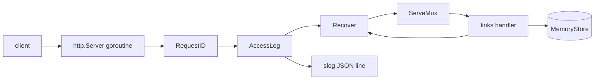

<div dir="rtl" lang="he">

# פרק 6: שירות HTTP לייצור

שירות שעובד על המחשב שלך רחוק מאוד משירות שאפשר להפעיל בייצור. הפער הוא לא באלגוריתם: הוא בתצורה שנבדקת
בעלייה, בלוגים שאפשר לחפש בהם, בכיבוי שלא קוטע בקשות, בבדיקות שרצות בלי רשת, ובדרך להסתכל לתוך תהליך שרץ.
ראיון בכיר בודק בדיוק את הפער הזה.

בפרק תבני את `shorty`, שירות קיצור כתובות, רק עם הספרייה הסטנדרטית של Go ועם `errgroup` מפרק 5. החבילה
`internal/platform` שלו, עם השרת, ה־middleware והתצורה, היא השלד שפרויקט הגמר, Hookline, יתחיל ממנו באבן
הדרך M1. בסוף הפרק, נקודת ביקורת 1: הוכחה שאת כותבת, בודקת ומפעילה שירות Go.

## מה נלמד בפרק

- הנתב של Go: תבניות עם מתודה ועם wildcards, ומה הוא עונה כשאין התאמה.
- כתיבת handlers ו־middleware: מזהה בקשה, לוג גישה, התאוששות מ־panic, ו־JSON עם גבול גודל.
- תצורה ממשתני סביבה שנבדקת כולה בעלייה, עם כל השגיאות בבת אחת.
- לוגים מובנים עם `log/slog`, שכל שורה של בקשה נושאת את אותו מזהה.
- כיבוי מסודר: מה הוא מחכה לו ומה הוא נוטש.
- בדיקות בתוך התהליך עם `httptest`, מבנה פרויקט ו־Makefile.
- פרופיל CPU ראשון עם pprof, ובנצ'מרק אחד שאת מודדת בעצמך.

## ידע מקדים

- פרק 3: מודולים וחבילות (סעיף 3.3), בדיקות טבלאיות (סעיף 3.8), ו־`gofmt` ו־staticcheck (סעיף 3.10).
- פרק 4: ממשקים קטנים (סעיף 4.3), שגיאות ועטיפה (סעיפים 4.4 ו־4.5), panic (סעיף 4.6) ו־generics
  (סעיף 4.7).
- פרק 5: goroutines, context, `sync` ו־`errgroup` (סעיפים 5.1 עד 5.6), ודליפות (סעיף 5.9).
- פרק 2: הכלים של סעיף 2.3, ובהם `make` ו־`curl`, ו־Git מסעיף 2.5.

## 6.1 `net/http` והנתב של Go

בלב `net/http` יש ממשק אחד, `http.Handler`, עם מתודה אחת: `ServeHTTP`, שמקבלת את הכותב של התשובה ואת
הבקשה.

כל דבר שעונה לבקשות הוא `Handler`: ה־handler שלך, הנתב, וכל middleware. הטיפוס `http.HandlerFunc` הופך
פונקציה רגילה עם החתימה הזאת ל־`Handler`. השרת מריץ כל בקשה ב־goroutine משלה, ולכן **כל handler חייב
להיות בטוח לשימוש מקבילי**: מה שהוא משתף עם בקשות אחרות, כמו המאגר של `shorty`, מוגן בנעילה (סעיף 5.5).

הנתב, `http.ServeMux`, הוא `Handler` שבוחר handler לפי הבקשה. מאז Go 1.22 התבניות שלו כוללות מתודה
ו־wildcards, וכך `shorty` רושם את הנתיבים שלו (הקובץ `internal/links/handlers.go`):

<div dir="ltr" align="left">

```go
func (h *Handler) Register(mux *http.ServeMux) {
	mux.HandleFunc("POST /v1/links", h.create)
	mux.HandleFunc("GET /v1/links/{code}", h.stats)
	mux.HandleFunc("GET /{code}", h.resolve)
}
```

</div>

| תבנית | מה היא מתאימה |
| --- | --- |
| `POST /v1/links` | רק `POST` לנתיב המדויק |
| `GET /{code}` | `GET` (וגם `HEAD`) לכל נתיב של מקטע אחד; הערך ב־`r.PathValue("code")` |
| `/files/{path...}` | כל מה שאחרי `/files/`, כולל לוכסנים |
| `/{$}` | רק השורש `/`, בניגוד ל־`/` שמתאים לכל נתיב |

כשכמה תבניות מתאימות, הספציפית ביותר מנצחת: `GET /healthz` גובר על `GET /{code}`. ולכן `shorty` שומר שמות
כמו `healthz` ולא מרשה להם להיות קוד מקוצר. שתי תבניות שאף אחת מהן אינה ספציפית יותר מהשנייה נחשבות
התנגשות, והרישום שלהן זורק panic כבר בעלייה.

כשאין התאמה, הנתב עונה בעצמו: 404 כשהנתיב לא קיים, ו־405 עם כותרת `Allow` כשהנתיב קיים אבל המתודה לא.
למשל, בקשת `GET` לנתיב `/v1/links` מקבלת 405, והכותרת `Allow` שלה היא `POST`.
אחרי ההתאמה, הנתב שומר את התבנית שנבחרה בשדה `r.Pattern`, ולוג הגישה של סעיף 6.4 רושם אותה.

> **איך Rust עושה את זה:** ב־axum, ה־`Router` ממפה נתיב ומתודה ל־handler, ו־extractors מפרקים את הבקשה
> לפי הטיפוסים בחתימה של הפונקציה. ב־Go החתימה תמיד אותה חתימה, ואת מוציאה בעצמך את `PathValue` ומפענחת את
> הגוף. ומה שב־axum הוא שכבה של tower, ב־Go הוא פשוט פונקציה שעוטפת `Handler` (סעיף 6.2).

## 6.2 handlers, middleware ו־JSON

ה־middleware (שכבה שעוטפת handler ומוסיפה התנהגות לפני הבקשה ואחריה) ב־Go היא פונקציה מ־`Handler`
ל־`Handler`. הנה הטיפוס, ופונקציה שמרכיבה כמה שכבות (הקובץ `internal/platform/middleware.go`):

<div dir="ltr" align="left">

```go
// Middleware wraps a handler with behaviour that runs before and after it.
type Middleware func(http.Handler) http.Handler

// Chain wraps h with mws; the first middleware is the outermost, so it sees
// the request first and the response last.
func Chain(h http.Handler, mws ...Middleware) http.Handler {
	for i := len(mws) - 1; i >= 0; i-- {
		h = mws[i](h)
	}
	return h
}
```

</div>

ב־`shorty` יש שלוש שכבות, לפי הסדר הזה (הקובץ `internal/app/app.go`): מזהה בקשה בחוץ, כדי שכל שורת לוג
אחריו תישא אותו; לוג גישה באמצע; והתאוששות מ־panic בפנים, כדי שלוג הגישה עוד יראה את ה־500 שהיא מייצרת.

השכבה הראשונה, מזהה הבקשה (request ID), שומרת מזהה תקין שהגיע מבחוץ, כדי שבקשה אחת תהיה ניתנת למעקב גם
דרך כמה שירותים, או יוצרת חדש:

<div dir="ltr" align="left">

```go
func RequestID(next http.Handler) http.Handler {
	return http.HandlerFunc(func(w http.ResponseWriter, r *http.Request) {
		id := r.Header.Get(RequestIDHeader)
		if !validRequestID(id) {
			id = newRequestID()
		}
		w.Header().Set(RequestIDHeader, id)
		next.ServeHTTP(w, r.WithContext(WithRequestID(r.Context(), id)))
	})
}
```

</div>

הבדיקה `validRequestID` מקבלת רק אותיות לטיניות, ספרות ושלושה סימנים (נקודה, קו תחתון ומקף), עד 64 תווים, כי מזהה מבחוץ נכתב ללוג, ומזהה
עם ירידת שורה הוא דרך לזייף שורות. המזהה עובר הלאה ב־context, עם מפתח מטיפוס פרטי.

השכבה הפנימית, ההתאוששות, תופסת panic של handler. בלעדיה `net/http` אמנם לא קורס, אבל הוא סוגר את החיבור,
והלקוח מקבל ניתוק במקום תשובה (הקובץ `internal/platform/middleware.go`):

<div dir="ltr" align="left">

```go
return http.HandlerFunc(func(w http.ResponseWriter, r *http.Request) {
	sw := wrap(w)
	defer func() {
		v := recover()
		if v == nil {
			return
		}
		if err, ok := v.(error); ok && errors.Is(err, http.ErrAbortHandler) {
			panic(v) // the documented way to abort a response; let net/http handle it
		}
		log.ErrorContext(r.Context(), "panic in handler",
			slog.Any("panic", v),
			slog.String("stack", string(debug.Stack())),
		)
		if sw.status == 0 { // nothing sent yet, so a clean 500 is still possible
			WriteError(sw, http.StatusInternalServerError, "internal error")
		}
	}()
	next.ServeHTTP(sw, r)
})
```

</div>

המחסנית נכתבת ללוג, והלקוח מקבל `internal error` בלבד. `http.ErrAbortHandler` הוא panic שמשמש במכוון
לביטול תשובה, ולכן הוא ממשיך הלאה. ו־`wrap` עוטף את `ResponseWriter` בטיפוס שזוכר את הסטטוס, כדי לדעת אם
עוד אפשר לשלוח 500 נקי; לוג הגישה משתמש באותו טיפוס.

**JSON נכנס.** קלט מהרשת לא אמין: גוף ענק, שדות לא צפויים, שני אובייקטים ברצף. `DecodeJSON` היא פונקציה
גנרית (סעיף 4.7) שמטפלת בכולם (הקובץ `internal/platform/httpjson.go`):

<div dir="ltr" align="left">

```go
func DecodeJSON[T any](w http.ResponseWriter, r *http.Request, maxBytes int64) (T, error) {
	var v T
	r.Body = http.MaxBytesReader(w, r.Body, maxBytes)
	dec := json.NewDecoder(r.Body)
	dec.DisallowUnknownFields()

	if err := dec.Decode(&v); err != nil {
		var tooBig *http.MaxBytesError
		switch {
		case errors.As(err, &tooBig):
			return v, &HTTPError{http.StatusRequestEntityTooLarge, fmt.Sprintf("body is larger than %d bytes", tooBig.Limit)}
		case errors.Is(err, io.EOF):
			return v, &HTTPError{http.StatusBadRequest, "body is empty"}
		default:
			return v, &HTTPError{http.StatusBadRequest, "invalid JSON: " + err.Error()}
		}
	}
	if err := dec.Decode(&struct{}{}); !errors.Is(err, io.EOF) {
		return v, &HTTPError{http.StatusBadRequest, "body must contain a single JSON value"}
	}
	return v, nil
}
```

</div>

| שורה | מה היא מונעת |
| --- | --- |
| `http.MaxBytesReader` | גוף גדול מהמגבלה: הקריאה נעצרת, והשגיאה היא `*http.MaxBytesError` |
| `DisallowUnknownFields` | שדה עם שגיאת כתיב שנבלע בשקט, כמו `"ulr"` |
| ה־`Decode` השני | גוף עם שני ערכי JSON, שהראשון בהם היה מתקבל |
| `*HTTPError` | שגיאה שיודעת מה הסטטוס ומה ההודעה ללקוח |

הפונקציה `RespondError` משלימה את התמונה: `*HTTPError` נשלחת כמו שהיא, וכל שגיאה אחרת נרשמת בלוג ונשלחת
כ־500 עם הודעה כללית. הודעה כמו כתובת פנימית של בסיס נתונים לא יוצאת החוצה, ויש לזה בדיקה.

## 6.3 תצורה ממשתני סביבה

שירות מקבל את התצורה שלו ממשתני סביבה: כך עובדים קונטיינרים ו־Kubernetes, שתפגשי בחלק ה, וכך אותו קובץ
הרצה רץ בכל סביבה. ל־`shorty` יש שישה:

| משתנה | ברירת מחדל | בדיקה |
| --- | --- | --- |
| `SHORTY_BASE_URL` | אין: חובה | כתובת מוחלטת של `http` או `https` |
| `SHORTY_ADDR` | `:8080` | שונה מכתובת ה־debug |
| `SHORTY_DEBUG_ADDR` | `127.0.0.1:6060` | הערך `off` מכבה אותו |
| `SHORTY_LOG_LEVEL` | `info` | אחת מ־`debug`, `info`, `warn`, `error` |
| `SHORTY_SHUTDOWN_TIMEOUT` | `10s` | משך זמן חיובי |
| `SHORTY_MAX_BODY_BYTES` | `4096` | בין 1 ל־1048576 |

שני עקרונות. **התצורה נבדקת כולה בעלייה, והשירות מסרב לעלות אם משהו שגוי:** ערך שגוי שמתגלה בבקשה הראשונה
אחרי פריסה הוא תקרית, ובעלייה הוא הודעת שגיאה. ו־**כל השגיאות בבת אחת**, אחרת כל תיקון דורש הפעלה מחדש
כדי לגלות את הטעות הבאה.

את שני העקרונות מממש טיפוס קטן ב־`internal/platform/env.go`. הוא קורא ערכים עם טיפוס, וצובר בעיות במקום
לעצור בראשונה. הקוד הספציפי ל־`shorty` הוא `LoadConfig` (הקובץ `internal/app/config.go`):

<div dir="ltr" align="left">

```go
func LoadConfig(lookup func(string) (string, bool)) (Config, error) {
	env := platform.NewEnv(lookup)
	cfg := Config{
		Addr:            env.String("SHORTY_ADDR", ":8080"),
		DebugAddr:       env.String("SHORTY_DEBUG_ADDR", "127.0.0.1:6060"),
		BaseURL:         strings.TrimSuffix(env.Required("SHORTY_BASE_URL"), "/"),
		LogLevel:        env.Level("SHORTY_LOG_LEVEL", slog.LevelInfo),
		ShutdownTimeout: env.Duration("SHORTY_SHUTDOWN_TIMEOUT", 10*time.Second),
		MaxBodyBytes:    env.Int64("SHORTY_MAX_BODY_BYTES", 4096),
	}
```

</div>

אחרי הקריאות באות בדיקות שמערבות כמה ערכים, כמו „כתובת ה־debug שונה מהכתובת הראשית”, וכל כשל נרשם עם
`env.Fail`. בסוף, `env.Err()` מחזירה את כל הבעיות כשגיאה אחת, ו־`main` יוצאת עם קוד 1:

<div dir="ltr" align="left">

```text
shorty: invalid configuration:
SHORTY_SHUTDOWN_TIMEOUT: "ten" is not a duration (example: 10s)
SHORTY_BASE_URL: "localhost" is not an absolute http or https URL
```

</div>

הפרמטר `lookup` הוא `os.LookupEnv` ב־`main`, ופונקציה שקוראת מ־map בבדיקות: כך בודקים תצורה בלי לגעת
בסביבה של התהליך. וערך ריק נחשב כאילו לא הוגדר, כי שורה כמו `SHORTY_ADDR=` היא כמעט תמיד טעות.

## 6.4 `slog`: לוגים מובנים

לוג מובנה (structured log) הוא רשומה של זוגות מפתח וערך, ולא משפט חופשי. את השורה
`request method=GET status=302` אפשר לסנן, לקבץ ולספור במערכת לוגים; את המשפט „GET returned a redirect”
אפשר רק לקרוא. החבילה `log/slog` בספרייה הסטנדרטית כותבת רשומות כאלה, ובייצור כותבים אותן כ־JSON, שורה
לכל רשומה.

ב־`shorty`, כל רשומה של בקשה נושאת את מזהה הבקשה, גם בלי שה־handler יעביר אותו בעצמו. הטריק הוא
`slog.Handler` שעוטף את ה־handler של JSON, ומוסיף לכל רשומה את המזהה שב־context (הקובץ
`internal/platform/logging.go`):

<div dir="ltr" align="left">

```go
func (h contextHandler) Handle(ctx context.Context, r slog.Record) error {
	if id := RequestIDFrom(ctx); id != "" {
		r = r.Clone() // records share state; never modify one you were handed
		r.AddAttrs(slog.String("request_id", id))
	}
	return h.Handler.Handle(ctx, r)
}
```

</div>

המחיר: צריך לרשום עם הגרסאות שמקבלות context, `InfoContext` ו־`ErrorContext` ודומיהן. שורה שנכתבה עם
`Info` רגיל תצא בלי מזהה, ויש בדיקה שתופסת את זה. כך נראות שתי שורות של בקשה אחת בהרצה שבה נכתב הספר
(המספרים והמזהה אצלך יהיו אחרים):

<div dir="ltr" align="left">

```text
{"time":"...","level":"INFO","msg":"link created","code":"gohome","request_id":"dec082966060b74f"}
{"time":"...","level":"INFO","msg":"request","method":"POST","path":"/v1/links","pattern":"POST /v1/links","status":201,"bytes":138,"duration":640167,"request_id":"dec082966060b74f"}
```

</div>

השורה השנייה היא לוג הגישה (access log), שורה אחת לכל בקשה. השדה `pattern` חשוב יותר משנראה: הנתיב
`/gohome` שונה בכל קוד, אבל התבנית `GET /{code}` היא ערך אחד. כשבחלק ו תבני מדדים, התבנית היא מה שנכנס
כ־label, ולא הנתיב. ה־`duration` הוא בננו־שניות, כי כך `slog` מקודד משך זמן ב־JSON.

> **איך Rust עושה את זה:** ב־Rust את משתמשת ב־`tracing`: `info!(code = %code, "link created")` כותב שדות
> מובנים, ו־span שנפתח לכל בקשה מוסיף את המזהה לכל אירוע שבתוכו. ב־Go אין spans בלוגים, ולכן המזהה עובר
> ב־context, וה־handler של `slog` מוציא אותו משם. העיקרון זהה: השדות של הבקשה מצטרפים לכל רשומה בלי שכל
> קריאה תזכור אותם.

שלושה כללים לכל לוג בייצור:

- **רמות בהיגיון:** `info` למה שסופרים, `warn` לחריג שהשירות התאושש ממנו, `error` למה שמישהו צריך לראות.
  הרמה נקבעת בתצורה.
- **לעולם לא סודות:** לא סיסמאות, לא מפתחות, לא כותרות אימות. לוגים נשמרים ומועתקים.
- **מפתחות קבועים:** אותו שם בכל שורה ובכל שירות, אחרת החיפוש מתפצל.

## 6.5 כיבוי מסודר

כשמערכת ההפעלה, Docker או Kubernetes רוצים לעצור תהליך, הם שולחים לו `SIGTERM`, מחכים זמן מה, ואז שולחים
`SIGKILL`, שאי אפשר לתפוס. בלי טיפול, Go יוצאת מיד ב־`SIGTERM`, וכל בקשה שבאמצע נקטעת. כיבוי מסודר
(graceful shutdown) הוא: להפסיק לקבל בקשות חדשות, לתת לבקשות שבדרך זמן לסיים, ורק אז לצאת.

הצעד הראשון הוא להפוך את האות ל־context שמתבטל, עם `signal.NotifyContext` (הקובץ `cmd/shorty/main.go`):

<div dir="ltr" align="left">

```go
// The first SIGINT or SIGTERM cancels ctx and starts the graceful shutdown.
ctx, stop := signal.NotifyContext(context.Background(), os.Interrupt, syscall.SIGTERM)
defer stop()
// Then restore the default behaviour, so a second Ctrl-C kills at once.
context.AfterFunc(ctx, stop)
```

</div>

השורה האחרונה היא פרט קטן שמשתמשים מעריכים: אחרי האות הראשון, `stop` מחזירה את התנהגות ברירת המחדל, ולכן
Ctrl-C שני הורג את התהליך מיד, בלי לחכות לתום זמן החסד.

הצעד השני הוא `Server.Shutdown`. הפונקציה `Serve` של `shorty` מריצה את השרת עד שה־context מתבטל, ואז מכבה
אותו (הקובץ `internal/platform/server.go`):

<div dir="ltr" align="left">

```go
func Serve(ctx context.Context, srv *http.Server, ln net.Listener, grace time.Duration) error {
	errc := make(chan error, 1) // buffered: the goroutine can always send and exit
	go func() { errc <- srv.Serve(ln) }()

	select {
	case err := <-errc:
		return fmt.Errorf("serve %s: %w", ln.Addr(), err) // failed before any shutdown
	case <-ctx.Done():
	}

	// ctx is already cancelled; the grace period needs a context of its own.
	shutCtx, cancel := context.WithTimeout(context.WithoutCancel(ctx), grace)
	defer cancel()
	if err := srv.Shutdown(shutCtx); err != nil {
		_ = srv.Close() // grace is over: cut the remaining connections
		return fmt.Errorf("shutdown %s: %w", ln.Addr(), err)
	}
	if err := <-errc; !errors.Is(err, http.ErrServerClosed) {
		return fmt.Errorf("serve %s: %w", ln.Addr(), err)
	}
	return nil
}
```

</div>

כל מה שלמדת בפרק 5 נמצא כאן. ה־channel עם חוצץ של אחד מבטיח שה־goroutine של `srv.Serve` תמיד תוכל לשלוח
ולצאת, גם אם אף אחד לא יקרא: אחרת זו דליפה. ה־`select` ממתין לכשל או לביטול. ו־`context.WithoutCancel`
נחוץ כי `ctx` כבר בוטל: זמן החסד צריך context חדש, שלא מבוטל מיד, אבל עדיין נושא את הערכים של ההורה.

| `Shutdown` מחכה ל־ | `Shutdown` לא מחכה ל־ |
| --- | --- |
| בקשות שכבר בטיפול, עד שה־handler חוזר | חיבורים שה־handler השתלט עליהם (`Hijack`), כמו WebSocket |
| | עבודה שה־handler הפעיל ב־goroutine משלו ולא חיכה לה |
| | כלום אחרי שזמן החסד נגמר: אז `Close` חותך הכול |

ועוד דבר שהשרת צריך, עוד לפני שמכבים אותו: זמנים קצובים, בפונקציה `NewServer` באותו קובץ.
ל־`http.Server` ריק אין אף אחד, ולכן לקוח איטי אחד יכול להחזיק חיבור לנצח:

<div dir="ltr" align="left">

```go
ReadHeaderTimeout: 5 * time.Second,  // slow-header (Slowloris) clients
ReadTimeout:       10 * time.Second, // the whole request, body included
WriteTimeout:      30 * time.Second, // from the end of the headers to the end of the response
IdleTimeout:       60 * time.Second, // keep-alive connections between requests
```

</div>

ל־`shorty` יש שני שרתים, הציבורי והפרטי של pprof (סעיף 6.8). הפונקציה `Run` מריצה את שניהם
ב־`errgroup` (הקובץ `internal/app/app.go`). כשאחד נכשל, ה־context המשותף מתבטל, והשני נכבה בצורה
מסודרת:

<div dir="ltr" align="left">

```go
g, gctx := errgroup.WithContext(ctx)
log.Info("listening", slog.String("addr", ln.Addr().String()), slog.String("base_url", cfg.BaseURL))
g.Go(func() error { return platform.Serve(gctx, api, ln, cfg.ShutdownTimeout) })
```

</div>

> **איך Rust עושה את זה:** ב־axum, `axum::serve(listener, app).with_graceful_shutdown(signal)` מקבל
> future שמסתיים כשמגיע האות, ומחכה לחיבורים הפתוחים. ההבדל הוא בגבול: ב־axum מוסיפים בעצמך
> `tokio::time::timeout` סביב ההמתנה. ב־Go, גבול הזמן הוא ה־context שמועבר ל־`Shutdown`, ו־`Close` הוא מה
> שקורה כשהוא עובר.

## 6.6 בדיקות עם `httptest`

החבילה `net/http/httptest` נותנת שתי דרכים לבדוק HTTP בתוך התהליך:

| כלי | מה הוא | מתי |
| --- | --- | --- |
| `httptest.NewRecorder` | `ResponseWriter` שזוכר סטטוס, כותרות וגוף | בדיקת handler או middleware ישירות, בלי רשת |
| `httptest.NewServer` | שרת אמיתי על כתובת מקומית, עם `Close` | כשצריך לקוח אמיתי: ניתוקים, כיבוי, timeouts |

רוב הבדיקות של `shorty` הן טבלאיות מעל `NewRecorder`: כל שורה היא גוף בקשה, הסטטוס הצפוי וחלק מהודעת
השגיאה. בדיקות ה־middleware כותבות את הלוגים ל־buffer, ומפרקות כל שורה כ־JSON כדי לבדוק שלכולן אותו
`request_id`. ובדיקת ה־panic משתמשת ב־`NewServer`, כי רק לקוח אמיתי מגלה שחיבור נסגר במקום תשובה.

הבדיקה המעניינת ביותר היא של הכיבוי המסודר. היא מפעילה את `Serve` עם handler שנתקע עד שהבדיקה משחררת
אותו, שולחת בקשה, ומבטלת את ה־context כשהבקשה באמצע (הקובץ `internal/platform/server_test.go`):

<div dir="ltr" align="left">

```go
<-started  // the request is in the handler
shutdown() // what SIGTERM does in main
select {
case err := <-served:
	t.Fatalf("Serve returned %v while a request was still in flight", err)
case <-time.After(100 * time.Millisecond):
}
if _, err := net.DialTimeout("tcp", url[len("http://"):], time.Second); err == nil {
	t.Error("new connections are still accepted during shutdown")
}

close(release) // the handler finishes
if r := <-got; r.err != nil || r.body != "finished" {
	t.Errorf("in-flight request got %q, %v; want the full response", r.body, r.err)
}
```

</div>

הבדיקה מוכיחה, בסדר הזה, ש־`Serve` לא חוזרת כל עוד בקשה בטיפול, שחיבורים חדשים כבר לא מתקבלים, ושהבקשה
שבדרך מקבלת תשובה מלאה. בדיקה שנייה מראה ש־handler שלא משתחרר גורם ל־`Serve` להחזיר
`context.DeadlineExceeded` עטופה אחרי זמן החסד. את הסדר קובעים ה־channels `started` ו־`release`, לא
`time.Sleep`.

כלל אחרון לבדיקות שירות: בבדיקה שלא בודקת את הלוגים, הלוגר הוא `slog.New(slog.DiscardHandler)`, כדי שהפלט של
הבדיקות יישאר קריא. וכמו בפרק 5, הכול רץ עם `-race`.

## 6.7 מבנה פרויקט ו־Makefile

למבנה של מודול Go יש שתי מוסכמות שהכלים עצמם מכבדים:

- **התיקייה `cmd/<name>/`** לכל תוכנית: חבילת `main` קטנה, שקוראת תצורה ומחברת חלקים. ב־`shorty` יש
  שתיים, `shorty` עצמו ו־`loadgen` לסעיף 6.8.
- **התיקייה `internal/`** לכל השאר. חבילה תחת `internal` אפשר לייבא רק מתוך העץ שמעליה; הקומפיילר אוכף את
  זה. כך את מחליטה מה ה־API הציבורי של המודול (כאן: כלום), ויכולה לשנות את כל השאר בחופשיות.

| חבילה | אחריות | מייבאת את |
| --- | --- | --- |
| `internal/platform` | תצורה, לוגים, middleware, JSON, שרת, pprof | הספרייה הסטנדרטית בלבד |
| `internal/links` | `Link`, הממשק `Store`, `MemoryStore`, ה־handlers | `platform` |
| `internal/app` | `Config`, `NewHandler` ו־`Run`: החיבור בין החלקים | `platform`, `links`, `errgroup` |
| `cmd/shorty` | `main`: תצורה, לוגר, אותות, `Run` | `app`, `platform` |

כיוון התלויות הוא העיקר: `platform` לא יודעת כלום על קיצור כתובות, ולכן Hookline יכול לקחת אותה כמו שהיא.
ו־`links` תלויה בממשק `Store` ולא במימוש, כך שבחלק ג יוכל להיכנס מימוש על PostgreSQL בלי לגעת ב־handlers.

ה־Makefile הוא רשימת הפקודות של הפרויקט, כדי שכל אחת תהיה מילה אחת, זהה אצלך ובהמשך ב־CI (הקובץ
`Makefile`):

<div dir="ltr" align="left">

```make
test:
	$(GO) test -race ./...

lint:
	@out="$$(gofmt -l .)"; if [ -n "$$out" ]; then echo "gofmt needed:"; echo "$$out"; exit 1; fi
	$(GO) vet ./...
	staticcheck ./...
```

</div>

שתי מלכודות של `make`: שורות הפקודה חייבות להתחיל בטאב ולא ברווחים, ו־`$` שמיועד ל־shell נכתב `$$`.
והפקודה `gofmt -l` רק מדפיסה קבצים שצריך לפרמט, בלי להיכשל, ולכן ה־Makefile בודק אם הפלט ריק.

## 6.8 pprof: פרופיל ראשון

הכלי pprof (הפרופיילר של Go, וגם שם הפורמט שלו) עונה על השאלה „על מה התהליך מבזבז זמן או זיכרון?” מתוך
תהליך שרץ. החבילה `net/http/pprof` חושפת אותו ב־HTTP. השירות מגיש אותה **על מאזין נפרד, שקשור
לכתובת המקומית `127.0.0.1`** (הקובץ `internal/platform/debug.go`):

<div dir="ltr" align="left">

```go
func DebugHandler() http.Handler {
	mux := http.NewServeMux()
	mux.HandleFunc("/debug/pprof/", pprof.Index) // index, heap, goroutine, allocs, ...
	mux.HandleFunc("/debug/pprof/cmdline", pprof.Cmdline)
	mux.HandleFunc("/debug/pprof/profile", pprof.Profile) // CPU, ?seconds=N
	mux.HandleFunc("/debug/pprof/symbol", pprof.Symbol)
	mux.HandleFunc("/debug/pprof/trace", pprof.Trace)
	return mux
}
```

</div>

למה לא על הפורט הציבורי? פרופיל חושף את מבנה הקוד ואת שורת הפקודה, ופרופיל CPU עולה CPU כל זמן שהוא רץ,
כך שכל אחד מבחוץ היה יכול להאט את השירות. בדיקה מוודאת ש־`/debug/pprof/` על השרת הציבורי מחזיר 404.
והייבוא של החבילה רושם את אותם נתיבים גם על `http.DefaultServeMux`, שלא מזיק רק כי `shorty` לא מגיש אותו.

**הפרופיל הראשון.** צריך שלושה טרמינלים: השירות, עומס, והפרופיילר. בראשון:

<div dir="ltr" align="left">

```bash
cd ~/senior-course/ch06
make run
```

</div>

בשני, יוצרים קוד מקוצר ומריצים עליו עומס במשך עשרים שניות. הכלי `cmd/loadgen` שולח בקשות משמונה
goroutines, ולא עוקב אחרי ההפניה לאתר האמיתי:

<div dir="ltr" align="left">

```bash
curl -s -X POST localhost:8080/v1/links -d '{"url": "https://go.dev/", "code": "gohome"}'
go run ./cmd/loadgen -url http://localhost:8080/gohome -c 8 -d 20s
```

</div>

ובשלישי, בזמן שהעומס רץ, פרופיל CPU של עשר שניות:

<div dir="ltr" align="left">

```bash
go tool pprof -top -nodecount 20 'http://127.0.0.1:6060/debug/pprof/profile?seconds=10'
```

</div>

הפלט הוא טבלה, וכך קוראים אותה:

| עמודה | פירוש |
| --- | --- |
| `flat` | זמן שבו הפונקציה עצמה רצה, בלי מה שהיא קראה לו |
| `flat%` | אותו זמן, כאחוז מסך הדגימות |
| `sum%` | סכום מצטבר של `flat%` עד השורה הזאת |
| `cum` | זמן הפונקציה יחד עם כל מה שהיא קראה לו |
| `cum%` | אותו זמן, כאחוז |

רשמי בפתק את חמש השורות העליונות ואת שורת הכותרת, שאומרת כמה דגימות נאספו. אחר כך שאלי את עצמך: האם בראש
יש קוד של `shorty`, או של הספרייה הסטנדרטית ומערכת ההפעלה? אם רוב הזמן בקריאות מערכת, זה רמז שהעבודה
נשלטת על ידי כתיבה לרשת וללוג, ולא על ידי החישוב. אל תניחי מראש מה תמצאי: מה שהפרופיל שלך מראה הוא
התשובה.

הפרופיל נשמר כקובץ בתיקייה `~/pprof`, ואפשר לפתוח אותו בממשק דפדפן, שבו יש גם תצוגת flame graph. במקום
שם הקובץ כתבי את הנתיב שהפקודה הקודמת הדפיסה:

<div dir="ltr" align="left">

```bash
go tool pprof -http=:8081 ~/pprof/<the-file-it-saved>.pb.gz
```

</div>

ושני פרופילים נוספים שימושיים מיד: `heap` לזיכרון שבשימוש,
ו־`goroutine?debug=1` למחסניות של כל ה־goroutines, הכלי הראשון כשחושדים בדליפה (סעיף 5.9).

## 6.9 בנצ'מרקים

בנצ'מרק (benchmark) ב־Go הוא פונקציה בקובץ בדיקה, שהשם שלה מתחיל ב־`Benchmark` והיא מקבלת `*testing.B`.
ב־`shorty` יש אחד, שמודד את כל נתיב הפענוח בתוך התהליך: שלוש שכבות ה־middleware, הנתב, המאגר וההפניה
(הקובץ `internal/app/bench_test.go`):

<div dir="ltr" align="left">

```go
log := platform.NewLogger(io.Discard, slog.LevelInfo) // real JSON encoding, output discarded
h := app.NewHandler(app.Config{BaseURL: "http://sho.rt", MaxBodyBytes: 4096}, store, log)
req := httptest.NewRequest(http.MethodGet, "/go", nil)

for b.Loop() {
	rec := httptest.NewRecorder()
	h.ServeHTTP(rec, req)
	if rec.Code != http.StatusFound {
		b.Fatalf("status %d", rec.Code)
	}
}
```

</div>

הלולאה `for b.Loop()` מחליטה בעצמה כמה סיבובים להריץ, לא מודדת את ההכנה שלפניה, ומונעת מהקומפיילר להשמיט
את הגוף. בקוד ישן תראי לולאה על `b.N` עם `b.ResetTimer()`. הלוגר כותב JSON אמיתי ל־`io.Discard`, כך
שהקידוד נמדד והפלט לא נשמר.

<div dir="ltr" align="left">

```bash
make bench
```

</div>

הפלט כולל שלושה מספרים, ואותם את רושמת:

| מספר | פירוש |
| --- | --- |
| `ns/op` | זמן ממוצע לסיבוב, בננו־שניות |
| `B/op` | בתים שהוקצו בממוצע לסיבוב |
| `allocs/op` | מספר ההקצאות לסיבוב; כל אחת היא עבודה עתידית לאוסף הזבל |

רשמי את שלושתם בפתק, יחד עם שם המעבד שמופיע בשורה `cpu:` בפלט ותאריך הריצה. מספר בלי מכונה הוא חסר
משמעות. ריצה אחת גם אינה מדידה: השתמשי ב־`-count=10` ובכלי `benchstat` כשתרצי להשוות שני מימושים (ראי
העשרה).

## 6.10 נקודת ביקורת 1

זה סוף חלק א. נקודת הביקורת עוברת על הכול מתחילתו, משכפול נקי של המאגר שלך, בלי להסתכל בפתרונות. כל פריט
צריך לעבוד:

- **פרק 3:** הבדיקות הטבלאיות של `logstat` עוברות.
- **פרק 4:** חבילת הבדיקות של `ledger` עוברת לשני המאגרים, בזיכרון ובקובץ JSON.
- **פרק 5:** `linkcheck` עובר עם `go test -race ./...`, ובדיקת הדליפות שקטה.
- **תצורה:** `shorty` עולה רק מתצורה בסביבה; בלי `SHORTY_BASE_URL`, או עם ערך שגוי, הוא מסרב עם הודעה
  ברורה.
- **ממשק:** יצירה, פענוח וסטטיסטיקה עובדים ב־`curl`, ו־`GET /v1/links` מחזיר 405.
- **לוגים:** כל שורה של בקשה נושאת את אותו `request_id`, וזה גם הערך בכותרת `X-Request-ID` של התשובה.
- **התאוששות:** handler שזורק panic מחזיר 500, והשירות ממשיך לשרת.
- **כיבוי:** אחרי Ctrl-C, שתי השורות האחרונות בלוג הן `shutting down` ו־`stopped`, ובדיקת הכיבוי מראה שבקשה
  שבדרך מסיימת.
- **מדידה:** יעדי הבדיקה, ה־lint והבנייה של ה־Makefile ירוקים, הבנצ'מרק רץ, ופרופיל CPU נשמר.
- **בעל פה:** את עונה בקול על שאלות הראיון של פרקים 3 עד 6.

כל דבר שנכשל נרשם ביומן התקיעות עם התיקון שלו. ולסיום, השאלה שמראיינים אוהבים: תארי בשתי דקות את חייה של
בקשה אחת ב־`shorty`. התרשים הזה הוא השלד של התשובה:

<div dir="ltr" align="left">



</div>

## סיכום

- הכול ב־`net/http` הוא `Handler`. כל בקשה רצה ב־goroutine משלה, ולכן מצב משותף מוגן.
- הנתב מאז Go 1.22 מתאים מתודה ו־wildcards, הספציפית מנצחת, ו־404 ו־405 מגיעים ממנו.
- ה־middleware היא פונקציה מ־`Handler` ל־`Handler`; הסדר: מזהה בחוץ, לוג באמצע, התאוששות בפנים.
- קלט JSON מוגבל בגודל, בלי שדות לא ידועים ובלי ערך שני; שגיאות פנימיות לא יוצאות ללקוח.
- תצורה ממשתני סביבה נבדקת כולה בעלייה, וכל הבעיות מדווחות יחד.
- הספרייה `slog` כותבת JSON; context handler מוסיף את מזהה הבקשה לכל שורה שנכתבה עם context.
- כיבוי מסודר: אות הופך ל־context, `Shutdown` מחכה לבקשות שבדרך עד זמן החסד, ו־`Close` אחריו.
- הכלי pprof על מאזין פרטי בלבד; בנצ'מרק נרשם עם המכונה שבה רץ.

## מונחים לזכור

| מונח בעברית | באנגלית | במשפט אחד |
| --- | --- | --- |
| handler | handler | מה שעונה לבקשה: כל מי שמממש `ServeHTTP` |
| נתב | router (mux) | בוחר handler לפי המתודה והנתיב |
| middleware | middleware | שכבה שעוטפת handler ופועלת לפניו ואחריו |
| מזהה בקשה | request ID | ערך שמלווה בקשה אחת בכל שורות הלוג ובין שירותים |
| לוג מובנה | structured log | רשומה של זוגות מפתח וערך, ולא משפט חופשי |
| לוג גישה | access log | שורה אחת לכל בקשה: מתודה, תבנית, סטטוס, משך |
| משתנה סביבה | environment variable | הדרך שבה שירות מקבל את התצורה שלו |
| כיבוי מסודר | graceful shutdown | הפסקת קבלה, סיום מה שבדרך, ואז יציאה |
| זמן חסד | grace period | הזמן שבקשות שבדרך מקבלות לסיים בכיבוי |
| פרופיל | profile | דגימות של היכן תהליך מבזבז זמן או זיכרון |
| בנצ'מרק | benchmark | פונקציה שמודדת זמן והקצאות לפעולה אחת |
| הקצאה | allocation | זיכרון שנלקח מהערימה ויעבור לאוסף הזבל |

## טעויות נפוצות

- **שרת `http.Server` בלי זמנים קצובים.** לקוח איטי אחד מחזיק חיבור לנצח. תמיד `ReadHeaderTimeout` לפחות.
- **להפעיל `ListenAndServe` בלי כיבוי מסודר.** `SIGTERM` קוטע בקשות באמצע. אות הופך ל־context,
  ו־`Shutdown` עם זמן חסד.
- **לקרוא ל־`Shutdown` עם ה־context שכבר בוטל.** היא חוזרת מיד עם שגיאה, והתהליך יוצא בזמן שבקשות עוד
  באמצע. זמן החסד צריך context חדש.
- **לפענח עם `json.NewDecoder(r.Body)` בלי גבול.** גוף של גיגה־בית נקרא כולו לזיכרון. קודם
  `http.MaxBytesReader`.
- **להגיש pprof על הפורט הציבורי.** הייבוא לבדו רושם נתיבים על `DefaultServeMux`; מגישים אותו רק על מאזין
  פרטי.
- **לכתוב `log.Info` במקום `log.InfoContext` בתוך handler.** השורה יוצאת בלי מזהה הבקשה, והקשר בין השורות
  אובד.
- **להחזיר `err.Error()` ללקוח.** הודעות פנימיות חושפות כתובות ומבנה. ללקוח הודעה כללית, ללוג הפרטים.

## שאלות ראיון

1. **מה קורה כששירות Go מקבל SIGTERM, ומה צריך כדי שלא יאבדו בקשות?**
   בלי טיפול, התהליך יוצא מיד, וכל בקשה באמצע נקטעת. עם `signal.NotifyContext` האות מבטל context;
   `Server.Shutdown` סוגר את המאזינים, מחכה שה־handlers שבדרך יחזרו, ועוצר כשזמן החסד נגמר, ואז `Close`
   חותך את השאר. צריך שזמן החסד יהיה קצר מהזמן שהמערכת מחכה לפני `SIGKILL`. ו־`Shutdown` לא מחכה לחיבורים
   שהשתלטו עליהם ולא ל־goroutines שה־handler הפעיל, ואלה באחריותך.

   **המשך:** ומה עם בקשות שעוד בדרך מה־load balancer? הן יגיעו לשירות שכבר סוגר. לכן מסמנים קודם „לא
   מוכן” בבדיקת המוכנות, מחכים שהניתוב יתעדכן, ורק אז מכבים; Kubernetes ו־probes מגיעים בחלק ה.

2. **איך תבני middleware לשירות, ובאיזה סדר?**
   פונקציה שמקבלת `Handler` ומחזירה `Handler`, ושרשרת שבה הראשונה היא החיצונית. מזהה בקשה בחוץ, כדי שכל
   מה שאחריו יכתוב אותו; לוג גישה וזמן אחריו; התאוששות מ־panic בפנים, כדי שלוג הגישה יראה את ה־500.
   לטיפוס שעוטף את ה־`ResponseWriter` יש מתודה `Unwrap`. בלעדיה, `http.ResponseController` לא מגיע לכותב
   המקורי, ופעולות כמו ריקון החוצץ (flush) נכשלות. השיקול המרכזי הוא מה
   כל שכבה צריכה לראות.

3. **למה לבדוק את התצורה בעלייה, ולא כשמשתמשים בה?**
   כי כשל בעלייה נראה מיד, בפריסה, לפני שתנועה מגיעה; כשל בשימוש מופיע שעות אחר כך, בבקשה של לקוח. השירות
   מסרב לעלות, והפריסה נכשלת בצורה בטוחה. ובונים את הבדיקה כך שתדווח על כל הבעיות בבת אחת. החיסרון: ערך
   שהשתנה בזמן ריצה לא נקלט בלי הפעלה מחדש, וזו בדרך כלל התנהגות רצויה.

4. **למה לוגים מובנים, ומה לא נכנס ללוג?**
   כי מערכת לוגים יכולה לסנן ולקבץ לפי שדות, ולא לפי משפטים. שאלה כמו „כמה 500 היו בתבנית `GET /{code}`
   בשעה האחרונה” הופכת לשאילתה. מזהה בקשה בכל שורה קושר את כל מה שקרה לבקשה אחת. בחוץ נשארים סודות,
   כותרות אימות ומידע אישי, כי לוגים מועתקים ונשמרים זמן רב.

5. **איך תמצאי למה שירות איטי בעומס?**
   קודם מודדים, לא מנחשים. פרופיל CPU מ־pprof בזמן עומס מראה איפה הזמן הולך, `flat` מול `cum`. פרופיל
   heap ו־`allocs` מראים לחץ זיכרון, ופרופיל goroutine מראה מה מחכה. אחר כך בנצ'מרק לנתיב החם, עם
   `-benchmem`, כדי לתקן ולהוכיח שיפור על אותה מכונה, בכמה ריצות. ואת pprof מגישים רק על מאזין פרטי.

## פתק Obsidian

הפתק המוכן נמצא גם כקובץ: `obsidian/06-go-http-service.md`. זה תוכנו:

- **Handler:** כל מה שעונה לבקשה; כל בקשה ב־goroutine משלה, ולכן מצב משותף מוגן.
- **נתב:** תבנית עם מתודה ו־wildcards; הספציפית מנצחת; 404 ו־405 עם `Allow` מגיעים ממנו.
- **middleware:** מזהה בחוץ, לוג באמצע, התאוששות בפנים.
- **JSON נכנס:** גבול גודל, בלי שדות לא ידועים, בלי ערך שני.
- **שגיאות:** `HTTPError` יוצאת כמו שהיא; כל השאר 500 כללי, והפרטים ללוג.
- **תצורה:** נבדקת כולה בעלייה, כל הבעיות יחד, `lookup` מוזרק לבדיקות.
- **לוגים:** JSON עם `slog`; מזהה הבקשה מה־context; רק הגרסאות עם context.
- **כיבוי:** אות הופך ל־context, `Shutdown` עם context חדש לזמן החסד, ו־`Close` אחריו.
- **pprof:** מאזין פרטי בלבד; `flat` מול `cum`.
- **בנצ'מרק:** `b.Loop()`, שלושה מספרים, ותמיד עם שם המכונה.
- **שאלה פתוחה:** ___

<div dir="ltr" align="left">

```text
mux.HandleFunc("GET /{code}", h)        r.PathValue("code")   r.Pattern
type Middleware func(http.Handler) http.Handler
r.Body = http.MaxBytesReader(w, r.Body, n); dec.DisallowUnknownFields()
slog.New(slog.NewJSONHandler(w, &slog.HandlerOptions{Level: lvl}))   log.InfoContext(ctx, ...)
ctx, stop := signal.NotifyContext(ctx, os.Interrupt, syscall.SIGTERM); context.AfterFunc(ctx, stop)
srv.Shutdown(context.WithTimeout(context.WithoutCancel(ctx), grace))  then srv.Close()
ReadHeaderTimeout ReadTimeout WriteTimeout IdleTimeout
httptest.NewRecorder()  httptest.NewServer(h)  slog.New(slog.DiscardHandler)
go tool pprof -top 'http://127.0.0.1:6060/debug/pprof/profile?seconds=10'
go test -run '^$' -bench Resolve -benchmem ./internal/app/
my bench: ___ ns/op  ___ B/op  ___ allocs/op  on cpu ___  date ___
my profile top function: ___
```

</div>

## תרגיל

**מטרה:** לבנות את `shorty`, שירות קיצור כתובות עם יצירה, פענוח וסטטיסטיקה, מאגר בזיכרון מאחורי ממשק,
תצורה ממשתני סביבה, שלוש שכבות middleware, כיבוי מסודר, pprof פרטי, בדיקות ובנצ'מרק, ולעבור את נקודת
הביקורת.
**זמן:** ארבעה ימי לימוד, ימים 11 עד 14, כ־55, 65 ו־60 דקות בנייה ויום ביקורת קל.
**ידע מקדים:** הפרק, פרקים 3 עד 5, ו־`build-essential` מותקן.

הצעדים, קוד ההתחלה, הרמזים והפתרון נמצאים
ב־[`exercises/ch06-shorty/README.md`](../exercises/ch06-shorty/README.md).

**קריטריון סיום:**

- קוד מקוצר נוצר ומפוענח בבקשה ידנית, ותצורה חסרה או שגויה עוצרת את העלייה עם הודעה ברורה.
- לכל שורות הלוג של בקשה יש אותו מזהה; בקשה שבדרך מסיימת בזמן כיבוי; handler שזורק panic מחזיר 500
  והשירות ממשיך.
- שלושת יעדי ה־Makefile ירוקים: `lint`, `test` ו־`build`.
- הנתיב `/debug/pprof` לא קיים על הפורט הציבורי.
- פרופיל CPU נשמר והפונקציה העליונה שלו רשומה בפתק; תוצאת הבנצ'מרק רשומה עם המכונה.
- כל רשימת נקודת הביקורת של סעיף 6.10 עובדת בלי להסתכל בפתרונות.

## העשרה אופציונלית

- הפוסט „Routing Enhancements for Go 1.22” בבלוג של Go מסביר את כללי הקדימות של הנתב, כולל הנימוק מאחורי
  ההתנגשויות.
- המדריך „A Guide to Writing slog Handlers” במאגר הדוגמאות של Go מראה איך כותבים handler נכון, כולל
  טיפול בקבוצות, שה־handler של `shorty` עושה בפשטות.
- הכלי `benchstat` (`golang.org/x/perf/cmd/benchstat`) משווה שתי סדרות של ריצות בנצ'מרק ואומר אם ההבדל
  מובהק. נסי: שני את ה־`RWMutex` של המאגר בזיכרון ל־`Mutex` רגיל, ומדדי.
- הפרופילים של נעילות וחסימות כבויים כברירת מחדל, ומפעילים אותם בקוד, למשל עם
  `runtime.SetMutexProfileFraction`. הוסיפי הפעלה כזאת מאחורי משתנה סביבה, ובדקי אם יש תחרות על הנעילה תחת
  עומס.

</div>
