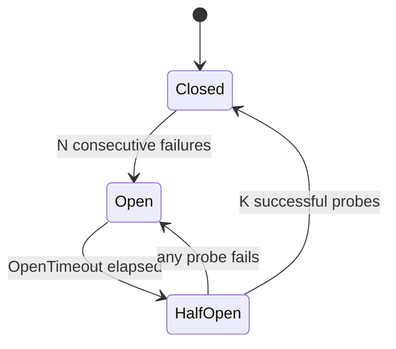

<div dir="rtl" lang="he">

# פרק 15: זמנים קצובים, ניסיונות חוזרים ומפסקי זרם

שירות שקורא לשירות אחר יכול להיכשל בדרכים שלא קיימות בתוך תהליך אחד: התשובה מתעכבת, מגיעה חלקית, או לא
מגיעה בכלל, ואת לא יודעת אם הפעולה בוצעה. הפרק הזה בונה את ארגז הכלים שמונע מכשל כזה להתפשט: זמן קצוב
שעובר לאורך השרשרת, ניסיונות חוזרים שלא מכפילים עומס, מפסק זרם, מחיצות אטומות והידרדרות מכובדת. כל רעיון
מודגם במעבדה קטנה, ואת המספרים את מודדת ורושמת בעצמך. אלה בדיוק השאלות ששואלים בראיון תכנון מערכות.

## מה נלמד בפרק

- מה זה כשל חלקי, ולמה „לא ענה” שונה מ„נכשל”.
- איך תקציב זמן עובר משירות לשירות, ולמה כל קפיצה מקבלת פחות מהשירות שקרא לה.
- ניסיון חוזר עם המתנה גדלה מעריכית ופיזור אקראי, ותקציב ניסיונות שמגביל אותם.
- איך שלוש שכבות של שלושה ניסיונות הופכות בקשה אחת לעשרים ושבע.
- מפסק זרם עם שלושה מצבים, כתוב מאפס עם שעון מוזרק ונבדק, ומה ספרייה מוכנה נותנת.
- מחיצה אטומה לכל תלות, והידרדרות מכובדת: ערך ישן, ברירת מחדל, ותכונה כבויה.

## ידע מקדים

- פרק 5, סעיף 5.4: ביטול וגבול זמן כולל ב־context, ושתי הדרכים לשאול למה הוא בוטל.
- פרק 5, סעיפים 5.5 ו־5.8: נעילות, המתנה ל־goroutines, ובדיקת מרוצים עם `-race`.
- פרק 6, סעיפים 6.2 ו־6.6: middleware, ו־`httptest` לבדיקות שרת.
- פרק 9, סעיף 9.5: מפתחות אידמפוטנטיות, שהופכים פעולה לבטוחה לניסיון חוזר.
- פרק 14, סעיף 14.3: המתנה גדלה ו־jitter לעבודות רקע. כאן אותו רעיון עובר לקריאה סינכרונית, עם גבול זמן.
- התרגיל לא מייבא קוד מתרגילים קודמים: כל החבילות שלו כתובות בתוכו.

## 15.1 כשל חלקי

בתוך תהליך אחד, קריאה לפונקציה מצליחה או זורקת שגיאה, ואת יודעת איזה מהשניים קרה. בין שני תהליכים
ברשת יש מצב שלישי: לא הגיעה תשובה. זה **כשל חלקי (partial failure)**: חלק מהמערכת תקין, חלק לא, ומבחוץ
אי אפשר להבחין בין האפשרויות האלה:

| מה קרה באמת | מה הקוראת רואה |
| --- | --- |
| הבקשה לא הגיעה לשרת | אין תשובה |
| השרת קיבל, ונפל באמצע | אין תשובה |
| השרת סיים, והתשובה אבדה בדרך | אין תשובה |
| השרת עדיין עובד, לאט | אין תשובה, בינתיים |

המשמעות המעשית: „לא ענה” אינו „נכשל”. ייתכן שההזמנה נרשמה, ייתכן שהכסף ירד. לכן ניסיון חוזר בטוח רק לפעולה
אידמפוטנטית (idempotent): פעולה שאפשר לחזור עליה בלי נזק, או שנושאת מפתח אידמפוטנטיות (פרק 9). כל המנגנונים
בפרק מניחים את זה.

הסכנה השנייה היא שכשל חלקי מתפשט. שירות איטי לא נכשל מהר; הוא מחזיק את הקוראות שלו. כל בקשה שמחכה תופסת
goroutine, חיבור וזיכרון, והקוראת שלה מחכה גם היא. בלי גבולות, תלות אחת איטית מקפיאה את כל השרשרת. המנגנונים
של הפרק הם גבולות:

| מנגנון | הגבול שהוא שם |
| --- | --- |
| זמן קצוב (timeout) וגבול זמן כולל (deadline) | כמה זמן מחכים |
| ניסיון חוזר (retry) עם תקציב | כמה פעמים מנסים שוב, ובאיזה קצב |
| מפסק זרם (circuit breaker) | מתי מפסיקים לנסות בכלל |
| מחיצה אטומה (bulkhead) | כמה מהמשאבים שלך תלות אחת יכולה לתפוס |
| הידרדרות מכובדת (graceful degradation) | מה עונים כשהתלות לא זמינה |

התרגיל מדמה את כל אלה בתהליך אחד. בחבילה `flaky` יש שרת שמשתבש בכוונה: כל בקשה מחכה זמן קבוע, ואחר כך
נכשלת ב־503 בהסתברות שנקבעת מראש. הוא גם סופר מה קרה לכל בקשה, ובמיוחד בקשות **נטושות**: כאלה שהקוראת
ויתרה עליהן בזמן שהשרת עוד עבד. כך זה נראה, בקובץ `flaky/flaky.go`:

<div dir="ltr" align="left">

```go
	if latency > 0 {
		t := time.NewTimer(latency)
		defer t.Stop()
		select {
		case <-t.C:
		case <-r.Context().Done():
			s.abandoned.Add(1) // nobody is waiting for this answer any more
			return
		}
	}
```

</div>

ה־context של בקשת שרת מתבטל כשהלקוח מתנתק, כמו שראית בפרק 5. שרת שמקשיב לביטול מפסיק לעבוד בשביל אף אחד.
שרת שלא מקשיב ממשיך לשרוף זמן מעבד על תשובה שאיש לא יקרא. המונה הזה יראה לך את ההבדל בסעיף הבא.

## 15.2 זמנים קצובים ותקציב זמן לאורך השרשרת

### 15.2.1 כל קריאה צריכה גבול

לקוח HTTP בלי זמן קצוב ובלי גבול ב־context מחכה לנצח. זמן קצוב הוא הגבול הראשון, והוא חובה
בכל קריאה ברשת. אבל זמן קצוב לכל קפיצה בנפרד לא מספיק. נניח משתמשת שמחכה 300 מילישניות לשירות, שקורא לשירות
שני, שקורא לשלישי:

<div dir="ltr" align="left">


</div>

אם לכל קפיצה יש זמן קצוב קבוע של 2 שניות, הלקוחה מוותרת אחרי 300 מילישניות, אבל שלושת השירותים
ממשיכים לחכות עוד שנייה וחצי. כל העבודה הזאת הולכת לפח. יותר מזה: אם הלקוחה מנסה שוב, עכשיו רצות שתי בקשות
במקביל במורד השרשרת, ואחת מהן יתומה.

הפתרון הוא **תקציב זמן (time budget)** אחד לכל הבקשה, שעובר לאורך השרשרת. בתוך תהליך Go הוא כבר קיים:
גבול הזמן הכולל של context עובר לכל פונקציה שמקבלת אותו. אבל context לא חוצה רשת. צריך לשלוח את מה שנשאר
בכותרת, ולהפוך אותו בצד השני חזרה לגבול זמן. כך עושה gRPC, עם הכותרת `grpc-timeout`. ב־HTTP אין כותרת
תקנית, והתרגיל משתמש ב־`X-Timeout-Ms`.

### 15.2.2 השרת קורא את התקציב

ה־middleware בקובץ `deadline/deadline.go` קורא את הכותרת ויוצר ממנה גבול זמן. הוא לא סומך על הקוראת
לגמרי: תקציב גדול מהמקסימום של השירות נחתך, וכותרת חסרה או משובשת מקבלת את המקסימום.

<div dir="ltr" align="left">

```go
func Middleware(max time.Duration, next http.Handler) http.Handler {
	return http.HandlerFunc(func(w http.ResponseWriter, r *http.Request) {
		budget := max
		if ms, err := strconv.ParseInt(r.Header.Get(Header), 10, 64); err == nil && ms > 0 {
			budget = min(budget, time.Duration(ms)*time.Millisecond)
		}
		ctx, cancel := context.WithTimeout(r.Context(), budget)
		defer cancel()
		next.ServeHTTP(w, r.WithContext(ctx))
	})
}
```

</div>

שימי לב שה־context החדש נגזר מ־`r.Context()`. כך שני הגבולות פועלים יחד: התקציב שבכותרת, וניתוק של הלקוחה.

### 15.2.3 הקפיצה מעבירה פחות ממה שקיבלה

לפני קריאה במורד הזרם, השירות שומר לעצמו **רזרבה**: זמן לטפל בתשובה, או בכשל, ולענות. אם הקפיצה הראשונה מעבירה
לשנייה את כל מה שנשאר לה, והשנייה משתמשת בכל התקציב, הלקוחה של הראשונה מקבלת ניתוק במקום תשובה מסודרת. מאותו קובץ:

<div dir="ltr" align="left">

```go
func Downstream(ctx context.Context, reserve time.Duration) (context.Context, context.CancelFunc, error) {
	dl, ok := ctx.Deadline()
	if !ok {
		return ctx, func() {}, nil
	}
	if time.Until(dl) <= reserve {
		return ctx, func() {}, ErrNoBudget
	}
	ctx, cancel := context.WithDeadline(ctx, dl.Add(-reserve))
	return ctx, cancel, nil
}
```

</div>

שתי החלטות בקוד הזה:

- **לא מתחילים קריאה חסרת סיכוי.** אם נשאר פחות מהרזרבה, הפונקציה מחזירה שגיאה מיד, והשירות עונה 504 בלי
  לשלוח כלום. קריאה שתיחתך באמצע רק מעמיסה על הצד השני.
- **הגבול מוחלט, לא יחסי.** הפונקציה עובדת עם נקודת זמן, `dl`, ולא עם משך. זמן שעבר בתור, בפענוח או
  בניסיון קודם כבר ירד מהתקציב, בלי שום חישוב נוסף.

והשליחה עצמה, באותו קובץ, ממירה את הזמן שנשאר בחזרה לכותרת:

<div dir="ltr" align="left">

```go
func Inject(req *http.Request) {
	dl, ok := req.Context().Deadline()
	if !ok {
		return
	}
	ms := max(time.Until(dl).Milliseconds(), 1)
	req.Header.Set(Header, strconv.FormatInt(ms, 10))
}
```

</div>

כל קפיצה מקבלת תקציב קטן מזה של הקוראת שלה, בגודל הרזרבה. זה מה שהמשפט „כל קפיצה צריכה זמן קצוב קטן
מהקוראת שלה” אומר בפועל.

> **שימי לב:** כותרת מבחוץ היא קלט. שירות שפונה לאינטרנט חותך אותה למקסימום שלו, כמו ה־middleware כאן, אחרת
> לקוחה יכולה לבקש ממנו לחכות שעה.

### 15.2.4 המעבדה: עם העברת תקציב ובלעדיה

התרחיש `deadline` במעבדה שולח עשר בקשות במקביל עם תקציב של 300 מילישניות, דרך שלוש קפיצות, לשרת שעונה
אחרי שנייה. פעם אחת לכל קפיצה זמן קצוב קבוע של 2 שניות על context חדש, ופעם שנייה התקציב עובר:

<div dir="ltr" align="left">

```bash
go run ./cmd/lab -scenario deadline
```

</div>

<div dir="ltr" align="left">

```text
== deadline: 10 concurrent requests, client budget 300ms, upstream latency 1s
config                    client errors  client waited  upstream received  upstream finished  upstream abandoned
fixed 2s timeout per hop  ___            ___            ___                ___                ___
budget propagated         ___            ___            ___                ___                ___
```

</div>

מלאי את השורות מההרצה שלך. מה לחפש: בשתי השורות הלקוחה נכשלת אחרי כ־300 מילישניות, כי שום מנגנון לא הופך
שרת של שנייה למהיר. ההבדל הוא בעמודות של השרת. בשורה הראשונה הוא מסיים עבודה שאיש לא מחכה לה; בשנייה הוא
נוטש אותה ומתפנה.

## 15.3 ניסיון חוזר עם jitter ותקציב ניסיונות

### 15.3.1 מתי לנסות שוב

ניסיון חוזר מתאים לכשל **זמני**: 503, ‏429, ניתוק, זמן קצוב. הוא לא מתאים לכשל שיחזור בכל ניסיון:
400, ‏404, הרשאה חסרה. ויש כשל שלישי, שקל לפספס: סירוב **שלך**. מפסק זרם פתוח או מחיצה מלאה יסרבו שוב בעוד
מילישנייה, ולכן הפונקציה `Retryable` בקובץ `hop/hop.go` לא מנסה אותם שוב:

<div dir="ltr" align="left">

```go
func Retryable(err error) bool {
	switch {
	case errors.Is(err, breaker.ErrOpen), errors.Is(err, breaker.ErrTooManyProbes),
		errors.Is(err, bulkhead.ErrFull), errors.Is(err, context.DeadlineExceeded),
		errors.Is(err, context.Canceled):
		return false
	}
	return true
}
```

</div>

### 15.3.2 המתנה גדלה מעריכית עם פיזור אקראי

אם אלף לקוחות נכשלים באותו רגע ומנסים שוב אחרי 100 מילישניות בדיוק, הם מגיעים שוב באותו רגע, וחוזר
חלילה. **המתנה גדלה מעריכית (exponential backoff)** מכפילה את ההמתנה בכל ניסיון. **פיזור אקראי (jitter)**
מגריל את ההמתנה בפועל, כדי שהלקוחות יתפזרו בזמן. הצורה שנקראת full jitter מגרילה בין אפס לתקרה. המקור הוא
מאמר של Brooker מ־2015 (הפרטים בהעשרה האופציונלית), והנוסחה שבו היא:

<div dir="ltr" align="left">

```text
sleep = random(0, min(cap, base * 2^attempt))
```

</div>

המימוש בקובץ `retry/retry.go` סופר ניסיונות חוזרים מ־1, ולכן המעריך הוא `n-1`:

<div dir="ltr" align="left">

```go
func Backoff(n int, base, cap time.Duration, rnd func(int64) int64) time.Duration {
	if n < 1 || base <= 0 || cap <= 0 {
		return 0
	}
	ceil := cap
	if n-1 < 62 { // past 2^62 the shift overflows; the cap has long been reached
		if d := base << (n - 1); d > 0 && d < cap {
			ceil = d
		}
	}
	return time.Duration(rnd(int64(ceil)))
}
```

</div>

ההגרלה היא פרמטר. בייצור עוברת `rand.Int64N`, ובבדיקה עוברת פונקציה שמחזירה תמיד את הערך המרבי, כך שאפשר
לבדוק כל תקרה בדיוק. ההזזה שמאלה של משך זמן עלולה לגלוש לערך שלילי, ובגלל זה השמירה על 62 ועל `d > 0`.
הבדיקה `TestBackoffCeilings` מנסה ניסיון מספר 80.

### 15.3.3 הלולאה, בתוך גבול הזמן

הפונקציה `Do` באותו קובץ מנסה עד שאחד מחמישה תנאים עוצר אותה. הנה הגוף שלה. בשורות עם `asked` נעסוק
בסעיף 15.3.5:

<div dir="ltr" align="left">

```go
	for attempt := 1; ; attempt++ {
		err := fn(ctx)
		if err == nil {
			return attempt, nil
		}
		if attempt >= p.MaxAttempts || !p.Retryable(err) || ctx.Err() != nil {
			return attempt, err
		}
		asked := serverDelay(err)
		wait := max(Backoff(attempt, p.Base, p.Cap, p.Rand), asked)
		if dl, ok := ctx.Deadline(); ok && p.Now().Add(wait).After(dl) {
			if p.Now().Add(asked).After(dl) { // the server's wait alone does not fit
				return attempt, fmt.Errorf("%w (asked %v, %v left): %w",
					ErrRetryAfterTooLong, asked, dl.Sub(p.Now()), err)
			}
			return attempt, err // sleeping would spend the budget the caller has left
		}
		if p.Budget != nil && !p.Budget.Withdraw() {
			return attempt, fmt.Errorf("%w: %w", ErrBudgetExhausted, err)
		}
		if serr := p.Sleep(ctx, wait); serr != nil {
			return attempt, err
		}
	}
```

</div>

| עוצר כש־ | למה |
| --- | --- |
| הצלחה | אין מה לנסות שוב |
| נגמרו הניסיונות | גבול קשיח, גם לכשל זמני |
| השגיאה לא זמנית | ניסיון נוסף ייכשל באותה צורה |
| ההמתנה הבאה חוצה את גבול הזמן | הלקוחה לא תחכה; עדיף להחזיר את השגיאה עכשיו (גם כשהשרת ביקש, ראי 15.3.5) |
| התקציב סירב | ראי 15.3.4 |

השעון, ההגרלה וההמתנה כולם מוזרקים. הבדיקה `TestDoStopsBeforeTheDeadline` בודקת שהלולאה עוצרת לפני גבול
הזמן בלי לישון אפילו מילישנייה אחת.

> **איך Rust עושה את זה:** ב־tower כל מנגנון הוא שכבה שעוטפת שירות: זמן קצוב, ניסיון חוזר, הגבלת
> מקביליות, כל אחד בשכבה משלו. ב־Go אין מסגרת כזאת בספרייה הסטנדרטית, ולכן התרגיל
> מרכיב את אותה שרשרת ידנית, בפונקציה `attempt`. הסדר בין השכבות חשוב בשתי השפות.

### 15.3.4 תקציב ניסיונות

גבול של שלושה ניסיונות מגביל בקשה אחת, אבל לא את כל הבקשות יחד. כשתלות נופלת לגמרי, כל בקשה מנסה שלוש
פעמים, והתלות מקבלת פי שלושה עומס בדיוק כשהיא הכי חלשה. **תקציב ניסיונות (retry budget)** מגביל את היחס בין
ניסיונות חוזרים לבקשות, על פני כל הבקשות לאותה תלות. המימוש בקובץ `retry/retry.go` הוא דלי אסימונים קטן:

<div dir="ltr" align="left">

```go
// Deposit records one call (not a retry).
func (b *Budget) Deposit() {
	b.mu.Lock()
	defer b.mu.Unlock()
	b.tokens = min(b.max, b.tokens+b.ratio)
}

// Withdraw takes one token for a retry and reports whether there was one.
func (b *Budget) Withdraw() bool {
	b.mu.Lock()
	defer b.mu.Unlock()
	if b.tokens < 1 {
		return false
	}
	b.tokens--
	return true
}
```

</div>

כל בקשה מפקידה עשירית אסימון, וכל ניסיון חוזר מושך אסימון שלם. כשהכול תקין, האסימונים נערמים עד התקרה
ומאפשרים ניסיונות חוזרים לכשל מקרי. כשהכול נופל, מותר בערך ניסיון חוזר אחד לכל עשר בקשות, ועוד מה שנערם
בתקרה. הבדיקה `TestBudgetCapsRetries` מראה את זה: אלף בקשות שכולן נכשלות, וכמאה ניסיונות חוזרים.

> **שימי לב:** התקציב משותף לכל הקוראות לאותה תלות בתהליך, לא לבקשה אחת. תקציב חדש לכל בקשה הוא שוב גבול
> ניסיונות לבקשה, והוא לא עוצר כלום.

### 15.3.5 כשהשרת אומר מתי לחזור: `Retry-After`

לפעמים השרת יודע יותר מהנוסחה. תשובת 429 או 503 יכולה לשאת את הכותרת `Retry-After`, שאומרת ללקוחה כמה
זמן לחכות. התקן שמגדיר אותה הוא RFC 9110, בסעיף 10.2.3, ולפיו יש לערך שתי צורות:

| צורה | דוגמה מהתקן | משמעות |
| --- | --- | --- |
| מספר שניות | `120` | לחכות שתי דקות |
| תאריך | `Fri, 31 Dec 1999 23:59:59 GMT` | לחכות עד הרגע הזה |

תאריך הופך להמתנה לפי השעון של הלקוחה, ותאריך שכבר עבר פירושו שאין צורך לחכות. התקן מחייב לקוח שקורא תאריך
להבין גם שתי צורות ישנות שלו, ו־`http.ParseTime` מהספרייה הסטנדרטית מכירה את שלושתן. הפונקציה
`ParseRetryAfter` בקובץ `hop/hop.go` מפרקת את הערך:

<div dir="ltr" align="left">

```go
func ParseRetryAfter(v string, now time.Time) (d time.Duration, ok bool) {
	v = strings.TrimSpace(v)
	if v == "" {
		return 0, false
	}
	// ParseUint takes digits only (no sign); on overflow it returns the maximum value.
	if secs, err := strconv.ParseUint(v, 10, 64); err == nil || errors.Is(err, strconv.ErrRange) {
		if secs > math.MaxInt64/uint64(time.Second) {
			return math.MaxInt64, true // centuries: no deadline will allow it anyway
		}
		return time.Duration(secs) * time.Second, true
	}
	t, err := http.ParseTime(v) // IMF-fixdate, and the two obsolete forms recipients must accept
	if err != nil {
		return 0, false
	}
	return max(t.Sub(now), 0), true
}
```

</div>

הפונקציה `strconv.ParseUint` לא מקבלת סימן, ולכן ערך כמו `-5` נדחה, כמו שהתקן דורש: רק ספרות. מספר ענק לא
גולש. הוא נהיה ההמתנה הארוכה ביותר שאפשר לייצג, ושום גבול זמן לא יאפשר אותה.

ההמתנה נשמרת בשגיאה עצמה, ורק כשהקוד הוא 429 או 503. מהפונקציה `send` באותו קובץ:

<div dir="ltr" align="left">

```go
	if resp.StatusCode >= 500 || resp.StatusCode == http.StatusTooManyRequests {
		se := &StatusError{Code: resp.StatusCode}
		if resp.StatusCode == http.StatusTooManyRequests || resp.StatusCode == http.StatusServiceUnavailable {
			se.RetryAfter, _ = ParseRetryAfter(resp.Header.Get("Retry-After"), c.now())
		}
		return se
	}
```

</div>

החבילה `retry` לא יודעת כלום על HTTP. היא מכירה רק ממשק קטן, והשגיאה `StatusError` מממשת אותו. מהקובץ
`retry/retry.go`:

<div dir="ltr" align="left">

```go
// ServerDelay is implemented by an error that carries the wait a server asked for,
// such as an HTTP Retry-After. Do waits at least that long before the next attempt.
type ServerDelay interface{ ServerDelay() time.Duration }

// serverDelay returns the wait err asks for, or 0.
func serverDelay(err error) time.Duration {
	var sd ServerDelay
	if errors.As(err, &sd) {
		return sd.ServerDelay()
	}
	return 0
}
```

</div>

בלולאה של 15.3.3 זה מתורגם לשלושה כללים:

- ההמתנה היא הגדולה מבין שתיים: הנוסחה, ומה שהשרת ביקש. השרת קובע מינימום, לא מקסימום.
- אם הבקשה של השרת לבדה חוצה את גבול הזמן, הלולאה מוותרת מיד, עם השגיאה `ErrRetryAfterTooLong`. לישון עד
  הגבול רק כדי להיכשל בו זה בזבוז, והשגיאה אומרת למה לא היה ניסיון נוסף.
- תקציב הניסיונות עדיין קובע. בקשה מהשרת לא נותנת זכות לניסיון חוזר; היא רק אומרת מתי, אם בכלל.

השעון שמתרגם תאריך להמתנה הוא אותו `Now` שבמדיניות, ולכן תאריך נמדד מול אותו זמן שהלולאה משווה לגבול. בזכות
זה הבדיקות `TestParseRetryAfter` ו־`TestCallHonorsRetryAfter` לא ישנות אף פעם. את הצד של השרת, שעונה 429 עם
הכותרת הזאת, תבני בפרק 16, סעיף 16.3.5.

> **שימי לב:** בלי גבול זמן על ה־context, שום דבר לא מגביל את ההמתנה שהשרת מבקש. זו עוד סיבה לכך שלכל
> קריאה יש גבול (15.2.1).

## 15.4 סערת ניסיונות חוזרים

### 15.4.1 החשבון

**סערת ניסיונות חוזרים (retry storm)** קורית כשכמה שכבות מנסות שוב כל אחת בנפרד. אם השכבה העליונה מנסה שלוש
פעמים, וכל ניסיון שלה מגיע לשכבה שמנסה שלוש פעמים, וכך שוב, אז שלוש שכבות של שלושה ניסיונות הן 27 פניות
לתלות התחתונה, על כל בקשה של משתמשת:

<div dir="ltr" align="left">

```text
attempts at the bottom = attempts_per_layer ^ layers = 3^3 = 27
```

</div>

זה לא תרחיש תיאורטי. כל שכבה נראית סבירה לבדה: „שלושה ניסיונות, מה כבר יכול לקרות”. אבל המכפלה פוגעת
בדיוק בתלות שכבר כושלת, ומונעת ממנה להתאושש. מנוע כזה יכול להחזיק תקלה קטנה בחיים שעות.

### 15.4.2 המעבדה

התרחיש `storm` בונה שרשרת של שלוש קפיצות לפני שרת שנכשל תמיד, ושולח מאה בקשות בכל אחת מארבע תצורות. כך מריצים:

<div dir="ltr" align="left">

```bash
go run ./cmd/lab -scenario storm
```

</div>

שלוש השורות הראשונות הן חשבון, ולכן הן זהות אצל כולן. הבדיקה `TestRetryStormAmplifies` מוודאת אותן:

<div dir="ltr" align="left">

```text
== storm: 100 user requests, 3 layers, upstream error rate 1.00
config                             A    B    C    upstream  per request  user ok
no retries                         100  100  100  100       1.0          0
3 attempts at every layer          100  300  900  2700      27.0         0
3 attempts at the top only         100  300  300  300       3.0          0
3 attempts + 10% budget per layer  ___  ___  ___  ___       ___          0
```

</div>

את השורה הרביעית רשמי מההרצה שלך. מה לראות בה: עם תקציב לכל שכבה, המכפיל נשאר קרוב ל־1, ולא ל־27, למרות
שכל שכבה עדיין „מנסה שלוש פעמים”. אפשר גם להריץ את התרחיש מול שרת שנכשל רק בחלק מהבקשות:

<div dir="ltr" align="left">

```bash
go run ./cmd/lab -scenario storm -error-rate 0.3
```

</div>

במצב הזה הניסיונות החוזרים דווקא מצילים בקשות. השווי את העמודה האחרונה בין התצורות.

### 15.4.3 שלושה כללים

- **שכבה אחת היא הבעלים של הניסיונות החוזרים.** בדרך כלל השכבה הקרובה ביותר לתלות, או זו שיודעת שהפעולה
  אידמפוטנטית. השאר מעבירות את הכשל הלאה.
- **תקציב בכל מקום שבו בכל זאת מנסים שוב.** הוא הופך מכפלה לתוספת קטנה.
- **לא מנסים שוב כשהגבול הכולל נגמר.** תשובה של 504 מקפיצה פנימית אומרת שהזמן של כולן נגמר.

ועוד פרט: קוד שגיאה שכבה מעבירה הלאה צריך לשמר את המשמעות. ה־handler בקובץ `hop/hop.go` מחזיר 504 כשהקפיצה
שמתחתיו החזירה 504, כדי שזמן קצוב עמוק בשרשרת יישאר זמן קצוב גם למעלה.

## 15.5 מפסק זרם

### 15.5.1 שלושה מצבים

תקציב ניסיונות מגביל ניסיונות חוזרים, אבל כל בקשה ראשונה עדיין יוצאת לתלות מתה. **מפסק זרם (circuit
breaker)** מפסיק לשלוח בכלל: אחרי רצף כשלים הוא „נפתח”, ובמשך זמן מה כל קריאה נכשלת מיד, בלי לצאת מהתהליך.
זה טוב לשני הצדדים: הקוראת מקבלת תשובה מהירה במקום להמתין לזמן קצוב, והתלות מקבלת שקט להתאושש.

<div dir="ltr" align="left">



</div>

| מצב | מה קורה לקריאה | מה מזיז אותו |
| --- | --- | --- |
| סגור (closed) | עוברת; כשלים רצופים נספרים | סף כשלים רצופים פותח |
| פתוח (open) | נכשלת מיד עם `ErrOpen` | אחרי זמן ההמתנה עובר לחצי־פתוח |
| חצי־פתוח (half-open) | כמה קריאות ניסיון עוברות, השאר נדחות | הצלחות סוגרות; כשל אחד פותח שוב |

המצב החצי־פתוח הוא העיקר. בלעדיו, מפסק שנסגר אחרי זמן קבוע היה שולח מיד את כל העומס לתלות שאולי עוד חלשה.
עם הגבלה על מספר הניסיונות, רק מעט קריאות בודקות אם היא חזרה.

### 15.5.2 המימוש, עם שעון מוזרק

המפסק בקובץ `breaker/breaker.go` מקבל את השעון בהגדרות, ולכן הבדיקות מזיזות זמן ביד ולא ישנות. הנקודה העדינה
היא **דור (generation)**: מונה שעולה בכל מעבר מצב. קריאה זוכרת את הדור שבו התחילה, ותוצאה מדור קודם לא
נספרת. השינוי ממצב חצי־פתוח לפתוח, למשל, לא יכול להתבטל בגלל קריאה איטית שהתחילה עוד כשהמפסק היה סגור.
הבקשה לאישור:

<div dir="ltr" align="left">

```go
func (b *Breaker) Allow() (done func(error), err error) {
	b.mu.Lock()
	defer b.mu.Unlock()
	switch b.current() {
	case Open:
		return nil, ErrOpen
	case HalfOpen:
		if b.probes >= b.s.HalfOpenProbes {
			return nil, ErrTooManyProbes
		}
		b.probes++
	}
	gen := b.generation
	return func(err error) { b.record(gen, err) }, nil
}
```

</div>

הצורה „קבלי אישור, ואחר כך דווחי” מאפשרת לעטוף כל קריאה, גם כזו שלא נכנסת לפונקציה אחת. המתודה `Execute`
עוטפת את שני הצעדים לנוחות. המעבר מפתוח לחצי־פתוח קורה בעצלות, בתוך `current`, בפעם הבאה שמישהו שואל: אין
טיימר ואין goroutine ברקע. והרישום של תוצאה:

<div dir="ltr" align="left">

```go
	failed := b.s.IsFailure(err)
	switch state {
	case Closed:
		if !failed {
			b.failures = 0
			return
		}
		b.failures++
		if b.failures >= b.s.FailureThreshold {
			b.setState(Open)
		}
	case HalfOpen:
		switch {
		case failed:
			b.setState(Open)
		case err != nil: // not a failure (our caller canceled): give the slot back
			b.probes--
		default:
			b.successes++
			if b.successes >= b.s.HalfOpenProbes {
				b.setState(Closed)
			}
		}
	}
```

</div>

מה נחשב כשל זו החלטה, ולכן היא בהגדרות. ברירת המחדל לא סופרת `context.Canceled`: הקוראת שלך ויתרה, וזה לא
אומר כלום על התלות. זמן קצוב, לעומת זאת, כן נספר, כי תלות איטית היא בדיוק מה שהמפסק אמור לזהות. והבדיקות,
בקובץ `breaker/breaker_test.go`, עוברות על כל מעבר בטבלה. הנה מקרה אחד מתוכה, ואחריו הזזת השעון:

<div dir="ltr" align="left">

```go
		{"a failed probe opens it again", []func() error{fail}, breaker.Open,
			[]string{"closed>open", "open>half-open", "half-open>open"}},
```

</div>

<div dir="ltr" align="left">

```go
			c.Add(9 * time.Second)
			if got := b.State(); got != breaker.Open {
				t.Fatalf("9s after opening state = %v, want still open", got)
			}
			c.Add(time.Second)
			if got := b.State(); got != breaker.HalfOpen {
				t.Fatalf("10s after opening state = %v, want half-open", got)
			}
```

</div>

עשר שניות של זמן מפסק עוברות בבדיקה בלי שום המתנה. בלי שעון מוזרק, הבדיקה הזאת הייתה ישנה עשר שניות, או
גרוע מזה, תלויה בתזמון ונכשלת לפעמים ב־CI.

### 15.5.3 מול ספרייה מוכנה

הספרייה הנפוצה היא `sony/gobreaker`, והגרסה שנבדקה, נכון לאוקטובר 2026, רשומה בנספח ג. התרגיל לא מייבא אותה, וגם
Hookline כותבת מפסק משלה, אבל כדאי להכיר את ההבדלים, כי בראיון ישאלו „למה לא ספרייה”:

| נושא | המפסק של התרגיל | הספרייה `gobreaker` (הגרסה שבנספח ג) |
| --- | --- | --- |
| שעון | מוזרק בהגדרות | קורא ל־`time.Now` ישירות |
| מתי נפתח | סף כשלים רצופים | פונקציה `ReadyToTrip` על מונים, ברירת מחדל: יותר מ־5 רצופים |
| חצי־פתוח | מספר ניסיונות `HalfOpenProbes`, ואותו מספר הצלחות סוגר | השדה `MaxRequests`, אותו היגיון |
| דור | מתעלם מתוצאה ישנה | אותו מנגנון בדיוק |
| מה לא נספר | הפונקציה `IsFailure` | הפונקציות `IsSuccessful` ו־`IsExcluded` |
| חלון מונים | אין, רק רצף | חלון מתגלגל עם `Interval` ו־`BucketPeriod` |
| גרסה מבוזרת | אין | הטיפוס `DistributedCircuitBreaker`, עם מצב משותף |

ההחלטה בפועל: ספרייה מוכנה כשהדרישות שלך תואמות לה, וכתיבה עצמית כשצריך שליטה, למשל בשעון לבדיקות או במדדים.
המפסק של התרגיל קצר ממאתיים שורות; הקושי הוא בבדיקות, לא בקוד.

### 15.5.4 המעבדה

התרחיש `breaker` מפיל את השרת לשנייה, מחזיר אותו לשנייה, וקורא לו כל 10 מילישניות:

<div dir="ltr" align="left">

```bash
go run ./cmd/lab -scenario breaker
```

</div>

<div dir="ltr" align="left">

```text
config                            calls  ok   upstream received  refused locally  transitions
no breaker                        ___    ___  ___                ___              ___
breaker (5 failures, 200ms open)  ___    ___  ___                ___              ___
```

</div>

רשמי את המספרים שלך. השוואה שכדאי לעשות: כמה פניות קיבל השרת בזמן התקלה בכל תצורה, וכמה בקשות הצליחו אחרי
שהשרת חזר. מפסק טוב מוריד את הראשון בהרבה, וכמעט לא פוגע בשני.

## 15.6 מחיצות אטומות (bulkheads)

### 15.6.1 מה המחיצה מבודדת

**מחיצה אטומה (bulkhead)** נקראת על שם המחיצות בגוף אונייה: חור בתא אחד לא מטביע את כולה. בשירות, התאים הם
משאבים: goroutines, חיבורים, מקומות בבריכת עבודה. בלי מחיצות, תלות אחת איטית תופסת את כל המשאבים, ובקשות
שבכלל לא צריכות אותה נתקעות מאחוריה. מחיצה מגבילה כמה קריאות לתלות אחת רצות בבת אחת, ולכן היא תופסת לכל
היותר את התא שלה.

המימוש הוא סמפור (semaphore) על channel עם מאגר. הנה הוא, מהקובץ `bulkhead/bulkhead.go`:

<div dir="ltr" align="left">

```go
func (b *Bulkhead) Acquire(ctx context.Context) error {
	select {
	case b.slots <- struct{}{}:
		return nil
	default:
	}
	if b.maxWait <= 0 {
		return ErrFull
	}
	timer := time.NewTimer(b.maxWait)
	defer timer.Stop()
	select {
	case b.slots <- struct{}{}:
		return nil
	case <-timer.C:
		return ErrFull
	case <-ctx.Done():
		return ctx.Err()
	}
}
```

</div>

שליחה ל־channel תופסת מקום, וקבלה ממנו משחררת. השאלה המעניינת היא כמה לחכות למקום. בלי המתנה בכלל, המחיצה
מסרבת ברגע שהיא מלאה; עם המתנה ארוכה, היא נהיית בעצמה תור, וחוזרת הבעיה שניסינו לפתור. המתנה קצרה, ותמיד
בתוך ה־context, היא הפשרה הרגילה.

### 15.6.2 הסדר בתוך ניסיון

הפונקציה `attempt` בקובץ `hop/hop.go` מרכיבה את המנגנונים לניסיון אחד:

<div dir="ltr" align="left">

```go
func (c *Caller) attempt(ctx context.Context) (err error) {
	if c.Bulkhead != nil {
		if err := c.Bulkhead.Acquire(ctx); err != nil {
			c.refused.Add(1)
			return err
		}
		defer c.Bulkhead.Release()
	}
	if c.Breaker != nil {
		done, refusal := c.Breaker.Allow()
		if refusal != nil {
			c.refused.Add(1)
			return refusal
		}
		defer func() { done(err) }() // err is the named result: the outcome of send
	}
	return c.send(ctx)
}
```

</div>

| שכבה | מקום | למה שם |
| --- | --- | --- |
| גבול זמן | ה־context, מבחוץ | חל על כל הניסיונות וההמתנות יחד |
| ניסיון חוזר | הפונקציה `retry.Do`, סביב `attempt` | בזמן ההמתנה לא מחזיקים מקום במחיצה |
| מחיצה | בתחילת הניסיון | מגבילה גם קריאות ניסיון של מפסק חצי־פתוח |
| מפסק | לפני השליחה | כל ניסיון נספר בנפרד |

> **טעות נפוצה:** בגרסה הראשונה של הקוד הזה, השורה של המפסק הייתה `done, err := c.Breaker.Allow()`. האופרטור `:=` בתוך
> בלוק התנאי יצר משתנה שגיאה חדש, והפונקציה הנדחית דיווחה תמיד שאין שגיאה. המפסק לא נפתח אף פעם, והבדיקה
> `TestBreakerStopsCallingADeadUpstream` היא שתפסה את זה. ערך מוחזר בעל שם יחד עם `:=` הוא מלכודת קלאסית ב־Go.

### 15.6.3 המעבדה

התרחיש `bulkhead` מריץ עשרים עובדים לשתי שניות. כל עובד מחליף בין תלות איטית, 500 מילישניות, לבין תלות מהירה:

<div dir="ltr" align="left">

```bash
go run ./cmd/lab -scenario bulkhead
```

</div>

<div dir="ltr" align="left">

```text
config                       fast ok  slow ok  slow refused
shared workers, no bulkhead  ___      ___      ___
bulkhead: 4 slots for slow   ___      ___      ___
```

</div>

בלי מחיצה, רוב העובדים תקועים רוב הזמן בתלות האיטית, והמהירה כמעט לא מתקדמת. עם ארבעה מקומות לאיטית, ההפך.
שימי לב גם לעמודה האחרונה: המחיר של המחיצה הוא סירובים מהירים לתלות האיטית, וזו החלטה עסקית, לא רק טכנית.

## 15.7 הידרדרות מכובדת

כל המנגנונים עד כאן גורמים לקריאה להיכשל מהר. **הידרדרות מכובדת (graceful degradation)** שואלת מה עונים
אחרי שהיא נכשלה. בדרך כלל יש תשובה טובה יותר משגיאה:

| כשהתלות לא זמינה | התשובה | המחיר |
| --- | --- | --- |
| מחירון, הגדרות, הרשאות | הערך הטוב האחרון, מסומן כישן | נתון ישן לזמן מוגבל |
| המלצות, „לקוחות קנו גם” | ברירת מחדל, או לא להציג | פחות תוכן בעמוד |
| תכונה כבדה בעומס | לכבות אותה בדגל תכונה (feature flag) | תכונה חסרה, לא דף שבור |
| פעולה שאפשר לדחות | לרשום לתור ולענות „התקבל” | עקביות בסופו של דבר |

הערך הישן הוא הכי נפוץ, והגבול שלו הוא העיקר: כמה ישן מותר להיות. מהקובץ `degrade/degrade.go`:

<div dir="ltr" align="left">

```go
	v, err = fetch(ctx)
	s.mu.Lock()
	defer s.mu.Unlock()
	if err == nil {
		s.last, s.at, s.ok = v, now(), true
		return v, false, nil
	}
	if s.ok && now().Sub(s.at) <= s.MaxStale {
		return s.last, true, nil
	}
	var zero T
	return zero, false, errors.Join(ErrNoValue, err)
```

</div>

הדגל `stale` חוזר לקוראת, כי ההחלטה מה לעשות עם ערך ישן שייכת לה: להציג אותו עם הערה, לא להשתמש בו לחיוב
כסף, לרשום מדד. ובאותו קובץ, `Optional` עוטפת חלק לא חיוני של תשובה: כשהתכונה כבויה, אין בכלל קריאה לתלות.

התרחיש `degrade` במעבדה קורא ערך פעם אחת, מפיל את השרת, וקורא שוב כל 100 מילישניות. רשמי כמה תשובות היו
טריות, כמה ישנות וכמה נכשלו, ובדקי שזה מתאים לגבול של שנייה. החלק השני של התרחיש מראה שכשהתכונה כבויה, אף
בקשה לא יוצאת לשרת.

> **שימי לב:** הידרדרות היא החלטת מוצר. „מה מציגים כשההמלצות למטה” צריך לעלות בשיחה עם מנהלת המוצר לפני
> התקלה, ולהיכתב בתיעוד ההפעלה. בתורנות באמצע הלילה זה כבר מאוחר מדי.

## סיכום

- כשל חלקי פירושו שאין תשובה ואין ודאות; ניסיון חוזר בטוח רק לפעולה אידמפוטנטית.
- גבול זמן כולל עובר לאורך השרשרת בכותרת; כל קפיצה שומרת רזרבה ומעבירה פחות ממה שקיבלה.
- ניסיון חוזר רק לכשל זמני, עם המתנה גדלה מעריכית ופיזור אקראי מלא, ולעולם לא מעבר לגבול הזמן.
- תקציב ניסיונות משותף לתלות מגביל את היחס בין ניסיונות חוזרים לבקשות, גם כשהכול נופל.
- שלוש שכבות של שלושה ניסיונות הן 27 פניות; שכבה אחת היא הבעלים של הניסיונות.
- מפסק זרם: סגור, פתוח, חצי־פתוח, עם דור שמתעלם מתוצאות ישנות ושעון מוזרק לבדיקות.
- מחיצה אטומה מגבילה כמה משאבים תלות אחת תופסת; הידרדרות מכובדת מחליטה מה עונים בלעדיה.

## מונחים לזכור

| מונח בעברית | באנגלית | במשפט אחד |
| --- | --- | --- |
| כשל חלקי | partial failure | חלק מהמערכת תקין וחלק לא, ומבחוץ אי אפשר לדעת מה קרה |
| זמן קצוב | timeout | משך מרבי לפעולה אחת |
| גבול זמן כולל | deadline | נקודת זמן מוחלטת שאחריה אף אחד כבר לא מחכה |
| תקציב זמן | time budget | הזמן שנשאר לבקשה, שעובר מקפיצה לקפיצה |
| רזרבה | reserve | הזמן שקפיצה שומרת לעצמה לפני שהיא מעבירה תקציב הלאה |
| ניסיון חוזר | retry | קריאה נוספת אחרי כשל זמני |
| המתנה גדלה | backoff | המתנה שגדלה בין ניסיון לניסיון |
| פיזור אקראי | jitter | הגרלה של ההמתנה כדי שלקוחות לא יחזרו יחד |
| תקציב ניסיונות | retry budget | גבול משותף על היחס בין ניסיונות חוזרים לבקשות |
| סערת ניסיונות חוזרים | retry storm | הכפלת עומס כשכמה שכבות מנסות שוב כל אחת בנפרד |
| מפסק זרם | circuit breaker | מפסיק לקרוא לתלות שנכשלת, ובודק מדי פעם אם חזרה |
| חצי־פתוח | half-open | מצב המפסק שבו כמה קריאות ניסיון בודקות את התלות |
| מחיצה אטומה | bulkhead | גבול על מספר הקריאות המקבילות לתלות אחת |
| הידרדרות מכובדת | graceful degradation | תשובה חלקית או ישנה במקום שגיאה |
| דגל תכונה | feature flag | מתג בזמן ריצה שמדליק ומכבה תכונה |

## טעויות נפוצות

- **זמן קצוב קבוע לכל קפיצה, בלי להעביר תקציב.** הלקוחה מוותרת, והשרשרת ממשיכה לעבוד בשבילה. העבירי את מה
  שנשאר, ושמרי רזרבה.
- **יצירת context חדש בתוך handler.** הקריאה ל־`context.Background()` בתוך handler מנתקת אותו מהביטול של הלקוחה.
  גזרי מ־`r.Context()`.
- **ניסיון חוזר בכל שכבה.** המכפלה פוגעת בתלות החלשה. שכבה אחת מנסה שוב, עם תקציב.
- **ניסיון חוזר בלי פיזור אקראי.** כל הלקוחות חוזרים באותו רגע. המתנה מלאה בין אפס לתקרה.
- **מפסק שסופר ביטולים.** לקוחות שמתנתקים פותחים מפסק לתלות תקינה. אל תספרי `context.Canceled`.
- **מחיצה עם המתנה בלי גבול.** היא נהיית תור, וכל הבקשות מחכות מאחוריה. סרבי מהר, או חכי מעט בתוך ה־context.

## שאלות ראיון

1. **שירות שלך קורא לשלושה שירותים, ואחד מהם התחיל לענות אחרי 30 שניות במקום 50 מילישניות. מה קורה, ומה
   היית שמה במקום?** בלי גבולות, כל בקשה נכנסת מחכה 30 שניות ותופסת goroutine וחיבור, ובקצב רגיל של בקשות
   הם נערמים עד שהשירות כולו מפסיק לענות, גם בנתיבים שלא צריכים את התלות. זמן קצוב לכל קריאה, נגזר מתקציב
   הבקשה, מגביל את ההמתנה. מחיצה לכל תלות מגבילה כמה משאבים היא תופסת, ומפסק זרם מפסיק לנסות אחרי רצף כשלים.
   ואז שאלת המוצר: מה מחזירים כשהתלות לא זמינה. השיקול: כל גבול גם מסרב לבקשות שאולי היו מצליחות, ולכן
   הערכים נקבעים לפי ה־p99 של התלות במצב תקין, לא לפי ניחוש.

2. **למה full jitter ולא המתנה מעריכית בלבד?** המתנה מעריכית מרווחת את הניסיונות של לקוחה אחת, אבל אם אלף
   לקוחות נכשלו יחד, הם עדיין חוזרים יחד, בגלים. הגרלה בין אפס לתקרה מפזרת אותם על פני כל החלון, והעומס
   על התלות נעשה אחיד. המחיר: לקוחה מסוימת עלולה לחכות כמעט אפס ולהיכשל שוב, ואחרת לחכות כמעט את התקרה. על
   פני הרבה לקוחות זה משתלם, וזה מה שהמאמר של Brooker מראה בסימולציה.

   **המשך:** ומה עם תקציב ניסיונות? פיזור לא משנה כמה ניסיונות יש, רק מתי. תקציב מגביל את הכמות, ושניהם
   נחוצים.

3. **הסבירי את שלושת המצבים של מפסק זרם, ומה הבעיה במפסק בלי מצב חצי־פתוח.** סגור: הכול עובר, וכשלים
   רצופים נספרים. פתוח: הכול נכשל מיד, למשך זמן קבוע. חצי־פתוח: מעט קריאות ניסיון עוברות; הצלחות סוגרות,
   כשל פותח שוב. בלי חצי־פתוח, המפסק נסגר אחרי הזמן הקבוע ושולח מיד את כל העומס לתלות שאולי רק התחילה
   להתאושש, והיא נופלת שוב. ועוד פרט שמבדיל תשובה טובה: תוצאה של קריאה שהתחילה לפני מעבר מצב לא צריכה להיספר,
   ולכן יש מונה דורות.

   **המשך:** מפסק לכל תהליך או מפסק משותף? מקומי פשוט ונכשל בבטחה, אבל כל תהליך לומד לבד. משותף, למשל
   ב־Redis, לומד מהר יותר, אבל מוסיף תלות לכל קריאה. ב־Hookline הבחירה היא מקומי.

4. **איך מעבירים deadline בין שירותים ב־HTTP?** ה־context לא חוצה רשת, ולכן שולחים את הזמן שנשאר בכותרת;
   ב־gRPC יש לזה כותרת מובנית. השרת קורא אותה, חותך למקסימום שלו כי זה קלט חיצוני, ויוצר context עם
   גבול. לפני קריאה הלאה הוא שומר רזרבה לעצמו ומעביר את השאר, ואם השאר קטן מדי הוא לא מתחיל בכלל. היתרון של
   גבול מוחלט על פני משך: זמן שעבר בתור כבר ירד מהתקציב. הסיכון: שעונים לא מסונכרנים בין מכונות, ולכן שולחים
   משך יחסי בכותרת וממירים אותו מקומית לנקודת זמן.

5. **מה ההבדל בין מחיצה אטומה להגבלת קצב?** מחיצה מגבילה כמה קריאות רצות בבת אחת לתלות מסוימת, כדי להגן
   עלייך מפני תלות איטית. הגבלת קצב מגבילה כמה בקשות לשנייה, בדרך כלל כדי להגן על שירות מפני לקוחות (פרק 16).
   בתלות איטית בקצב קבוע, מחיצה היא שתופסת את הבעיה, כי מה שגדל הוא מספר הקריאות הפתוחות, לא הקצב.

## פתק Obsidian

הפתק המוכן נמצא גם כקובץ: `obsidian/15-timeouts-retries-breakers.md`. זה תוכנו:

- **כשל חלקי:** אין תשובה זה לא נכשל; ניסיון חוזר רק לפעולה אידמפוטנטית.
- **תקציב זמן:** גבול מוחלט אחד לבקשה, בכותרת בין שירותים, רזרבה בכל קפיצה.
- **ניסיון חוזר:** רק לכשל זמני, לא לסירוב שלי, ולא מעבר לגבול הזמן.
- **פיזור אקראי מלא:** הגרלה בין אפס לתקרה שמכפילה את עצמה.
- **תקציב ניסיונות:** כל בקשה מפקידה עשירית, כל ניסיון חוזר מושך אחד, משותף לתלות.
- **הכותרת `Retry-After`:** ב־429 וב־503 מחכים לפחות כמה שהשרת ביקש; אם זה חוצה את הגבול, מוותרים מיד.
- **סערה:** ניסיונות בחזקת מספר השכבות; שכבה אחת בעלת הניסיונות.
- **מפסק זרם:** סגור, פתוח, חצי־פתוח; דור מתעלם מתוצאות ישנות; ביטול לא נספר.
- **מחיצה אטומה:** סמפור לכל תלות, סירוב מהיר או המתנה קצרה בתוך ה־context.
- **הידרדרות:** ערך ישן עם גבול, ברירת מחדל, תכונה כבויה; החלטת מוצר מראש.
- **שאלה פתוחה:** ___

<div dir="ltr" align="left">

```text
deadline.Middleware(max, h)    deadline.Downstream(ctx, reserve)    deadline.Inject(req)
header X-Timeout-Ms (gRPC: grpc-timeout)
sleep = random(0, min(cap, base * 2^attempt))      # full jitter, Brooker 2015
retry.NewBudget(0.1, 10): Deposit per call, Withdraw per retry
Retry-After: 120 | Fri, 31 Dec 1999 23:59:59 GMT   (RFC 9110 10.2.3; wait = max(backoff, asked))
storm: 3 layers x 3 attempts = 27 upstream calls per request
breaker: closed -> open (N failures) -> half-open (timeout) -> closed (K ok) | open (1 fail)
bulkhead: slots := make(chan struct{}, n); acquire = send, release = receive
go run ./cmd/lab -scenario storm|deadline|breaker|bulkhead|degrade
my storm budget row: A ___ B ___ C ___ upstream ___
my breaker run: upstream received without ___ with ___
my bulkhead run: fast ok without ___ with ___
```

</div>

## תרגיל

**מטרה:** לבנות מעבדת עמידות: שרת שמשתבש בכוונה ולקוח שכל מנגנון בו נדלק בדגל; להשלים את העברת התקציב, את
הניסיון החוזר עם `Retry-After` ועם תקציב ניסיונות, את מפסק הזרם ואת המחיצה; ולרשום את מספרי המעבדה עם כל
מנגנון ובלעדיו.
**זמן:** שני ימי לימוד, ימים 46 ו־47, כ־45 דקות בנייה ביום 46 וכ־65 ביום 47. **ידע מקדים:** הפרק, ופרקים 5 ו־6.

הצעדים, קוד ההתחלה, הרמזים והפתרון נמצאים
ב־[`exercises/ch15-resilience-lab/README.md`](../exercises/ch15-resilience-lab/README.md).

**קריטריון סיום:**

- כל הבדיקות עוברות עם `-race`, כולל הבדיקה שמראה קריאה שנחתכת כשהתקציב נגמר, ובדיקות `Retry-After`.
- טבלת הסערה מההרצה שלך שמורה בפתק, כולל שורת התקציב.
- בדיקות המצבים של מפסק הזרם עוברות בלי לישון.
- מספרי המעבדה של המפסק, המחיצה וההידרדרות רשומים בפתק, עם ובלי כל מנגנון.

## העשרה אופציונלית

- המאמר של Brooker על המתנה גדלה ופיזור אקראי, מבלוג הארכיטקטורה של AWS משנת 2015, משווה בסימולציה בין
  צורות של פיזור. הכתובת נבדקה באוקטובר 2026:
  [Exponential Backoff And Jitter](https://aws.amazon.com/blogs/architecture/exponential-backoff-and-jitter/).
- קראי את הקובץ המרכזי של `sony/gobreaker`, וחפשי בו את המקבילות של שלוש המתודות הפנימיות של המפסק בתרגיל.
- הוסיפי למפסק חלון של שיעור כשלים במקום כשלים רצופים, ובדיקה שמראה למה זה עדיף בתנועה מעורבת.

</div>
