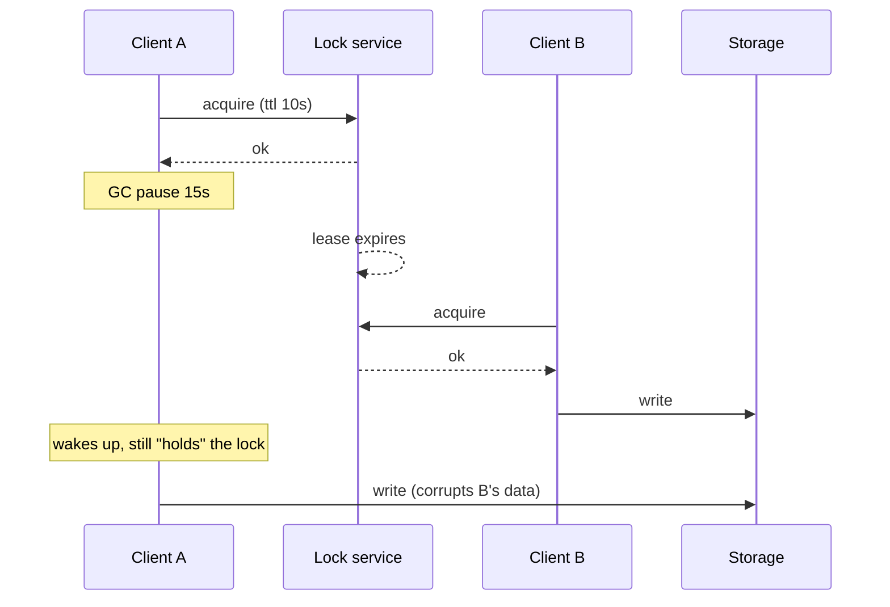

<div dir="rtl" lang="he">

# פרק 18: נעילות, בחירת מנהיג וסאגות

בתוך תהליך אחד, `sync.Mutex` עושה בדיוק מה שהוא מבטיח. בין תהליכים, כל הבטחה כזאת נשענת על שעונים, על רשת
ועל תהליכים שלא נעצרים באמצע, ושלושתם משקרים לפעמים. בפרק הזה תבני בחירת מנהיג (leader election) מעל נעילה
של PostgreSQL ותהרגי את המנהיג באמצע, תראי נעילת Redis שמוחזקת בידי שניים בבת אחת, ותתקני את זה עם אסימון
גידור (fencing token). בסוף תבני סאגה (saga): פעולה מרובת שלבים שמתבטלת בסדר הפוך כשאחד השלבים נכשל. החבילה
`leader` מהתרגיל עוברת כמו שהיא לפרויקט הגמר.

## מה נלמד בפרק

- למה נעילה מבוזרת קשה: עצירות של תהליך, שעונים שקופצים, ונעילה שפג תוקפה בזמן שמחזיקים בה.
- advisory locks ב־PostgreSQL ברמת סשן וברמת טרנזקציה, והמלכודת של מאגר חיבורים.
- נעילה ב־Redis עם `SET NX PX`, מה היא נותנת ומה לא.
- אסימוני גידור: מספר עולה שהאחסון בודק, והדרך היחידה לעצור כתיבה של מחזיק לשעבר.
- בחירת מנהיג עם advisory lock, כולל השתלטות אחרי `pg_terminate_backend`.
- קונצנזוס ברמת הרעיון: רוב, תקופות ושכפול יומן, ומתי לפנות ל־etcd או ל־ZooKeeper.
- סאגות בתזמור ובכוריאוגרפיה, ופעולות מפצות שרצות בסדר הפוך.

## ידע מקדים

- פרק 11, סעיפים 11.4 ו־11.7: נעילות שורה, ומאגר החיבורים של pgx. סעיף 11.6 הראה ש־goose נועל בעצמו.
- פרק 12, סעיף 12.1: Redis בקונטיינר והספרייה go-redis.
- פרק 17, סעיף 17.7: פיצולי רשת, ולמה אי אפשר להניח שהם לא קורים.
- פרק 5, סעיפים 5.4 עד 5.8: goroutines, ‏channels ו־context. המנהיג מריץ את העבודה שלו ב־goroutine.
- פרק 15, סעיף 15.1: כשל חלקי. כל הפרק הזה הוא כשל חלקי בין תהליכים.

## 18.1 למה נעילה מבוזרת קשה

### 18.1.1 שני סוגי נעילות

מאמר של Martin Kleppmann מפברואר 2016 על נעילה מבוזרת (הכותרת בהעשרה בסוף הפרק) מבחין בין שתי מטרות:

| מטרה | דוגמה | מה קורה כשהנעילה נכשלת |
| --- | --- | --- |
| יעילות (efficiency) | לא לחשב אותו דוח פעמיים, לא לשלוח אותה התראה פעמיים | עבודה כפולה, או הודעה כפולה. מעצבן וזול |
| נכונות (correctness) | רק כותב אחד לקובץ, רק תהליך אחד שמפרסם מה־outbox | נתונים משובשים, סדר שבור, כסף שזז פעמיים |

לפני שבוחרים כלי, שואלים איזו מהשתיים זו. לנעילת יעילות מספיקה כמעט כל נעילה. לנעילת נכונות לא מספיקה
שום נעילה לבדה, ושאר הסעיף מסביר למה.

### 18.1.2 שלוש דרכים שבהן נעילה נשברת

נעילה מבוזרת כמעט תמיד היא חכירה (lease): נעילה עם תוקף. בלי תוקף, מחזיק שמת משאיר את הנעילה לנצח. עם תוקף,
הנעילה משתחררת גם אם המחזיק עדיין חושב שהיא שלו. שלושה דברים גורמים לזה:

- **התהליך נעצר.** איסוף זבל (GC) שעוצר את העולם, מכונה וירטואלית שהוקפאה להעברה, דף זיכרון שנקרא מהדיסק,
  `SIGSTOP`. התהליך לא יודע שעבר זמן, כי מבחינתו לא עבר.
- **השעון קופץ.** התוקף נמדד בשעון. שעון קיר שמתוקן אחורה או קדימה, או שעונים שונים בשני מחשבים, מקצרים או
  מאריכים אותו. התיעוד של Redis על נעילות מבוזרות מציין במפורש ש־Redis לא משתמש בשעון מונוטוני לתפוגה.
- **הרשת מאחרת.** בקשה שיצאה כשהנעילה הייתה בתוקף מגיעה אחרי שפג. Kleppmann מביא תקרית שבה מנות נתקעו ברשת
  כ־90 שניות.

כך זה נראה, בתרחיש של Kleppmann, עם שני לקוחות ושרת אחסון:

<div dir="ltr" align="left">



</div>

אף בדיקה של A לא עוזרת: גם אם A בודק שהנעילה שלו רגע לפני הכתיבה, העצירה יכולה ליפול בין הבדיקה לכתיבה.
הפתרון חייב לשבת בצד שמקבל את הכתיבה, וזה סעיף 18.4.

## 18.2 advisory locks ב־PostgreSQL

### 18.2.1 סשן מול טרנזקציה

advisory lock (נעילה שהאפליקציה מגדירה את משמעותה, והמסד רק אוכף שיש לה מחזיק אחד) נלקחת על מפתח מספרי
מטיפוס `bigint`, ולא על שורה. היא מקומית למסד: אותו מפתח בשני מסדים הוא שתי נעילות. לפי התיעוד של גרסה 18
יש לה שתי רמות:

| רמה | לוקחים | משתחררת | הערות |
| --- | --- | --- | --- |
| סשן | `pg_advisory_lock`, או `pg_try_advisory_lock` שלא מחכה | ב־`pg_advisory_unlock`, או כשהסשן נגמר | נערמת: שלוש לקיחות דורשות שלושה שחרורים |
| טרנזקציה | `pg_advisory_xact_lock`, או `pg_try_advisory_xact_lock` | בסוף הטרנזקציה, ורק אז | אין שחרור ידני |

הגרסה עם `try` מחזירה מיד אמת או שקר, וזו שבחירת מנהיג צריכה: מועמדת שהפסידה ממשיכה הלאה ומנסה שוב אחר כך.
נעילה ברמת טרנזקציה מתאימה למשימה קצרה בתוך טרנזקציה, כמו „רק מיגרציה אחת בכל רגע”. נעילה ברמת סשן מתאימה
למה שנמשך זמן רב, כמו להיות המנהיג, וכאן מתחילה המלכודת.

### 18.2.2 המלכודת: נעילת סשן ומאגר חיבורים

נעילה ברמת סשן שייכת לחיבור אחד. אבל ב־pgx, כמו ברוב הספריות, השאילתות רצות דרך `pgxpool`, וכל קריאה יכולה
לקבל חיבור אחר מהמאגר (פרק 11, סעיף 11.7). שלושה דברים משתבשים:

- **השחרור הולך לחיבור אחר.** ‏`pg_advisory_unlock` על חיבור שלא מחזיק מחזירה שקר עם אזהרה, והנעילה נשארת.
- **החיבור חוזר למאגר עם הנעילה.** קוד אחר לגמרי מקבל אותו, ובלי לדעת מחזיק בנעילה.
- **המאגר סוגר חיבורים בעצמו.** חיבור שעבר את אורך החיים המרבי שלו נסגר, והנעילה משתחררת בלי שאיש החליט.

לכן ב־pgx (v5.11.0, נכון לאוקטובר 2026) לוקחים חיבור אחד במפורש, ומחזיקים בו לכל אורך החזקת הנעילה. הקריאה
היא `pool.Acquire`. התרגיל הולך צעד נוסף: `Hijack` מוציא את החיבור מהמאגר לגמרי, כך שהוא לעולם לא יחזור
אליו עם נעילה. כך מתחילה המועמדות, בקובץ `leader/leader.go`:

<div dir="ltr" align="left">

```go
	pc, err := e.pool.Acquire(ctx)
	if err != nil {
		return false, err
	}
	// A session lock belongs to this one session. Take the connection out of the pool so it
	// can never be handed to other code (or returned still holding the lock), and close it at
	// the end of the term: closing the session releases the lock even if unlocking failed.
	conn := pc.Hijack()
	defer conn.Close(context.Background())

	var got bool
	if err := conn.QueryRow(ctx, `SELECT pg_try_advisory_lock($1)`, e.cfg.Key).Scan(&got); err != nil {
		return false, fmt.Errorf("pg_try_advisory_lock: %w", err)
	}
	if !got {
		return false, nil // someone else leads; try again later
	}
```

</div>

סגירת החיבור בסוף, עם `defer`, היא רשת הביטחון: כשהסשן נגמר, PostgreSQL משחרר כל נעילה שלו, גם אם השחרור
המפורש נכשל. ועוד מקרה שבו נעילת סשן לא עובדת בכלל: proxy כמו PgBouncer במצב של מאגר לפי טרנזקציה מחליף
את החיבור לשרת בין טרנזקציות, ולכן לנעילת סשן אין שם משמעות.

> **איך Rust עושה את זה:** ב־Rust היית מחזירה אובייקט שומר, שה־`Drop` שלו משחרר ושמחזיק את החיבור בהשאלה.
> הקומפיילר היה מונע מהחיבור לחזור למאגר כל עוד ה־guard חי. ב־Go אין לזה אכיפה, ולכן הקוד מוציא את החיבור
> מהמאגר בעצמו, ו־`defer` ממלא את תפקיד ה־`Drop`.

### 18.2.3 מי מחזיק?

הטבלה `pg_locks` מראה כל נעילה. מפתח `bigint` מוצג בה מפוצל: החצי העליון בעמודה `classid`, התחתון ב־`objid`,
ו־`objsubid` שווה 1. התיעוד נותן את הנוסחה להרכבה מחדש, והפונקציה `HolderPID` משתמשת בה:

<div dir="ltr" align="left">

```go
	err := pool.QueryRow(ctx, `
		SELECT pid FROM pg_locks
		WHERE locktype = 'advisory' AND granted AND objsubid = 1
		  AND database = (SELECT oid FROM pg_database WHERE datname = current_database())
		  AND ((classid::bigint << 32) | objid::bigint) = $1`, key).Scan(&pid)
```

</div>

עם מזהה התהליך ביד אפשר לסיים את הסשן מבחוץ, וכך הבדיקות מדמות מנהיג שמת, בקובץ `leader/leader_test.go`:

<div dir="ltr" align="left">

```go
	// The timeout (ms) makes pg_terminate_backend wait until the backend has really exited.
	if err := admin.QueryRow(ctx, `SELECT pg_terminate_backend($1, 5000)`, pid).Scan(&terminated); err != nil || !terminated {
```

</div>

הארגומנט השני, באלפיות שנייה, הוא חדש יחסית: הפונקציה מחכה עד שהתהליך באמת יצא, ומחזירה שקר אם הזמן עבר.
בלעדיו היא מחזירה אמת ברגע שהאות נשלח.

## 18.3 נעילות ב־Redis וגבולותיהן

### 18.3.1 הנעילה של מופע אחד

התיעוד של Redis מתאר נעילה על מופע אחד בפקודה אחת: `SET resource_name my_random_value NX PX 30000`. הדגל
`NX` כותב רק אם המפתח לא קיים, ו־`PX` קובע תפוגה באלפיות שנייה. מהקובץ `redislock/redislock.go`:

<div dir="ltr" align="left">

```go
func Acquire(ctx context.Context, rdb *redis.Client, key string, ttl time.Duration) (*Lock, error) {
	b := make([]byte, 16)
	if _, err := rand.Read(b); err != nil {
		return nil, err
	}
	token := hex.EncodeToString(b)
	// SET key token NX PX <ttl in ms>: set only if absent, expire after ttl.
	err := rdb.SetArgs(ctx, key, token, redis.SetArgs{Mode: "NX", TTL: ttl}).Err()
	if errors.Is(err, redis.Nil) {
		return nil, ErrNotAcquired
	}
	if err != nil {
		return nil, err
	}
	return &Lock{rdb: rdb, key: key, token: token}, nil
}
```

</div>

הערך האקראי חיוני. מחזיק שנעצר אחרי שהנעילה פגה, ואז מוחק את המפתח עם `DEL`, מוחק נעילה של מישהו אחר.
לכן השחרור בודק שהערך עדיין שלו, ומוחק רק אז, בסקריפט Lua שרץ באופן אטומי:

<div dir="ltr" align="left">

```go
	release = redis.NewScript(`
if redis.call("GET", KEYS[1]) == ARGV[1] then
	return redis.call("DEL", KEYS[1])
end
return 0`)
```

</div>

לפי התיעוד, מגרסה 8.4 יש ל־Redis פקודה שעושה את זה בלי סקריפט: `DELEX` עם התנאי `IFEQ`. הסקריפט עובד בכל
גרסה, ולכן התרגיל משתמש בו.

### 18.3.2 שניים מחזיקים

הבדיקה `TestExpiredHolderAndNewHolderOverlap` מדגימה את הבעיה של כל חכירה. מהקובץ `redislock/redislock_test.go`:

<div dir="ltr" align="left">

```go
	a, err := Acquire(ctx, rdb, key, 200*time.Millisecond)
	if err != nil {
		t.Fatal(err)
	}
	time.Sleep(300 * time.Millisecond) // a pauses; nothing tells it the key expired

	b, err := Acquire(ctx, rdb, key, 10*time.Second)
	if err != nil {
		t.Fatalf("b could not acquire after a's TTL: %v", err)
	}
	// a wakes up. It finds out only if it asks Redis, and only after the fact:
	if err := a.Extend(ctx, 10*time.Second); !errors.Is(err, ErrNotHeld) {
		t.Fatalf("a.Extend: err = %v, want ErrNotHeld", err)
	}
	if err := a.Release(ctx); !errors.Is(err, ErrNotHeld) {
		t.Fatalf("a.Release: err = %v, want ErrNotHeld (and b's lock untouched)", err)
	}
	if err := b.Release(ctx); err != nil {
		t.Fatalf("b.Release: %v; a must not have deleted b's lock", err)
	}
```

</div>

בין ההשתלטות של B לבין הניסיון של A להאריך, שני תהליכים מאמינים שהם מחזיקים, ו־A יודע על זה רק אם הוא
שואל, ורק בדיעבד. שום תדירות של הארכה לא סוגרת את החלון, כי העצירה יכולה ליפול בין ההארכה לכתיבה.

### 18.3.3 ומה עם Redlock?

אותו עמוד בתיעוד של Redis מוסיף שתי בעיות של מופע אחד ומציע אלגוריתם בשם Redlock:

- **שכפול אסינכרוני.** אם הראשי של Redis נופל אחרי שנתן נעילה ולפני שהעביר אותה למשני, המשני שמקודם נותן את
  אותה נעילה לאחר.
- **Redlock.** חמישה מופעים עצמאיים; הנעילה נחשבת שלך אם קיבלת רוב, בזמן קצר מהתוקף.

Kleppmann טוען במאמר שלו ש־Redlock נשען על הנחות תזמון: עיכובי רשת חסומים, עצירות חסומות ושעונים מדויקים.
כשהן נשברות, שני לקוחות יכולים להחזיק. ול־Redlock אין מנגנון ליצירת אסימוני גידור. ההמלצה שלו: לנעילת יעילות
מספיק מופע Redis אחד; לנעילת נכונות, מערכת קונצנזוס כמו ZooKeeper, יחד עם אסימוני גידור. העמוד של Redis
מפנה לניתוח של Kleppmann ולתגובה של מחבר Redis, וממליץ בעצמו לממש אסימוני גידור כשאכפת לך מנכונות.

## 18.4 fencing tokens

אסימון גידור (fencing token) הוא מספר שעולה בכל פעם שהנעילה עוברת יד. המחזיק שולח אותו עם כל כתיבה, והאחסון
זוכר את הגבוה ביותר שראה ודוחה כל כתיבה עם מספר נמוך ממנו. בתרחיש של סעיף 18.1, ‏A קיבל 33 ו־B קיבל 34. B
כתב עם 34; כש־A מתעורר וכותב עם 33, האחסון דוחה אותו. A עדיין חושב שהוא מחזיק, ושום דבר רע לא קרה.

ההגנה הזאת עובדת רק אם הבדיקה וההחלפה הן פעולה אחת, אחרת שני כותבים עוברים את הבדיקה יחד. בתרגיל זו פקודה
אחת של PostgreSQL, מהקובץ `fencing/fencing.go`:

<div dir="ltr" align="left">

```go
func (s Store) Write(ctx context.Context, name, value string, token int64) error {
	tag, err := s.DB.Exec(ctx, `
		INSERT INTO fenced_resources (name, value, token) VALUES ($1, $2, $3)
		ON CONFLICT (name) DO UPDATE SET value = EXCLUDED.value, token = EXCLUDED.token
		WHERE fenced_resources.token <= EXCLUDED.token`, name, value, token)
	if err != nil {
		return fmt.Errorf("fenced write %q: %w", name, err)
	}
	if tag.RowsAffected() == 0 {
		return fmt.Errorf("write %q with token %d: %w", name, token, ErrStaleToken)
	}
	return nil
}
```

</div>

התנאי `WHERE` של `ON CONFLICT` מחליט אם השורה הקיימת מתעדכנת. כשהוא שקר, לא נכתב כלום, ו־`RowsAffected`
מחזיר אפס. הסימן קטן או שווה מאפשר למנהיג אחד לכתוב כמה פעמים באותה תקופה. הבדיקה של החבילה עוברת על רצף:

| כתיבה | אסימון | תוצאה |
| --- | --- | --- |
| מנהיג בתקופה 33 | 33 | נכתב |
| אותו מנהיג שוב | 33 | נכתב |
| מנהיג חדש | 34 | נכתב |
| המנהיג הישן מתעורר | 33 | `ErrStaleToken` |
| מנהיג שקפץ תקופה | 36 | נכתב; מספרים מותר לדלג, אסור לרדת |

מאיפה מגיע המספר? הוא חייב להיות מונוטוני ולעבור יד עם הנעילה. ב־ZooKeeper, לפי Kleppmann, משמשים לזה מזהה
הטרנזקציה או מספר הגרסה של הצומת. בתרגיל, המנהיג מגדיל מונה בטבלה, בזמן שהוא כבר מחזיק את הנעילה (סעיף 18.5).

הגבול של הרעיון: האחסון חייב לשתף פעולה. מסד שלך, תור, או שירות שלך יכולים לבדוק אסימון. שירות חיצוני שמקבל
webhook, או שרת דואר, לא יבדקו. שם ההגנה היא אידמפוטנטיות: מפתח שמאפשר לצד השני לזהות כפילות (פרק 9, סעיף 9.5).

## 18.5 בחירת מנהיג

### 18.5.1 התכנון

בחירת מנהיג היא נעילה שמחזיקים לאורך זמן: כמה עותקים של שירות רצים, ורק אחד מהם עושה עבודה מסוימת. ב־Hookline
זה ה־relay, שמפרסם מה־outbox לפי הסדר: שני relays היו מפרסמים כפול ומערבבים סדר. החבילה `leader` בנויה כך:

| שלב | מה קורה |
| --- | --- |
| מועמדות | חיבור ייעודי מהמאגר, ו־`pg_try_advisory_lock`. הפסד: לחכות `Retry` ולנסות שוב |
| תקופה חדשה | המנצחת מגדילה את המונה בטבלה `leader_terms`, וזה האסימון שלה |
| עבודה | פונקציית העבודה רצה ב־goroutine עם context ועם מספר התקופה |
| דופק | כל `Heartbeat` המנהיג מריץ `SELECT 1` על החיבור שמחזיק את הנעילה |
| ירידה | הדופק נכשל, העבודה חזרה, או שה־context בוטל: מבטלים את העבודה, מחכים לה, משחררים |

הלב הוא הפונקציה `serve`, מהקובץ `leader/leader.go`:

<div dir="ltr" align="left">

```go
func (e *Elector) serve(ctx context.Context, conn *pgx.Conn, term int64,
	lead func(context.Context, int64) error, log *slog.Logger) {
	leadCtx, cancel := context.WithCancel(ctx)
	defer cancel()
	done := make(chan error, 1)
	go func() { done <- lead(leadCtx, term) }()

	ticker := time.NewTicker(e.cfg.Heartbeat)
	defer ticker.Stop()
	alive := true
	var leadErr error
	for running := true; running; {
		select {
		case <-ctx.Done():
			running = false
		case leadErr = <-done:
			done = nil // already received
			running = false
		case <-ticker.C:
			hbCtx, cancelHB := context.WithTimeout(ctx, e.cfg.Heartbeat)
			_, err := conn.Exec(hbCtx, `SELECT 1`)
			cancelHB()
			if err != nil && ctx.Err() == nil {
				log.Warn("leader: heartbeat failed, leadership lost", "err", err)
				alive, running = false, false
			}
		}
	}
	cancel() // tell lead to stop, then wait for it: never two terms in one process
	if done != nil {
		leadErr = <-done
	}
	if leadErr != nil && !errors.Is(leadErr, context.Canceled) {
		log.Warn("leader: lead returned an error", "err", leadErr)
	}
	if alive { // a clean step-down: give the lock back now rather than at Close
		unlockCtx, cancelUnlock := context.WithTimeout(context.Background(), e.cfg.Heartbeat)
		defer cancelUnlock()
		if _, err := conn.Exec(unlockCtx, `SELECT pg_advisory_unlock($1)`, e.cfg.Key); err != nil {
			log.Warn("leader: unlock failed; closing the session releases the lock", "err", err)
		}
	}
}
```

</div>

שלוש החלטות שכדאי להבין:

- **הדופק רץ על החיבור שמחזיק את הנעילה.** כל עוד הסשן חי, הנעילה שלו; כשהסשן מת, השאילתה נכשלת. שאילתה
  על חיבור אחר מהמאגר לא הייתה מוכיחה כלום.
- **מחכים לעבודה לפני שחוזרים.** ‏`cancel()` רק מבקש לעצור. בלי ההמתנה, תהליך אחד יכול להריץ שתי תקופות במקביל.
- **שחרור מפורש רק כשהסשן חי.** בירידה מסודרת הנעילה חוזרת מיד, והבאה בתור לא מחכה. כשהסשן מת, אין מה לשחרר.

### 18.5.2 להרוג את המנהיג

הבדיקה `TestFollowerTakesOverWhenTheLeaderSessionIsKilled` מריצה שתי מועמדות, כל אחת עם מאגר משלה, כמו שני
תהליכים. אחרי ש־A מנצחת, B מנסה כעשר פעמים ונכשלת. אז הבדיקה מסיימת את הסשן של A:

<div dir="ltr" align="left">

```go
	killed := time.Now()
	terminateHolder(t, admin, key)
	// Two things happen, in either order: B wins term 2, and A's heartbeat notices.
	got := map[event]bool{}
	for range 2 {
		got[next(t, events, 5*time.Second)] = true
	}
	if !got[event{"A", 1, false}] || !got[event{"B", 2, true}] {
		t.Fatalf("events %v, want A stopping term 1 and B leading term 2", got)
	}
	t.Logf("takeover completed %v after the kill", time.Since(killed).Round(time.Millisecond))
```

</div>

שני האירועים מגיעים בכל סדר: B יכולה לנצח לפני שהדופק של A הבחין, ובדיוק בגלל זה יש אסימון. הבדיקה
`TestPausedLeaderIsFenced` מריצה את התרחיש של סעיף 18.1 עד הסוף: A נעצרת, הסשן שלה מסתיים, B נבחרת בתקופה 2
וכותבת, ואז A מתעוררת וכותבת עם 1, ו־`fencing.Store` דוחה אותה.

בתרגיל תריצי את אותו דבר עם שני תהליכים אמיתיים, ותהרגי אחד מהם עם `kill -9`. כשתהליך מת, מערכת ההפעלה סוגרת
את חיבורי ה־TCP שלו, השרת רואה שהסשן נגמר, והנעילה משתחררת. מהלוג של המועמדת השנייה, בקיצור:

<div dir="ltr" align="left">

```text
level=INFO msg=campaigning name=beta key=1818
level=INFO msg="leader: elected" name=beta key=1818 term=2 backend_pid=…
level=INFO msg="working as leader" name=beta term=2 tick=1
```

</div>

כמה זמן עבר בין המוות להשתלטות? זה תלוי ב־`-retry`, ובלוג שלך יש חותמות זמן. תמדדי ותרשמי.

### 18.5.3 מתי יש שני מנהיגים, ומתי אף אחד

| מצב | מה קורה | כמה זמן |
| --- | --- | --- |
| התהליך מת | ה־TCP נסגר, השרת משחרר, והבאה מנצחת בניסיון הבא | עד `Retry` |
| הסשן מסתיים מבחוץ | הבאה מנצחת, והישנה עוד חושבת שהיא מנהיגה | עד `Heartbeat`: אסימון הגידור מגן |
| התהליך נעצר | כמו קודם, רק שהישנה לא מריצה דופק בכלל | כל אורך העצירה: רק האסימון מגן |
| פיצול רשת בין המנהיג לשרת | הדופק נכשל אחרי זמן קצוב והמנהיג יורד, אבל השרת עוד לא יודע שהסשן מת | אין מנהיג, עד שהשרת מזהה את החיבור המת |

השורה האחרונה היא בחירה בעקביות על פני זמינות (פרק 17, סעיף 17.7): עדיף רגע בלי relay מאשר שניים. כמה זמן
השרת לוקח לזהות חיבור מת תלוי בהגדרות keepalive של TCP, למשל `tcp_keepalives_idle` בשרת, וכדאי לקבוע אותן
במפורש ולא להסתמך על ברירת המחדל של מערכת ההפעלה.

## 18.6 קונצנזוס: הרעיון בלי Raft

### 18.6.1 הבעיה

הבחירה שבנית נשענת על PostgreSQL אחד: הוא מכריע מי מחזיק. אם הוא נופל, אין מנהיג; אם יש לו משני, ההכרעה עוברת
בשכפול אסינכרוני, עם אותה בעיה של Redis. קונצנזוס (consensus) הוא הבעיה של להכריע בלי שרת אחד כזה: כמה צמתים
מסכימים על ערך, או על רצף ערכים, גם כשחלק מהם נופלים או מנותקים.

### 18.6.2 שלושה רעיונות

- **רוב (quorum).** החלטה מתקבלת כשרוב הצמתים מאשרים. כל שני רובים נחתכים בצומת אחד לפחות, ולכן אי אפשר לקבל
  שתי החלטות סותרות. חמישה צמתים ממשיכים לעבוד אחרי שניים נפלו; שלושה, אחרי שאחד נפל.
- **תקופות (terms).** כל בחירה של מנהיג פותחת תקופה עם מספר גבוה יותר. הודעה מתקופה ישנה נדחית. זה אסימון
  הגידור של סעיף 18.4, בנוי לתוך הפרוטוקול.
- **שכפול יומן (log replication).** המנהיג מקבל פקודות, מוסיף אותן ליומן ושולח לאחרים. רשומה נחשבת מאושרת כשרוב
  כתבו אותה, וכל הצמתים מריצים את היומן באותו סדר, ולכן מגיעים לאותו מצב.

האלגוריתמים המוכרים שמממשים את זה הם Raft ו־Paxos. ל־ZooKeeper יש פרוטוקול דומה משלו. הקושי הוא במקרים: מנהיג שנופל באמצע שליחה, שני
מועמדים שמתחילים בחירות יחד, צומת שחוזר אחרי שבוע. לכן לא מממשים קונצנזוס בעצמך בשביל מוצר; משתמשים במערכת
שעושה רק את זה, ונבדקה שנים.

### 18.6.3 מתי לפנות ל־etcd או ל־ZooKeeper

| מצב | כלי סביר |
| --- | --- |
| השירות כבר תלוי ב־PostgreSQL אחד, ומספיק שהבחירה זמינה כמוהו | advisory lock, כמו בפרק |
| תיאום בין שירותים שאין להם מסד משותף, או שהמסד עצמו מבוזר | etcd או ZooKeeper |
| בקר (controller) שרץ בתוך Kubernetes | אובייקט `Lease` של Kubernetes, שנשמר ב־etcd |
| נעילת יעילות בלבד | מופע Redis אחד |

המערכת etcd מממשת את Raft. היא גם שומרת את כל המצב של Kubernetes. בפרק 20 תפגשי את Kubernetes, שבוחר מנהיג לרכיבים שלו בדיוק
כך. בראיון, הניסוח החשוב: קונצנזוס פותר הסכמה בין צמתים, לא את העצירה של לקוח. גם עם etcd צריך אסימון גידור.

## 18.7 סאגות ופעולות מפצות

### 18.7.1 כשאין טרנזקציה אחת

הזמנה בחנות נוגעת בשלושה שירותים: מלאי, תשלום ומשלוח, כל אחד עם מסד משלו. אין טרנזקציה אחת שעוטפת את שלושתם,
ושני־שלבי (two-phase commit) בין שירותים שונים נדיר ושביר. סאגה (saga), רעיון ממאמר של Garcia-Molina ו־Salem
משנת 1987, מחליפה טרנזקציה גדולה ברצף של טרנזקציות מקומיות. לכל צעד יש פעולה מפצה (compensating action), וכשצעד
נכשל, מריצים את הפעולות המפצות של הצעדים שהצליחו, בסדר הפוך.

פעולה מפצה היא ביטול סמנטי, לא `ROLLBACK`. החיוב כבר קרה ונרשם; הפיצוי הוא זיכוי, שגם הוא נרשם. מכאן כמה כללים:

- **פיצוי חייב להיות אידמפוטנטי.** אחרי קריסה הוא ירוץ שוב, ושני זיכויים הם באג חדש.
- **מה שאי אפשר לבטל בא אחרון.** מייל ללקוחה לא חוזר. שמים אותו אחרי כל צעד שעלול להיכשל.
- **אין בידוד.** בין הצעדים, שירותים אחרים רואים מצב ביניים: מלאי שמור להזמנה שעוד תבוטל. מסמנים אותו כזמני,
  למשל בסטטוס `PENDING`, ומתכננים את הקוראים בהתאם.

### 18.7.2 תזמור מול כוריאוגרפיה

| | תזמור (orchestration) | כוריאוגרפיה (choreography) |
| --- | --- | --- |
| מי מחליט | מתזמר אחד קורא לכל שירות לפי הסדר | כל שירות מגיב לאירוע של הקודם ומפרסם אירוע משלו |
| איפה הלוגיקה | במקום אחד, קל לקרוא ולבדוק | מפוזרת בין השירותים |
| צימוד | המתזמר מכיר את כולם | כל שירות מכיר רק אירועים |
| כשמשהו נכשל | המתזמר יודע בדיוק מה לפצות | כל שירות צריך להאזין גם לאירועי כישלון |
| מתאים ל | תהליך עסקי עם כמה צעדים ותנאים | שתיים־שלוש תגובות פשוטות לאירוע |

בכוריאוגרפיה, ה־outbox מפרק 13 הוא הדרך לפרסם אירוע יחד עם הכתיבה המקומית. התרגיל מממש תזמור, בתוך תהליך אחד.

### 18.7.3 המתזמר

צעד הוא שם, פעולה ופיצוי. מהקובץ `saga/saga.go`:

<div dir="ltr" align="left">

```go
func Run(ctx context.Context, steps []Step) error {
	for i, s := range steps {
		err := ctx.Err()
		if err == nil {
			err = s.Do(ctx)
		}
		if err != nil {
			return compensate(context.WithoutCancel(ctx), steps[:i], &Error{Step: s.Name, Err: err})
		}
	}
	return nil
}
```

</div>

<div dir="ltr" align="left">

```go
func compensate(ctx context.Context, done []Step, sagaErr *Error) error {
	for i := len(done) - 1; i >= 0; i-- {
		s := done[i]
		if s.Compensate == nil {
			continue
		}
		if err := s.Compensate(ctx); err != nil {
			// keep going: the other steps still need undoing
			sagaErr.Compensation = append(sagaErr.Compensation, fmt.Errorf("compensate %q: %w", s.Name, err))
			continue
		}
		sagaErr.Compensated = append(sagaErr.Compensated, s.Name)
	}
	return sagaErr
}
```

</div>

שלושה פרטים קטנים שהם רוב העבודה:

- **‏`steps[:i]` הם רק הצעדים שהצליחו.** הצעד שנכשל לא מפוצה, כי הוא לא קרה. אם הוא קרה בחלקו, זה עניינו
  לנקות, בתוך הטרנזקציה המקומית שלו.
- **הפיצויים רצים עם `context.WithoutCancel`.** לקוחה שסגרה את הדפדפן באמצע לא אמורה להשאיר כסף מחויב בלי מלאי.
- **כשל בפיצוי לא עוצר את האחרים.** הוא נאסף לתוך השגיאה, כי מישהו יצטרך לטפל בו ידנית או בניסיון חוזר.

הדוגמה בקובץ `saga/example_test.go` היא גם בדיקה, ולכן הפלט מאומת בכל הרצה:

<div dir="ltr" align="left">

```text
do reserve-stock
do book-courier
do charge-card
undo book-courier
undo reserve-stock
saga: step "charge-card" failed: card declined; compensated [book-courier reserve-stock]
```

</div>

הבדיקה הטבלאית `TestCompensationRunsInReverseOrder` מזריקה כשל בכל אחד מארבעת הצעדים, ובודקת את רצף הקריאות
המדויק. מתזמר בייצור עושה עוד שני דברים שהתרגיל משאיר בחוץ: שומר במסד אילו צעדים הסתיימו, כדי שאחרי קריסה ימשיך
או יפצה, ומנסה שוב צעדים ופיצויים שנכשלו, עם המתנה גדלה (פרק 14).

## סיכום

- נעילה מבוזרת היא חכירה עם תוקף. עצירת תהליך, שעון שקופץ ורשת שמאחרת גורמים לשני מחזיקים בבת אחת.
- שאלי קודם אם זו נעילת יעילות או נכונות. לנעילת נכונות אין מספיק בלי בדיקה בצד האחסון.
- נעילת סשן ב־PostgreSQL שייכת לחיבור אחד. ב־pgx לוקחים חיבור ייעודי ומחזיקים בו, ובתרגיל מוציאים אותו מהמאגר.
- נעילת Redis היא `SET NX PX` עם ערך אקראי ושחרור בהשוואה. היא טובה ליעילות, ואינה מגינה מפני מחזיק שהתעורר.
- אסימון גידור הוא מספר עולה שהאחסון בודק בפעולה אחת עם הכתיבה; הוא עוצר כתיבות מאוחרות של מחזיק לשעבר.
- בחירת מנהיג: נעילה, תקופה חדשה, עבודה ב־goroutine ודופק על אותו חיבור. בין מוות להשתלטות יכולים להיות שניים.
- קונצנזוס נשען על רוב, תקופות ושכפול יומן. לא מממשים אותו לבד; etcd ו־ZooKeeper קיימים בשביל זה.
- סאגה מחליפה טרנזקציה מבוזרת בצעדים מקומיים ופיצויים בסדר הפוך. פיצויים אידמפוטנטיים, ומה שלא מתבטל בא אחרון.

## מונחים לזכור

| מונח בעברית | באנגלית | במשפט אחד |
| --- | --- | --- |
| נעילה | lock | הבטחה שרק מחזיק אחד ניגש למשאב |
| חכירה | lease | נעילה עם תוקף, שמשתחררת גם אם המחזיק חי |
| advisory lock | advisory lock | נעילה של PostgreSQL על מפתח מספרי שהאפליקציה מגדירה את משמעותו |
| נעילת סשן | session-level lock | נעילה שחיה עד שחרור מפורש או סוף הסשן |
| אסימון גידור | fencing token | מספר עולה שהאחסון בודק כדי לדחות כתיבה של מחזיק לשעבר |
| בחירת מנהיג | leader election | הכרעה איזה עותק אחד של שירות עושה עבודה מסוימת |
| תקופה | term | מספר של כהונת מנהיג; עולה בכל בחירה |
| דופק | heartbeat | בדיקה תקופתית שהמנהיג עדיין מחזיק |
| קונצנזוס | consensus | הסכמה של כמה צמתים על ערך, למרות כשלים |
| רוב | quorum | מספר הצמתים שאישורם מכריע; שני רובים תמיד נחתכים |
| שכפול יומן | log replication | הפצה של רצף פקודות לכל הצמתים באותו סדר |
| סאגה | saga | רצף טרנזקציות מקומיות עם פעולה מפצה לכל אחת |
| פעולה מפצה | compensating action | ביטול סמנטי של צעד שכבר התבצע |
| תזמור | orchestration | סאגה שמתזמר אחד מנהל |
| כוריאוגרפיה | choreography | סאגה שבה כל שירות מגיב לאירועים של האחרים |

## טעויות נפוצות

- **נעילת סשן דרך `pgxpool` בלי חיבור ייעודי.** השחרור הולך לחיבור אחר והנעילה נתקעת. ‏`Acquire` ומחזיקים.
- **להאמין שהארכה תכופה סוגרת את החלון.** העצירה יכולה ליפול בין ההארכה לכתיבה. רק האחסון יכול לבדוק.
- **לשחרר נעילת Redis עם `DEL`.** מוחקים נעילה של מישהו אחר. משווים את הערך ומוחקים בפעולה אחת.
- **לבדוק אסימון ואז לכתוב, בשתי פקודות.** שני כותבים עוברים את הבדיקה יחד. התנאי בתוך פקודת הכתיבה.
- **דופק על חיבור אחר מזה שמחזיק.** הדופק מצליח אחרי שהנעילה כבר אבדה. דופקים על אותו חיבור.
- **פיצוי שאינו אידמפוטנטי.** אחרי קריסה הוא רץ פעמיים, ומחזירים כסף פעמיים.
- **לבטל פיצויים עם ה־context של הבקשה.** הלקוחה התנתקה, והסאגה נשארת באמצע. ‏`context.WithoutCancel`.

## שאלות ראיון

1. **נעילה עם TTL של 30 שניות. איך היא יכולה להיות מוחזקת בידי שני תהליכים בבת אחת?** התוקף נמדד בזמן,
   והמחזיק לא חווה את הזמן הזה אם הוא נעצר: GC, מכונה וירטואלית מוקפאת, דיסק איטי. אחרי 30 שניות הנעילה
   משתחררת ומישהו אחר לוקח אותה, והראשון מתעורר וממשיך לכתוב. גם שעון שקופץ, או בקשה שתקועה ברשת, יוצרים את
   אותו חלון. אי אפשר לסגור את החלון מצד המחזיק, ולכן לנעילת נכונות מוסיפים אסימון גידור שהאחסון בודק.

   **המשך:** ואם האחסון לא יודע לבדוק אסימון, כמו שירות חיצוני? אז אין לנעילה ערבות נכונות, והכתיבה חייבת
   להיות אידמפוטנטית, עם מפתח שמאפשר לצד השני לזהות כפילות.

2. **הסבירי advisory lock ב־PostgreSQL, ולמה צריך זהירות עם מאגר חיבורים.** זו נעילה על מפתח מספרי
   שהאפליקציה מגדירה, ברמת סשן או ברמת טרנזקציה. ברמת סשן היא שייכת לחיבור שלקח אותה, ומשתחררת כשהוא נסגר,
   וזה מה שהופך אותה לטובה לבחירת מנהיג: תהליך שמת משחרר אוטומטית. במאגר, כל שאילתה יכולה לרוץ על חיבור אחר,
   ולכן השחרור יכול ללכת לחיבור הלא נכון, והחיבור הנועל יכול לחזור למאגר. לוקחים חיבור ייעודי, ומאחורי
   PgBouncer במצב טרנזקציה עוברים לנעילה ברמת טרנזקציה או לחיבור ישיר.

3. **תכנני הרצה של עותק פעיל אחד של worker מתוך שלושה. מה קורה כשהמנהיג מת?** שלושתם מנסים advisory lock עם
   `try` כל שנייה; המנצח מגדיל מונה תקופה ומתחיל לעבוד, ומריץ דופק על החיבור שמחזיק. כשהתהליך מת, השרת משחרר
   ומישהו אחר מנצח בניסיון הבא. כשהסשן מת אבל התהליך חי, יכולים להיות שני מנהיגים עד הדופק הבא, ולכן כל כתיבה
   נושאת את מספר התקופה. ובפיצול רשת, המנהיג יורד והשרת עוד מחזיק את הסשן, כך שלזמן מה אין מנהיג; זו בחירה
   בעקביות, וקיצור הזמן הזה הוא עניין של keepalive.

4. **מתי סאגה, ומתי טרנזקציה?** אם כל הנתונים במסד אחד, טרנזקציה: היא נותנת אטומיות ובידוד בחינם. סאגה
   מתאימה כשהצעדים בשירותים שונים, או כשהם ארוכים מכדי להחזיק נעילות לאורכם. המחיר הוא שאין בידוד, ולכן
   צריך מצבי ביניים גלויים, פיצויים אידמפוטנטיים, וסדר שבו מה שלא מתבטל בא אחרון. תזמור קל יותר לקרוא ולבדוק;
   כוריאוגרפיה מפחיתה צימוד אבל מפזרת את הלוגיקה.

   **המשך:** מה קורה אם הפיצוי עצמו נכשל? מנסים שוב, כי הוא אידמפוטנטי, ואם הוא ממשיך להיכשל, הסאגה נעצרת
   במצב שדורש התערבות, עם התראה.

5. **מתי היית מוסיפה etcd או ZooKeeper למערכת?** כשצריך הכרעה בין שירותים שאין להם מסד משותף, או כשהזמינות של
   הבחירה חייבת להיות גבוהה מזו של מסד אחד. הם מממשים קונצנזוס: רוב, תקופות ושכפול יומן, ונותנים חכירות
   ומספרי גרסה שמשמשים כאסימוני גידור. אם השירות כבר נופל כשה־PostgreSQL שלו נופל, advisory lock נותן אותה
   זמינות בלי רכיב חדש לתפעל.

## פתק Obsidian

הפתק המוכן נמצא גם כקובץ: `obsidian/18-locks-leaders-sagas.md`. זה תוכנו:

- **יעילות מול נכונות:** לנעילת יעילות מספיק Redis אחד; לנעילת נכונות צריך בדיקה בצד האחסון.
- **למה זה נשבר:** עצירת תהליך, שעון שקופץ, רשת שמאחרת. חכירה משתחררת גם כשהמחזיק חי.
- **advisory lock:** סשן או טרנזקציה; נעילת סשן שייכת לחיבור אחד, ולכן חיבור ייעודי ולא המאגר.
- **Redis:** ערך אקראי, תפוגה, ושחרור רק אם הערך שלך. ‏Redlock לא נותן אסימונים.
- **אסימון גידור:** מספר עולה; האחסון דוחה נמוך מהגבוה שראה, בפקודה אחת עם הכתיבה.
- **בחירת מנהיג:** `try`, תקופה חדשה, עבודה ב־goroutine, דופק על אותו חיבור. השתלטות אצלי אחרי ___.
- **קונצנזוס:** רוב, תקופות, שכפול יומן. etcd ו־ZooKeeper, לא מימוש עצמי.
- **סאגה:** צעדים מקומיים, פיצויים בסדר הפוך, אידמפוטנטיים; מה שלא מתבטל אחרון.
- **שאלה פתוחה:** ___

<div dir="ltr" align="left">

```text
SELECT pg_try_advisory_lock(k)        -- session lock, no wait; true/false
SELECT pg_advisory_unlock(k)          -- same session only
SELECT pg_advisory_xact_lock(k)       -- released at COMMIT/ROLLBACK
pg_locks: (classid::bigint << 32) | objid::bigint = k, objsubid = 1
SELECT pg_terminate_backend(pid, 5000)
pgx: pc, _ := pool.Acquire(ctx); conn := pc.Hijack(); defer conn.Close(ctx)
Redis: SET key token NX PX ttl ; release = Lua GET==token then DEL  (8.4+: DELEX key IFEQ token)
fence: INSERT ... ON CONFLICT (name) DO UPDATE ... WHERE t.token <= EXCLUDED.token ; 0 rows = stale
go run ./cmd/elect -name alpha | -name beta ; kill -9 <leader pid> ; takeover after ___
saga: do 1..n ; on failure at i: undo i-1..1 with context.WithoutCancel(ctx)
quorum of 5 = 3, tolerates ___ failures
```

</div>

## תרגיל

**מטרה:** לבנות בחירת מנהיג מעל נעילה של PostgreSQL ולראות השתלטות אמיתית, להראות נעילת Redis שמוחזקת
בידי שניים ולעצור כתיבה מאוחרת באסימון גידור, ולכתוב סאגה מתוזמרת עם פיצויים ובדיקות. **זמן:** שני ימי לימוד, ימים 52 ו־53, כ־55 דקות בנייה ביום 52 וכ־60 ביום 53.
**ידע מקדים:** סעיפים 18.1 עד 18.4 ליום 52 ו־18.5 עד 18.7 ליום 53;
פרקים 11 ו־12 למסד ול־Redis.

הצעדים, קוד ההתחלה, הרמזים והפתרון נמצאים ב־
[`exercises/ch18-leader/README.md`](../exercises/ch18-leader/README.md).

**קריטריון סיום:**

- הבדיקה `TestPausedLeaderIsFenced` עוברת: כתיבה של מנהיג לשעבר נדחית.
- שני תהליכים של `elect` רצים, אחד נהרג, והשני משתלט; הלוג של ההשתלטות שמור בפתק.
- בדיקות הסאגה עוברות לכשל בכל צעד, עם הפיצויים הנכונים בסדר הפוך.
- כל הבדיקות ירוקות עם `-race`, בלי דילוגים.
- כלי העיצוב והניתוח הסטטי שקטים.

## העשרה אופציונלית

| מקור | למה כדאי |
| --- | --- |
| „How to do distributed locking” של Martin Kleppmann, 2016 | הטיעון המלא של סעיפים 18.1 עד 18.4 |
| העמוד „Distributed Locks with Redis” בתיעוד של Redis | ‏Redlock, וקישור לתגובה של מחבר Redis למאמר של Kleppmann |
| „In Search of an Understandable Consensus Algorithm” של Ongaro ו־Ousterhout | המאמר של Raft; בחירת מנהיג ושכפול יומן, קריא בלי רקע פורמלי |
| „Sagas” של Garcia-Molina ו־Salem, 1987 | המקור של סעיף 18.7 |

- הוסיפי ל־`saga` שמירת מצב בטבלה של PostgreSQL, והמשך אחרי קריסה: בדיקה שעוצרת את התהליך באמצע וממשיכה.
- הוסיפי ל־`redislock` נעילה עם `DELEX` במקום הסקריפט, ובדקי שהיא עובדת מול Redis 8.10.

</div>
