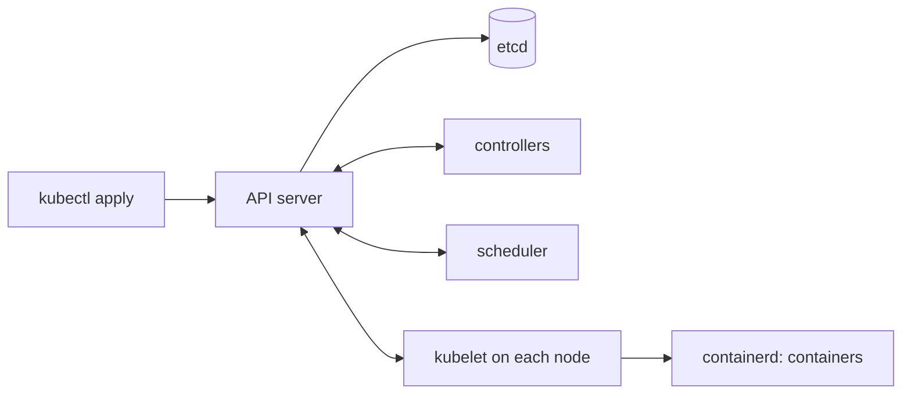

<div dir="rtl" lang="he">

# פרק 20: Kubernetes על kind

המילה Kubernetes הופיעה ב־19 מתוך 30 המודעות הבכירות שנבדקו ביד לספר, בכל חמש מודעות ה־platform ובשבע
מתוך שמונה מודעות ה־DevOps (סעיפים 1.4 ו־2 בקובץ המחקר `00-stage1/01-market-research.md`). בראיון לא יבקשו ממך לנהל אשכול, אבל יצפו
שתדעי מה קורה כשאת מריצה `kubectl apply`, למה pod נעלם ומי מחזיר אותו, ואיך בדיקת מוכנות שונה מבדיקת חיות.
הפרק הזה בונה אשכול אמיתי על המחשב שלך, ופורס עליו את shorty מפרק 6 ואת ה־receiver מפרק 8, אובייקט אחרי
אובייקט.

## מה נלמד בפרק

- מה Kubernetes פותר: מצב רצוי, בקרים שמתקנים סטייה, ו־API אחד לכל המשאבים.
- להרים אשכול kind עם node image נעול ב־digest, ולטעון אליו image מקומי.
- pods: היחידה שרצה, ולמה כמעט אף פעם לא יוצרים אותה ישירות.
- Deployments ו־ReplicaSets: מי מחזיק את מספר העותקים, ומה קורה כשמוחקים pod.
- Services ו־DNS: שם ו־IP יציבים מול pods שמתחלפים, ו־`kubectl port-forward`.
- ConfigMaps ו־Secrets, ולמה base64 אינו הצפנה.
- שלוש בדיקות (probes) ומה כל אחת עושה כשהיא נכשלת, ממופות לנקודות הקצה של shorty.

## ידע מקדים

- פרק 19: ה־images של shorty ושל ה־receiver, משתמש מספרי שאינו root, מערכת קבצים לקריאה בלבד, ולמה לא
  `latest`. התרגיל מביא עותק של שני הקונטיינרים לבנייה, כך שאפשר להתחיל גם בלי תרגיל 19.
- פרק 6: התצורה של shorty מהסביבה, כיבוי מסודר על `SIGTERM`, והפורט הפרטי של הניפוי.
- פרק 2, סעיף 2.10: kind ו־kubectl מותקנים. ב־Mac שעליו נכתב הספר רץ kubectl 1.36 מול אשכול 1.37; ההפרש של גרסה
  אחת בתוך מדיניות התמיכה של Kubernetes, אבל עדיף שתתקיני את הגרסה הנעולה שבנספח ג.
- כ־2 GB פנויים במכונה של Docker. האשכול של התרגיל הוא node אחד.

## 20.1 מה Kubernetes פותר

נניח שיש לך שלוש מכונות ושירות שצריך לרוץ בארבעה עותקים. בלי מערכת, מישהו מחליט איפה כל עותק רץ, מפעיל
מחדש עותק שנפל, מעביר עותקים כשמכונה מתה, מעדכן את מאזן העומסים בכל שינוי, ומחליף גרסה בלי להפיל את כולם.
Kubernetes עושה את כל זה, ועושה את זה באותה דרך לכל שירות.

הרעיון המרכזי הוא **מצב רצוי** (desired state). את לא אומרת „הפעל קונטיינר”; את כותבת „צריכים לרוץ שני
עותקים של shorty מה־image הזה”, ושומרת את המשפט ב־API. רכיבים שנקראים בקרים (controllers) רצים בלולאה:
משווים בין הרצוי לבין המצב בפועל, ופועלים כדי לסגור את הפער. pod נמחק? יש פער של אחד, ובקר יוצר pod חדש.
זה נקרא לולאת התאמה (reconciliation loop), וכמעט כל התנהגות בפרק הזה היא מקרה פרטי שלה.

<div dir="ltr" align="left">



</div>

| רכיב | תפקיד |
| --- | --- |
| API server | הדלת היחידה: כל קריאה וכתיבה, של אדם או של רכיב, עוברת בו |
| etcd | מסד הנתונים של האשכול, שבו שמור המצב הרצוי |
| scheduler | מחליט על איזה node כל pod חדש ירוץ |
| controllers | הלולאות שמתקנות פער: עותקים, endpoints, ועוד |
| kubelet | הסוכן שעל כל node: מפעיל את הקונטיינרים של ה־pods שהוקצו לו ומריץ את הבדיקות |

המונח cluster (אשכול: קבוצת מכונות שמנוהלות יחד) והמונח node (מכונה אחת באשכול, פיזית או וירטואלית)
יופיעו מעכשיו באנגלית, כמו שאר אוצר המילים של Kubernetes.

מה Kubernetes **לא** פותר: הוא לא הופך שירות לא אמין לאמין, לא מתכנן את הקיבולת בשבילך, ולא זול. שירות
אחד על מכונה אחת לא צריך אותו. הוא משתלם כשיש הרבה שירותים, הרבה פריסות וצוות שרוצה דרך אחת לעשות את כולן.

## 20.2 kind: אשכול על המחשב שלך

הכלי kind (קיצור של Kubernetes in Docker) מריץ כל node כקונטיינר של Docker. בתוך הקונטיינר רצים kubelet,
containerd ורכיבי ה־control plane, בדיוק כמו במכונה אמיתית. זה אשכול אמיתי לכל דבר שהפרק צריך, ונמחק
בפקודה אחת.

### 20.2.1 node image נעול ב־digest

ה־node הוא image בשם `kindest/node`, וכל גרסה של kind נבנתה מול גרסאות מסוימות שלו. הוראות הפרסום של
kind v0.33.0 אומרות במפורש שחובה לנעול את ה־image ב־digest, כי התג לבדו לא מבטיח image שנבנה לגרסה הזאת
(נכון לאוקטובר 2026; ראי נספח ג). זה הקובץ `kind-config.yaml` של התרגיל:

<div dir="ltr" align="left">

```yaml
# One-node kind cluster for chapter 20:
#   kind create cluster --name ch20 --config kind-config.yaml
# The node image is pinned by digest, as the kind v0.33.0 release notes require.
kind: Cluster
apiVersion: kind.x-k8s.io/v1alpha4
nodes:
  - role: control-plane
    image: kindest/node:v1.37.0@sha256:a1ed56cfb0e7b93589bdf97c8cd566405a265939e3620fc4f5de89adff580ae5
```

</div>

את ה־digest לא מעתיקים מבלוג. הוא מופיע בהוראות הפרסום של הגרסה, וכך קוראים אותן מהטרמינל:

<div dir="ltr" align="left">

```bash
gh api repos/kubernetes-sigs/kind/releases/tags/v0.33.0 --jq .body | grep 'v1.37.0'
```

</div>

ואז יוצרים את האשכול ובודקים שהוא עונה:

<div dir="ltr" align="left">

```bash
kind create cluster --name ch20 --config kind-config.yaml
kubectl cluster-info --context kind-ch20
kubectl get nodes
```

</div>

<div dir="ltr" align="left">

```text
NAME                 STATUS   ROLES           AGE   VERSION
ch20-control-plane   Ready    control-plane   40s   v1.37.0
```

</div>

הפקודה `kind create cluster` גם מוסיפה לקובץ `~/.kube/config` הקשר (context) בשם `kind-ch20` והופכת אותו
לנוכחי. כל פקודת `kubectl` שתריצי אחריה פונה לאשכול הזה.

### 20.2.2 למה צריך לטעון את ה־image

ה־image שבנית נמצא באחסון של Docker במחשב שלך. ה־node של kind הוא קונטיינר, ובתוכו containerd משלו, עם
אחסון נפרד. כשה־kubelet מבקש את `shorty:ch20`, containerd מחפש אצלו, לא מוצא, ומנסה למשוך מ־Docker Hub,
שם הוא לא קיים. הפקודה הבאה מעתיקה את ה־image מ־Docker לתוך ה־node:

<div dir="ltr" align="left">

```bash
docker build -t shorty:ch20 data/shorty
kind load docker-image shorty:ch20 --name ch20
```

</div>

גם התגית חשובה כאן. מדיניות המשיכה (`imagePullPolicy`) שברירת המחדל שלה תלויה בתגית:

| תגית | ברירת המחדל | מה קורה עם image שנטען ל־kind |
| --- | --- | --- |
| `shorty:ch20` | `IfNotPresent` | נמצא ב־node, רץ |
| `shorty:latest` או בלי תגית | `Always` | ניסיון משיכה מ־registry, `ErrImagePull` |

לכן ה־manifests של התרגיל כותבים את המדיניות במפורש, ותגית שאינה `latest`.

## 20.3 pods

ה־pod (היחידה הקטנה ביותר ש־Kubernetes מריץ: קונטיינר אחד או יותר שחולקים רשת ואחסון) הוא מה שרץ בפועל.
לכל pod כתובת IP משלו באשכול, והקונטיינרים שבתוכו מדברים זה עם זה דרך `localhost`. ברוב המקרים יש בו
קונטיינר אחד.

התכונה החשובה של pod היא שהוא **בן חלוף**. אם ה־node שלו מת, הוא לא עובר ל־node אחר; הוא פשוט נגמר, ומישהו
אחר צריך ליצור pod חדש, עם שם חדש ו־IP חדש. pod שיצרת בעצמך אף אחד לא ייצור מחדש. התרגיל משתמש ב־pod
בודד בדיוק למקרה שבו זה מה שרוצים: משימה חד־פעמית ששולחת webhook אחד ונגמרת. זה הקובץ `pods/sender.yaml`:

<div dir="ltr" align="left">

```yaml
apiVersion: v1
kind: Pod
metadata:
  name: sender
  namespace: ch20
spec:
  restartPolicy: Never
  securityContext:
    runAsNonRoot: true
    seccompProfile:
      type: RuntimeDefault
  containers:
    - name: sender
      image: receiver:ch20 # the same image carries the receiver-send script
      imagePullPolicy: IfNotPresent
      command: ["receiver-send"]
      # $(SECRET) is expanded by Kubernetes from the env below, not by a shell.
      args: ["http://receiver.ch20.svc.cluster.local:8081/hooks/orders", "--secret", "$(SECRET)"]
      env:
        - name: SECRET
          valueFrom:
            secretKeyRef:
              name: receiver-secret
              key: signing-secret
      securityContext:
        allowPrivilegeEscalation: false
        readOnlyRootFilesystem: true
        capabilities:
          drop: ["ALL"]
```

</div>

כל manifest (קובץ YAML שמתאר אובייקט) מתחיל בארבעה שדות: `apiVersion` ו־`kind` אומרים מה זה, `metadata`
נותן שם ו־namespace (מרחב שמות בתוך האשכול; בתרגיל כל האובייקטים ב־`ch20`), ו־`spec` הוא המצב הרצוי.
שאר השדות יחזרו בסעיפים הבאים: הסוד בסעיף 20.6, השם של ה־receiver בסעיף 20.5, והגדרות האבטחה הן
אותן החלטות מפרק 19, שנכתבות עכשיו כמדיניות של האשכול.

> **שימי לב:** הסוד מגיע לתוכנית כארגומנט בשורת הפקודה, כי `receiver-send` מקבל אותו רק כך. כל מי
> שיכול לראות את רשימת התהליכים ב־node רואה אותו. בשירות אמיתי סוד נקרא ממשתנה סביבה או מקובץ.

## 20.4 deployments ו־ReplicaSets

את shorty לא מריצים כ־pod בודד. מריצים Deployment (אובייקט שמתאר שירות: כמה עותקים, מאיזה image, ואיך
להחליף גרסה), והוא מנהל את ה־pods. בפועל יש שכבה באמצע:

| אובייקט | אחראי על | שואל בכל סיבוב |
| --- | --- | --- |
| Deployment | גרסאות: יוצר ReplicaSet לכל תבנית pod, ועובר ביניהן בהדרגה | האם ה־ReplicaSet של התבנית הנוכחית בגודל הנכון? |
| ReplicaSet | מספר עותקים של תבנית אחת | כמה pods עם התווית שלי חיים, ולכמה הם צריכים להגיע? |
| Pod | קונטיינרים רצים | (אין לו בקר משלו; ה־kubelet מריץ אותו) |

זה התחלת הקובץ `k8s/shorty-deployment.yaml`:

<div dir="ltr" align="left">

```yaml
apiVersion: apps/v1
kind: Deployment
metadata:
  name: shorty
  namespace: ch20
  labels:
    app: shorty
spec:
  replicas: 2
  selector:
    matchLabels:
      app: shorty # must match the template labels below, and never changes
  template:
    metadata:
      labels:
        app: shorty
    spec:
      securityContext:
        runAsNonRoot: true # refuse to start if the image would run as root
        seccompProfile:
          type: RuntimeDefault
```

</div>

הקשר בין האובייקטים הוא **תוויות** (labels), לא שמות. ה־selector אומר „ה־pods שלי הם אלה עם התווית
`app: shorty`”, והתבנית מבטיחה שכל pod חדש יקבל אותה. ה־ReplicaSet מוסיף תווית משלו, `pod-template-hash`,
כדי שלא יתבלבל בין pods של גרסה ישנה וחדשה. ה־selector של Deployment אינו ניתן לשינוי אחרי היצירה.

### 20.4.1 לראות את הבקר עובד

<div dir="ltr" align="left">

```bash
kubectl apply -f k8s/
kubectl -n ch20 rollout status deployment/shorty
kubectl -n ch20 get deployments,replicasets,pods -l app=shorty
```

</div>

<div dir="ltr" align="left">

```text
NAME                     READY   UP-TO-DATE   AVAILABLE   AGE
deployment.apps/shorty   2/2     2            2           20s

NAME                                DESIRED   CURRENT   READY   AGE
replicaset.apps/shorty-57f9769656   2         2         2       20s

NAME                          READY   STATUS    RESTARTS   AGE
pod/shorty-57f9769656-6wdxs   1/1     Running   0          20s
pod/shorty-57f9769656-snrjl   1/1     Running   0          20s
```

</div>

הפלט הוא מההרצה שבה נכתב הספר, והשמות והגילים אצלך יהיו אחרים. השם של ה־ReplicaSet הוא שם ה־Deployment ועוד הגיבוב של התבנית, ושם
ה־pod הוא שם ה־ReplicaSet ועוד סיומת אקראית. עכשיו מחקי pod אחד, ומיד הסתכלי שוב:

<div dir="ltr" align="left">

```bash
kubectl -n ch20 delete pod shorty-57f9769656-6wdxs
kubectl -n ch20 get pods -l app=shorty
```

</div>

ה־pod שמחקת בתהליך כיבוי, ולידו pod חדש עם שם אחר. ה־ReplicaSet ראה פער בין 2 ל־1 וסגר אותו. זה ההבדל
מה־pod הבודד של סעיף 20.3: את ה־sender אף אחד לא היה מחזיר.

> **איך Rust עושה את זה:** אין מקבילה בשפה, אבל יש בתבנית. מי שכתבה supervisor ב־tokio, לולאה שמחכה
> ל־`JoinHandle` ומפעילה מחדש משימה שנפלה, כתבה בקר קטן. ההבדל הוא שהבקר של Kubernetes לא מחכה לאירוע
> של משימה מסוימת: הוא משווה בכל פעם רשימה רצויה לרשימה בפועל, ולכן הוא מתקן גם פער שלא ראה נוצר.

## 20.5 services ו־DNS

ל־pods של shorty יש כתובות IP, אבל הן משתנות בכל פעם ש־pod מתחלף, ויש שתיים מהן. לקוח צריך כתובת אחת
שלא זזה. את זה נותן Service (אובייקט שנותן שם וכתובת IP וירטואלית יציבים לקבוצת pods, ומחלק ביניהם
חיבורים). זה הקובץ `k8s/shorty-service.yaml`:

<div dir="ltr" align="left">

```yaml
# A stable name and virtual IP in front of the ready shorty pods.
# Inside the cluster: http://shorty.ch20.svc.cluster.local (or http://shorty from ch20).
apiVersion: v1
kind: Service
metadata:
  name: shorty
  namespace: ch20
spec:
  type: ClusterIP
  selector:
    app: shorty
  ports:
    - name: http
      port: 80
      targetPort: http # the container port by name
```

</div>

גם כאן הקשר הוא דרך תוויות. בקר נוסף מחזיק לכל Service רשימה של הכתובות של ה־pods שהוא בוחר **ושמוכנים
לקבל תעבורה**, באובייקטים שנקראים EndpointSlices. על כל node, הרכיב kube-proxy מתרגם את הכתובת
הווירטואלית לאחת מהכתובות ברשימה. המילה „מוכנים” היא הגשר לסעיף 20.7.

<div dir="ltr" align="left">

```bash
kubectl -n ch20 get service shorty
kubectl -n ch20 get endpointslices -l kubernetes.io/service-name=shorty
```

</div>

### 20.5.1 DNS בתוך האשכול

כל Service מקבל שם ב־DNS של האשכול (שירות בשם CoreDNS שרץ בתוכו). השם המלא בנוי לפי תבנית קבועה:

| מאיפה הקריאה | השם שמספיק |
| --- | --- |
| מאותו namespace | `shorty` |
| מ־namespace אחר | `shorty.ch20` |
| השם המלא | `shorty.ch20.svc.cluster.local` |

> **טעות נפוצה:** לכל Service באותו namespace, ה־kubelet מוסיף לכל pod משתני סביבה בסגנון ישן של Docker.
> בשביל Service בשם `receiver` הוא מוסיף את `RECEIVER_PORT` עם הערך `tcp://10.96.x.x:8081`, וזה בדיוק
> השם שה־receiver קורא כמספר הפורט שלו. בהרצה הראשונה, בזמן כתיבת הספר, ה־pod נפל בלולאה בגלל זה. השדה
> `enableServiceLinks: false` בקובץ `k8s/receiver-deployment.yaml` מכבה את ההזרקה; DNS עושה את העבודה ממילא.

ה־sender של סעיף 20.3 משתמש בשם המלא של ה־receiver. כשהוא מסתיים, הלוג שלו מראה שהבקשה הגיעה:

<div dir="ltr" align="left">

```bash
kubectl apply -f pods/sender.yaml
kubectl -n ch20 logs -f sender
```

</div>

<div dir="ltr" align="left">

```text
200 {"status":"ok","duplicate":false}
```

</div>

### 20.5.2 `kubectl port-forward`

הכתובת של Service מסוג `ClusterIP` קיימת רק בתוך האשכול. כדי לפנות אליה מהמחשב שלך בזמן פיתוח, הפקודה
`kubectl port-forward` פותחת פורט מקומי ומעבירה אותו דרך ה־API server:

<div dir="ltr" align="left">

```bash
kubectl -n ch20 port-forward svc/shorty 8080:80
```

</div>

ובחלון שני:

<div dir="ltr" align="left">

```bash
curl -s -X POST localhost:8080/v1/links -H 'Content-Type: application/json' -d '{"url":"https://kubernetes.io/","code":"k8s"}'
curl -s -i localhost:8080/k8s | head -3
```

</div>

שני דברים שכדאי לדעת על הכלי הזה. הראשון: גם כשהיעד הוא Service, הוא בוחר pod **אחד** ומחובר אליו, בלי
איזון. אם ה־pod הזה נמחק, החיבור נשבר ומריצים את הפקודה מחדש. השני: זה כלי לפיתוח ולניפוי. חשיפה אמיתית
של שירות היא ingress, בפרק הבא.

## 20.6 ConfigMaps ו־Secrets

### 20.6.1 ConfigMap

את התצורה של shorty, שבפרק 6 הגיעה ממשתני סביבה, מחזיק ConfigMap (אובייקט של זוגות מפתח וערך לתצורה
שאינה סודית). זה הקובץ `k8s/shorty-configmap.yaml`:

<div dir="ltr" align="left">

```yaml
apiVersion: v1
kind: ConfigMap
metadata:
  name: shorty-config
  namespace: ch20
data:
  SHORTY_BASE_URL: http://localhost:8080
  SHORTY_LOG_LEVEL: info
  SHORTY_SHUTDOWN_TIMEOUT: 10s
```

</div>

וה־Deployment הופך כל מפתח למשתנה סביבה, בקטע הבא מתוך המכל של shorty:

<div dir="ltr" align="left">

```yaml
          envFrom:
            - configMapRef:
                name: shorty-config
```

</div>

ה־image נשאר אותו image בכל סביבה, וההבדלים בין פיתוח לייצור יושבים ב־ConfigMap. משתני סביבה נקראים פעם
אחת, כשהתהליך עולה. שינוי ב־ConfigMap לא מגיע ל־pods שכבר רצים, וצריך להפעיל אותם מחדש:

<div dir="ltr" align="left">

```bash
kubectl -n ch20 rollout restart deployment/shorty
```

</div>

### 20.6.2 Secret, ולמה base64 אינו הצפנה

ה־Secret (האובייקט של Kubernetes לסודות) נראה כמו ConfigMap, והערכים בו מקודדים ב־base64. קידוד אינו
הצפנה: כל מי שיכול לקרוא את האובייקט קורא את הסוד. נסי בעצמך:

<div dir="ltr" align="left">

```bash
kubectl -n ch20 create secret generic receiver-secret --from-literal=signing-secret=change-me
kubectl -n ch20 get secret receiver-secret -o jsonpath='{.data.signing-secret}'; echo
kubectl -n ch20 get secret receiver-secret -o jsonpath='{.data.signing-secret}' | base64 -d; echo
```

</div>

<div dir="ltr" align="left">

```text
Y2hhbmdlLW1l
change-me
```

</div>

אז מה כן מגן על סוד ב־Kubernetes? שלושה דברים, ואף אחד מהם אינו ה־base64:

| הגנה | מה היא עושה |
| --- | --- |
| הרשאות (RBAC) | מי רשאי לקרוא Secrets ובאיזה namespace; קריאת Secret היא הרשאה נפרדת מקריאת ConfigMap |
| הצפנה באחסון (encryption at rest) | הגדרה של ה־API server שמצפינה Secrets לפני שהם נכתבים ל־etcd; כבויה כברירת מחדל באשכול שמרימים לבד |
| מקור חיצוני | מנהל סודות שמחזיק את הערך, ו־Kubernetes מקבל אותו בזמן ריצה בלבד |

ולכן ההחלטה בתרגיל: אין קובץ Secret במאגר. ה־manifests מפנים לשם `receiver-secret`, והסוד עצמו נוצר
בפקודה. אחת מבדיקות התרגיל נכשלת אם קובץ עם `kind: Secret` נכנס לתיקייה. בשירות אמיתי הערך מגיע ממנהל
הסודות, והפרק על אבטחה בחלק ז מרחיב.

ה־receiver קורא את הסוד כמשתנה סביבה, בקטע הבא מתוך `k8s/receiver-deployment.yaml`:

<div dir="ltr" align="left">

```yaml
          env:
            - name: RECEIVER_DEFAULT_SECRET
              valueFrom:
                secretKeyRef:
                  name: receiver-secret
                  key: signing-secret
```

</div>

## 20.7 probes

ה־kubelet יודע אם התהליך בקונטיינר חי. הוא לא יודע אם התהליך מסוגל לענות. בשביל זה יש בדיקות (probes):
בקשות שה־kubelet שולח לקונטיינר כל כמה שניות. יש שלושה סוגים, וההבדל ביניהם הוא **מה קורה כשהבדיקה
נכשלת**:

| בדיקה | שאלה | כשהיא נכשלת | נקודת הקצה של shorty |
| --- | --- | --- | --- |
| `startupProbe` | האם סיים לעלות? | עד שהיא מצליחה, שתי האחרות לא רצות; אחרי כל הניסיונות, הפעלה מחדש | `/healthz` |
| `livenessProbe` | האם התהליך תקוע? | הקונטיינר מופעל מחדש | `/healthz` |
| `readinessProbe` | האם לשלוח אליו תעבורה עכשיו? | ה־pod יוצא מה־endpoints של ה־Service, **בלי** הפעלה מחדש | `/readyz` |

זה המשך המכל של shorty בקובץ `k8s/shorty-deployment.yaml`:

<div dir="ltr" align="left">

```yaml
          # Until the startup probe succeeds, the other two probes do not run.
          startupProbe:
            httpGet:
              path: /healthz
              port: http
            periodSeconds: 1
            failureThreshold: 30
          # Fails: the kubelet restarts the container. Keep it cheap and local.
          livenessProbe:
            httpGet:
              path: /healthz
              port: http
            periodSeconds: 10
            failureThreshold: 3
          # Fails: the pod leaves the Service endpoints, and is not restarted.
          readinessProbe:
            httpGet:
              path: /readyz
              port: http
            periodSeconds: 2
            failureThreshold: 2
```

</div>

### 20.7.1 מה מותר לבדיקת חיות לבדוק

הכלל החשוב: **בדיקת חיות לא בודקת תלויות.** אם `/healthz` היה בודק את מסד הנתונים, תקלה במסד הייתה
מכשילה את בדיקת החיות של כל העותקים בבת אחת, וה־kubelet היה מפעיל את כולם מחדש. הפעלה מחדש לא מתקנת את
המסד; היא רק מוסיפה לתקלה גל של שירותים שעולים ונופלים. בדיקת חיות שואלת רק „האם התהליך שלי מסוגל לענות”.
את התלויות, אם בכלל, בודקת בדיקת המוכנות.

ב־shorty, `/healthz` עונה מתוך התהליך בלי לגעת בשום דבר, וזה בדיוק מה שצריך. ל־`/readyz` אין תלויות לבדוק,
ולכן התרגיל הוסיף לו מתג, בקובץ `internal/app/ready.go`, כדי שתוכלי לראות מה בדיקת מוכנות עושה:

<div dir="ltr" align="left">

```go
// ServeHTTP is GET /readyz: 200 while ready, 503 otherwise.
func (r *Readiness) ServeHTTP(w http.ResponseWriter, _ *http.Request) {
	if r.off.Load() {
		http.Error(w, "not ready", http.StatusServiceUnavailable)
		return
	}
	_, _ = w.Write([]byte("ready\n"))
}
```

</div>

המתג עצמו יושב על הפורט הפרטי של הניפוי (פרק 6), שמאזין ל־`127.0.0.1` בתוך ה־pod. הפקודה
`kubectl port-forward` מגיעה גם אליו, כי היא נכנסת לרשת של ה־pod עצמו.

### 20.7.2 התרגיל: לכבות מוכנות

<div dir="ltr" align="left">

```bash
POD=$(kubectl -n ch20 get pods -l app=shorty -o jsonpath='{.items[0].metadata.name}')
kubectl -n ch20 port-forward "pod/$POD" 6060:6060
```

</div>

ובחלון שני:

<div dir="ltr" align="left">

```bash
curl -s -X POST 'localhost:6060/debug/ready?state=off'
kubectl -n ch20 get pods -l app=shorty
kubectl -n ch20 get endpointslices -l kubernetes.io/service-name=shorty -o jsonpath='{range .items[*].endpoints[*]}{.targetRef.name}{" ready="}{.conditions.ready}{"\n"}{end}'
```

</div>

תוך כמה שניות, ה־pod מופיע עם `0/1` בעמודה `READY`, ו־`0` בעמודה `RESTARTS`. ב־EndpointSlice הוא מסומן
`ready=false`, ו־Service כבר לא שולח אליו תעבורה. הוא חי, ממשיך לרוץ, ואף אחד לא הפעיל אותו מחדש. החזירי
אותו עם `state=on`. אם הבדיקה הזאת הייתה בדיקת חיות, אחרי שלושה כישלונות הקונטיינר היה מופעל מחדש, והמתג
היה חוזר למצבו ההתחלתי.

> **העשרה אופציונלית:** מוכנות היא גם מה שמאפשר כיבוי בלי בקשות שנכשלות. כש־pod מקבל `SIGTERM`, יש פרק
> זמן קצר שבו הוא עדיין ברשימת ה־endpoints. שירות זהיר ממשיך לענות כמה שניות אחרי האות, ורק אז מתחיל את
> הכיבוי המסודר מפרק 6. פרק 21 חוזר לזה עם פריסות הדרגתיות.

## סיכום

- Kubernetes שומר מצב רצוי, ובקרים בלולאה סוגרים כל פער בינו לבין המצב בפועל.
- kind מריץ nodes כקונטיינרים; ה־node image נעול ב־digest, ו־image מקומי נטען ל־node עם `kind load`.
- pod הוא בן חלוף ואף אחד לא מחזיר pod בודד; Deployment מחזיק ReplicaSet, וה־ReplicaSet מחזיק את מספר
  העותקים.
- הקשר בין אובייקטים הוא תוויות: selector של Deployment ושל Service.
- Service נותן שם, IP ו־DNS יציבים מול pods מוכנים; `port-forward` מתחבר ל־pod אחד, לפיתוח בלבד.
- ConfigMap לתצורה, Secret לסודות; base64 אינו הצפנה, וההגנה היא הרשאות, הצפנה באחסון ומקור חיצוני.
- שלוש בדיקות: הפעלה, חיות ומוכנות; חיות מפעילה מחדש ולא בודקת תלויות, מוכנות מוציאה מהתעבורה בלי להפעיל
  מחדש.

## מונחים לזכור

| מונח בעברית | באנגלית | במשפט אחד |
| --- | --- | --- |
| מצב רצוי | desired state | מה שכתבת ב־API שצריך לרוץ, ולא הפקודה להריץ אותו |
| בקר | controller | לולאה שמשווה רצוי לבפועל וסוגרת את הפער |
| לולאת התאמה | reconciliation loop | השוואה ותיקון שחוזרים כל הזמן, ולא תגובה לאירוע בודד |
| cluster | cluster | קבוצת nodes שמנוהלת כמערכת אחת |
| node | node | מכונה אחת באשכול, שעליה רץ kubelet |
| pod | pod | קונטיינר אחד או יותר שחולקים רשת; היחידה שרצה |
| Deployment | Deployment | שירות: כמה עותקים, מאיזו תבנית, ואיך מחליפים גרסה |
| ReplicaSet | ReplicaSet | מחזיק מספר קבוע של pods מתבנית אחת |
| תווית | label | זוג מפתח וערך על אובייקט, שבו אובייקטים אחרים בוחרים אותו |
| Service | Service | שם ו־IP יציבים מול קבוצת pods מוכנים |
| namespace | namespace | מרחב שמות בתוך האשכול |
| ConfigMap | ConfigMap | תצורה שאינה סודית, כזוגות מפתח וערך |
| Secret | Secret | האובייקט לסודות; base64 בלבד, בלי הצפנה מעצמו |
| הצפנה באחסון | encryption at rest | הצפנה של Secrets לפני שהם נכתבים ל־etcd |
| בדיקת מוכנות | readiness probe | נכשלת: ה־pod יוצא מהתעבורה, בלי הפעלה מחדש |
| בדיקת חיות | liveness probe | נכשלת: הקונטיינר מופעל מחדש |
| בדיקת הפעלה | startup probe | מגינה על שירות שעולה לאט עד שסיים לעלות |

## טעויות נפוצות

- **`ErrImagePull` על image שבנית.** שכחת `kind load docker-image`, או שהתגית היא `latest` והמדיניות
  היא `Always`. טוענים, ונותנים תגית אחרת.
- **selector שלא תואם לתוויות של התבנית.** ה־API server דוחה את ה־Deployment. ב־Service זה גרוע יותר:
  הוא נוצר בלי endpoints, ואף בקשה לא מגיעה.
- **בדיקת חיות שבודקת את מסד הנתונים.** תקלה אחת במסד מפעילה מחדש את כל העותקים יחד. חיות בודקת רק את
  התהליך.
- **לשנות ConfigMap ולחכות.** משתני סביבה נקראים בעלייה. מפעילים מחדש עם `rollout restart`.
- **לשמור Secret ב־Git, „כי הוא מקודד”.** base64 נפתח בפקודה אחת. הסוד נוצר מבחוץ.
- **משתנה סביבה של האפליקציה שמתנגש עם שם של Service.** Service בשם `receiver` מזריק `RECEIVER_PORT` לכל
  pod ב־namespace. האפליקציה נופלת על ערך שלא כתבת. מכבים עם `enableServiceLinks: false`.
- **`runAsNonRoot` עם image שהמשתמש שלו בשם.** ה־pod נתקע ב־`CreateContainerConfigError`, כי אי אפשר לוודא
  שם. כותבים `USER` במספרים (פרק 19).

## שאלות ראיון

1. **מה ההבדל בין pod, ReplicaSet ו־Deployment?** pod הוא הקונטיינרים שרצים, בן חלוף, ואף אחד לא מחזיר
   אותו אם יצרת אותו ישירות. ReplicaSet מחזיק מספר קבוע של pods מתבנית אחת, ויוצר חדש כשאחד נעלם.
   Deployment מנהל ReplicaSets לאורך גרסאות: שינוי בתבנית יוצר ReplicaSet חדש, והוא מגדיל אותו ומקטין את
   הישן בהדרגה. ביום יום עובדים מול Deployment, ואת ה־ReplicaSet רואים כשמנפים פריסה.

2. **מה ההבדל בין בדיקת מוכנות לבדיקת חיות, ומה תשימי בכל אחת?** חיות נכשלת: הקונטיינר מופעל מחדש,
   ולכן היא בודקת רק שהתהליך עצמו מסוגל לענות, בלי תלויות. מוכנות נכשלת: ה־pod יוצא מה־endpoints בלי
   הפעלה מחדש, ולכן היא המקום לומר „אל תשלחו לי עכשיו”: בזמן חימום, בכיבוי, או כשתלות קריטית לא זמינה.
   וגם שם בזהירות: מוכנות שתלויה במסד מוציאה את כל העותקים בבת אחת, והתוצאה זהה לנפילה.

   **המשך:** ובשביל מה בדיקת הפעלה? לשירות שעולה לאט. בלעדיה, בדיקת החיות צריכה זמן המתנה ראשוני ארוך,
   שמאט גם את זיהוי התקיעה אחר כך. איתה, החיות רצה רק אחרי שהשירות עלה.

3. **האם Secret ב־Kubernetes מוצפן?** לא מעצמו. הערכים מקודדים ב־base64, וכל מי שרשאי לקרוא את האובייקט
   קורא את הסוד. ההגנות האמיתיות: הרשאות שמפרידות קריאת Secrets מקריאת שאר האובייקטים, הצפנה באחסון
   שמוגדרת ב־API server, ומנהל סודות חיצוני. ועוד נקודה: סוד במשתנה סביבה יכול לדלוף ללוגים ולדוחות
   קריסה, וקובץ מוצמד מאפשר גם להחליף אותו בלי להפעיל מחדש.

4. **איך pod אחד מוצא שירות אחר באשכול?** דרך Service וה־DNS של האשכול: השם `receiver.ch20.svc.cluster.local`
   מתפרש לכתובת וירטואלית יציבה, ו־kube-proxy מעביר את החיבור לאחד ה־pods המוכנים מתוך ה־EndpointSlices.
   ה־pods עצמם מתחלפים, וכתובות ה־IP שלהם לא מעניינות אף אחד. בתוך אותו namespace מספיק השם הקצר.

5. **למה את צריכה `kind load`, ומה המקבילה באשכול אמיתי?** ה־node של kind מריץ containerd משלו, עם אחסון
   נפרד מ־Docker במחשב שלך, ולכן image שבנית מקומית לא קיים בשבילו. `kind load` מעתיק אותו. באשכול אמיתי
   אין העתקה: דוחפים ל־registry, וה־nodes מושכים לפי שם ו־digest, עם הרשאת משיכה. זה גם למה תגיות שלא זזות
   חשובות: כל node מושך בעצמו, בזמן שלו.

## פתק Obsidian

הפתק המוכן נמצא גם כקובץ: `obsidian/20-kubernetes-on-kind.md`. זה תוכנו:

- **מצב רצוי:** כותבים מה צריך לרוץ; בקרים בלולאה סוגרים כל פער.
- **רכיבים:** API server הוא הדלת היחידה; etcd שומר; scheduler מציב; kubelet מריץ ובודק.
- **kind:** nodes כקונטיינרים; node image נעול ב־digest; image מקומי נטען עם `kind load`.
- **תגית:** `latest` או בלי תגית פירושו משיכה תמיד; ב־kind זה `ErrImagePull`.
- **pod:** בן חלוף, IP משלו; pod בודד אף אחד לא מחזיר.
- **Deployment:** מנהל ReplicaSets לפי גרסאות; ReplicaSet מחזיק את מספר העותקים.
- **תוויות:** הקשר בין Deployment, ReplicaSet, pods ו־Service.
- **Service:** שם ו־IP יציבים, רק ל־pods מוכנים; DNS לפי שם, namespace ו־`svc.cluster.local`.
- **port-forward:** pod אחד, בלי איזון, לפיתוח.
- **תצורה:** ConfigMap נקרא בעלייה; Secret הוא base64, לא הצפנה; לא ב־Git.
- **בדיקות:** הפעלה מגינה על עלייה; חיות מפעילה מחדש, בלי תלויות; מוכנות מוציאה מהתעבורה בלי הפעלה מחדש.
- **שאלה פתוחה:** ___

<div dir="ltr" align="left">

```text
cluster     kind create cluster --name ch20 --config kind-config.yaml ; kind delete cluster --name ch20
node image  kindest/node:v1.37.0@sha256:a1ed56cf...   (from: gh api repos/kubernetes-sigs/kind/releases/tags/v0.33.0)
load        docker build -t shorty:ch20 data/shorty ; kind load docker-image shorty:ch20 --name ch20
apply       kubectl apply -f k8s/ ; kubectl -n ch20 rollout status deployment/shorty
look        kubectl -n ch20 get deploy,rs,pods -l app=shorty ; kubectl -n ch20 describe pod POD
endpoints   kubectl -n ch20 get endpointslices -l kubernetes.io/service-name=shorty
dns         <service>.<namespace>.svc.cluster.local
forward     kubectl -n ch20 port-forward svc/shorty 8080:80   (one pod, no balancing)
secret      kubectl -n ch20 create secret generic receiver-secret --from-literal=signing-secret=change-me
decode      kubectl -n ch20 get secret receiver-secret -o jsonpath='{.data.signing-secret}' | base64 -d
config      kubectl -n ch20 rollout restart deployment/shorty   (env is read at start)
probes      startup /healthz -> liveness /healthz (restart) ; readiness /readyz (out of endpoints)
drill       kubectl -n ch20 port-forward pod/POD 6060:6060 ; curl -X POST 'localhost:6060/debug/ready?state=off'
mine        replacement pod appeared after ___ s   readiness out after ___ s   restarts during drill ___
```

</div>

## תרגיל

**מטרה:** להרים אשכול kind עם node image נעול, לטעון אליו את images של shorty ושל ה־receiver, ולכתוב ל־shorty
Deployment, Service, ConfigMap ובדיקות; לראות ReplicaSet מחזיר pod שנמחק, ובדיקת מוכנות מוציאה pod מהתעבורה
בלי להפעיל אותו מחדש.
**זמן:** שני ימי לימוד, ימים 60 ו־61, כ־50 ו־45 דקות בנייה בהתאמה.
**ידע מקדים:** הפרק; פרק 19 (ה־Dockerfiles, שהתרגיל מביא עותק שלהם); kind ו־kubectl מפרק 2.

הצעדים, קבצי ההתחלה, הרמזים והפתרון נמצאים ב־
[`exercises/ch20-k8s-basics/README.md`](../exercises/ch20-k8s-basics/README.md).

**קריטריון סיום:**

- האשכול נוצר מהקובץ שלך, עם node image נעול ב־digest, ונמחק בסוף.
- ה־Deployment מדווח על כל העותקים מוכנים, ו־pod שנמחק מוחלף אוטומטית.
- קריאות דרך `port-forward` מצליחות, וה־`short_url` מגיע מה־ConfigMap.
- כיבוי המוכנות מוציא pod מה־endpoints בלי הפעלה מחדש, וה־sender מגיע ל־receiver לפי שם.
- הסקריפט `run_all.sh` מסתיים ב־`PASS` בשני השלבים שלו.

## העשרה אופציונלית

- לקרוא בתיעוד של Kubernetes את העמוד על בדיקות (Configure Liveness, Readiness and Startup Probes), ובמיוחד
  את הדוגמה של בדיקה מסוג gRPC.
- להחליף את משתנה הסביבה של ה־receiver בקובץ מוצמד מ־Secret, ולראות שהקובץ מתעדכן בלי הפעלה מחדש כשמשנים
  את ה־Secret.
- להריץ `kubectl get events -n ch20 --sort-by=.lastTimestamp` אחרי תרגיל המוכנות, ולקרוא מה ה־kubelet רשם.

</div>
