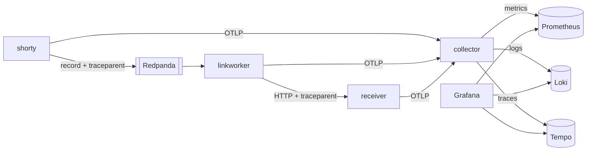

<div dir="rtl" lang="he">

# פרק 24: טלמטריה: OpenTelemetry, Prometheus, Grafana ו־Loki

שירות בייצור הוא קופסה שחורה עד שהוא מספר על עצמו. כשמשהו נשבר בשלוש בלילה, השאלה היא לא „מה הבאג” אלא
„איפה בכלל להסתכל”, והתשובה תלויה במה שהשירות פולט: מדדים, לוגים ומעקבים. מודעות לתפקידי SRE ופלטפורמה
מבקשות במפורש בעלות על ניטור ותורנות (ראי `01-market-research.md`, סעיפים 1.3 ו־1.4), וראיון בכיר בודק אם את יודעת
לחבר את שלושת האותות לסיפור אחד.

בפרק תכשירי את `shorty` מפרק 6 ואת המקבל מפרק 8 ב־OpenTelemetry. תריצי מחסנית מלאה של חמישה רכיבים
(הם מפורטים בסעיף 24.1.2), ותעבירי מעקב אחד דרך הודעת Kafka. אותה מחסנית, אותו דשבורד ואותו
דפוס של חוקים ישמשו את פרק 25 ואת Hookline באבן הדרך M8.

## מה נלמד בפרק

- מה כל אחד משלושת האותות עונה, ואיך מזהה מעקב (trace ID) קושר ביניהם.
- הגדרת OpenTelemetry ב־Go: ספקים, מייצאים והפצת הקשר, ו־`otelhttp` כשכבת middleware.
- אותו דבר ב־Python עם FastAPI, ולמה שם מעבירים ספקים במפורש.
- המודל של Prometheus: סדרות, סוגי מדדים, ושאילתות PromQL שמריצים בעצמך.
- RED לשירות ו־USE למשאב, ודשבורד Grafana שנטען מקובץ.
- לוגים ב־Loki ומעקבים ב־Tempo, עם קפיצה מלוג למעקב ובחזרה.
- הפצת הקשר המעקב (trace context) דרך הכותרות של רשומה ב־Kafka.

## ידע מקדים

- פרק 6: `shorty`, ה־middleware שלו, הלוגר ומזהה הבקשה (סעיפים 6.2 ו־6.4), והכיבוי המסודר (סעיף 6.5).
- פרק 8: המקבל ב־FastAPI, ה־lifespan והחתימה (סעיפים 8.4 עד 8.7).
- פרק 13: Redpanda והכתיבה והקריאה של רשומות עם franz-go.
- פרק 19: בניית image רב־שלבית ו־compose עם healthcheck. התרגיל מעתיק את ה־Dockerfiles משם.
- פרק 2: כל הכלים מותקנים, וגם `python3` זמין ב־WSL2.

## 24.1 שלושת האותות

תצפיתיות (observability) היא היכולת לענות על שאלות על מערכת רצה בלי לשנות אותה. היא נשענת על שלושה סוגי
נתונים, שנקראים אותות (signals), וכל אחד עונה על שאלה אחרת:

| אות | מה הוא | השאלה שהוא עונה | מחיר |
| --- | --- | --- | --- |
| מדד (metric) | מספר שנמדד לאורך זמן, מצטבר בתהליך ונשלח כל כמה שניות | „כמה, וכמה מהר?” | זול: גודל קבוע, לא תלוי בכמות הבקשות |
| לוג (log) | רשומה אחת לאירוע אחד, עם שדות | „מה בדיוק קרה כאן?” | יקר יחסית: גדל עם כל בקשה |
| מעקב (trace) | עץ של spans לבקשה אחת, דרך כל השירותים שהיא עברה | „איפה הזמן הלך, ואיפה זה נכשל?” | יקר: לרוב דוגמים חלק מהבקשות |

ה־span (יחידת העבודה של מעקב: פעולה אחת עם התחלה, סוף, שם ותכונות) הוא אבן הבניין של המעקב. ל־span יש
מזהה משלו ומזהה של ה־span ההורה, וכל ה־spans של בקשה אחת חולקים מזהה מעקב אחד בן 16 בתים.

### 24.1.1 מה קושר את האותות

שלושה אותות נפרדים הם שלושה מקומות לחפש בהם. מה שהופך אותם לכלי אחד הוא שהם חולקים מזהים:

- **מזהה המעקב בכל שורת לוג.** שורת שגיאה ב־Loki מובילה בלחיצה למעקב המלא ב־Tempo, ומ־span אפשר לחזור לכל
  השורות של אותה בקשה.
- **דוגמאות (exemplars).** מדד הוא סיכום, ולכן אין בו בקשות. דוגמה היא דגימה אחת שנשמרת ליד הסיכום, עם מזהה
  מעקב של בקשה אמיתית: נקודה על גרף ה־p99 שאפשר ללחוץ עליה ולראות בקשה איטית אחת.
- **אותן תכונות של המשאב.** התכונה `service.name` מופיעה בשלושת האותות, ולכן אותו שם שירות מסנן מדדים, לוגים
  ומעקבים.

הזרימה בעבודה היא כמעט תמיד באותו כיוון: מדד מראה שיש בעיה, דוגמה או מעקב מראים איפה, ולוג מסביר למה.

### 24.1.2 המחסנית של הפרק

OpenTelemetry (תקן פתוח וסט ספריות לפליטת שלושת האותות, שלא קשור לספק מסוים) הוא מה שהשירותים מדברים.
הפרוטוקול שלו נקרא OTLP. השירותים שולחים OTLP ל־collector (תהליך שמקבל טלמטריה, מעבד אותה ומעביר אותה
לאחסון), והוא מפצל לשלושה אחסונים:

<div dir="ltr" align="left">



</div>

למה collector באמצע, ולא כל שירות ישירות לכל אחסון? שלוש סיבות:

- **השירותים מכירים כתובת אחת.** החלפת אחסון, או הוספה של ספק מסחרי, היא שינוי בקובץ אחד ולא פריסה של כל
  השירותים.
- **עיבוד במקום אחד:** מגבלת זיכרון, איגוד למנות, דגימה, הסרת שדות רגישים.
- **השירות לא מחכה לאחסון.** כש־Loki איטי, ה־collector סופג את זה, ולא כל שירות בנפרד.

> **שימי לב:** נכון לאוקטובר 2026, את ה־image של ה־collector לוקחים מ־GHCR. בגרסה המוצמדת, התג
> הרב־ארכיטקטורי פורסם רק שם, ולא ב־Docker Hub. הפרטים בנספח ג.

## 24.2 OpenTelemetry ב־Go

ל־OpenTelemetry ב־Go יש שתי שכבות, וההפרדה ביניהן היא העיקר:

| שכבה | מודול | מי משתמש בה |
| --- | --- | --- |
| API | `go.opentelemetry.io/otel` | כל ספרייה שרוצה לפלוט טלמטריה: `otelhttp`, `kotel`, הקוד שלך |
| SDK | `go.opentelemetry.io/otel/sdk` ותתי־המודולים שלו | רק `main`: מחליט לאן הנתונים הולכים |

ספרייה שתלויה רק ב־API לא עושה כלום עד שמישהו מתקין SDK. לכן ספריות יכולות להיות מכושרות מראש בלי לכפות
עלייך דבר, והתוכנית מחליטה פעם אחת, בעלייה, מה קורה לנתונים.

### 24.2.1 ספקים, מייצאים ו־resource

ההגדרה כולה נמצאת בפונקציה אחת, `Setup` (הקובץ `internal/telemetry/telemetry.go`). זה החלק של המעקבים
והמדדים:

<div dir="ltr" align="left">

```go
	traceExp, err := otlptracehttp.New(ctx)
	if err != nil {
		return nil, err
	}
	tp := sdktrace.NewTracerProvider(
		sdktrace.WithResource(res),
		sdktrace.WithBatcher(traceExp), // spans leave in batches, off the request path
	)

	metricExp, err := otlpmetrichttp.New(ctx)
	if err != nil {
		return nil, errors.Join(err, tp.Shutdown(ctx))
	}
	mp := sdkmetric.NewMeterProvider(
		sdkmetric.WithResource(res),
		sdkmetric.WithReader(sdkmetric.NewPeriodicReader(metricExp)),
	)
```

</div>

| מושג | מה הוא | כאן |
| --- | --- | --- |
| מייצא (exporter) | שולח נתונים החוצה | OTLP ב־HTTP, לכתובת שב־`OTEL_EXPORTER_OTLP_ENDPOINT` |
| ספק (provider) | המפעל של tracers או meters, ומחזיק את המייצאים | אחד לכל אות |
| batcher | אוסף spans ושולח אותם במנות, ב־goroutine נפרדת | הבקשה לא מחכה לרשת |
| קורא תקופתי (periodic reader) | אוסף את המדדים כל פרק זמן ומייצא | כל 5 שניות, לפי `OTEL_METRIC_EXPORT_INTERVAL` |
| resource | התכונות של התהליך עצמו | `service.name`, `service.version`, `service.instance.id` |

אין בקוד אף כתובת: המייצאים קוראים את משתני הסביבה הסטנדרטיים. הפונקציה `newResource` בונה את תיאור התהליך
מקבוצת המוסכמות (semantic conventions: שמות התכונות שכל מימושי OpenTelemetry מסכימים עליהם). החבילה היא
`semconv/v1.43.0`, אותה גרסה שה־SDK עצמו מייבא, וכדאי לא לערבב גרסאות. אחרי הספקים באה ההתקנה:

<div dir="ltr" align="left">

```go
	otel.SetTracerProvider(tp)
	otel.SetMeterProvider(mp)
	otel.SetLoggerProvider(lp)
	otel.SetTextMapPropagator(propagation.NewCompositeTextMapPropagator(
		propagation.TraceContext{}, // the traceparent and tracestate headers
		propagation.Baggage{},
	))
```

</div>

ה־propagator הוא מה שכותב את הקשר המעקב לכותרות של בקשה יוצאת וקורא אותו מבקשה נכנסת. `TraceContext`
מממש את התקן של W3C, ובו הכותרת `traceparent`. בלי השורה הזאת כל שירות פותח מעקב חדש, והשרשרת נשברת בכל
קפיצה.

ו־`Setup` מחזירה פונקציית כיבוי. ב־`main` היא רצה בסוף, עם context חדש של חמש שניות. הסיבה: ה־context
הראשי כבר בוטל כשמגיעים לשם, בדיוק כמו בכיבוי המסודר של סעיף 6.5:

<div dir="ltr" align="left">

```go
	// Telemetry first: the logger, otelhttp and kotel all use the globals it sets.
	shutdown, err := telemetry.Setup(ctx, "shorty", version)
	if err != nil {
		return err
	}
	defer func() {
		// ctx is cancelled by now; the flush gets a few seconds of its own.
		flushCtx, cancel := context.WithTimeout(context.Background(), 5*time.Second)
		defer cancel()
		if err := shutdown(flushCtx); err != nil {
			fmt.Fprintln(os.Stderr, "shorty: telemetry shutdown:", err)
		}
	}()
```

</div>

בלי הכיבוי, ה־spans האחרונים שבמנה שעוד לא נשלחה פשוט אובדים, ודווקא הם מתעדים את מה שקרה לפני שהתהליך
נעצר.

> **איך Rust עושה את זה:** ב־Rust ה־crate `opentelemetry` מחולק באותה צורה לשתי שכבות. בדרך כלל מחברים
> אותו ל־`tracing`, כך שכל פונקציה מסומנת הופכת ל־span. ב־Go אין שכבת מעקב משותפת כזאת: ה־spans באים
> מספריות מכושרות, או מקריאה מפורשת ל־`tracer.Start`.

### 24.2.2 ה־middleware של `otelhttp`

הספרייה `otelhttp` יוצרת span של שרת לכל בקשה, וממשיכה מעקב שהגיע בכותרת `traceparent`. היא גם מקליטה
מדד של משך הבקשות, `http.server.request.duration`. הנה שרשרת ה־middleware החדשה (הקובץ `internal/app/app.go`):

<div dir="ltr" align="left">

```go
	return platform.Chain(mux,
		platform.RoutePattern(mux),
		otelhttp.NewMiddleware("shorty",
			// Health checks every few seconds are noise in traces and in the SLI.
			otelhttp.WithFilter(func(r *http.Request) bool { return r.URL.Path != "/healthz" }),
		),
		platform.RequestID,
		platform.AccessLog(log),
		platform.Recover(log),
	)
```

</div>

הסדר חשוב. `otelhttp` מחוץ ללוג הגישה, כדי שכשלוג הגישה כותב, ה־span כבר ב־context והשורה תישא את מזהה
המעקב. והיא מחוץ להתאוששות, כדי שה־500 שההתאוששות מייצרת יירשם ב־span ובמדד.

השכבה הראשונה, `RoutePattern`, היא תיקון לבעיה שקל לא לראות. הנתב של Go כותב את התבנית שנבחרה, כמו
`GET /{code}`, לשדה `r.Pattern` של הבקשה שהוא קיבל. אבל `RequestID` מעביר הלאה עותק של הבקשה עם context
חדש, והנתב כותב לעותק. השכבות שבחוץ, ובהן `otelhttp`, לא רואות את התבנית, וה־span נקרא סתם `GET`. הפתרון
הוא לשאול את הנתב מראש (הקובץ `internal/platform/route.go`):

<div dir="ltr" align="left">

```go
		return http.HandlerFunc(func(w http.ResponseWriter, r *http.Request) {
			if _, pattern := mux.Handler(r); pattern != "" {
				r = r.WithContext(r.Context()) // a shallow copy; never modify the caller's request
				r.Pattern = pattern
			}
			next.ServeHTTP(w, r)
		})
```

</div>

למה זה כל כך חשוב? כי התבנית הופכת ל־label בשם `http_route` במדד. התבנית `/{code}` היא ערך אחד; הנתיב
עצמו, `/abc123`, הוא ערך חדש לכל קוד מקוצר, וכל ערך הוא סדרה חדשה ב־Prometheus. זו בעיית הקרדינליות
(cardinality: מספר הצירופים השונים של labels), והיא דרך נפוצה להפיל מערכת מדדים.

### 24.2.3 לוגים עם מזהה המעקב

הלוגר של פרק 6 הוסיף את מזהה הבקשה מה־context. עכשיו הוא מוסיף גם את מזהה המעקב ואת מזהה ה־span (הקובץ
`internal/platform/logging.go`):

<div dir="ltr" align="left">

```go
func (h contextHandler) Handle(ctx context.Context, r slog.Record) error {
	id := RequestIDFrom(ctx)
	sc := trace.SpanContextFromContext(ctx)
	if id != "" || sc.IsValid() {
		r = r.Clone() // records share state; never modify one you were handed
		if id != "" {
			r.AddAttrs(slog.String("request_id", id))
		}
		if sc.IsValid() {
			r.AddAttrs(
				slog.String("trace_id", sc.TraceID().String()),
				slog.String("span_id", sc.SpanID().String()),
			)
		}
	}
	return h.Handler.Handle(ctx, r)
}
```

</div>

הלוגים צריכים להגיע גם ל־Loki. יש שתי דרכים: לקרוא את ה־stdout של הקונטיינרים, או לשלוח כל רשומה ב־OTLP.
התרגיל בוחר ב־OTLP, דרך הגשר `otelslog`. הגשר הופך כל רשומת לוג לרשומה של OpenTelemetry, ולוקח את מזהה
המעקב מה־context בעצמו. הפונקציה `NewLogger` מקבלת handlers נוספים ומפצלת אליהם:

<div dir="ltr" align="left">

```go
func NewLogger(w io.Writer, level slog.Leveler, also ...slog.Handler) *slog.Logger {
	var h slog.Handler = contextHandler{slog.NewJSONHandler(w, &slog.HandlerOptions{Level: level})}
	if len(also) > 0 {
		h = slog.NewMultiHandler(append([]slog.Handler{h}, also...)...)
	}
	return slog.New(minLevel{h, level})
}
```

</div>

שני פרטים. ה־`contextHandler` עוטף רק את ה־JSON, כי הגשר כבר מכניס את המעקב לשדות הייעודיים של רשומת
OTLP, ושדה כפול רק מבלבל. ו־`minLevel` מחיל את הרמה על כל ה־handlers, כי לגשר אין אפשרות רמה משלו. בלעדיו
גם שורות הניפוי היו מגיעות ל־Loki. ב־`main` הקריאה היא:

<div dir="ltr" align="left">

```go
	log := platform.NewLogger(os.Stdout, cfg.LogLevel, otelslog.NewHandler("shorty"))
```

</div>

### 24.2.4 לבדוק טלמטריה בלי רשת

הבדיקות לא שולחות כלום החוצה. הן מתקינות ספקים שכותבים לזיכרון, וקוראות מהם (הקובץ
`internal/app/telemetry_test.go`):

<div dir="ltr" align="left">

```go
var (
	spans  = tracetest.NewInMemoryExporter()
	reader = sdkmetric.NewManualReader()
)

func TestMain(m *testing.M) {
	otel.SetTracerProvider(sdktrace.NewTracerProvider(sdktrace.WithSyncer(spans)))
	otel.SetMeterProvider(sdkmetric.NewMeterProvider(sdkmetric.WithReader(reader)))
	os.Exit(m.Run())
}
```

</div>

ארבע הבדיקות בקובץ בודקות:

- שה־span נקרא לפי התבנית, ולא לפי הנתיב.
- שלנתוני המדד יש תבנית וקוד סטטוס.
- ששורת לוג הגישה נושאת את מזהה המעקב של ה־span.
- שכשל בפרסום נותן 503, וה־span שלו מסומן כשגיאה.

התחליף הגלובלי הוא פשרה: הבדיקות בחבילה הזאת לא רצות במקביל. החלופה היא להעביר ספקים לכל רכיב
במפורש, וב־Python זו באמת הדרך (סעיף 24.3).

## 24.3 OpenTelemetry ב־Python

ב־Python אותם מושגים בדיוק: resource, ספק לכל אות, מייצא OTLP ב־HTTP. ההבדל הוא שהמודול `receiver.telemetry`
לא מתקין את הספקים כגלובליים, ובכוונה: ה־API של Python מרשה להגדיר את ספק המעקבים הגלובלי פעם אחת בלבד
בתהליך. בדיקה שרוצה ספק בזיכרון לא יכולה להחליף אותו אחרי שמישהו כבר הגדיר. לכן `setup_telemetry` מחזירה את
הספקים, ומי שצריך אותם מקבל אותם (הקובץ `src/receiver/telemetry.py`):

<div dir="ltr" align="left">

```python
def setup_telemetry(
    service_name: str = "receiver",
    *,
    span_processor: SpanProcessor | None = None,
    metric_reader: MetricReader | None = None,
    log_exporter: LogRecordExporter | None = None,
) -> Telemetry:
    """Build the three providers. The keyword arguments replace the OTLP exporters (tests)."""
    resource = Resource.create(
        {"service.name": service_name, "service.instance.id": socket.gethostname()}
    )  # Resource.create also reads OTEL_RESOURCE_ATTRIBUTES and OTEL_SERVICE_NAME

    tracer_provider = TracerProvider(resource=resource)
    tracer_provider.add_span_processor(span_processor or BatchSpanProcessor(OTLPSpanExporter()))

    reader = metric_reader or PeriodicExportingMetricReader(OTLPMetricExporter())
    meter_provider = MeterProvider(resource=resource, metric_readers=[reader])

    logger_provider = LoggerProvider(resource=resource)
    logger_provider.add_log_record_processor(
        BatchLogRecordProcessor(log_exporter or OTLPLogExporter())
    )
    return Telemetry(tracer_provider, meter_provider, logger_provider)
```

</div>

הכישור של FastAPI הוא חבילה נפרדת, `opentelemetry-instrumentation-fastapi`, שמוסיפה שכבה ליישום. חבילות
הכישור הן בגרסאות בטא, ממוספרות בנפרד מה־SDK. לכן הן מוצמדות בדיוק ב־`pyproject.toml`, כי בטא יכולה
להשתנות בין גרסאות (הצמדות נכון לאוקטובר 2026 בנספח ג). החיבור עצמו:

<div dir="ltr" align="left">

```python
def instrument(app: FastAPI, telemetry: Telemetry) -> None:
    """Server spans and http.server.request.duration for every route except /stats and /control."""
    # The Python instrumentations still emit the old HTTP conventions (http.server.duration in
    # milliseconds) unless asked for the stable ones, which the Go services and the dashboard use.
    os.environ.setdefault("OTEL_SEMCONV_STABILITY_OPT_IN", "http")
    FastAPIInstrumentor.instrument_app(
        app,
        tracer_provider=telemetry.tracer_provider,
        meter_provider=telemetry.meter_provider,
        excluded_urls="stats,control,receipts,reset",
        exclude_spans=["receive", "send"],  # no extra spans per ASGI message
    )
```

</div>

> **טעות נפוצה:** לשכוח את `OTEL_SEMCONV_STABILITY_OPT_IN`. בלעדיו הכישור של Python פולט את המדד בשם הישן,
> `http.server.duration`, באלפיות שנייה, ושירות Python לא מופיע בדשבורד שבנוי על השם היציב ובשניות. כשמערבבים
> שפות, המוסכמות צריכות להיות אותן מוסכמות.

ללוגים יש שני מסלולים, כמו ב־Go. ה־handler ששולח ב־OTLP לוקח את המעקב מה־span הנוכחי. הוא בא מהחבילה
`opentelemetry-instrumentation-logging`, כי זה שב־SDK מסומן כמיושן. לשורות הטקסט ב־stderr יש מסנן קטן
שמוסיף את המזהים:

<div dir="ltr" align="left">

```python
class TraceContextFilter(logging.Filter):
    """Adds trace_id and span_id of the current span to every record (empty strings outside one)."""

    @override
    def filter(self, record: logging.LogRecord) -> bool:
        context = trace.get_current_span().get_span_context()
        record.trace_id = format(context.trace_id, "032x") if context.is_valid else ""
        record.span_id = format(context.span_id, "016x") if context.is_valid else ""
        return True
```

</div>

הפורמט `032x` חשוב: מזהה מעקב הוא מספר בן 128 ביט, וההצגה הסטנדרטית היא 32 ספרות הקסדצימליות עם אפסים
מובילים. בלעדיו, מזהה שמתחיל באפס לא יימצא בחיפוש. בקובץ `main.py` הסדר הוא טלמטריה, לוגים, יישום,
כישור והרצה. ההרצה מקבלת `log_config=None`, כדי שהשרת לא ידרוס את הגדרת הלוגים.

## 24.4 Prometheus: מדדים ו־PromQL

Prometheus שומר סדרות זמן (time series). סדרה היא שם מדד ועוד קבוצת labels, ולכל סדרה רשימה של זוגות זמן
וערך. כל צירוף חדש של labels הוא סדרה חדשה. הנה שתיים מהמחסנית, עם חלק מה־labels בלבד:

<div dir="ltr" align="left">

```text
http_server_request_duration_seconds_count{job="shorty", http_route="/{code}", http_request_method="GET", http_response_status_code="302"}
http_server_request_duration_seconds_count{job="shorty", http_route="/{code}", http_request_method="GET", http_response_status_code="404"}
```

</div>

### 24.4.1 שלושה סוגי מדדים

| סוג | מה הוא | דוגמה כאן | איך קוראים אותו |
| --- | --- | --- | --- |
| counter | רק עולה (ומתאפס כשהתהליך עולה מחדש) | `linkworker_deliveries_total` | תמיד דרך `rate` או `increase` |
| gauge | עולה ויורד | `go_goroutine_count` | כמו שהוא, או `avg_over_time` |
| histogram | ספירה של מדידות לפי דליים (buckets), ועוד סכום וספירה | `http_server_request_duration_seconds` | `histogram_quantile` על `rate` של הדליים |

ה־histogram הוא הסוג שהכי חשוב להבין. במקום לשמור כל משך זמן, הוא סופר כמה בקשות נגמרו תוך 5 אלפיות, תוך
10, וכן הלאה, עד 10 שניות. ב־Prometheus כל דלי הוא סדרה עם label בשם `le` („קטן או שווה”), והדליים
מצטברים: הדלי `le="0.25"` כולל את כל מה שבדלי `le="0.1"`. מזה אפשר להעריך אחוזונים בלי לשמור את המדידות.
המחיר: האחוזון הוא הערכה, והדיוק שלו תלוי בגבולות הדליים.

### 24.4.2 איך המדדים מגיעים

שתי דרכים להכניס מדדים ל־Prometheus:

| דרך | איך | יתרון | חיסרון |
| --- | --- | --- | --- |
| גירוד (scrape) | Prometheus שולף כל 15 שניות את `/metrics` מכל שירות | Prometheus יודע מי למטה (`up == 0`) | צריך לגלות את השירותים ולהגיע אליהם |
| דחיפה ב־OTLP | השירות שולח ל־collector, וה־collector ל־Prometheus | צינור אחד לשלושת האותות; שירותים קצרים לא נעלמים | מי שלא שולח פשוט שותק |

התרגיל בוחר בדחיפה: הקולט של OTLP ב־Prometheus 3, מאחורי ה־collector. כך יש לשלושת האותות צינור אחד וכתובת
אחת, ושם המדד ב־Prometheus יוצא מהמוסכמות של OpenTelemetry. החלופה, מייצא ב־collector
ש־Prometheus מגרד ממנו, עובדת גם היא ומוסיפה קפיצה. הדגלים מהקובץ `data/compose.yaml`:

<div dir="ltr" align="left">

```yaml
    command:
      - --config.file=/etc/prometheus/prometheus.yml
      - --web.enable-otlp-receiver # accept OTLP metrics at /api/v1/otlp/v1/metrics
      - --enable-feature=exemplar-storage # keep the trace IDs attached to histogram samples
      - --web.enable-lifecycle # POST /-/reload after editing rules
      - --storage.tsdb.retention.time=2d
```

</div>

והחלק הרלוונטי בתצורה (הקובץ `data/prometheus.yml`):

<div dir="ltr" align="left">

```yaml
otlp:
  # service.name becomes the job label and service.instance.id the instance
  # label by default. Promote the few resource attributes worth querying by;
  # the rest stay in the target_info series.
  promote_resource_attributes:
    - service.version
    - deployment.environment.name

storage:
  tsdb:
    # Pushed samples can arrive slightly late or out of order; accept them.
    out_of_order_time_window: 30m
```

</div>

התרגום של השמות הוא מכני, וכדאי להכיר אותו כי בו תחפשי:

| ב־OpenTelemetry | ב־Prometheus |
| --- | --- |
| `http.server.request.duration`, יחידה `s`, histogram | `http_server_request_duration_seconds_bucket`, `_count`, `_sum` |
| `linkworker.deliveries`, counter | `linkworker_deliveries_total` |
| תכונה `http.response.status_code` | label `http_response_status_code` |
| `service.name` במשאב | label `job` |

### 24.4.3 PromQL שאת מריצה

PromQL היא שפת השאילתות של Prometheus. את לומדת אותה הכי מהר כשמריצים. עם המחסנית למעלה ותנועה רצה (ראי
התרגיל), הנה ארבע הפונקציות שתשתמשי בהן כל יום. השאילתה הראשונה, קצב הבקשות לשנייה של `shorty`:

<div dir="ltr" align="left">

```bash
curl -s --get http://localhost:9090/api/v1/query \
  --data-urlencode 'query=sum(rate(http_server_request_duration_seconds_count{job="shorty"}[1m]))'
```

</div>

| פונקציה | מה היא עושה | למה |
| --- | --- | --- |
| `rate(c[1m])` | שינוי לשנייה של counter, בממוצע על הדקה האחרונה | counter גולמי הוא מספר שרק עולה, ולא אומר כלום לבד |
| `increase(c[1h])` | כמה ה־counter עלה בשעה | „כמה שגיאות היו בשעה האחרונה” |
| `sum by (http_route) (...)` | מסכם את כל הסדרות, ומשאיר רק את ה־label שנבחר | מאחד את כל העותקים והסטטוסים |
| `histogram_quantile(0.99, ...)` | מעריך אחוזון מדליים | ה־p99 של זמן התגובה |

שני כללים שחוסכים שעות. **קודם `rate`, אחר כך `sum`:** הפונקציה הראשונה יודעת לטפל באיפוס של counter כשתהליך
עולה מחדש, אבל רק על סדרה אחת. סכום של counters גולמיים מאבד את המידע הזה. ו־**ל־`histogram_quantile` חייבים
להשאיר את `le`:**

<div dir="ltr" align="left">

```bash
curl -s --get http://localhost:9090/api/v1/query --data-urlencode \
  'query=histogram_quantile(0.99, sum by (le) (rate(http_server_request_duration_seconds_bucket{job="shorty"}[5m])))'
```

</div>

בלי `le` בתוך ה־`by`, הדליים מסוכמים לערך אחד, והפונקציה מחזירה תוצאה ריקה בלי שום הודעת שגיאה. את
התשובות שלך תרשמי בפתק; הן תלויות בתנועה שלך ובמחשב שלך.

## 24.5 RED ו־USE

שתי שיטות אומרות אילו מדדים צריך, כדי שלא תצטרכי להמציא בכל שירות מחדש.

**RED לשירות** (מה הלקוח מרגיש), שלוש שאלות לכל שירות שעונה לבקשות:

| אות | שאלה | PromQL ל־`shorty` |
| --- | --- | --- |
| Rate | כמה בקשות לשנייה? | `sum by (http_route) (rate(http_server_request_duration_seconds_count{job="shorty"}[1m]))` |
| Errors | איזה חלק מהן נכשל? | 5xx חלקי הכול, ראי הדשבורד |
| Duration | כמה זמן הן לוקחות? | `histogram_quantile` על הדליים, p50, p95 ו־p99 |

שימי לב לשאלה מה נחשב שגיאה. 404 על קוד שלא קיים הוא תשובה נכונה של `shorty`, לא כשל שלו. לכן ה־E של
`shorty` סופר רק 5xx. זו החלטה, והיא תחזור בפרק 25 כשתגדירי מה הלקוח מקבל.

**USE למשאב** (מה מגביל את המערכת), שלוש שאלות לכל משאב: מעבד, דיסק, חיבורים, תור, או עובד. ב־`linkworker`
המשאב הוא העובד עצמו, שמטפל ברשומה אחת בכל פעם. שלושת המכשירים שלו (הקובץ `internal/linkworker/worker.go`):

<div dir="ltr" align="left">

```go
// Worker handles one record at a time. Its three instruments are USE for the
// worker itself, the resource of section 24.5:
//
//	linkworker.busy        seconds spent handling records (utilization: its rate)
//	linkworker.wait        seconds a record waited between produce and handling (saturation)
//	linkworker.deliveries  handled records by outcome (errors)
```

</div>

| אות | שאלה | איך נמדד |
| --- | --- | --- |
| Utilization | כמה מהזמן העובד עסוק? | `rate(linkworker_busy_seconds_total[1m])`: שניות עבודה לכל שנייה; 1.0 הוא עסוק תמיד |
| Saturation | כמה עבודה מחכה? | p95 של `linkworker_wait_seconds`: הזמן מכתיבת הרשומה עד תחילת הטיפול |
| Errors | כמה נכשלו? | `linkworker_deliveries_total{outcome="error"}` |

הטריק במדד הניצולת הוא counter של שניות: כל רשומה מוסיפה את משך הטיפול בה, וה־`rate` של זה הוא בדיוק
החלק של הזמן שבו העובד עבד. והרוויה נמדדת בזמן המתנה ולא באורך התור, כי אורך התור ב־Kafka דורש שאילתה
ל־broker, וזמן ההמתנה נמדד בחינם מחותמת הזמן של הרשומה. כשהרוויה עולה בזמן שהניצולת קרובה ל־1, העובד לא
עומד בקצב, וזה הרגע להוסיף partitions ועובדים.

## 24.6 Grafana

Grafana מציגה נתונים ממקורות (datasources) ואינה שומרת נתונים בעצמה. כל ההגדרה שלה בתרגיל נטענת מקבצים בעלייה
(provisioning), ולכן היא זהה בכל מחשב ושורדת `down -v`. מקורות הנתונים (הקובץ
`data/grafana/provisioning/datasources/datasources.yaml`) מקבלים `uid` קבוע, כי הדשבורד והקישורים בין
המקורות מפנים אליו:

<div dir="ltr" align="left">

```yaml
  - name: Prometheus
    type: prometheus
    uid: prometheus
    access: proxy
    url: http://prometheus:9090
    isDefault: true
    editable: false
    jsonData:
      # An exemplar is a sample that carries a trace ID: show it as a link to Tempo.
      exemplarTraceIdDestinations:
        - name: trace_id
          datasourceUid: tempo
```

</div>

ה־`$$` בקובץ, למשל ב־`$${__trace.traceId}`, הוא בריחה: Grafana מחליפה `$NAME` במשתני סביבה בקבצים
שהיא טוענת, ו־`$$` אומר „דולר אמיתי”.

הדשבורד עצמו הוא קובץ JSON בשם „RED overview”, בתיקייה של הדשבורדים: `data/grafana/dashboards/red.json`. בראשו משתנה בשם `job`
שהאפשרויות שלו נשלפות מ־Prometheus, וכל השאילתות משתמשות בו. כך אותו דשבורד משמש את `shorty`, את
`receiver` ואת השירותים של Hookline. הנה הפאנל של השגיאות, כפי שהוא ב־JSON:

<div dir="ltr" align="left">

```json
        {
          "refId": "A",
          "datasource": {
            "type": "prometheus",
            "uid": "prometheus"
          },
          "expr": "sum(rate(http_server_request_duration_seconds_count{job=\"$job\", http_response_status_code=~\"5..\"}[$__rate_interval])) / sum(rate(http_server_request_duration_seconds_count{job=\"$job\"}[$__rate_interval]))",
          "legendFormat": "5xx ratio",
          "exemplar": false
        }
```

</div>

המשתנה `$__rate_interval` של Grafana בוחר חלון ל־`rate` שתמיד מכיל לפחות כמה דגימות, לפי רזולוציית הגרף.
חלון קבוע וקצר מדי, כמו `[10s]` כשמדדים מגיעים כל 5 שניות, נותן גרף קופצני או ריק. ובפאנל של זמן התגובה
הדגל `exemplar` דולק: הנקודות על הקו הן דוגמאות, ולחיצה עליהן פותחת את המעקב ב־Tempo.

> **שימי לב:** הספק של הדשבורדים מוגדר עם `allowUiUpdates`, אז אפשר לערוך בממשק. אבל מה שנשמר בממשק לא חוזר
> לקובץ. אחרי עריכה, ייצאי את הדשבורד (בתפריט השיתוף) והחליפי את הקובץ. אחרת השינוי ייעלם בהורדה הבאה של
> המחסנית.

## 24.7 Loki ולוגים

Loki שומר לוגים בגישה שונה ממנוע חיפוש. הוא לא מאנדקס את תוכן השורות, רק כמה labels לכל זרם (stream), ובזמן
שאילתה סורק את השורות של הזרמים שנבחרו. הגישה הזאת זולה לאחסון, ומחייבת משמעת: labels מעטים עם מעט ערכים.

לוגים שמגיעים ב־OTLP מתפצלים בשלושה אופנים:

| מה | איפה ב־Loki | דוגמה |
| --- | --- | --- |
| תכונות המשאב הנפוצות | labels של הזרם, באינדקס | `service_name`, `service_instance_id` |
| תכונות של הרשומה, מזהה המעקב וה־span | מטא־נתונים מובנים (structured metadata): שדות על כל שורה, לא באינדקס | `trace_id`, `code`, `error` |
| גוף הרשומה | השורה עצמה | `request`, `link created` |

זו בדיוק ההפרדה הנכונה. אילו מזהה המעקב היה label, כל בקשה הייתה זרם חדש, ו־Loki היה קורס תחת
הקרדינליות. כמטא־נתונים, אפשר לסנן לפיו בזול בתוך זרם. שאילתת LogQL (שפת השאילתות של Loki) שמחזירה את
כל השורות של מעקב אחד, משלושת השירותים:

<div dir="ltr" align="left">

```text
{service_name=~"shorty|linkworker|receiver"} | trace_id="<the trace id>"
```

</div>

החלק בסוגריים המסולסלים בוחר זרמים לפי labels, וחייב להיות בו לפחות תנאי אחד שאינו ריק. מה שאחרי הקו
האנכי מסנן שורות. ב־Grafana, השדה `trace_id` של כל שורה הופך לקישור למעקב. זה שדה נגזר (derived field)
במקור הנתונים של Loki:

<div dir="ltr" align="left">

```yaml
      derivedFields:
        - name: trace_id
          matcherType: label
          matcherRegex: trace_id
          datasourceUid: tempo
          url: "$${__value.raw}"
          urlDisplayLabel: Open trace
```

</div>

**למה ה־collector ולא Alloy.** ‏Alloy הוא ההפצה של ה־collector מבית Grafana, עם שפת תצורה משלה. הוא יודע
גם לקרוא קבצי לוג של קונטיינרים. התרגיל צריך רק OTLP פנימה ושלושה יעדים החוצה, וה־collector עושה את זה
בתצורת YAML שהיא אותה תצורה בכל ספק, כולל ספקים מסחריים. Alloy היה מנצח אילו היינו צריכים לגרד קבצי לוג
של תהליכים שאינם מכושרים. הצינורות (הקובץ `data/otel-collector.yaml`):

<div dir="ltr" align="left">

```yaml
service:
  extensions: [health_check]
  pipelines:
    traces:
      receivers: [otlp]
      processors: [memory_limiter, batch]
      exporters: [otlp_grpc/tempo]
    metrics:
      receivers: [otlp]
      processors: [memory_limiter, batch]
      exporters: [otlp_http/prometheus]
    logs:
      receivers: [otlp]
      processors: [memory_limiter, batch]
      exporters: [otlp_http/loki]
```

</div>

> **טעות נפוצה:** להעתיק תצורת collector ישנה עם המייצאים `otlp` ו־`otlphttp`. בגרסה המוצמדת שמותיהם
> `otlp_grpc` ו־`otlp_http`. את רשימת הרכיבים של image מסוים אפשר לבקש מהקובץ
> הבינארי שבו, בפקודה `components`.

## 24.8 Tempo ומעקבים

Tempo שומר מעקבים ומחזיר אותם לפי מזהה, או לפי חיפוש. נכון לאוקטובר 2026 Tempo בגרסה 3, ובמצב החד־תהליכי
(`-target=all`) כל הרכיבים רצים בתהליך אחד, בלי Kafka פנימי ועם דיסק מקומי. התצורה שלו בתרגיל קצרה
(הקובץ `data/tempo.yaml`).

מעקב הוא עץ. לכל span יש סוג (kind) שאומר את תפקידו בקריאה:

| סוג | מתי | דוגמה במעקב של התרגיל |
| --- | --- | --- |
| server | מקבל בקשה | `POST /v1/links` ב־`shorty`, `POST /hooks/{name}` במקבל |
| client | שולח בקשה | `HTTP POST` ב־`linkworker` |
| producer | כותב הודעה | `links.created publish` |
| consumer | קורא ומטפל בהודעה | `links.created receive`, `links.created process` |
| internal | עבודה בתוך תהליך | (אין בתרגיל) |

כך נראה מעקב אחד של יצירת קישור, מהבקשה ל־`shorty` ועד המקבל:

<div dir="ltr" align="left">

```text
shorty      POST /v1/links                 server
shorty        links.created publish        producer
linkworker      links.created receive      consumer
linkworker        links.created process    consumer
linkworker          HTTP POST              client
receiver              POST /hooks/{name}   server
```

</div>

מעקב לפי מזהה מבקשים ב־API של Tempo, וזה מה שבדיקת המחסנית עושה:

<div dir="ltr" align="left">

```bash
curl -s http://localhost:3200/api/traces/<the trace id>
```

</div>

במסך Explore של Grafana אפשר לחפש מעקבים בשפה TraceQL. השאילתה הבאה מוצאת מעקבים שבהם span של `shorty` נכשל:

<div dir="ltr" align="left">

```text
{ resource.service.name = "shorty" && status = error }
```

</div>

מכל span, הכפתור של הלוגים פותח ב־Loki את השורות של אותו מעקב. זו ההגדרה `tracesToLogsV2` במקור הנתונים
של Tempo.

**דגימה.** התרגיל שומר כל מעקב. במערכת עמוסה זה יקר, ולכן דוגמים, באחת משתי נקודות:

- **בתחילת הבקשה** (head sampling): למשל אחוז אחד מהמעקבים. ההחלטה עוברת הלאה בכותרת.
- **בסופה, ב־collector** (tail sampling): שומרים את כל המעקבים עם שגיאה או האיטיים.

הדגימה בסוף מדויקת יותר, והיא דורשת להחזיק מעקבים שלמים בזיכרון עד שהם נגמרים.

## 24.9 הפצת הקשר דרך Kafka

ב־HTTP, הקשר המעקב עובר בכותרת `traceparent`. גם לרשומת Kafka יש headers (זוגות של מפתח וערך, ליד המפתח
והערך של הרשומה), ובהם הוא עובר באותה צורה בדיוק:

<div dir="ltr" align="left">

```text
traceparent: 00-4bf92f3577b34da6a3ce929d0e0e4736-00f067aa0ba902b7-01
             ^^ ^^^^^^^^^^^^^^^^^^^^^^^^^^^^^^^^ ^^^^^^^^^^^^^^^^ ^^
             version  trace ID (16 bytes)        parent span ID   flags (01 = sampled)
```

</div>

ל־franz-go יש תוסף רשמי ל־OpenTelemetry בשם `kotel`, מודול נפרד באותו מאגר. הגרסה המוצמדת מופיעה בנספח
ג. הוא מתחבר כ־hooks של הלקוח (הקובץ `internal/events/events.go`):

<div dir="ltr" align="left">

```go
func Hooks() (kgo.Opt, *kotel.Tracer) {
	tracer := kotel.NewTracer()
	k := kotel.NewKotel(kotel.WithTracer(tracer))
	return kgo.WithHooks(k.Hooks()...), tracer
}
```

</div>

| צד | hook | מה קורה |
| --- | --- | --- |
| כתיבה | כשרשומה נכנסת למאגר של הלקוח | נפתח span של `publish`, כילד של ההקשר שהרשומה נושאת; הכותרת `traceparent` נכתבת לרשומה |
| כתיבה | כשה־broker אישר | ה־span נסגר, עם ה־partition, ה־offset או השגיאה |
| קריאה | כשרשומה נקראה | ההקשר נשלף מה־headers, ו־span של `receive` נפתח כילד שלו |
| טיפול | הקוד שלך קורא ל־`WithProcessSpan` | span של `process`, ילד של ה־receive; כל מה שהקוד עושה נכנס מתחתיו |

הצד הכותב מעביר את ה־context של הבקשה ברשומה עצמה, ומחכה לאישור (מאותו קובץ):

<div dir="ltr" align="left">

```go
	ctx, cancel := context.WithTimeout(ctx, p.timeout)
	defer cancel()
	rec := &kgo.Record{Key: []byte(ev.Code), Value: value, Context: ctx}
	if err := p.client.ProduceSync(ctx, rec).FirstErr(); err != nil {
		return fmt.Errorf("publish to %s: %w", p.topic, err)
	}
```

</div>

והצד הקורא פותח את ה־span של הטיפול, וכל מה שבתוכו, הלוג והקריאה למקבל, יורש ממנו (הקובץ
`internal/linkworker/worker.go`):

<div dir="ltr" align="left">

```go
func (w *Worker) Handle(r *kgo.Record) error {
	start := w.now()
	ctx, span := w.tracer.WithProcessSpan(r)
	defer span.End()
	w.wait.Record(ctx, start.Sub(r.Timestamp).Seconds())
	defer func() { w.busy.Add(ctx, w.now().Sub(start).Seconds()) }()
```

</div>

הקריאה למקבל עוברת דרך `otelhttp.NewTransport`, שפותח span של לקוח וכותב את הכותרת לבקשה. המקבל
ב־Python ממשיך משם. ארבעה תהליכים, שתי שפות, broker אחד, מעקב אחד.

שתי הערות של בכירה. **הורה או קישור:** כאן ה־span של הצרכן הוא ילד של ה־span של הכותב, וזה טבעי כשכל רשומה
היא תוצאה של בקשה אחת. כשצרכן מעבד מנה של רשומות מבקשות שונות, או כשהטיפול מתעכב בשעות, נכון יותר מעקב חדש
עם קישור (span link) לכותב. ב־`kotel` זו האפשרות `LinkSpans`. **מוסכמות ישנות:** `kotel` כותב תכונות לפי
גרסה ישנה של המוסכמות, למשל `messaging.source.name`, בזמן ש־`otelhttp` כותב לפי החדשות. זה לא שובר את
המעקב, אבל חיפוש לפי שם תכונה צריך לדעת איזו גרסה כתבה אותה.

והבדיקה של הקפיצה לא צריכה broker. היא מפעילה את ה־hooks ביד. קודם את זה של הכתיבה, על רשומה אחת. אחר כך
רשומה חדשה, שיש לה רק את הכותרות של הראשונה, כמו שהצרכן מקבל אותה, עוברת בצד הקורא ובעובד. הבדיקה
בודקת שכל ה־spans באותו מעקב, וש־`traceparent` הגיע למקבל (הקובץ `internal/linkworker/worker_test.go`). בדיקה נוספת,
ב־`internal/events`, עושה את אותו דבר מול Redpanda אמיתי כשמוגדר `KAFKA_BROKERS`.

## סיכום

- שלושה אותות: מדד אומר שיש בעיה, מעקב אומר איפה, לוג אומר למה. מזהה המעקב ודוגמאות קושרים ביניהם.
- השירותים שולחים OTLP ל־collector אחד, והוא מפצל לשלושה אחסונים.
- ב־Go: ספרייה תלויה ב־API, ו־`main` מתקין SDK: resource, ספק ומייצא לכל אות, propagator, וכיבוי שמרוקן.
- ה־middleware של `otelhttp` מחוץ ללוג הגישה ולהתאוששות; התבנית ולא הנתיב, כדי לשמור על קרדינליות.
- ב־Python מעבירים ספקים במפורש, ומבקשים את המוסכמות היציבות של HTTP.
- ב־PromQL: קודם `rate` ואז `sum`; ל־`histogram_quantile` משאירים את `le`.
- RED לשירות (קצב, שגיאות, משך), USE למשאב (ניצולת, רוויה, שגיאות).
- ב־Loki מזהה המעקב הוא מטא־נתונים מובנים ולא label; ב־Tempo מעקב הוא עץ של spans עם סוגים.
- דרך Kafka ההקשר עובר ב־`traceparent` בתוך headers של הרשומה, עם `kotel`.

## מונחים לזכור

| מונח בעברית | באנגלית | במשפט אחד |
| --- | --- | --- |
| תצפיתיות | observability | היכולת לענות על שאלות על מערכת רצה בלי לשנות אותה |
| אות | signal | אחד משלושת סוגי הטלמטריה: מדד, לוג, מעקב |
| מדד | metric | מספר שנמדד לאורך זמן ומסוכם בתהליך |
| מעקב | trace | עץ ה־spans של בקשה אחת דרך כל השירותים |
| span | span | פעולה אחת במעקב, עם התחלה, סוף, הורה ותכונות |
| מזהה מעקב | trace ID | 16 בתים שכל ה־spans והלוגים של בקשה חולקים |
| הקשר מעקב | trace context | מזהה המעקב וה־span הנוכחי, שעוברים בין שירותים |
| דוגמה | exemplar | דגימה של מדד שנושאת מזהה מעקב של בקשה אמיתית |
| resource | resource | התכונות של התהליך שפולט, כמו `service.name` |
| מייצא | exporter | הרכיב ששולח טלמטריה החוצה |
| collector | collector | תהליך שמקבל טלמטריה, מעבד אותה ומעביר לאחסון |
| מוסכמות | semantic conventions | שמות התכונות והמדדים המוסכמים של OpenTelemetry |
| קרדינליות | cardinality | מספר הצירופים השונים של labels, כלומר מספר הסדרות |
| דלי | bucket | טווח במדד histogram, עם label בשם `le` |
| דגימה | sampling | שמירה של חלק מהמעקבים בלבד |
| מטא־נתונים מובנים | structured metadata | שדות על כל שורה ב־Loki שאינם באינדקס |
| RED | RED | קצב, שגיאות ומשך: המדדים של שירות |
| USE | USE | ניצולת, רוויה ושגיאות: המדדים של משאב |

## טעויות נפוצות

- **נתיב גולמי כ־label.** הנתיב `/abc123` במקום התבנית יוצר סדרה לכל קוד ומפיל את Prometheus. ל־labels
  נותנים רק ערכים מקבוצה קטנה.
- **‏`otelhttp` בתוך שכבה שמעתיקה את הבקשה.** ה־span נקרא `GET` בלי תבנית, ולמדד אין תבנית נתיב. התבנית
  צריכה להגיע לכל השכבות.
- **לשכוח את ה־propagator.** כל שירות פותח מעקב חדש, ובמקום מעקב אחד יש ארבעה חתוכים.
- **לא לקרוא לכיבוי של הטלמטריה.** המנה האחרונה של spans ולוגים, זו שמתעדת את הקריסה, לא נשלחת.
- **`sum` לפני `rate` על counters.** איפוס של תהליך אחד נראה כירידה, והקצב יוצא שגוי.
- **`histogram_quantile` בלי `le` ב־`by`.** תוצאה ריקה בלי שגיאה.
- **לסמוך על Grafana שתשמור עריכות.** מה שלא יוצא חזרה לקובץ ה־JSON נעלם בהעלאה הבאה של המחסנית.

## שאלות ראיון

1. **מה ההבדל בין מדדים, לוגים ומעקבים, ומתי תשתמשי בכל אחד?**
   מדד הוא סיכום זול בגודל קבוע, ולכן הוא הבסיס להתראות ולדשבורדים: הוא עונה „כמה” ו„כמה מהר” לאורך זמן.
   לוג מתעד אירוע אחד בפירוט, ועונה „מה קרה בדיוק”, אבל המחיר שלו גדל עם התנועה. מעקב מראה את המסלול של
   בקשה אחת דרך שירותים, ועונה „איפה הזמן הלך”, ולרוב דוגמים אותו. השילוב הוא העיקר: מזהה מעקב בלוגים
   ודוגמאות במדדים, כדי לעבור מגרף לבקשה ומבקשה לשורה.

2. **למה collector, ולא לשלוח ישירות מהשירותים לאחסון?**
   השירות מכיר כתובת אחת, וכל החלטה על יעדים, דגימה, הסרת שדות רגישים או החלפת ספק נעשית במקום אחד בלי
   פריסה של שירותים. ה־collector גם סופג האטות של האחסון. המחיר: עוד רכיב שצריך להפעיל ולנטר, ועוד קפיצה.
   במערכת קטנה מאוד שליחה ישירה סבירה; ככל שיש יותר שירותים ויעדים, collector משתלם.

   **המשך:** איפה מריצים אותו? לרוב גם ליד כל שירות או node (agent) וגם כשכבה מרכזית (gateway). ה־agent
   מוסיף מידע מקומי ושולח מהר, וה־gateway מרכז דגימה בסוף ומפתחות של ספקים.

3. **מה זה קרדינליות, ואיך מונעים פיצוץ שלה?**
   כל צירוף של ערכי labels הוא סדרה נפרדת, עם זיכרון ואינדקס משלה. label עם מזהה משתמש, נתיב גולמי או
   מזהה בקשה מכפיל את מספר הסדרות במספר הערכים, ו־Prometheus מאט או קורס. מונעים בכך שה־labels של מדדים
   הם קבוצה סגורה וקטנה: תבנית נתיב, סטטוס, מתודה. מה שייחודי לבקשה הולך ללוג או למעקב, ושם הוא זול.

4. **איך עובר הקשר מעקב דרך Kafka, ומה צריך לשקול?**
   הכותב כותב את `traceparent` ל־headers של הרשומה, והצרכן שולף אותו ופותח span כילד. השאלה המעניינת היא
   אם להמשיך את אותו מעקב או לפתוח חדש עם קישור. רשומה אחת שנובעת מבקשה אחת וטופלה מיד מתאימה להמשך.
   טיפול במנות, או טיפול שקורה שעות אחר כך, מתאים למעקב חדש עם קישור, אחרת מעקבים נמתחים לשעות ומכילים
   עבודה של בקשות אחרות.

5. **מה RED ומה USE, ולמה צריך את שניהם?**
   RED (קצב, שגיאות, משך) מתאר שירות מנקודת המבט של הלקוח, ועליו בונים התראות. USE (ניצולת, רוויה,
   שגיאות) מתאר משאב, ועוזר למצוא מה מגביל את השירות כש־RED אומר שמשהו לא בסדר. דוגמה: זמן התגובה עולה
   (RED); הניצולת של העובד קרובה ל־1 וזמן ההמתנה עולה (USE), ולכן הבעיה היא קיבולת ולא באג.

   **המשך:** מה ה־S של USE בשירות HTTP? למשל מספר הבקשות שממתינות לחיבור או ל־goroutine פנויה, או אורך
   התור לפני שרת. כשאין מדד ישיר, זמן ההמתנה הוא קירוב טוב.

## פתק Obsidian

הפתק המוכן נמצא גם כקובץ: `obsidian/24-telemetry.md`. זה תוכנו:

- **שלושה אותות:** מדד אומר שיש בעיה, מעקב איפה, לוג למה.
- **הקשר:** מזהה המעקב בכל שורת לוג, ודוגמאות על ה־histogram.
- **collector:** כתובת אחת לשירותים, עיבוד במקום אחד, שלושה יעדים.
- **Go:** ספריות תלויות ב־API, ו־`main` מתקין SDK; הפצת הקשר של W3C; כיבוי שמרוקן.
- **otelhttp:** מחוץ ללוג ולהתאוששות; התבנית צריכה להגיע אליו.
- **Python:** ספקים במפורש; המוסכמות היציבות של HTTP בבקשה מפורשת.
- **PromQL:** `rate` ואז `sum`; ב־`histogram_quantile` משאירים `le`.
- **RED ו־USE:** שירות מול משאב; ניצולת כ־counter של שניות עבודה.
- **Loki:** labels מעטים; מזהה המעקב במטא־נתונים מובנים.
- **Kafka:** `traceparent` ב־headers; הורה מול קישור.
- **שאלה פתוחה:** ___

<div dir="ltr" align="left">

```text
docker compose -p ch24 -f data/compose.yaml up -d --build --wait
docker compose -p ch24 -f data/compose.yaml run --rm loadgen -d 2m
bash tests/check_stack.sh
docker compose -p ch24 -f data/compose.yaml down -v
OTEL_EXPORTER_OTLP_ENDPOINT=http://collector:4318   OTEL_METRIC_EXPORT_INTERVAL=5000
sum by (http_route) (rate(http_server_request_duration_seconds_count{job="shorty"}[1m]))
histogram_quantile(0.99, sum by (le) (rate(http_server_request_duration_seconds_bucket{job="shorty"}[5m])))
rate(linkworker_busy_seconds_total[1m])     linkworker_wait_seconds_bucket
{service_name="shorty"} | trace_id="..."     { resource.service.name = "shorty" && status = error }
traceparent: 00-<32 hex trace id>-<16 hex span id>-01
grafana http://localhost:3000  prometheus :9090  loki :3100  tempo :3200
my p99 for shorty: ___ ms at ___ req/s   my trace id: ___
```

</div>

## תרגיל

**מטרה:** לכשר את שלושת השירותים ב־OpenTelemetry, להריץ את מחסנית הטלמטריה המלאה, לבנות דשבורד RED מקובץ,
ולהעביר מעקב אחד דרך Kafka.
**זמן:** שלושה ימי לימוד, ימים 72 עד 74, כ־60, 60 ו־65 דקות בנייה.
**ידע מקדים:** הפרק, פרקים 6, 8, 13 ו־19, ו־Docker Desktop עם כ־4 GB פנויים.

הצעדים, קוד ההתחלה, הרמזים והפתרון נמצאים
ב־[`exercises/ch24-telemetry/README.md`](../exercises/ch24-telemetry/README.md).

**קריטריון סיום:**

- בקשה אחת ל־`shorty` נותנת מעקב שנראה ב־Grafana, עם ה־spans של ה־handler.
- הדשבורד „RED overview” נטען מהקובץ, והפאנלים שלו זזים כשהתנועה רצה.
- שורת לוג ב־Loki מובילה בלחיצה למעקב שלה, ומ־span אפשר להגיע לשורות.
- מעקב אחד מכיל את הכתיבה ל־Kafka, את הטיפול בצרכן ואת הבקשה למקבל.
- הבדיקות של שני המודולים ירוקות, והסקריפט `tests/check_stack.sh` מסתיים ב־`ALL CHECKS PASSED`.

## העשרה אופציונלית

- המסמך „Semantic Conventions for HTTP” באתר של OpenTelemetry מפרט את כל התכונות והמדדים של בקשות, כולל
  הגבולות המומלצים של הדליים. השווי אותו למה ש־`otelhttp` פולט.
- הוסיפי ל־collector מעבד של דגימה בסוף (tail sampling) ששומר רק מעקבים עם שגיאה או ארוכים מ־500 אלפיות, ובדקי ב־Tempo
  כמה מעקבים נשארו.
- בפרק 6 בדקת ביצועים עם pprof. הוסיפי ל־`shorty` אפשרות להעביר פרופילים ל־Grafana Pyroscope, האות הרביעי
  שנקרא פרופיילינג רציף, וחשבי מתי הוא שווה את המחיר.
- השווי את Alloy ל־collector: הריצי את Alloy עם רכיבי OTLP במקום ה־collector, ובדקי מה משתנה בתצורה ומה
  לא.

</div>
