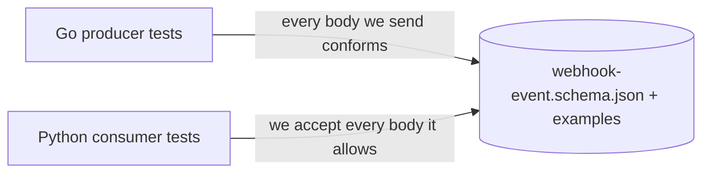

<div dir="rtl" lang="he">

# פרק 26: אסטרטגיית בדיקות ובדיקות עומס

בפרקים הקודמים כתבת הרבה בדיקות: טבלאיות, עם `httptest`, ומול מסד שהרמת ביד. בפרק הזה השאלה משתנה מ„איך
בודקים את הפונקציה הזו” ל„איזו בדיקה שווה את המחיר שלה”. זו שאלה של בכירה: בראיון שואלים מה היית בודקת,
באיזו רמה, ומה יקרה כשהבדיקות יתחילו להיכשל לפעמים. בסוף הפרק תמדדי את `shorty` תחת עומס, ותדעי לקרוא
את המספרים בלי להאמין להם יותר מדי.

## מה נלמד בפרק

- איך בוחרים רמה לבדיקה: יחידה, אינטגרציה, חוזה, קצה לקצה; המחיר מול הביטחון, ולמה הוויכוח בין הפירמידה
  לגביע הוא שאלה של הקשר.
- בדיקות שנכשלות לפעמים: מאיפה הן באות, ובוני נתונים לבדיקות.
- ‏testcontainers-go: ‏PostgreSQL אמיתי לכל חבילת בדיקות, בלי הגדרה מחוץ ל־Go.
- בדיקת חוזה ל־webhook, שרצה גם ביצרן ב־Go וגם בצרכן ב־Python.
- בדיקות תכונה עם rapid, ו־fuzzing מובנה של Go, כולל שמירת קריסה כבדיקה קבועה.
- ‏k6: תרחישים בקצב הגעה קבוע, ספים, בדיקות ותגיות; ואיך קוראים אחוזונים, חימום והשמטה מתואמת.

## ידע מקדים

- פרק 3, סעיף 3.8: בדיקות טבלאיות. פרק 5: ‏goroutines וגלאי המרוצים.
- פרק 6: ‏`shorty`, שהוא היעד של בדיקת העומס. פרק 8: המקבל ב־Python וקובץ וקטורי החתימה.
- פרק 7: פרויקט uv, ‏ruff ו־mypy, לצרכן ב־Python.
- פרק 10: ה־repository של ההזמנות ובדיקות האינטגרציה שלו.
- פרק 14: פונקציית ה־backoff עם פיזור מלא.
- פרק 23: ‏service container ב־CI, והכלל „דילוג הוא כישלון”.
- פרק 2, סעיפים 2.4 ו־2.10: ‏Docker Desktop ו־k6.

## 26.1 מה לבדוק ובאיזו רמה

### 26.1.1 ארבע רמות

לכל בדיקה יש מחיר: זמן כתיבה, זמן ריצה, ותחזוקה כשהקוד משתנה. ויש לה תמורה: כמה ביטחון היא נותנת
שהמערכת עובדת בשביל מי שמשתמשת בה. הרמות נבדלות בעיקר במה שהן מחליפות בזיוף:

| רמה | מה רץ באמת | מה מזויף | זמן טיפוסי | מה היא תופסת |
| --- | --- | --- | --- | --- |
| יחידה (unit) | פונקציה או חבילה | כל מה שמחוץ לתהליך | אלפיות שנייה | לוגיקה, קצוות, שגיאות |
| אינטגרציה (integration) | הקוד שלך מול תלות אמיתית: מסד, Redis, Kafka | שירותים של צוותים אחרים | שניות | SQL, אילוצים, טרנזקציות, הגדרות של ה־driver |
| חוזה (contract) | הצורה של מה שעובר בין שני שירותים | כל השאר | אלפיות שנייה | שינוי שובר בין יצרן לצרכן |
| קצה לקצה (e2e) | כל המערכת, כמו בייצור | כמעט כלום | דקות | חיבורים, הגדרות, פריסה |

הסדר בטבלה הוא גם סדר המחיר. בדיקת יחידה רצה מאות פעמים בשנייה, ותגיד לך בדיוק איפה הבאג. בדיקת קצה
לקצה רצה בדקות, נכשלת מסיבות שאינן קשורות לשינוי שלך, ואומרת „משהו שבור”. אבל רק היא יודעת שה־image עולה,
שה־Ingress מנתב ושה־worker באמת קורא מה־topic.

### 26.1.2 פירמידה או גביע

שתי תמונות מתחרות על החלוקה:

- **הפירמידה** (test pyramid): בסיס רחב של בדיקות יחידה, שכבה דקה יותר של אינטגרציה, וקצה צר של בדיקות קצה
  לקצה. ההיגיון הוא מחיר: הבדיקות הזולות והמהירות נושאות את רוב העומס. מי שהפך אותה למוכרת הוא Mike Cohn,
  בספר „Succeeding with Agile” מ־2009 (לפי Martin Fowler, הוא צייר אותה לראשונה כבר ב־2003 או 2004).
- **הגביע** (testing trophy): בסיס של ניתוח סטטי, ומעליו החלק השמן הוא דווקא אינטגרציה. ההיגיון הוא
  ביטחון: בדיקת יחידה שמזייפת את המסד בודקת שהקוד קורא לזיוף, ולא שה־SQL נכון. את הגביע הציג Kent C. Dodds
  ב־2018, בהשראת משפט של Guillermo Rauch: „Write tests. Not too many. Mostly integration.”

שתיהן צודקות, כל אחת בהקשר אחר. כשהקוד הוא לוגיקה טהורה, כמו backoff, חתימה או חישוב מחיר, בדיקות יחידה
נותנות כמעט את כל הביטחון במחיר אפסי, והפירמידה מתאימה. כשרוב הקוד הוא דבק בין HTTP למסד, כמו ה־repository
של פרק 10, בדיקת יחידה עם זיוף של pgx לא תתפוס אף אחד מהבאגים שבאמת קורים: עמודה בשם לא נכון, אילוץ
`CHECK`, או סדר מיון שבור. שם הגביע מתאים.

השאלה שכדאי לשאול על כל בדיקה היא לא „איזו רמה”, אלא **„איזה באג היא תתפוס, ומה היא תעלה לי?”**. וכלי
שינה את החשבון: כשמסד אמיתי עולה בשתי שניות מתוך `go test` (סעיף 26.2), אינטגרציה כבר לא יקרה כמו שהייתה.

### 26.1.3 בדיקות שנכשלות לפעמים

בדיקה שנכשלת לפעמים (flaky test), בלי שינוי בקוד, גרועה מבדיקה חסרה. אחרי הפעם השלישית מריצים שוב
ומפסיקים לקרוא את הכשלונות, ואז גם הכשל האמיתי עובר בלי שמישהו מסתכל. רוב הסיבות חוזרות:

| סיבה | איך היא נראית | התיקון |
| --- | --- | --- |
| זמן | ‏`time.Sleep(100 * time.Millisecond)` ואז בדיקה; עובר אצלך, נכשל ב־CI עמוס | לחכות לתנאי, לא לזמן; שעון מוזרק |
| סדר | בדיקה תלויה בנתונים שבדיקה אחרת השאירה | מצב נקי לכל בדיקה: מסד, סכמה או טרנזקציה משלה |
| מקביליות | מרוץ נתונים שמופיע רק תחת עומס | ‏`-race` תמיד, ו־`-count=N` כדי לחזור על הבדיקה |
| אקראיות | זרע שונה בכל הרצה | מקור אקראיות מוזרק, וזרע מודפס בכשל |
| סביבה | פורט תפוס, שעון של מכונה, אזור זמן | פורט שמוקצה דינמית, ‏UTC בבדיקות |
| שירות חיצוני | בדיקה שפונה לאינטרנט | שרת מקומי (`httptest`) או קונטיינר |

שימי לב שכל התיקונים בטבלה הם אותו רעיון: **להוציא מהבדיקה את מה שהיא לא שולטת בו.** ה־backoff של פרק 14
מקבל את מקור האקראיות כפרמטר מאותה סיבה, ובסעיף 26.4 זה יאפשר ל־rapid לשלוט בו.

### 26.1.4 בוני נתונים לבדיקות

בבדיקות האינטגרציה של פרק 10, כל הנתונים נבנו במחרוזת SQL אחת: 25 הזמנות עם `generate_series`. זה מהיר
לכתוב, אבל כל בדיקה חדשה שצריכה „לקוח עם הזמנה אחת שבוטלה” מוסיפה עוד מחרוזת, וכשנוספת עמודה חובה צריך
לתקן את כולן. בונה נתונים (test data builder) הופך את זה: ערכי ברירת מחדל שיוצרים שורה תקינה, ומתודה לכל
שדה שבדיקה עשויה לרצות לשנות. מהקובץ `orders/builder_test.go` בתרגיל:

<div dir="ltr" align="left">

```go
type orderBuilder struct {
	id         int64
	customerID int64
	status     string
	createdAt  time.Time
	items      int
}

func anOrder(id int64) *orderBuilder {
	return &orderBuilder{id: id, customerID: 1, status: "delivered", createdAt: epoch.Add(time.Duration(id) * time.Hour), items: 1}
}

func (b *orderBuilder) forCustomer(id int64) *orderBuilder { b.customerID = id; return b }
func (b *orderBuilder) at(t time.Time) *orderBuilder       { b.createdAt = t; return b }
func (b *orderBuilder) withItems(n int) *orderBuilder      { b.items = n; return b }
```

</div>

ובדיקה שמשתמשת בו אומרת רק את מה שחשוב לה, כאן: של מי ההזמנה:

<div dir="ltr" align="left">

```go
	seedCatalog(t, pool)
	anOrder(1).insert(t, pool)
	anOrder(2).forCustomer(2).insert(t, pool)
	anOrder(3).insert(t, pool)
```

</div>

היתרון האמיתי הוא בקריאה. מי שקוראת את הבדיקה בעוד חצי שנה רואה מיד שההבדל היחיד בין ההזמנות הוא הלקוח, ולכן
זה מה שנבדק. ואם תתווסף עמודה חובה ל־`orders`, משנים שורה אחת ב־`insert`, ולא כל בדיקה.

> **איך Rust עושה את זה:** אותו רעיון נכתב בדרך כלל עם `Default` ותחביר העדכון של struct
> (`Order { customer_id: 2, ..Default::default() }`), או עם bon ו־derive_builder. ב־Go אין תחביר כזה, ולכן
> הבנאי הוא פונקציה שמחזירה ערכי ברירת מחדל, ומתודות שמחזירות את המצביע לשרשור.

## 26.2 testcontainers-go

### 26.2.1 למה לא compose

עד עכשיו, בדיקות מול מסד דרשו שני צעדים: `docker compose up` בטרמינל, ואז `go test` עם `DATABASE_URL`. זה עובד,
אבל יש בזה שלוש חולשות. מישהי שמריצה `go test ./...` בלי להרים את ה־compose מקבלת דילוג ירוק (פרק 23, סעיף
23.3.1). הגרסה של המסד מוגדרת בקובץ אחר מהבדיקות. ושני מאגרים שמשתמשים באותו פורט מתנגשים.

‏testcontainers-go היא ספרייה שמרימה קונטיינרים מתוך קוד הבדיקה, דרך ה־API של Docker. המודולים שלה עוטפים
images נפוצים: הם יודעים על איזה פורט PostgreSQL מקשיב, מתי הוא באמת מוכן, ואיך בונים לו כתובת חיבור. נכון
לאוקטובר 2026 הגרסה היא זו של נספח ג, והמודול של PostgreSQL הוא מודול Go נפרד באותו מאגר, עם אותה גרסה:

<div dir="ltr" align="left">

```text
github.com/testcontainers/testcontainers-go                    v0.44.0
github.com/testcontainers/testcontainers-go/modules/postgres   v0.44.0
```

</div>

שני הנתיבים והגרסה נבדקו מול `proxy.golang.org`, וה־API שבפרק נבדק מול הקוד של התגית `v0.44.0`.

### 26.2.2 קונטיינר אחד לחבילה

להרים קונטיינר לכל בדיקה זה בזבוז: PostgreSQL עולה בשנייה או שתיים, וחבילה עם עשרים בדיקות תחכה דקה.
להרים אחד לכל `go test ./...` זה בלתי אפשרי: כל חבילה היא קובץ בינארי נפרד, בתהליך נפרד. נקודת האמצע היא
`TestMain`, פונקציה שרצה פעם אחת לכל קובץ בדיקות מהודר, לפני כל הבדיקות שלו. זה העוזר מהתרגיל, בקובץ
`internal/pgtest/pgtest.go`:

<div dir="ltr" align="left">

```go
func Main(m *testing.M) int {
	flag.Parse() // testing.Short reads the -short flag
	if testing.Short() {
		return m.Run()
	}
	ctx := context.Background()

	ctr, err := postgres.Run(ctx, Image,
		postgres.WithDatabase("pgtest"),
		postgres.WithUsername("course"),
		postgres.WithPassword("change-me"), // a throw-away test server, not a secret
		postgres.BasicWaitStrategies(),
	)
	// Terminate even when Run failed: a container that started but never became ready
	// still exists. TerminateContainer accepts a nil container.
	defer func() {
		if err := testcontainers.TerminateContainer(ctr); err != nil {
			fmt.Fprintln(os.Stderr, "pgtest: terminate container:", err)
		}
	}()
	if err != nil {
		fmt.Fprintln(os.Stderr, "pgtest: start PostgreSQL (is Docker running? use -short to skip):", err)
		return 1
	}
```

</div>

כמה דברים שכדאי לראות בקוד הזה:

| שורה | מה היא עושה | למה |
| --- | --- | --- |
| `postgres.Run(ctx, Image, ...)` | יוצר ומפעיל קונטיינר מ־`postgres:18.6` | ה־image מוצמד, כמו בקובצי ה־compose |
| `BasicWaitStrategies()` | מחכה לשורת המוכנות פעמיים, ואז לפורט | ‏PostgreSQL מאתחל, נסגר ועולה שוב; ב־Docker Desktop הפורט נפתח רק אחרי זה |
| ה־`defer` לפני בדיקת השגיאה | מוחק את הקונטיינר בכל מקרה | קונטיינר שעלה ולא הגיע למוכנות עדיין קיים |
| `return 1` | נכשל, ולא מדלג | בלי Docker הבדיקות לא בדקו כלום, וזה צריך להיראות |
| `testing.Short()` | יציאה מוקדמת עם `-short` | הדרך המקובלת ב־Go לבקש רק את הבדיקות המהירות |

ההערה של המודול עצמו על אסטרטגיית ההמתנה אומרת שבלי ההמתנה לפורט, הבדיקות יהיו „flaky” במערכות שאינן
Linux, כי Docker Desktop מפעיל שם מתווך נפרד לפורט. זה בדיוק הסוג של סיבה מהטבלה בסעיף 26.1.3.

שימי לב גם למה שהמודול עושה בלי שביקשת: הוא מריץ את PostgreSQL עם `fsync=off`. הנתונים לא נכתבים לדיסק
בבטחה, והבדיקות מהירות יותר. זה בסדר למסד שחי דקה, ואסור בכל מסד אחר.

ב־`TestMain` של החבילה נשארת שורה אחת. מהקובץ `orders/orders_test.go`:

<div dir="ltr" align="left">

```go
// One PostgreSQL container for every test in this package; each test gets its own database.
func TestMain(m *testing.M) { os.Exit(pgtest.Main(m)) }
```

</div>

הקריאה ל־`os.Exit` נמצאת מחוץ לפונקציה של העוזר, ולא בתוכה, כי יציאה מהתהליך לא מריצה את פקודות
ה־`defer`. אם העוזר היה יוצא בעצמו, הקונטיינר לא היה נמחק.

### 26.2.3 מסד ריק לכל בדיקה

קונטיינר אחד משותף מחזיר את בעיית הסדר: בדיקה אחת משאירה שורות, ובדיקה אחרת סופרת אותן. יש שלוש דרכים
לבודד בתוך שרת אחד:

| דרך | עלות לבדיקה | מחיר |
| --- | --- | --- |
| טרנזקציה שמבוטלת בסוף | כמעט אפס | לא מתאים לקוד שפותח טרנזקציות משלו או משתמש בכמה חיבורים |
| סכמה לכל בדיקה (כמו בפרק 10) | נמוכה | צריך `search_path`, וקל לשכוח אותו בחיבור אחד |
| מסד לכל בדיקה | עשרות אלפיות שנייה | הבידוד הכי מלא; כל בדיקה יכולה לרוץ במקביל |

התרגיל בוחר מסד לכל בדיקה. `NewDatabase` יוצרת מסד בשם ייחודי ומוחקת אותו ב־`t.Cleanup`:

<div dir="ltr" align="left">

```go
	name := fmt.Sprintf("test_%d", nextID.Add(1))
	ident := pgx.Identifier{name}.Sanitize()
	if _, err := admin.Exec(ctx, "CREATE DATABASE "+ident); err != nil {
		t.Fatalf("pgtest: create database: %v", err)
	}
	t.Cleanup(func() {
		// FORCE closes connections a test forgot to close, instead of failing the drop.
		if _, err := admin.Exec(context.Background(), "DROP DATABASE "+ident+" WITH (FORCE)"); err != nil {
			t.Errorf("pgtest: drop database: %v", err)
		}
	})
```

</div>

הפקודה `CREATE DATABASE` לא מקבלת פרמטרים, ולכן שם המסד מוכנס לטקסט של השאילתה. הטיפוס `pgx.Identifier`
מצטט אותו כמזהה, כך שגם שם מוזר לא הופך ל־SQL. ומכיוון שאף בדיקה לא חולקת מסד, פונקציית ההכנה של הבדיקות
מסמנת כל בדיקה כמקבילית (`t.Parallel()`).

> **שימי לב:** אם בניית הנתונים יקרה מדי לכל בדיקה, המודול מציע `Snapshot` ו־`Restore`: שומרים מסד מוכן
> כתבנית, ומשחזרים ממנה לפני כל בדיקה, במקום לשתף מסד אחד עם נתונים בין כולן.

### 26.2.4 ‏Ryuk, ‏Mac ו־WSL2

פקודת ה־`defer` מוחקת את הקונטיינר כשהבדיקות מסתיימות כרגיל. אבל עצירה ביד, panic ב־goroutine אחר, או זמן
קצוב של `go test` הורגים את התהליך לפני שהיא רצה. בשביל זה testcontainers מרים לפני הקונטיינר שלך עוד אחד,
Ryuk: הוא מחזיק חיבור פתוח מהתהליך של הבדיקות, וכשהחיבור נסגר, מכל סיבה, הוא מוחק כל קונטיינר שקיבל את
התוויות של אותה הרצה. לכן בפלט של ההרצה הראשונה תראי שני images יורדים, `postgres:18.6`
ו־`testcontainers/ryuk`.

שלוש הערות סביבה:

- **‏WSL2 עם Docker Desktop.** כשהשילוב עם ההפצה דלוק (פרק 2, סעיף 2.4), הקובץ `/var/run/docker.sock` קיים
  בתוך Ubuntu, ו־testcontainers מוצא אותו לבד. אם `docker ps` עובד בטרמינל של WSL, גם הבדיקות יעבדו.
- **‏Mac עם Docker Desktop.** לפי התיעוד של testcontainers-go, הספרייה מחפשת את Docker בסדר קבוע, וזה
  הסדר:
  1. קובץ ההגדרות `~/.testcontainers.properties`.
  2. משתנה הסביבה `DOCKER_HOST`.
  3. ה־context הנוכחי של Docker.
  4. ורק אז `/var/run/docker.sock`.

  כש־Docker Desktop לא יוצר את הקישור ב־`/var/run`, ה־context הנוכחי מצביע לשקע שלו בתיקיית הבית, וזה מספיק.
- **לכבות את Ryuk.** המשתנה `TESTCONTAINERS_RYUK_DISABLED=true` מכבה אותו. יש סביבות שבהן אין ברירה, למשל
  Docker בלי root, שצריך לפעמים להריץ את Ryuk עם הרשאות מיוחדות במקום לכבות אותו. אבל על המחשב שלך, כיבוי
  פירושו קונטיינרים שנשארים אחרי כל עצירה ביד.

בסוף כל הרצה, הפקודה הזו צריכה להחזיר רשימה ריקה:

<div dir="ltr" align="left">

```bash
docker ps -a --filter label=org.testcontainers=true
```

</div>

**ב־CI.** על runner של GitHub Actions יש Docker, ולכן אותן בדיקות רצות שם בלי service container (פרק 23, סעיף
23.3): ההגדרה של המסד עוברת מקובץ ה־workflow לקוד הבדיקה.

## 26.3 בדיקות חוזה

### 26.3.1 מה בדיקת אינטגרציה לא רואה

ב־Hookline, היצרן הוא worker ב־Go ששולח webhook, והצרכן הוא שירות של מישהו אחר, כאן המקבל ב־Python מפרק 8.
בדיקת אינטגרציה של ה־worker בודקת שהוא שולח, עם `httptest`. בדיקה של המקבל בודקת שהוא מקבל את מה שהבדיקה
שלו שולחת. שתיהן ירוקות גם כשה־worker משנה את `created_at` לחותמת יוניקס במספר, והמקבל מצפה למחרוזת.

בדיקת חוזה (contract test) סוגרת את הפער הזה בלי להריץ את שני השירותים יחד. מגדירים קובץ אחד שמתאר את מה
שעובר ביניהם, ושני הצדדים בודקים את עצמם מולו, כל אחד בשפה שלו:

<div dir="ltr" align="left">



</div>

שני הכיוונים חשובים. היצרן מוכיח ש**כל מה שהוא שולח** עומד בחוזה. הצרכן מוכיח שהוא **מקבל כל מה שהחוזה
מתיר**, כולל שדות אופציונליים שחסרים ושדות שהוא לא מכיר. אף צד לא מייבא קוד של השני. הקובץ הוא כל ההסכם.

> **העשרה אופציונלית:** הגישה של Pact, „חוזה שהצרכן מגדיר” (consumer-driven contract), הופכת את הכיוון: הצרכן
> כותב את הציפיות שלו, והיצרן מריץ אותן. זה מתאים כשיש לך כמה צרכנים פנימיים שכל אחד משתמש בחלק אחר של
> ה־API. ל־webhook שנשלח לצרכנים חיצוניים שאת לא מכירה, החוזה הוא של היצרן, וסכמה מפורסמת מתאימה יותר.

### 26.3.2 הסכמה

החוזה כתוב ב־JSON Schema, בטיוטה 2020-12. מהקובץ `contract/webhook-event.schema.json` (התיאורים קוצרו כאן):

<div dir="ltr" align="left">

```json
  "type": "object",
  "required": ["id", "type", "created_at", "data"],
  "properties": {
    "id": {
      "description": "The event id; the same in every delivery and retry of this event (Hookline-Event-Id).",
      "type": "string",
      "format": "uuid"
    },
    "type": {
      "description": "Dotted lowercase words, at least two, such as invoice.paid.",
      "type": "string",
      "maxLength": 100,
      "pattern": "^[a-z][a-z0-9_]*(\\.[a-z][a-z0-9_]*)+$",
      "$comment": "Python's re lets $ match before a final newline; Go's regexp does not. The not-pattern makes both sides reject it.",
      "not": {"pattern": "\\n"}
    },
```

</div>

ושתי החלטות שכדאי לראות:

- **‏`additionalProperties: true`.** הצרכן חייב להתעלם ממאפיינים שהוא לא מכיר. כך היצרן יכול להוסיף שדה
  אופציונלי בלי גרסה חדשה ובלי לשבור אף אחד. ‏`false` נראה „בטוח יותר”, אבל הוא הופך כל תוספת לשינוי שובר.
- **הדוגמאות הן חלק מהחוזה.** בתיקייה `contract/testdata/examples` יש ארבע דוגמאות תקינות ועשר שגויות. שני
  הצדדים מריצים את כולן, ולכן הם מסכימים לא רק על הסכמה, אלא על מה שהיא אומרת בפועל.

**‏`format` הוא הערה, עד שמבקשים אחרת.** בטיוטה 2020-12, מילת המפתח `format` היא ברירת מחדל רק הערה: בודק
שלא קיבל הוראה מפורשת לא בודק שמחרוזת היא uuid. זה נכון בשני הבודקים שבתרגיל. ב־Go, הבודק הוא
`github.com/santhosh-tekuri/jsonschema/v6`, ובבדיקה מהקובץ `contract/contract_test.go` הוא מקבל את ההוראה:

<div dir="ltr" align="left">

```go
	c := jsonschema.NewCompiler()
	c.AssertFormat()
	if err := c.AddResource(contract.SchemaURL, doc); err != nil {
		t.Fatal(err)
	}
	sch, err := c.Compile(contract.SchemaURL)
```

</div>

ב־Python, החבילה `jsonschema` צריכה בודק פורמטים מפורש. ויש לה מלכודת נוספת: את התאריכים היא בודקת רק כשהחבילה
`rfc3339-validator` מותקנת, ובלעדיה היא מדלגת בשקט. לכן החבילה הזו מוצמדת בקובץ הפרויקט, ולכן יש בדיקה שנכשלת
אם היא חסרה. מהקובץ `consumer/tests/test_contract.py`:

<div dir="ltr" align="left">

```python
# Without format_checker, "format" is only an annotation and "evt_123" passes as a uuid.
validator = Draft202012Validator(SCHEMA, format_checker=Draft202012Validator.FORMAT_CHECKER)


def test_schema_is_valid_2020_12() -> None:
    Draft202012Validator.check_schema(SCHEMA)


def test_formats_are_really_checked() -> None:
    # date-time is checked only when rfc3339-validator is installed; fail loudly if it is not.
    assert "date-time" in Draft202012Validator.FORMAT_CHECKER.checkers
    assert "uuid" in Draft202012Validator.FORMAT_CHECKER.checkers
```

</div>

שתי הגרסאות, `v6.0.3` לבודק של Go ו־4.26.0 ל־`jsonschema`, נבדקו ב־`proxy.golang.org` וב־PyPI ב־5 באוקטובר 2026.

### 26.3.3 הפער שרק בדיקת חוזה מוצאת

הגרסה הראשונה של הסכמה לא כללה את השורה `"not"`. כל הבדיקות של Go עברו. בצד של Python, אחת נכשלה: הדוגמה
`type-trailing-newline.json`, שבה הערך הוא `"invoice.paid\n"`, התקבלה כתקינה.

הסיבה היא בהגדרה של `$` בשני מנועי הביטויים הרגולריים:

- **ב־Go,** בחבילה `regexp`, הסימן מתאים בלי דגל מיוחד רק לסוף הטקסט.
- **ב־Python,** בחבילה `re`, הסימן מתאים גם לפני תו שורה חדשה אחד בסוף.

כל בודק משתמש במנוע של השפה שלו, עם התבנית כמו שהיא. אותה סכמה, שני בודקים מכובדים, ושתי תשובות שונות.

בלי בדיקת החוזה, הפער היה מתגלה בייצור: צרכן ב־Python שמאמת עם הסכמה מקבל סוג אירוע עם שורה חדשה, ומנתב
אותו למקום שלא קיים. התיקון הוא בסכמה, לא בבודק, כי לסכמה יש צרכנים שאת לא שולטת בבודקים שלהם. ‏`"not":
{"pattern": "\\n"}` דוחה כל ערך עם שורה חדשה, בשני המנועים. ‏`\z` היה פותר את זה ב־Python וב־Go, אבל הוא לא
חלק מהדיאלקט של ECMA-262 ש־JSON Schema מגדירה, ובודקים אחרים לא יבינו אותו.

### 26.3.4 היצרן מסכים עם החוזה

בצד היצרן, `contract.New` בונה את הגוף ודוחה את מה שהסכמה הייתה דוחה, כדי שהטעות תיתפס אצלך ולא אצל
המקבל. אבל איך יודעים ש־`New` ו־הסכמה מסכימים, אם הם כתובים פעמיים, פעם ב־Go ופעם ב־JSON? בדיקת תכונה (סעיף
26.4) עונה על זה: לכל מחרוזת `type`, ‏`New` מקבלת אותה אם ורק אם הסכמה מקבלת גוף איתה. מהקובץ
`contract/contract_test.go`:

<div dir="ltr" align="left">

```go
		ev, newErr := contract.New(id, typ, at, data)
		hand, err := json.Marshal(map[string]any{"id": id, "type": typ, "created_at": at.UTC().Format(time.RFC3339), "data": data})
		if err != nil {
			t.Fatal(err)
		}
		schemaErr := validate(sch, hand)
		if (newErr == nil) != (schemaErr == nil) {
			t.Fatalf("type %q: New says %v, schema says %v", typ, newErr, schemaErr)
		}
```

</div>

‏`typ` מגיע ממחולל שחצי מהזמן מייצר מחרוזות שמתאימות לתבנית, וחצי מהזמן כל מחרוזת שהיא. ככה בודקים גם את
הקבלה וגם את הדחייה. ‏`hand` נבנה ביד ולא דרך `New`, כדי שהסכמה תשפוט גם ערכים ש־`New` דחתה.

## 26.4 בדיקות תכונה עם rapid

### 26.4.1 מה בדיקה טבלאית לא מוצאת

בדיקה טבלאית בודקת את הקלטים שחשבת עליהם. הבדיקות של ה־backoff מפרק 14 טובות: הן כוללות ניסיון שלילי,
ניסיון 64 שהיה גורם לגלישה, ותקרה שאינה חזקה של 2. אבל כל השורות שם הן עם מדיניות אחת, 100 אלפיות שנייה עד
2 שניות. מה קורה כשהבסיס גדול מהתקרה? כשהתקרה היא `math.MaxInt64`?

בדיקת תכונה (property-based test) הופכת את הכיוון: במקום רשימת קלטים ותוצאות, כותבים **מה נכון לכל קלט**,
ומחולל מייצר מאות קלטים. כשתכונה נכשלת, הספרייה מקטינה (shrinking) את הקלט לדוגמה הקטנה ביותר שעדיין נכשלת,
ומדפיסה את הזרע שמשחזר אותה. ב־Go, הספרייה בספר היא `pgregory.net/rapid`, בגרסה של נספח ג.

> **איך Rust עושה את זה:** ‏proptest ו־quickcheck הם המקבילים. ‏rapid קרוב יותר לרוח של proptest: המחוללים
> מורכבים מתוך הבדיקה עצמה (`Draw`), וההקטנה פועלת על רצף ההגרלות, כך שאין צורך לכתוב פונקציית הקטנה לכל טיפוס.

### 26.4.2 שלוש תכונות ל־backoff

המחוללים מהקובץ `backoff/property_test.go`. מדיניות היא כל זוג של בסיס ותקרה חיוביים, עד ה־`Duration` הגדול
ביותר, בכל סדר. וניסיון הוא שילוב של טווח קטן, שבו ההכפלה קורית, עם טווח ענק:

<div dir="ltr" align="left">

```go
var policyGen = rapid.Custom(func(t *rapid.T) backoff.Policy {
	return backoff.Policy{
		Base: time.Duration(rapid.Int64Range(1, math.MaxInt64).Draw(t, "base")),
		Cap:  time.Duration(rapid.Int64Range(1, math.MaxInt64).Draw(t, "cap")),
	}
})

// attemptGen covers the attempts that matter: below 1, the doubling range, and far beyond it.
var attemptGen = rapid.OneOf(rapid.IntRange(-5, 70), rapid.IntRange(70, math.MaxInt32))
```

</div>

**גבולות.** כל המתנה בין 0 לתקרה של הניסיון, ואף תקרה לא עוברת את `Cap`. הטריק כאן הוא מקור האקראיות.
‏`Delay` מקבלת ממשק `Rand`, ובבדיקה הוא מושך כל מספר מ־rapid. כך rapid מגריל גם את התוצאה של ה־„אקראיות”,
מחפש בכוונה את הקצוות 0 ו־`n-1`, ומקטין גם אותם:

<div dir="ltr" align="left">

```go
type drawnRand struct{ t *rapid.T }

func (r drawnRand) Int64N(n int64) int64 {
	return rapid.Int64Range(0, n-1).Draw(r.t, "draw")
}
```

</div>

<div dir="ltr" align="left">

```go
func TestPropertyDelayWithinBounds(t *testing.T) {
	rapid.Check(t, func(t *rapid.T) {
		p := policyGen.Draw(t, "policy")
		attempt := attemptGen.Draw(t, "attempt")
		ceiling := p.Ceiling(attempt)
		if ceiling < min(p.Base, p.Cap) || ceiling > p.Cap {
			t.Fatalf("Ceiling(%d) = %v, want within [%v, %v]", attempt, ceiling, min(p.Base, p.Cap), p.Cap)
		}
		if d := p.Delay(attempt, drawnRand{t}); d < 0 || d > ceiling {
			t.Fatalf("Delay(%d) = %v outside [0, %v]", attempt, d, ceiling)
		}
	})
}
```

</div>

**הכפלה עד התקרה.** מתחת לתקרה, הניסיון הבא מקבל בדיוק פי שניים; כשהגיעה לתקרה, היא נשארת שם. שתי התכונות
יחד אומרות „מעריכי, ואז שטוח”, ופוסלות גם גלישה שהופכת מספר ענק לשלילי:

<div dir="ltr" align="left">

```go
		cur, next := p.Ceiling(attempt), p.Ceiling(attempt+1)
		switch {
		case next < cur:
			t.Fatalf("Ceiling(%d) = %v < Ceiling(%d) = %v: not monotone", attempt+1, next, attempt, cur)
		case cur == p.Cap && next != p.Cap:
			t.Fatalf("Ceiling left the cap: %v then %v", cur, next)
		case next < p.Cap && next != 2*cur:
			t.Fatalf("below the cap the ceiling must double: %v then %v", cur, next)
		}
```

</div>

**פיזור סביר.** פיזור מלא אמור לפזר את ההמתנות על כל הטווח. הבדיקה מושכת 4000 המתנות ממקור אקראי עם זרע,
ובודקת שהממוצע קרוב לחצי התקרה ושכל חצי של הטווח קיבל חלק הגון. כאן צריך זהירות: בדיקה סטטיסטית יכולה
להיכשל במקרה, וזו בדיוק בדיקה שנכשלת לפעמים. הסף נבחר כך שזה לא יקרה: לממוצע של n הגרלות אחידות יש סטיית
תקן של `c/sqrt(12n)`, כאן בערך 0.46% מהתקרה, והסף הוא 5%, יותר מעשר סטיות. ההערה בקוד אומרת את זה, כדי שמי
שתרצה להדק את הסף תדע מה היא משלמת.

### 26.4.3 כשתכונה נכשלת

בצעד 9 של התרגיל את שוברת בכוונה את `Ceiling`, ומריצה. rapid לא מדפיס את הקלט הראשון שנכשל, אלא את הקטן ביותר
שהוא מצא, ואת הדרך לשחזר אותו. הפלט שלו כולל שתי שורות שחשובות לך: הערכים שהוגרלו, בשמות שנתת ב־`Draw`,
והדגל `-rapid.seed=` או `-rapid.failfile=`. עם הדגל, אותו כשל חוזר בכל הרצה עד שתתקני.

כך נראה הכשל בהרצה שבה נכתב הספר, עם `c > p.Cap` במקום `c > p.Cap/2` (הזרע, התאריך ושם הקובץ יהיו אחרים אצלך):

<div dir="ltr" align="left">

```text
--- FAIL: TestPropertyDelayWithinBounds (0.01s)
    property_test.go:36: [rapid] failed after 1 tests: Ceiling(70) = 4ns, want within [1ns, 3ns]
        To reproduce, specify -run="TestPropertyDelayWithinBounds" -rapid.failfile="testdata/rapid/TestPropertyDelayWithinBounds/TestPropertyDelayWithinBounds-20261005135337-97769.fail" (or -rapid.seed=5818600877315787123)
        Failed test output:
    property_test.go:37: [rapid] draw policy: backoff.Policy{Base:1, Cap:3}
    property_test.go:38: [rapid] draw attempt: 70
    property_test.go:41: Ceiling(70) = 4ns, want within [1ns, 3ns]
```

</div>

שימי לב למדיניות שנשארה אחרי ההקטנה: בסיס של ננו־שנייה אחת ותקרה של שלוש. זו הדוגמה הקטנה ביותר שבה הכפלה
של ערך שעדיין מתחת לתקרה עוברת אותה, ומשם קל לראות את הבאג. הבדיקה הטבלאית של פרק 14 תופסת גם היא את השבירה
הזו, כי במדיניות היחידה שלה 1600 כפול 2 עובר את התקרה. התכונה לא צריכה שמישהו יבחר מדיניות כזו מראש.

קובץ הכשל נשמר תחת `testdata/rapid/` של החבילה, אבל בניגוד לקבצים של fuzzing (סעיף 26.5.3) הוא לא רץ לבד
בהרצה הבאה. כשהכשל מצא באג ששווה לזכור, מוסיפים את הקלט כשורה לבדיקה הטבלאית. ובברירת המחדל rapid בודק 100
קלטים לכל תכונה, עם זרע אקראי; ‏`-rapid.checks` מגדיל את המספר בהרצה ידנית או לילית.

### 26.4.4 הלוך וחזור בחתימה

תכונת הלוך וחזור (round trip) היא הקלה ביותר לנסח וחזקה במיוחד: מה שפונקציה אחת מייצרת, השנייה מקבלת.
מהקובץ `signature/property_test.go`:

<div dir="ltr" align="left">

```go
		secret := rapid.SliceOfN(rapid.Byte(), 1, 64).Draw(t, "secret")
		body := rapid.SliceOf(rapid.Byte()).Draw(t, "body")
		ts := rapid.Int64Range(0, maxTimestamp).Draw(t, "timestamp")
		// Any receiver clock within the tolerance, on either side.
		skew := rapid.Int64Range(-300, 300).Draw(t, "skew")

		header := signature.Sign(secret, ts, body)
		if err := signature.Verify(header, body, secret, time.Unix(ts+skew, 0), signature.DefaultTolerance); err != nil {
			t.Fatalf("Verify(Sign(...)) = %v, header %q", err, header)
		}
```

</div>

שימי לב לגוף: בתים שרירותיים, לא מחרוזת UTF-8. הווקטורים המשותפים מכסים גוף ריק, עברית ושורה חדשה בסוף.
התכונה מכסה גם בתים שאינם טקסט בכלל. והתכונה השנייה בקובץ, שינוי של בית אחד בגוף או של הסוד, חייבת לתת תמיד
`signature_mismatch`, ולא סיבה אחרת. אם החותם היה מנרמל את הגוף, למשל מסיר רווחים, היא הייתה נכשלת.

**מתי בדיקת תכונה שווה את המחיר?** כשיש לך משפט פשוט שנכון לכל קלט: הלוך וחזור, גבולות, שוויון בין שתי
מימושים (מהיר ואיטי), או אינווריאנטה של מבנה נתונים. כשהדרך היחידה לנסח את הציפייה היא לחשב את התוצאה
מחדש, באותה לוגיקה, הבדיקה לא בודקת כלום. שם בדיקה טבלאית עם תוצאות שחושבו ביד עדיפה.

## 26.5 fuzzing ב־Go

### 26.5.1 יעד fuzzing

‏fuzzing מייצר קלטים כמו בדיקת תכונה, אבל עם מטרה אחרת. הוא לא מכיר את המבנה של הקלט; הוא מקבל בתים
או מחרוזות, משנה אותם, ומודד אילו ענפים בקוד כל קלט הפעיל. קלט שהגיע לענף חדש נשמר ומשמש בסיס לשינויים
הבאים. כך הוא מוצא, בלי שמישהו תיאר לו את הפורמט, את הקלטים שגורמים לקוד שמפרק טקסט לקרוס.

ב־Go זה חלק מ־`go test` מאז גרסה 1.18. יעד fuzzing הוא פונקציה שמתחילה ב־`Fuzz` ומקבלת `*testing.F`. מהקובץ
`signature/fuzz_test.go`, החלק שבודק כל קלט:

<div dir="ltr" align="left">

```go
	f.Fuzz(func(t *testing.T, header string) {
		h, err := signature.ParseHeader(header)
		if err != nil {
			return // rejecting is fine; panicking is not
		}
		if h.Timestamp < 0 || len(h.Signatures) == 0 {
			t.Fatalf("ParseHeader(%q) accepted %+v", header, h)
		}
		for _, s := range h.Signatures {
			if len(s) != sha256.Size {
				t.Fatalf("ParseHeader(%q): signature of %d bytes", header, len(s))
			}
		}
		again, err := signature.ParseHeader(h.String())
		if err != nil || !reflect.DeepEqual(again, h) {
			t.Fatalf("round trip of %q via %q: %+v, %v", header, h.String(), again, err)
		}
	})
```

</div>

היעד בודק שלושה דברים, מהחלש לחזק: אין קריסה; אם הכותרת התקבלה, התוצאה הגיונית; והתוצאה מתפרקת חזרה
לעצמה. ההבדל מבדיקת תכונה הוא שהיעד לא יודע מה „נכון” לקלט נתון. הוא בודק רק מה שנכון תמיד.

### 26.5.2 זרעים, והקריסה

לפני שמתחילים, נותנים ל־fuzzer זרעים (seed corpus) עם `f.Add`: קלטים אמיתיים שמהם הוא מתחיל לשנות. ביעד
בתרגיל הזרעים הם כל הכותרות מקובץ הווקטורים המשותף, תקינות ושגויות. בלי הדגל `-fuzz`, ‏`go test` מריץ רק
אותם, כבדיקה רגילה. עם הדגל, הוא ממשיך לייצר:

<div dir="ltr" align="left">

```bash
go test -run '^$' -fuzz '^FuzzParseHeader$' -fuzztime 60s ./signature/
```

</div>

| דגל | תפקיד |
| --- | --- |
| `-run '^$'` | לא להריץ את שאר הבדיקות של החבילה |
| `-fuzz '^FuzzParseHeader$'` | איזה יעד; הביטוי חייב להתאים ליעד אחד בדיוק |
| `-fuzztime 60s` | כמה זמן; בלעדיו הוא רץ עד שמוצא כשל או עד `Ctrl-C` |

ב־`ParseHeader` של קוד ההתחלה יש באג, והוא עובר את כל הווקטורים. הקוד מזהה את המפתח לפי חיתוך,
`item[:2] == "t="`, אחרי שבדק שיש בפריט סימן שוויון. זה הפלט של ההרצה על קוד ההתחלה, במחשב שעליו נכתב
הספר (שורות של מחסנית הקריאות הושמטו):

<div dir="ltr" align="left">

```text
fuzz: elapsed: 0s, gathering baseline coverage: 0/24 completed
fuzz: elapsed: 0s, gathering baseline coverage: 24/24 completed, now fuzzing with 12 workers
fuzz: elapsed: 0s, execs: 192 (898/sec), new interesting: 0 (total: 24)
        testing.go:2076: panic: runtime error: slice bounds out of range [:2] with length 1
    Failing input written to testdata/fuzz/FuzzParseHeader/b074d9d373d06c31
```

</div>

פחות משנייה, ובערך מאתיים ניסיונות. הקלט שנמצא הוא `"="`: פריט באורך תו אחד, שיש בו סימן שוויון, והחיתוך
`[:2]` נופל עליו. אף וקטור לא כלל פריט כזה, ואף אחד לא היה חושב לכתוב אותו. ואם הוא היה מגיע בכותרת של בקשה,
ה־handler היה נופל (או, עם middleware שתופס panic, מחזיר 500 במקום 401).

### 26.5.3 הקריסה הופכת לבדיקה

הקובץ ש־`go test` כתב נראה כך, והשם שלו הוא גיבוב של התוכן:

<div dir="ltr" align="left">

```text
go test fuzz v1
string("=")
```

</div>

הוא נמצא בתיקייה `testdata/fuzz/FuzzParseHeader/` של החבילה, ו־`go test` רגיל מריץ כל קובץ בתיקייה הזו כזרע.
כלומר, מהרגע שהקובץ קיים, הבדיקה הרגילה נכשלת עד שהבאג מתוקן, וממשיכה לבדוק אותו אחר כך. מוסיפים אותו
ל־Git, והוא בדיקת רגרסיה בלי שורת קוד אחת. בפתרון הוא נמצא בדיוק שם.

יש שני מקומות שבהם קלטים נשמרים, ושווה להבחין ביניהם:

| מקום | מה יש בו | ב־Git? |
| --- | --- | --- |
| `testdata/fuzz/<Target>/` בחבילה | קלטים שגרמו לכשל, וזרעים שהוספת ביד | כן: אלה בדיקות |
| `$(go env GOCACHE)/fuzz/` | כל הקלטים „המעניינים” שה־fuzzer צבר | לא: זה מטמון מקומי |

התיקון ב־`solution/signature/signature.go` מחליף את החיתוך ב־`strings.Cut`, שמחזיר מפתח וערך בלי להניח אורך.
אחרי התיקון, הריצי עוד 60 שניות: לפעמים התיקון הראשון רק מזיז את הקריסה למקום הבא.

**ב־CI.** הזרעים רצים בכל `go test`, ולכן בכל PR. ‏fuzzing עצמו רץ עד שמוצא משהו, ולכן הוא שייך ל־workflow
לילי עם `-fuzztime` קצוב, ולא לשער של PR.

## 26.6 k6: בדיקת עומס ראשונה

### 26.6.1 ‏k6 בגרסה 2

‏k6 הוא כלי לבדיקות עומס של Grafana: בינארי אחד ב־Go, שמריץ סקריפטים ב־JavaScript. כל משתמש מדומה הוא VU
(virtual user), ולכל VU יש לולאה משלו שמריצה את הפונקציה שבחרת. נכון לאוקטובר 2026 הגרסה בספר היא 2.3.0
(נספח ג), ו־k6 2 חדשה יחסית. לפי מדריך ההגירה הרשמי, השינויים השוברים מגרסה 1 הם בעיקר הסרות:

| הוסר בגרסה 2 | מה במקומו |
| --- | --- |
| ה־executor ‏`externally-controlled`, והפקודות `k6 pause`, ‏`resume`, ‏`scale`, ‏`status` | ‏executor אחר, למשל `constant-arrival-rate` |
| הדגל `--no-summary` | ‏`--summary-mode=disabled` |
| ‏`--summary-mode=legacy` | נשארו `compact`, ‏`full`, ‏`disabled` |
| המודול `k6/experimental/redis` | ‏`k6/x/redis` |
| הצורה `k6 cloud script.js` | ‏`k6 cloud run script.js` |

כל מה שהסקריפט בפרק משתמש בו נשאר: `k6/http`, ‏`check`, ה־executor ‏`constant-arrival-rate`, ספים ותגיות. הסקריפט
נבדק מול הבינארי 2.3.0 עצמו, בהרצה שבה נכתב הספר.

### 26.6.2 מודל פתוח ומודל סגור

לפני הקוד, ההחלטה החשובה ביותר בבדיקת עומס. יש שתי דרכים לייצר עומס:

- **מודל סגור** (closed model): מספר קבוע של VUs, וכל אחד שולח בקשה, מחכה לתשובה, ושולח את הבאה. זה מה
  שעושה הסקריפט של ההתחלה, עם `vus: 5`. כשהשרת מאט, ה־VUs מחכים, ושולחים פחות. העומס יורד בדיוק כשהשרת
  מתקשה.
- **מודל פתוח** (open model): בקשות חדשות מתחילות בקצב קבוע, בלי קשר לתשובות. כך מתנהגים משתמשים אמיתיים
  באתר: אף אחד מהם לא יודע שהשרת איטי לאחרים. כשהשרת מאט, יש יותר בקשות בדרך, וזמני התגובה עולים.

במודל סגור, שרת שמתחיל להיתקע נראה במדידה כמו שרת שקיבל פחות עומס, ולא כמו שרת שקורס. זו גרסה של ההשמטה
המתואמת שבסעיף 26.7.2. ב־k6, המודל הפתוח הוא ה־executor ‏`constant-arrival-rate`: הוא מתחיל `rate` איטרציות בכל
`timeUnit`, ומקצה VUs מתוך מאגר כדי להספיק.

### 26.6.3 הסקריפט

מהקובץ `loadtest/shorty.js` בפתרון, התרחישים:

<div dir="ltr" align="left">

```js
export const options = {
  // The redirect is the answer we measure. Following it would load the target site and time
  // someone else's server.
  maxRedirects: 0,
  // Bodies are not needed for the checks below; discarding them saves memory in k6, not in shorty.
  discardResponseBodies: true,
  scenarios: {
    // Warm-up: same traffic at a quarter of the rate. Its samples carry phase:warmup, and no
    // threshold looks at them.
    warmup: {
      executor: 'constant-arrival-rate',
      exec: 'resolve',
      rate: Math.max(1, Math.floor(RATE / 4)),
      timeUnit: '1s',
      duration: '10s',
      preAllocatedVUs: 10,
      maxVUs: 50,
      tags: { phase: 'warmup' },
    },
    resolve: {
      executor: 'constant-arrival-rate',
      exec: 'resolve',
      startTime: '10s',
      rate: RATE,
      timeUnit: '1s',
      duration: '30s',
      preAllocatedVUs: 20,
      maxVUs: 200,
      tags: { phase: 'measure' },
    },
```

</div>

שלושה תרחישים רצים בסקריפט: חימום של 10 שניות ברבע מהקצב, ואחריו, במקביל, תרחיש מדוד של הפניות ותרחיש
של יצירת קישורים בעשירית מהקצב. כל מפתח בתרחיש עונה על שאלה:

| מפתח | התשובה כאן |
| --- | --- |
| `exec` | איזו פונקציה מהסקריפט רצה בכל איטרציה |
| `rate`, ‏`timeUnit` | כמה איטרציות מתחילות, באיזו יחידת זמן |
| `startTime` | מתי התרחיש מתחיל, יחסית לתחילת הבדיקה |
| `preAllocatedVUs`, ‏`maxVUs` | כמה VUs מוכנים מראש, ועד כמה מותר לגדול כשהתשובות מאטות |
| `tags` | תגית שמוצמדת לכל מדידה של התרחיש; הספים מסננים לפיה |

שני מפתחות ברמה העליונה שקל לשכוח. **‏`maxRedirects: 0`:** ‏`shorty` עונה 302, ו־k6 עוקב אחרי הפניות בברירת
המחדל. בלי השורה הזו, כל בקשה ממשיכה ל־`example.com`, והמדידה כוללת שרת זר ברשת. זו הסיבה שבסקריפט של
ההתחלה „חצי מהבקשות” הולכות לשרת אחר. **‏`discardResponseBodies`:** הבדיקות לא צריכות גוף, ו־k6 לא שומר אותו.

### 26.6.4 בדיקות, תגיות וספים

הפונקציה של ההפניה, מאותו קובץ:

<div dir="ltr" align="left">

```js
export function resolve(data) {
  const code = data.codes[Math.floor(Math.random() * data.codes.length)];
  // The name tag groups 100 different URLs into one series; without it, every URL would be its
  // own time series in the results.
  const res = http.get(`${BASE_URL}/${code}`, { tags: { name: 'resolve' } });
  check(res, {
    'resolve: 302': (r) => r.status === 302,
    'resolve: has Location': (r) => (r.headers.Location || '').startsWith('https://example.com/'),
  });
}
```

</div>

‏`data` הוא מה ש־`setup` החזירה: מאה קודים שנוצרו פעם אחת לפני הבדיקה. ‏`check` לא עוצר דבר; הוא סופר הצלחות
וכשלונות במדד בשם `checks`. והתגית `name` מקבצת מאה כתובות שונות לסדרה אחת. בלעדיה, k6 משתמש בכתובת המלאה
כשם, ובבדיקה עם מזהים בכתובת זה הופך לאלפי סדרות.

והספים, שהופכים מדידה לבדיקה:

<div dir="ltr" align="left">

```js
  thresholds: {
    'http_req_duration{phase:measure,name:resolve}': ['p(95)<25', 'p(99)<100'],
    'http_req_duration{phase:measure,name:create}': ['p(95)<50'],
    // Stop early if a quarter of the requests fail: there is nothing left to measure.
    'http_req_failed{phase:measure}': [
      { threshold: 'rate<0.01' },
      { threshold: 'rate<0.25', abortOnFail: true, delayAbortEval: '5s' },
    ],
    'checks{phase:measure}': ['rate>0.99'],
    // An iteration that could not start (no free VU) is load the server never saw.
    'dropped_iterations{scenario:resolve}': ['count==0'],
  },
```

</div>

| סף | מה הוא אומר |
| --- | --- |
| ‏`p(95)<25`, ‏`p(99)<100` | ‏95% מההפניות בשלב המדוד מתחת ל־25 אלפיות שנייה, ו־99% מתחת ל־100 |
| ‏`http_req_failed` ‏`rate<0.01` | פחות מאחוז שגיאות; עם 25% הבדיקה נעצרת אחרי 5 שניות לפחות |
| ‏`checks` ‏`rate>0.99` | הבדיקות של התוכן עוברות, ולא רק קוד ה־HTTP |
| ‏`dropped_iterations` ‏`count==0` | כל איטרציה שתוכננה באמת התחילה |

הסינון `{phase:measure}` הוא מה שמוציא את החימום מהספים: למדידות של החימום יש `phase:warmup`. כשסף אחד נכשל,
k6 מסיים בקוד יציאה שאינו אפס, ולכן אותו סקריפט יכול לרוץ ב־CI כשער.

הסף האחרון שווה מילה. ב־`constant-arrival-rate`, כשכל ה־VUs תפוסים ואין מקום לגדול, k6 לא מתחיל את האיטרציה,
ומוסיף אחד ל־`dropped_iterations`. בלי הסף, בדיקה של 3000 בקשות לשנייה שבפועל שלחה 1800 יכולה לעבור את ספי
זמן התגובה, כי השרת קיבל פחות ממה שביקשת.

### 26.6.5 הרצה

‏`shorty` רץ בחלון אחד, עם `SHORTY_LOG_LEVEL=warn`, כדי שהלוג לא יהיה חלק ממה שנמדד. בחלון השני:

<div dir="ltr" align="left">

```bash
k6 run -e RATE=200 --summary-export=results/rate-200.json loadtest/shorty.js
```

</div>

‏`-e` מעביר משתנה ל־`__ENV` של הסקריפט. ‏`--summary-export` שומר את הסיכום כ־JSON, כדי שתוכלי להשוות הרצות
בלי להעתיק מהטרמינל. מה שמופיע בטרמינל הוא הסיכום של סוף הבדיקה, ובראשו הספים, כל אחד עם ✓ או ✗ והערך
שנמדד. בחלק הבא, איך לקרוא אותו.

## 26.7 לקרוא תוצאות עומס

### 26.7.1 אחוזונים, לא ממוצעים

שורת `http_req_duration` בסיכום מראה כמה סטטיסטיקות. בסקריפט היא מוגדרת כך, ב־`summaryTrendStats`: ממוצע,
מינימום, חציון, ‏p90, ‏p95, ‏p99 ומקסימום. הממוצע הוא המספר הכי פחות שימושי ביניהם:

- **זמני תגובה לא מתפלגים סימטרית.** רוב הבקשות מהירות, ומעט מאוד איטיות פי מאה (‏GC, נעילה, ניסיון חוזר).
  הממוצע מושפע מהזנב אבל לא מראה אותו: ממוצע של 3 אלפיות שנייה יכול להסתיר אחוז בקשות של חצי שנייה.
- **משתמשת חווה את הזנב.** דף אחד שולח עשרות בקשות. אם 1% מהבקשות איטיות, בדף של 50 בקשות כ־40% מהטעינות
  כוללות לפחות אחת כזו, ובדף של 100 בקשות כ־63%. לכן p99 של שירות פנימי קרוב לחציון של מי שקוראת לו עשרות
  פעמים בכל פעולה.
- **יעד רמת שירות (SLO) מנוסח באחוזונים.** „‏99% מהבקשות מתחת ל־200 אלפיות שנייה” הוא בדיוק הסף
  `p(99)<200`. ‏Hookline מגדירה כך את יעד הקליטה של אירועים.

ותמיד להסתכל גם על המקסימום, ולא כמספר אלא כשאלה: אם הוא רחוק מאוד מ־p99, מה קרה בבקשה הזו?

### 26.7.2 השמטה מתואמת

השמטה מתואמת (coordinated omission) היא טעות שבה כלי המדידה מתאם את עצמו עם השרת, ומשמיט בדיוק את המדידות
הגרועות. את השם נתן לה Gil Tene, בהרצאה „How NOT to Measure Latency” ובדיונים ברשימת התפוצה
mechanical-sympathy, ב־2013. התרחיש הקלסי: כלי במודל סגור שולח בקשה כל 10 אלפיות שנייה. השרת נתקע לשנייה שלמה.
הכלי מחכה, ומודד בקשה אחת של שנייה. אבל משתמשים אמיתיים היו שולחים מאה בקשות בשנייה הזו, וכולן היו מחכות.
המדידה מראה בקשה איטית אחת מתוך אלפים, כשבפועל מאה בקשות היו איטיות.

‏`constant-arrival-rate` מתחיל איטרציות לפי לוח זמנים, ולכן לא מחכה לשרת, כל עוד יש VUs פנויים. כשאין, הוא
לא מעמיד פנים: הוא סופר `dropped_iterations`. לכן שני כללים:

- **הסף על `dropped_iterations` הוא חלק מהמדידה.** בדיקה עם איטרציות שנזרקו מודדת שרת שקיבל פחות עומס ממה
  שתכננת.
- **‏`maxVUs` צריך להספיק לקצב כפול זמן התגובה.** לפי חוק ליטל, מספר הבקשות בדרך הוא הקצב כפול זמן התגובה. ב־3000
  בקשות לשנייה ו־50 אלפיות שנייה, זה 150 VUs. אם השרת מאט לחצי שנייה, צריך 1500.

### 26.7.3 חימום

עשר השניות הראשונות של כל תהליך שונות מהשאר. מאגר החיבורים של k6 נפתח, ה־GC של `shorty` עוד לא מצא את הקצב
שלו, ו־CPU של מחשב נייד עולה בתדר. אם הן נכללות בסף, p99 מודד את ההתחלה ולא את השירות. לכן בסקריפט החימום
הוא תרחיש נפרד עם תגית משלו, והספים מסננים אותו. ובשירות עם מטמון, החימום הוא גם ההבדל בין מטמון ריק למלא:
שתי מדידות שונות, ושתיהן שוות רישום, כל אחת בנפרד.

### 26.7.4 למה מספרים מהמחשב שלך אינם מספרי ייצור

הרצת את k6 ואת `shorty` על אותו מחשב. זו מדידה אמיתית של משהו, ולא של ייצור:

| במחשב שלך | בייצור |
| --- | --- |
| ‏k6 ו־`shorty` מתחרים על אותם מעבדים | מחולל העומס על מכונות אחרות |
| ‏loopback, בלי רשת | רשת, ‏TLS, מאזן עומסים, ‏Ingress |
| מאגר בזיכרון של 100 קישורים | מסד, מטמון, מיליוני שורות |
| ‏CPU שמשנה תדר, דפדפן ו־IDE ברקע | מכונה ייעודית עם הגבלות CPU של Kubernetes |
| הרצה אחת של 30 שניות | עומס של שעות, עם GC, דליפות ותחזוקת מסד |

מה כן שווה מספר מהמחשב שלך? **השוואה.** אותו סקריפט, אותו מחשב, לפני ואחרי שינוי: זה מראה אם השינוי
האט או האיץ, גם אם המספר המוחלט לא מתאר אף שרת אמיתי. וגם **צורה**: באיזה קצב p99 מתחיל לעלות מהר יותר
מהקצב, ומתי מופיעות איטרציות שנזרקו. אלה התכונות של העקומה, והן מעבירות לייצור הרבה יותר טוב מהמספרים.

### 26.7.5 התוצאות שלך

בתרגיל את מריצה בשלושה קצבים, ורושמת. אין כאן מספרים מוכנים: הם תלויים במחשב שלך, ובמה שרץ עליו באותו רגע.
תמדדי ותרשמי:

| ‏RATE | ‏`http_reqs` לשנייה | ‏avg ‏(ms) | ‏p95 ‏(ms) | ‏p99 ‏(ms) | ‏max ‏(ms) | ‏`dropped_iterations` | ספים עברו? |
| --- | --- | --- | --- | --- | --- | --- | --- |
| 200 | ___ | ___ | ___ | ___ | ___ | ___ | ___ |
| 1000 | ___ | ___ | ___ | ___ | ___ | ___ | ___ |
| 3000 | ___ | ___ | ___ | ___ | ___ | ___ | ___ |

כשאת קוראת את הטבלה, חפשי שלושה דברים: היחס בין p99 לממוצע בכל שורה, השורה הראשונה שבה `http_reqs` לשנייה
כבר לא שווה ל־`RATE` (בערך, כולל היצירות), והשורה הראשונה שבה סף נכשל. הנקודה שבה העקומה מתכופפת שווה יותר
מכל מספר בודד בטבלה.

## סיכום

- רמת בדיקה נבחרת לפי הבאג שהיא תתפוס והמחיר שלה; הפירמידה מתאימה ללוגיקה, הגביע לקוד שהוא דבק סביב תלויות.
- בדיקה שנכשלת לפעמים נובעת כמעט תמיד ממשהו שהיא לא שולטת בו: זמן, סדר, אקראיות, סביבה.
- בונה נתונים נותן לכל בדיקה להגיד רק את מה שחשוב לה.
- ‏testcontainers-go מרים PostgreSQL אחד לכל חבילה ב־`TestMain`, מסד ריק לכל בדיקה, ו־Ryuk מנקה כשהתהליך מת.
- בדיקת חוזה היא קובץ אחד ודוגמאות, ששני הצדדים מריצים; היא תפסה פער אמיתי בין `$` של Go ושל Python.
- ‏`format` ב־JSON Schema הוא הערה עד שהבודק מתבקש לאכוף אותו.
- בדיקת תכונה מתארת מה נכון לכל קלט; rapid מקטין כשל ומדפיס זרע לשחזור.
- ‏fuzzing מוצא קלטים שאף אחד לא דמיין; הקריסה נשמרת ב־`testdata/fuzz` ורצה בכל `go test`.
- ‏k6 במודל פתוח עם ספים, חימום מסונן ו־`maxRedirects: 0`; ‏`dropped_iterations` הוא חלק מהתוצאה.
- אחוזונים ולא ממוצע; מספרים מהמחשב שלך טובים להשוואה ולצורה של העקומה, לא כתחזית לייצור.

## מונחים לזכור

| מונח בעברית | באנגלית | במשפט אחד |
| --- | --- | --- |
| בדיקת יחידה | unit test | בדיקה של פונקציה או חבילה, בלי שום דבר מחוץ לתהליך |
| בדיקת אינטגרציה | integration test | הקוד שלך מול תלות אמיתית, כמו מסד בקונטיינר |
| בדיקת חוזה | contract test | יצרן וצרכן בודקים כל אחד את עצמו מול אותו תיאור של מה שעובר ביניהם |
| בדיקת קצה לקצה | end-to-end test | כל המערכת רצה כמו בייצור |
| פירמידת בדיקות | test pyramid | הרבה בדיקות יחידה, מעט בדיקות קצה לקצה, לפי מחיר |
| גביע הבדיקות | testing trophy | הדגש על אינטגרציה, לפי ביטחון |
| בדיקה שנכשלת לפעמים | flaky test | נכשלת בלי שינוי בקוד, בגלל זמן, סדר או סביבה |
| בונה נתונים לבדיקות | test data builder | ערכי ברירת מחדל תקינים ומתודה לכל שדה שבדיקה משנה |
| ‏Ryuk | Ryuk | הקונטיינר של testcontainers שמוחק את הקונטיינרים כשתהליך הבדיקות מת |
| בדיקת תכונה | property-based test | טענה שנכונה לכל קלט, ומחולל שמייצר קלטים |
| הקטנה | shrinking | צמצום קלט שנכשל לדוגמה הקטנה ביותר שעדיין נכשלת |
| ‏fuzzing | fuzzing | יצירת קלטים לפי כיסוי ענפים, כדי למצוא קריסות |
| זרעים | seed corpus | הקלטים שה־fuzzer מתחיל מהם, ורצים בכל `go test` |
| בדיקת עומס | load test | מדידה של שירות תחת קצב בקשות מתוכנן |
| מודל פתוח | open model | בקשות מגיעות בקצב קבוע בלי לחכות לתשובות |
| מודל סגור | closed model | מספר קבוע של משתמשים, שכל אחד מחכה לתשובה לפני הבקשה הבאה |
| סף | threshold | תנאי על מדד ב־k6, שכשלונו נותן קוד יציאה שאינו אפס |
| השמטה מתואמת | coordinated omission | כלי שמחכה לשרת ולכן משמיט את המדידות הגרועות |
| חימום | warm-up | פרק זמן בתחילת בדיקה שאינו נכלל בספים |

## טעויות נפוצות

- **בדיקות אינטגרציה שמדלגות כשאין Docker.** ‏`go test ./...` ירוק, ושום דבר לא נבדק. ‏`pgtest.Main` נכשל
  בקוד 1, ומי שרוצה רק בדיקות מהירות מבקשת זאת במפורש עם `-short`.
- **‏`os.Exit` בתוך הפונקציה שמרימה את הקונטיינר.** ה־`defer` לא רץ, והקונטיינר נשאר. מחזירים קוד יציאה,
  וקוראים ל־`os.Exit` ב־`TestMain`.
- **מסד משותף עם נתונים לכל הבדיקות.** בדיקה אחת משנה מה שאחרת סומכת עליו, וכשלון מופיע רק בסדר מסוים.
  מסד או סכמה לכל בדיקה.
- **בודק סכמה שלא אוכף `format`.** ‏uuid ו־`date-time` לא נבדקים, בשקט. ב־Go ‏`AssertFormat`, ב־Python
  `format_checker`, ו־`rfc3339-validator` מותקן.
- **בדיקה סטטיסטית עם סף הדוק.** היא נכשלת לפעמים, כמו כל בדיקה אקראית. מחשבים את הסטייה הצפויה, ובוחרים סף
  רחוק ממנה.
- **קריסה של fuzzer שלא נכנסה ל־Git.** הבאג תוקן, והבדיקה שהייתה מונעת את החזרה שלו נמחקה עם התיקייה.
  ‏`testdata/fuzz` עוברת commit.
- **‏k6 עם `vus` ו־`duration` לבדיקת קצב.** שרת איטי מקבל פחות בקשות, והמדידה נראית טוב. ‏`constant-arrival-rate`
  וסף על `dropped_iterations`.
- **ממוצע כמדד ההצלחה.** הוא מסתיר את הזנב. ספים על p95 ו־p99.

## שאלות ראיון

1. **מקבלים שירות חדש עם אפס בדיקות. מה כותבים קודם?**
   תלוי ממה השירות עשוי. אם הוא בעיקר דבק בין HTTP למסד, מתחילים בכמה בדיקות אינטגרציה שעוברות דרך ה־handlers
   מול מסד אמיתי בקונטיינר: הן תופסות SQL שבור, אילוצים והגדרות, והן שורדות שינויים פנימיים. אם יש בו
   לוגיקה עדינה, כמו חישוב מחיר או מכונת מצבים, בדיקות יחידה ותכונה עליה. ובשירות שמדבר עם שירותים אחרים,
   בדיקות חוזה על הממשקים, כי שם השבירות הכי יקרות. ההחלטה היא לפי הבאגים הצפויים ולפי המחיר, לא לפי
   פירמידה קבועה.

   **המשך:** ומה עם בדיקות קצה לקצה? מעט, על המסלולים שאם הם נשברים, העסק נשבר: הרשמה, תשלום, שליחת webhook.
   הן יקרות ונכשלות מסיבות רבות, ולכן הן רשת ביטחון ולא הכלי העיקרי.

2. **מה בדיקת חוזה מוצאת שבדיקת אינטגרציה לא מוצאת?**
   בדיקת אינטגרציה של היצרן בודקת שהוא שולח, ושל הצרכן שהוא מקבל, כל אחד מול זיוף שהוא כתב לעצמו. שתיהן
   עוברות גם כשהזיופים כבר לא תואמים. בדיקת חוזה מצמידה את שני הצדדים לתיאור אחד משותף, ולכן שינוי שובר
   נתפס בצד שעשה אותו, לפני הפריסה. בדוגמה מהפרק, היא תפסה גם הבדל בין בודקי הסכמה של Go ושל Python, שאף
   בדיקה בצד אחד לא יכלה לתפוס. המחיר: לתחזק את הסכמה ואת הדוגמאות, ולהחליט מי הבעלים שלהן.

3. **יש לך בדיקה שנכשלת פעם בעשרים הרצות ב־CI. מה עושים?**
   קודם כול לא מתעלמים ולא מוסיפים ניסיון חוזר אוטומטי, כי זה מסתיר גם באג אמיתי. משחזרים: ‏`-count=200`,
   ‏`-race`, ולפעמים `-cpu=1,4` או עומס מלאכותי. בודקים את הסיבות הקבועות: המתנה לזמן במקום לתנאי, נתונים
   משותפים בין בדיקות, אקראיות בלי זרע, תלות בשעון. אם אין תיקון מיידי, מסמנים אותה, פותחים כרטיס עם בעלים,
   ומוציאים אותה מהשער, אבל לא מוחקים. לפעמים היא מצאה מרוץ אמיתי בקוד, ולא בבדיקה.

4. **מה ההבדל בין בדיקת תכונה ל־fuzzing, ומתי תבחרי כל אחת?**
   בדיקת תכונה מייצרת קלטים לפי מבנה שאת מגדירה, ובודקת טענה עשירה: הלוך וחזור, גבולות, שוויון בין שני
   מימושים. כשהיא נכשלת היא מקטינה את הקלט. ‏fuzzing לא יודע כלום על המבנה; הוא משנה בתים ומונחה לפי כיסוי
   ענפים, ולכן מוצא קריסות במקומות שאף אחד לא דמיין. לקוד שמפרק קלט מבחוץ, כמו כותרת חתימה, ‏fuzzing. ללוגיקה
   עם טענות ברורות, כמו backoff, בדיקת תכונה. הרבה פעמים, שתיהן על אותה פונקציה.

5. **הצוות מריץ בדיקת עומס ומדווח „ממוצע 4ms ב־2000 בקשות לשנייה, הכול טוב”. מה תשאלי?**
   איך נוצר העומס: מודל פתוח או סגור, ואם סגור, האם הקצב בפועל הוא 2000 או שהשרת „הוריד” אותו. מה p99
   ו־p99.9, ולא הממוצע. האם היו איטרציות שנזרקו או שגיאות. האם החימום הוצא מהמדידה. ואיפה רץ מחולל העומס:
   על אותה מכונה, דרך loopback, או ברשת עם TLS ומאזן עומסים כמו בייצור. ובסוף, כמה זמן נמשכה הבדיקה, כי
   דליפות ו־GC מופיעים אחרי דקות ולא אחרי שלושים שניות.

   **המשך:** ומה זה השמטה מתואמת? כלי שמחכה לתשובה לפני הבקשה הבאה מודד בקשה איטית אחת כשהשרת נתקע, במקום
   את כל הבקשות שהיו מגיעות בזמן הזה, ולכן הזנב נראה קטן בהרבה ממה שמשתמשים חוו.

## פתק Obsidian

הפתק המוכן נמצא גם כקובץ: `obsidian/26-testing-strategy-load.md`. זה תוכנו:

- **רמה:** לפי הבאג שהבדיקה תתפוס ומחירה; פירמידה ללוגיקה, גביע לדבק סביב תלויות.
- **‏flaky:** זמן, סדר, מקביליות, אקראיות, סביבה, שירות חיצוני; להוציא מהבדיקה מה שהיא לא שולטת בו.
- **בונה נתונים:** ברירות מחדל תקינות, מתודה לכל שדה שבדיקה משנה.
- **‏testcontainers:** קונטיינר אחד לחבילה ב־`TestMain`, מסד לכל בדיקה, ‏`defer` לפני בדיקת השגיאה, ‏Ryuk לגיבוי.
- **חוזה:** קובץ סכמה ודוגמאות; היצרן מוכיח שהוא שולח בתוך החוזה, הצרכן שהוא מקבל כל מה שהחוזה מתיר.
- **‏format:** הערה בלבד עד `AssertFormat` או `format_checker`; ‏`date-time` ב־Python צריך `rfc3339-validator`.
- **‏`$`:** ב־Python מתאים לפני שורה חדשה בסוף, ב־Go לא.
- **תכונה:** טענה לכל קלט, הקטנה, זרע לשחזור; מקור אקראיות מוזרק נותן ל־rapid לשלוט בו.
- **‏fuzz:** זרעים עם `f.Add`; קריסה נשמרת ב־`testdata/fuzz` ורצה בכל `go test`.
- **‏k6:** ‏`constant-arrival-rate`, ‏`maxRedirects: 0`, תגית לחימום, ספים על p95, ‏p99, שגיאות, ‏`dropped_iterations`.
- **תוצאות:** אחוזונים, השמטה מתואמת, חימום; מספרי מחשב נייד להשוואה ולצורה, לא לייצור.
- **שאלה פתוחה:** ___

<div dir="ltr" align="left">

```text
func TestMain(m *testing.M) { os.Exit(pgtest.Main(m)) }
postgres.Run(ctx, "postgres:18.6", postgres.WithDatabase(..), WithUsername(..), WithPassword(..), postgres.BasicWaitStrategies())
defer testcontainers.TerminateContainer(ctr)   ctr.ConnectionString(ctx, "sslmode=disable")   go test -short
docker ps -a --filter label=org.testcontainers=true      TESTCONTAINERS_RYUK_DISABLED (leave unset)
jsonschema.NewCompiler(); c.AssertFormat(); c.AddResource(url, doc); c.Compile(url)
Draft202012Validator(schema, format_checker=Draft202012Validator.FORMAT_CHECKER)   rfc3339-validator
rapid.Check(t, func(t *rapid.T) { x := rapid.IntRange(a, b).Draw(t, "x") })   -rapid.checks=2000 -rapid.seed=N
go test -run '^$' -fuzz '^FuzzX$' -fuzztime 60s ./pkg/      testdata/fuzz/FuzzX/<hash>   $(go env GOCACHE)/fuzz
k6 run -e RATE=200 --summary-export=results/rate-200.json loadtest/shorty.js
executor: 'constant-arrival-rate' rate timeUnit duration startTime preAllocatedVUs maxVUs tags exec
thresholds: 'http_req_duration{phase:measure,name:resolve}': ['p(95)<25','p(99)<100']  'dropped_iterations{scenario:resolve}': ['count==0']
my runs: rate 200 p99 ___  rate 1000 p99 ___  rate 3000 p99 ___  first dropped iterations at rate ___
```

</div>

## תרגיל

**מטרה:** בדיקות אינטגרציה ל־repository של פרק 10 עם testcontainers, חוזה JSON Schema שנבדק ב־Go וב־Python,
בדיקות תכונה ל־backoff ולחתימה, יעד fuzzing שמוצא קריסה ונשמר כבדיקה, וסקריפט k6 עם ספים מול `shorty`.
**זמן:** שני ימי לימוד, ימים 80 ו־81, כ־65 דקות בנייה בכל אחד.
**ידע מקדים:** הפרק; פרקים 6, 8, 10 ו־14, שהקוד שלהם מועתק לתרגיל; פרק 7 לצרכן ב־Python; ו־Docker ו־k6 מפרק 2.

הצעדים, קוד ההתחלה, הרמזים והפתרון נמצאים
ב־[`exercises/ch26-testing/README.md`](../exercises/ch26-testing/README.md).

**קריטריון סיום:**

- בדיקות האינטגרציה מרימות לעצמן PostgreSQL, עוברות, ולא משאירות קונטיינרים.
- הסכמה דוחה את כל הדוגמאות השגויות בשני הצדדים, ו־18 בדיקות ה־Python עוברות.
- שלוש תכונות ה־backoff ושתי תכונות החתימה עוברות עם `-rapid.checks=2000`.
- יעד ה־fuzzing רץ 60 שניות בלי כשל אחרי התיקון, וקובץ הקריסה ב־Git.
- סקריפט ה־k6 בקצב הגעה קבוע עם ספים, וטבלת התוצאות שלך מלאה, עם הקריאה שלך מתחתיה.

## העשרה אופציונלית

- הריצי את בדיקות האינטגרציה עם `-count=5 -race`, ומדדי ותרשמי כמה זמן לוקח הקונטיינר לעומת המסד לכל בדיקה.
  אחר כך נסי את `Snapshot` ו־`Restore` של המודול במקום `CREATE DATABASE`, והשווי.
- ב־Python, ‏Hypothesis (בגרסה של נספח ג) היא המקבילה של rapid. כתבי בצרכן תכונה: כל גוף ש־`contract.New` היה
  מייצר, לפי הסכמה, ‏`parse_event` מקבלת. ‏`hypothesis-jsonschema` יכולה לייצר קלטים ישירות מהסכמה.
- הוסיפי ל־`loadtest/shorty.js` תרחיש `ramping-arrival-rate` שעולה מ־100 ל־5000 בקשות לשנייה בשתי דקות, ומצאי
  את הנקודה שבה p99 מתחיל לעלות. זו בדיקת לחץ (stress test), לא בדיקת עומס.
- ‏workflow לילי שמריץ `go test -fuzz` עם `-fuzztime 5m` ומעלה את `testdata/fuzz` כ־artifact כשנמצא כשל (פרק 23).
- קראי את ההרצאה של Gil Tene „How NOT to Measure Latency”, והשווי את מה שהוא מראה לפלט של ההרצה שלך ב־3000.

</div>
