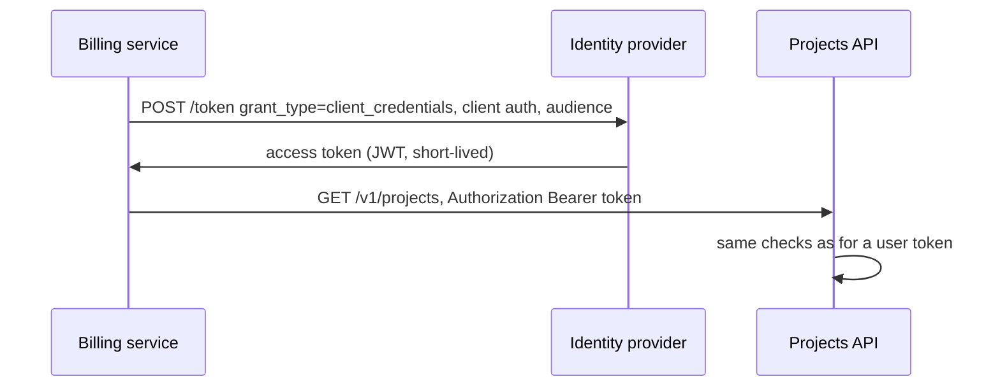

<div dir="rtl" lang="he">

# פרק 28: אבטחה לשירותי backend

רוב הפריצות לשירותי API אינן קריפטוגרפיה מתוחכמת. הן handler שמחזיר אובייקט של לקוח אחר, טוקן שנבדק רק
חלקית, שרת שמבקש כתובת שהמשתמש בחר ומגיע לרשת הפנימית, וסוד שנכתב ללוג. הפרק עובר על הרשימה של OWASP
לממשקי API, ובונה את ההגנות כקוד Go עם בדיקות: אימות טוקנים, הרשאה לכל אובייקט, הגנה מ־SSRF, מפתחות API
מגובבים ולוגים שלא מדליפים. ובסוף, מודל איומים שמחבר את כולם.

## מה נלמד בפרק

- את רשימת OWASP API Security Top 10 מ־2023, וכל פריט ממופה לקוד Go מוחשי.
- איך OIDC עובד למשתמשים (authorization code עם PKCE) ולשירותים (client credentials).
- לאמת JWT נכון עם `golang-jwt/jwt/v5`: רשימת אלגוריתמים, `iss`, `aud`, זמנים עם מרווח, ו־`kid` מתוך JWKS.
- למצוא ולתקן BOLA: handler שמחזיר אובייקט של דייר אחר, הבדיקה שתופסת אותו, והתיקון.
- להגן מ־SSRF עם בדיקת כתובת ו־`Control` של `net.Dialer` שבודק את הכתובת אחרי ה־DNS.
- לשמור מפתחות API כגיבוב, לנהל סודות, ולהשמיט סודות מלוגים של `slog`.
- להפיק SBOM, לסרוק תלויות, ולבנות מודל איומים בשיטת STRIDE.

## ידע מקדים

- פרק 6: handlers, middleware, context ולוגים עם `slog`. פרק 9: קודי סטטוס ושגיאות של API.
- פרק 10: שאילתות עם placeholders, כי התיקון של BOLA הוא שאילתה. פרק 27: סקירה לפי סיכון, ו־govulncheck.
- פרק 5: נעילות והדגל `-race`. פרק 2: Docker פועל, כי Syft, Grype ו־Trivy רצים כקונטיינרים.
- התרגיל מייבא מודול אחד מבחוץ, `github.com/golang-jwt/jwt/v5`, בגרסה המוצמדת ב־`go.mod`.

## 28.1 OWASP API Security Top 10

הארגון OWASP מפרסם רשימה של עשר הבעיות הנפוצות והמסוכנות בממשקי API. המהדורה הנוכחית, נכון לאוקטובר 2026,
היא של 2023. אין טעם לשנן אותה; יש טעם לדעת לזהות כל פריט בקוד. הטבלה ממפה כל פריט לצורה שלו ב־Go, ולמקום
בספר שמטפל בו:

| מזהה | שם | איך זה נראה בקוד Go | איפה בספר |
| --- | --- | --- | --- |
| API1 | Broken Object Level Authorization | חיפוש לפי `r.PathValue("id")` בלי הדייר מהטוקן | סעיף 28.4 |
| API2 | Broken Authentication | טוקן שנבדקת רק החתימה שלו, או אלגוריתם שלא נעול | סעיפים 28.2 ו־28.3 |
| API3 | Broken Object Property Level Authorization | struct שלם שמפוענח מהבקשה או מוחזר בתשובה, כולל שדות פנימיים | סעיף 28.4 |
| API4 | Unrestricted Resource Consumption | `limit` בלי תקרה, גוף בלי `MaxBytesReader`, בלי הגבלת קצב | פרקים 6 ו־16 |
| API5 | Broken Function Level Authorization | נתיב ניהול שבודק רק שהמשתמש מחובר, ולא את התפקיד שלו | סעיף 28.4 |
| API6 | Unrestricted Access to Sensitive Business Flows | זרימה עסקית (הרשמה, רכישה) שאפשר להריץ אוטומטית בלי גבול | מודל איומים, סעיף 28.8 |
| API7 | Server Side Request Forgery | `http.Get(url)` על כתובת שהמשתמש סיפק | סעיף 28.5 |
| API8 | Security Misconfiguration | שרת בלי זמנים קצובים, pprof על הפורט הציבורי, CORS פתוח | פרקים 6 ו־27 |
| API9 | Improper Inventory Management | גרסה ישנה של ה־API שעדיין פתוחה ואף אחד לא זוכר | פרק 9 |
| API10 | Unsafe Consumption of APIs | אמון עיוור בתשובה של שירות צד שלישי | פרק 15, וסעיף 28.5 |

שימי לב שהפריט הראשון אינו באג קריפטוגרפי. BOLA בראש הרשימה כי הוא פשוט, נפוץ, ובלתי נראה לכלים: ה־handler
עובד בדיוק כמו שנכתב, והתוקפת היא משתמשת מחוברת וחוקית שפשוט מחליפה מזהה בכתובת.

## 28.2 אימות ו־OIDC

אימות (authentication) עונה על „מי את?”. הרשאה (authorization) עונה על „מה מותר לך?”. רוב השירותים לא
מאמתים סיסמאות בעצמם: הם סומכים על ספק זהות (identity provider) חיצוני, ומקבלים ממנו טוקן חתום. הפרוטוקול
המקובל הוא OIDC (OpenID Connect), שכבת זהות מעל OAuth 2.0. הטוקן הוא בדרך כלל JWT (JSON Web Token): אובייקט
חתום בשלושה חלקים, מופרדים בנקודות.

### 28.2.1 משתמשים: authorization code עם PKCE

כשמשתמשת נכנסת לאפליקציה, האפליקציה מפנה אותה לספק, הספק מאמת אותה, ומחזיר לאפליקציה **קוד** חד־פעמי.
האפליקציה מחליפה את הקוד בטוקנים. PKCE (Proof Key for Code Exchange) מוסיף סוד חד־פעמי שנוצר בדפדפן, כך
שמי שיירט את הקוד בדרך לא יוכל להחליף אותו:

<div dir="ltr" align="left">

```mermaid
sequenceDiagram
  participant U as User browser
  participant A as App
  participant I as Identity provider
  participant S as API
  A->>A: verifier = random; challenge = SHA256(verifier)
  A->>I: redirect /authorize?code_challenge=challenge&state=s
  U->>I: login (password, MFA)
  I->>A: redirect back with code and state
  A->>I: POST /token code + verifier
  I->>I: SHA256(verifier) == challenge ?
  I->>A: access token (JWT), id token
  A->>S: GET /v1/projects, Authorization Bearer token
  S->>S: verify signature, iss, aud, exp, kid
```

</div>

| פריט | תפקיד |
| --- | --- |
| `state` | ערך אקראי שהאפליקציה בודקת כשהיא חוזרת; מונע זיוף של התחלת ההתחברות |
| `code_verifier` | סוד אקראי שנשאר אצל האפליקציה; נשלח רק בהחלפת הקוד |
| `code_challenge` | הגיבוב של ה־verifier; נשלח בהתחלה, גלוי לכולם |
| ה־id token | אומר לאפליקציה מי המשתמשת; לא נשלח ל־API |
| ה־access token | מה שה־API מקבל ובודק, עם קהל יעד (`aud`) של ה־API |

### 28.2.2 שירותים: client credentials

שירות שקורא לשירות אחר אין לו משתמשת ואין לו דפדפן. הוא מזדהה מול הספק עם מזהה וסוד משלו (או עם מפתח
פרטי, שעדיף), ומקבל access token ישירות:

<div dir="ltr" align="left">



</div>

שני כללים לשני המקרים. **ה־API לא מבחין בין המקורות**: הוא בודק את אותו טוקן באותה דרך. ו**הטוקן קצר
חיים**: דקות, לא ימים, כי JWT שנבדק מקומית אי אפשר לבטל לפני שפג תוקפו.

איך ה־API יודע מה המפתחות של הספק? הספק מפרסם מסמך גילוי (discovery) בכתובת קבועה מתחת ל־issuer, ובו כתובת
של JWKS (JSON Web Key Set: רשימת המפתחות הציבוריים שלו, כל אחד עם מזהה `kid`). הספרייה `go-oidc` (בגרסה
המוצמדת בנספח ג) עושה את הגילוי, מורידה את המפתחות ומרעננת אותם כשהספק מחליף מפתח. בתרגיל ה־JWKS הוא קובץ
מקומי, כדי שהבדיקות ירוצו בלי רשת; את ההחלפה ל־`go-oidc` בייצור תמצאי ברשימת ההמשך של מודל האיומים.

## 28.3 JWT: מה בודקים

טוקן JWT הוא `header.payload.signature`, כל חלק ב־base64url. ה־header אומר באיזה אלגוריתם נחתם (`alg`)
ובאיזה מפתח (`kid`), ה־payload הוא הטענות (claims), והחתימה מכסה את שניהם. בדיקה נכונה עונה על שש שאלות,
ולכל אחת יש התקפה מוכרת כשהיא חסרה:

| בדיקה | השאלה | מה קורה בלעדיה |
| --- | --- | --- |
| רשימת אלגוריתמים | האם `alg` הוא אחד מאלה שאני מצפה להם? | `alg: none` מתקבל; או HS256 עם המפתח הציבורי כסוד |
| `kid` | איזה מפתח מה־JWKS? האם הוא מתאים לאלגוריתם? | מפתח לא נכון, או בלבול בין סוגי מפתחות |
| חתימה | האם הטוקן נחתם במפתח הזה ולא שונה? | כל אחד כותב לעצמו `tenant` אחר |
| `iss` | האם הספק הוא הספק שלי? | טוקן מספק אחר שגם הוא נחתם כראוי |
| `aud` | האם הטוקן הונפק בשבילי? | טוקן לשירות אחר נשלח אליי ומתקבל |
| `exp`, `nbf`, `iat` | האם הוא בתוקף עכשיו, עם מרווח קטן לסטיית שעונים? | טוקן גנוב עובד לנצח |

ההתקפה בשורה הראשונה ראויה להסבר. בבלבול אלגוריתמים (algorithm confusion), השרת מחזיק מפתח RSA ציבורי
ומצפה ל־RS256. התוקפת חותמת טוקן ב־HS256, אלגוריתם סימטרי, ומשתמשת במפתח **הציבורי** כסוד. ספרייה שבוחרת
את האלגוריתם לפי ה־header תאמת את החתימה בהצלחה. ההגנה: השרת קובע את רשימת האלגוריתמים, לא הטוקן.

### 28.3.1 הקוד

כל הבדיקות האלה הן אפשרויות של ה־parser של `jwt/v5`, ו־`NewVerifier` בונה אותו פעם אחת (הקובץ
`internal/jwtauth/verifier.go`):

<div dir="ltr" align="left">

```go
	parser := jwt.NewParser(
		jwt.WithValidMethods(cfg.Methods),
		jwt.WithIssuer(cfg.Issuer),
		jwt.WithAudience(cfg.Audience),
		jwt.WithLeeway(cfg.Leeway),
		jwt.WithExpirationRequired(),
		jwt.WithIssuedAt(),
		jwt.WithTimeFunc(cfg.Now),
	)
```

</div>

| אפשרות | מה היא אוכפת |
| --- | --- |
| `WithValidMethods` | רשימת האלגוריתמים; כל `alg` אחר נדחה לפני שבודקים חתימה |
| `WithIssuer`, `WithAudience` | התאמה מדויקת של `iss`; `aud` חייב להופיע ולהכיל את השירות |
| `WithLeeway` | מרווח לסטיית שעונים על `exp`, `nbf` ו־`iat`; בתרגיל 30 שניות |
| `WithExpirationRequired` | טוקן בלי `exp` נדחה, במקום להיחשב „בתוקף לנצח” |
| `WithIssuedAt` | טוקן שהונפק בעתיד נדחה |
| `WithTimeFunc` | השעון; הבדיקות מקפיאות אותו |

לפני כן, `NewVerifier` מסרבת לתצורה מסוכנת: בלי issuer, בלי audience, או עם `none` או HS ברשימה. ברירת מחדל
של „הכול מותר” היא באג, ולכן אין ברירת מחדל.

את המפתח בוחרת פונקציה שה־parser קורא לה אחרי שבדק את האלגוריתם. היא מוצאת את ה־`kid` ב־JWKS, ומוודאת
שסוג המפתח מתאים למשפחת האלגוריתם (אותו קובץ):

<div dir="ltr" align="left">

```go
func (v *Verifier) keyFor(t *jwt.Token) (any, error) {
	kid, _ := t.Header["kid"].(string)
	if kid == "" {
		return nil, ErrNoKID
	}
	key, ok := v.cfg.Keys[kid]
	if !ok {
		return nil, fmt.Errorf("%w %q", ErrUnknownKID, kid)
	}
	switch t.Method.(type) {
	case *jwt.SigningMethodRSA, *jwt.SigningMethodRSAPSS:
		if _, ok := key.(*rsa.PublicKey); !ok {
			return nil, ErrKeyType
		}
	case *jwt.SigningMethodECDSA:
		if _, ok := key.(*ecdsa.PublicKey); !ok {
			return nil, ErrKeyType
		}
	default:
		return nil, ErrKeyType
	}
	return key, nil
}
```

</div>

ופרט אחד בטענות עצמן. הטיפוס `Claims` מוסיף לטענות הרשומות את `tenant`. המתודה `Validate` שלו דוחה טוקן
בלי דייר או בלי נושא (`sub`), וה־parser קורא לה אחרי הבדיקות הרגילות. כך חוסר בדייר נדחה כמו טוקן שפג
תוקפו.

> **איך Rust עושה את זה:** ב־crate `jsonwebtoken`, המבנה `Validation` מחזיק את רשימת האלגוריתמים, את
> המנפיק, את הקהל ואת המרווח, והפונקציה `decode` דוחה טוקן שלא מתאים. העיקרון זהה: האלגוריתם מגיע מהתצורה
> של השרת, לא מה־header.

### 28.3.2 הבדיקות

כל שורה בבדיקה הטבלאית יוצרת טוקן שתקין חוץ מדבר אחד, ומוודאת שהוא נדחה בשגיאה הנכונה. המפתחות נוצרים פעם
אחת לכל הרצה, וה־JWKS נבנה מהם, כך שאין מפתח פרטי במאגר (הקובץ `internal/jwtauth/verifier_test.go`):

<div dir="ltr" align="left">

```go
		{"alg none", func(t *testing.T) string {
			return sign(t, jwt.SigningMethodNone, "rsa-1", goodClaims(), jwt.UnsafeAllowNoneSignatureType)
		}, jwt.ErrTokenSignatureInvalid},
		{"alg confusion: HS256 keyed with the public key", func(t *testing.T) string {
			return sign(t, jwt.SigningMethodHS256, "rsa-1", goodClaims(), pubDER)
		}, jwt.ErrTokenSignatureInvalid},
```

</div>

בטבלה 19 שורות, בחמש קבוצות:

| קבוצה | השורות |
| --- | --- |
| תקינים | טוקן RS256, טוקן ES256 |
| אלגוריתם | `none`; בלבול אלגוריתמים; RS512, שאינו ברשימה |
| מנפיק וקהל | issuer שגוי; audience של שירות אחר; בלי audience |
| זמנים | פג תוקף מעבר למרווח; פג תוקף בתוך המרווח (מתקבל); בלי `exp`; `nbf` בעתיד; `iat` בעתיד |
| מפתח ותוכן | בלי `kid`; `kid` לא מוכר; מפתח EC על טוקן RSA; payload ששונה; בלי דייר; מחרוזת שאינה JWT |

השורה „פג תוקף בתוך המרווח” חשובה כמו האחרות: היא מוכיחה שהמרווח עובד, ולא רק שהכול נדחה.

ניסוי מהתרגיל מראה למה יש שתי שכבות. כשמוחקים את `WithValidMethods`, השורות של `none` ושל בלבול
האלגוריתמים עדיין נדחות, כי `keyFor` מסרבת למפתח RSA על טוקן שאינו RSA. אבל טוקן RS512 מתקבל: הוא חתום
במפתח הנכון, באלגוריתם שאף אחד לא התכוון לאשר. כל שכבה תופסת מה שהשנייה מפספסת.

ה־middleware מחזיר 401 עם הכותרת `WWW-Authenticate` לפי RFC 6750. הסיבה המדויקת נכתבת ללוג, והלקוחה מקבלת
רק `invalid_token`, כי „פג תוקף” מול „חתימה שגויה” הוא מידע שימושי לתוקפת. והטוקן עצמו לא נכתב לשום מקום.

## 28.4 הרשאות: BOLA

BOLA (Broken Object Level Authorization) הוא מצב שבו משתמשת מחוברת וחוקית מבקשת אובייקט לפי מזהה, והשירות
מחזיר אותו בלי לבדוק שהוא שלה. בקוד ההתחלה של התרגיל, המאגר מחפש לפי מזהה בלבד, וה־handler משתמש בזה
(הקובץ `starter/internal/projects/handler.go`):

<div dir="ltr" align="left">

```go
	p, err := h.Store.ByID(r.Context(), r.PathValue("id"))
```

</div>

ה־handler כן בודק שיש משתמשת מחוברת. הוא פשוט לא שואל של מי האובייקט. זו בדיוק הסיבה שאף כלי לא תופס את
זה: הקוד נכון מבחינת טיפוסים, שגיאות ומקביליות, והוא עושה מה שנכתב.

**הבדיקה שתופסת את זה** מתחזה לדייר אחד ומבקשת אובייקט של דייר אחר. היא גם בודקת שהתשובה לא מגלה אם
המזהה קיים (הקובץ `internal/projects/handler_test.go`):

<div dir="ltr" align="left">

```go
func TestTenantCannotReadAnotherTenantsProject(t *testing.T) {
	h := newServer()
	rec := as(t, h, "globex", "/v1/projects/prj_a1")
	if rec.Code != http.StatusNotFound {
		t.Fatalf("globex reading acme's project: status %d, body %q; want 404", rec.Code, rec.Body.String())
	}
	if strings.Contains(rec.Body.String(), "Acme") {
		t.Fatalf("response leaks the other tenant's data: %q", rec.Body.String())
	}
	// "Not yours" must look exactly like "does not exist", or ids can be enumerated.
	missing := as(t, h, "globex", "/v1/projects/prj_zz")
	if missing.Code != rec.Code || missing.Body.String() != rec.Body.String() {
		t.Fatalf("cross-tenant answer %d %q differs from missing-id answer %d %q",
			rec.Code, rec.Body.String(), missing.Code, missing.Body.String())
	}
}
```

</div>

על קוד ההתחלה הבדיקה נכשלת עם 200 ועם השם של הפרויקט של הדייר האחר. **התיקון** הוא להכניס את הדייר למפתח
החיפוש, כך שאי אפשר לשכוח אותו. החתימה של הממשק משתנה, והקומפיילר מוצא כל מקום שקורא לה (הקובץ
`internal/projects/store.go` בפתרון):

<div dir="ltr" align="left">

```go
func (s *MemoryStore) Get(_ context.Context, tenantID, id string) (Project, error) {
	s.mu.RLock()
	defer s.mu.RUnlock()
	p, ok := s.byID[id]
	if !ok || p.TenantID != tenantID {
		return Project{}, ErrNotFound
	}
	return p, nil
}
```

</div>

ב־PostgreSQL (פרק 10) זה אותו רעיון בשאילתה: `WHERE tenant_id = $1 AND id = $2`, ולא שליפה לפי מזהה ובדיקה
ב־Go אחריה. וה־handler לוקח את הדייר **רק מהטוקן המאומת**, לעולם לא מכותרת, מפרמטר או מגוף הבקשה.

ארבע החלטות שהתיקון מגלם:

- **404 ולא 403.** תשובה 403 מאשרת שהמזהה קיים, וזה מספיק כדי למפות מזהים של לקוחות אחרים.
- **הדייר בחתימה של המאגר.** בדיקה שה־handler עושה אחרי השליפה תישכח ב־handler הבא.
- **מזהים אקראיים לא מספיקים.** הם מקשים לנחש, אבל מזהה דולף בלוג, בקישור או בצילום מסך.
- **בדיקת BOLA לכל נתיב חדש.** זו השורה האחרונה ברשימת ההמשך של מודל האיומים.

שני האחים של BOLA ברשימה של OWASP הם אותה שאלה ברמה אחרת. ברמת השדה (API3): `Project` מסמן את `TenantID`
ב־`json:"-"`, כך שהשדה הפנימי לא יוצא בתשובה, ומפענחים קלט לטיפוס בקשה נפרד ולא ל־struct השמור. וברמת
הפונקציה (API5): נתיב ניהול בודק תפקיד, לא רק שהמשתמשת מחוברת.

## 28.5 SSRF

SSRF (Server Side Request Forgery) קורה כשהשירות שולח בקשה לכתובת שהמשתמשת בחרה. ב־Hookline, למשל, דייר
רושם כתובת שאליה יישלחו webhooks. אם הכתובת היא `http://169.254.169.254/latest/meta-data/`, השרת מבקש את
שירות המטא־דאטה של הענן ועלול להחזיר מפתחות גישה זמניים. אם היא `http://10.0.0.5:9200/`, השרת פונה לבסיס
נתונים פנימי שאף פעם לא נחשף לאינטרנט.

### 28.5.1 למה בדיקת המחרוזת לא מספיקה

הניסיון הראשון הוא לבדוק את הכתובת לפני הבקשה. הוא נשבר בשלוש דרכים:

| עקיפה | למה בדיקת מחרוזת מפספסת |
| --- | --- |
| שם שמצביע לכתובת פנימית | `internal.attacker.example` עובר כל בדיקה של מחרוזת, ונפתר ל־`10.0.0.5` |
| DNS rebinding | השם נפתר לכתובת ציבורית בבדיקה, ולכתובת פנימית שנייה אחר כך, בחיבור |
| כתיב חלופי | `0x7f000001` אינו כתובת IP בעיני `url.Parse`, אבל resolver של המערכת עשוי לפרש אותו כ־127.0.0.1 |
| הפניה | הכתובת הראשונה תקינה, והשרת שלה מחזיר 302 לכתובת פנימית |

המסקנה: **בודקים את הכתובת שאליה מתחברים בפועל, אחרי ה־DNS, בכל חיבור.** ב־Go יש לזה נקודה מדויקת: הפונקציה
`Control` של `net.Dialer` נקראת אחרי שהכתובת נפתרה ולפני `connect`, עם הכתובת של אותו ניסיון חיבור.

### 28.5.2 שתי שכבות

השכבה הראשונה, `CheckURL`, דוחה מה שאפשר לדחות מהמחרוזת: סכמה (ברירת המחדל: `https` בלבד), פרטי התחברות
בכתובת, בלי host, וכתובת IP מפורשת שנמצאת בטווח חסום. היא נותנת הודעת שגיאה ברורה מוקדם, ברישום הכתובת. השכבה
השנייה היא זו שמחזיקה (הקובץ `internal/ssrf/ssrf.go`):

<div dir="ltr" align="left">

```go
func (p Policy) Control(network, address string, _ syscall.RawConn) error {
	if network != "tcp4" && network != "tcp6" {
		return fmt.Errorf("%w: network %q", ErrBlocked, network)
	}
	ap, err := netip.ParseAddrPort(address)
	if err != nil {
		return fmt.Errorf("%w: %v", ErrBlocked, err)
	}
	return p.CheckAddr(ap.Addr())
}
```

</div>

הפונקציה `CheckAddr` מבטלת קודם את המיפוי של IPv4 בתוך IPv6, כי הכתובת `::ffff:127.0.0.1` היא בעצם
127.0.0.1. אחר כך היא בודקת מול רשימה מפורשת של טווחים:

| טווחים | למה חסומים |
| --- | --- |
| `127.0.0.0/8`, `::1/128` | loopback: השרת עצמו |
| `10.0.0.0/8`, `172.16.0.0/12`, `192.168.0.0/16`, `fc00::/7` | רשתות פרטיות; בטווח האחרון גם כתובת המטא־דאטה של AWS ב־IPv6 |
| `169.254.0.0/16`, `fe80::/10` | link-local; בטווח הראשון שירות המטא־דאטה של הענן |
| `100.64.0.0/10`, `0.0.0.0/8` | CGNAT, שמשמש לרוב רשתות פנימיות; „הרשת הזאת” |
| `64:ff9b::/96`, `2002::/16`, `2001::/32` | צורות של IPv6 שמטמיעות כתובת IPv4 |
| multicast, שמורים ותיעוד | אין סיבה לגיטימית להתחבר אליהם |

רשימה מפורשת עדיפה על המתודות `IsPrivate` ו־`IsLoopback` לבדן: היא מכסה גם טווחים שהן לא מכסות, ומראה
לסוקרת בדיוק מה חסום.

והלקוח מחבר הכול (אותו קובץ):

<div dir="ltr" align="left">

```go
func (p Policy) Client(timeout time.Duration) *http.Client {
	dialer := &net.Dialer{Timeout: 5 * time.Second, Control: p.Control}
	transport := &http.Transport{
		Proxy:                 nil, // a proxy would make the dialer check the proxy, not the target
		DialContext:           dialer.DialContext,
		ForceAttemptHTTP2:     true,
		MaxIdleConns:          100,
		IdleConnTimeout:       90 * time.Second,
		TLSHandshakeTimeout:   5 * time.Second,
		ResponseHeaderTimeout: 10 * time.Second,
	}
	return &http.Client{
		Timeout:   timeout,
		Transport: transport,
		CheckRedirect: func(req *http.Request, via []*http.Request) error {
			if len(via) >= maxRedirects {
				return fmt.Errorf("%w: more than %d redirects", ErrBlocked, maxRedirects)
			}
			_, err := p.CheckURL(req.URL.String())
			return err
		},
	}
}
```

</div>

| שורה | למה |
| --- | --- |
| `Control: p.Control` | כל חיבור, כולל אחרי הפניה וכולל כל כתובת שה־DNS החזיר, עובר את הבדיקה |
| `Proxy: nil` | עם proxy, החיבור הוא אל ה־proxy, וה־dialer היה בודק את הכתובת שלו במקום את היעד |
| `CheckRedirect` | כל הפניה נבדקת מחדש: סכמה, פרטי התחברות, כתובת מפורשת; ומספר ההפניות מוגבל |
| הזמנים הקצובים | כתובת שהמשתמשת בחרה יכולה גם להיות פשוט איטית; פרק 15 |

### 28.5.3 הבדיקות, עם שרת מקומי

שרת `httptest` מאזין על 127.0.0.1, וזה בדיוק מה שצריך: כתובת שחייבת להיחסם. כל בדיקה סופרת כמה בקשות הגיעו
לשרת, כי ההוכחה היא לא רק שגיאה, אלא שהחיבור לא נוצר בכלל. הבדיקה החשובה היא של שם שנפתר ל־loopback
(הקובץ `internal/ssrf/ssrf_test.go`):

<div dir="ltr" align="left">

```go
	byName := "http://localhost:" + u.Port() + "/"
	if _, err := httpPolicy.CheckURL(byName); err != nil {
		t.Fatalf("CheckURL(%q) = %v; a hostname should pass the string check", byName, err)
	}
	_, err := httpPolicy.Client(2 * time.Second).Get(byName)
	if !errors.Is(err, ssrf.ErrBlocked) {
		t.Fatalf("Get(%s) error = %v; want ErrBlocked from the dialer", byName, err)
	}
```

</div>

השם עובר את בדיקת המחרוזת, וה־dialer חוסם אותו. כך נראות השגיאות בהרצה על Mac (על WSL2 הכתובת שנבחרה
ל־`localhost` עשויה להיות 127.0.0.1 במקום `::1`):

<div dir="ltr" align="left">

```text
Get "http://127.0.0.1:51007": dial tcp 127.0.0.1:51007: ssrf: destination not allowed: 127.0.0.1 is in 127.0.0.0/8
Get "http://localhost:51007/": dial tcp [::1]:51007: ssrf: destination not allowed: ::1 is in ::1/128
Get "http://0x7f000001:51007/": dial tcp 127.0.0.1:51007: ssrf: destination not allowed: 127.0.0.1 is in 127.0.0.0/8
```

</div>

השורה השלישית מוכיחה את הטבלה של סעיף 28.5.1: ה־resolver של המערכת הפך את `0x7f000001` ל־127.0.0.1, ורק
ה־dialer ראה את זה. הבדיקה של התרגיל לא מניחה איזה resolver יש לך; היא דורשת רק שגיאה ואפס בקשות.

בדיקות נוספות: הפניה לכתובת המטא־דאטה, לסכמה אחרת ולכתובת עם סיסמה נחסמות; יותר מחמש הפניות נעצרות; ומדיניות
של פיתוח, עם חריג מפורש ל־`127.0.0.1/32`, כן מגיעה לשרת המקומי. Hookline משתמש באותו חריג רק במצב פיתוח.

## 28.6 ניהול סודות

סוד (secret) הוא כל ערך שמי שמחזיק בו יכול לפעול בשמך: סיסמה למסד נתונים, מפתח API, סוד חתימה, מפתח פרטי.
שלוש שאלות על כל סוד: איפה הוא נשמר, איך הוא מגיע לתהליך, ואיך מחליפים אותו.

### 28.6.1 איך הסוד מגיע לתהליך

| דרך | יתרון | חיסרון |
| --- | --- | --- |
| משתנה סביבה | פשוט, כל כלי תומך | נראה ב־`/proc/<pid>/environ`, עובר לתהליכי בן, נשפך בדוחות קריסה; החלפה דורשת הפעלה מחדש |
| קובץ שמותקן לקונטיינר | הרשאות קובץ; Kubernetes מעדכן את הקובץ כשה־Secret משתנה | צריך לקרוא מחדש כדי ליהנות מההחלפה |
| מנהל סודות (Vault, AWS Secrets Manager וכדומה) | בקרת גישה, יומן ביקורת, סודות זמניים | עוד מערכת שצריכה להיות זמינה, ועוד הרשאה לנהל |

ב־Kubernetes, האובייקט `Secret` **מקודד ב־base64, לא מוצפן**. כל מי שיכול לקרוא אותו ב־API קורא את הערך.
שלושה דברים מגנים עליו:

- הרשאות גישה ב־RBAC, לפי מינימום הרשאות (least privilege).
- הצפנה במנוחה של מאגר הנתונים של ה־cluster, שהמנהלת שלו מפעילה.
- לא לשמור אותו גלוי במאגר Git.

פרק 20 מראה איך מחברים Secret ל־pod.

**החלפה (rotation)** היא הבדיקה האמיתית. סוד שאי אפשר להחליף בלי השבתה לא יוחלף, גם אחרי שדלף. הדפוס: שני
ערכים תקפים בזמן החפיפה (הישן והחדש), הפצה של החדש, ורק אחר כך ביטול הישן. JWKS עושה בדיוק את זה עם מפתחות
חתימה: כמה `kid` בבת אחת.

### 28.6.2 מפתחות API מגובבים

מפתח API הוא סוד ארוך טווח שהשירות שלך מנפיק. כלל הברזל: **שומרים רק גיבוב (hash)**. אם בסיס הנתונים דולף,
התוקפת מקבלת גיבובים, לא מפתחות. במפתח של התרגיל שלושה חלקים, `hl_<id>_<secret>`:

| חלק | תפקיד |
| --- | --- |
| הקידומת `hl` | אומרת מה המחרוזת: אדם מזהה אותה, וסורקי סודות ב־Git מוצאים אותה |
| המזהה | 6 בתים אקראיים בהקסדצימלי; ציבורי, ומשמש לחיפוש השורה |
| הסוד | 32 בתים מ־`crypto/rand`, ב־base64url |

הנה ההנפקה והאימות (הקובץ `internal/apikey/apikey.go`):

<div dir="ltr" align="left">

```go
func Generate(prefix, owner string) (plaintext string, stored Stored, err error) {
	if !prefixRE.MatchString(prefix) {
		return "", Stored{}, errors.New("apikey: prefix must be 2 to 8 lowercase letters")
	}
	buf := make([]byte, idBytes+secretBytes)
	if _, err := rand.Read(buf); err != nil { // never fails on supported platforms; checked anyway
		return "", Stored{}, err
	}
	id := hex.EncodeToString(buf[:idBytes])
	secret := base64.RawURLEncoding.EncodeToString(buf[idBytes:])
	plaintext = prefix + "_" + id + "_" + secret
	return plaintext, Stored{ID: id, Hash: sha256.Sum256([]byte(plaintext)), Owner: owner}, nil
}
```

</div>

<div dir="ltr" align="left">

```go
func (s Stored) Matches(key string) bool {
	sum := sha256.Sum256([]byte(key))
	return subtle.ConstantTimeCompare(sum[:], s.Hash[:]) == 1
}
```

</div>

**למה SHA-256 ולא bcrypt?** גיבוב איטי כמו bcrypt או argon2 נועד לסיסמאות: ערכים שאנשים בוחרים, עם מעט
אנטרופיה, שאפשר לנחש במיליארדי ניסיונות. למפתח שלנו 256 ביטים אקראיים, ואין מה לנחש: גם בגיבוב מהיר, חיפוש
ממצה לא יסתיים לעולם. גיבוב איטי היה רק עולה זמן CPU **בכל בקשה**, והופך כל בקשה עם מפתח שגוי לדרך זולה
להעמיס על השירות. ולמה השוואה בזמן קבוע? כדי שזמן התשובה לא יגלה כמה בתים ראשונים של הגיבוב התאימו. כאן
החשיפה קטנה, כי התוקפת לא שולטת בגיבוב, אבל ההשוואה הזאת לא עולה כלום ומונעת ויכוח.

המפתח מוצג למשתמשת פעם אחת, ביצירה. אם איבדה אותו, מנפיקים חדש ומבטלים את הישן; אין „שחזור”.

### 28.6.3 לעולם לא ללוג

לוגים מועתקים, נשמרים חודשים, ונקראים על ידי יותר אנשים מאשר בסיס הנתונים. החבילה `redact` של התרגיל נותנת
שלושה כלים, מהחזק לחלש:

- **הטיפוס `Secret`:** מחרוזת שכל צורת הדפסה שלה היא `[REDACTED]`, בכל דרך שבה Go מדפיסה ערך.
- **הפונקציה `ReplaceAttr`:** מחליפה ערכים לפי שם המפתח, ולפי צורת הערך.
- **הפונקציה `Header`:** כותבת כותרות HTTP כקבוצה, כי `ReplaceAttr` לא נכנסת לתוך maps.

הפונקציה `ReplaceAttr` מתחברת ל־`slog.HandlerOptions`, ו־`slog` קורא לה לכל מאפיין, גם בתוך קבוצות (הקובץ
`internal/redact/redact.go`):

<div dir="ltr" align="left">

```go
func ReplaceAttr(_ []string, a slog.Attr) slog.Attr {
	if a.Value.Kind() == slog.KindGroup {
		return a // slog calls ReplaceAttr again for each member
	}
	if sensitive(a.Key) {
		return slog.String(a.Key, Redacted)
	}
	if a.Value.Kind() == slog.KindString && secretShapes.MatchString(a.Value.String()) {
		return slog.String(a.Key, secretShapes.ReplaceAllString(a.Value.String(), Redacted))
	}
	return a
}
```

</div>

הבדיקה כותבת ללוג סיסמה, טוקן, מפתח API, סוד חתימה ועוגייה בכל הצורות שיש להן (לפי שם, בתוך קבוצה, דרך
`With`, בתוך משפט חופשי, ככותרת), ומוודאת שאף אחד מהם לא מופיע בפלט. והיא בודקת גם את הכיוון ההפוך: שהכתובת
ושאר הערכים הרגילים נשארו, כי מסנן שמוחק יותר מדי מכבים מהר מאוד. כך נראית שורה אחת:

<div dir="ltr" align="left">

```text
{"time":"...","level":"INFO","msg":"calling endpoint","url":"https://hooks.example.com","Authorization":"[REDACTED]","note":"retrying with [REDACTED]","signing_secret":"[REDACTED]"}
```

</div>

בדיקה שלישית מתעדת את המגבלה: `slog.Any("headers", h)` עם `http.Header` גולמי **כן** מדליף, כי זה map. היא
עוברת כל עוד הדליפה קיימת, וכך אם `slog` ישתנה, הבדיקה תגיד לעדכן את התיעוד. מסנן כזה הוא רשת ביטחון, לא
תחליף לא לכתוב סודות מלכתחילה.

## 28.7 SBOM וסריקת תלויות

ה־SBOM (Software Bill of Materials: רשימה של כל הרכיבים שנכנסו לתוכנה, עם גרסאות) עונה על שאלה שתוקפים
שואלים מהר מכם: „איפה אצלנו רץ הרכיב הפגיע שפורסם הבוקר?” עם SBOM לכל image, התשובה היא חיפוש, לא חפירה.
שלושה כלים, כולם רצים כקונטיינרים:

| כלי | מה הוא עושה |
| --- | --- |
| Syft | מפיק SBOM מתיקייה, מ־image או מקובץ הרצה, בפורמטים CycloneDX או SPDX |
| Grype | סורק SBOM, תיקייה או image מול מאגרי חולשות |
| Trivy | סורק חולשות, סודות ותצורה שגויה בתיקייה, ב־image או ב־cluster |

הפקה של SBOM לתרגיל של הפרק, בתוך התיקייה שלו. לתרגיל תלות חיצונית אחת, וזה מה שהטבלה מראה:

<div dir="ltr" align="left">

```bash
cd ~/senior-course/ch28
docker run --rm -v "$PWD:/src:ro" anchore/syft:v1.54.0 scan dir:/src -o table
docker run --rm -v "$PWD:/src:ro" anchore/syft:v1.54.0 scan dir:/src -o cyclonedx-json > sbom.cdx.json
```

</div>

<div dir="ltr" align="left">

```text
NAME                          VERSION  TYPE       
github.com/golang-jwt/jwt/v5  v5.3.1   go-module
```

</div>

ואז הסריקה. כדי לראות ממצא, סורקים את קוד ההתחלה של פרק 27, שמצמיד בכוונה גרסה ישנה של `x/text`:

<div dir="ltr" align="left">

```bash
docker run --rm -v "$HOME/senior-course/ch27/seeded:/src:ro" anchore/grype:v0.120.0 dir:/src
docker run --rm -v "$HOME/senior-course/ch27/seeded:/src:ro" aquasec/trivy:0.75.0 fs --scanners vuln /src
```

</div>

הפלט של Grype, מהרצה ב־5 באוקטובר 2026 (המספרים אצלך יהיו אחרים, כי המאגר מתעדכן):

<div dir="ltr" align="left">

```text
NAME               INSTALLED  FIXED IN  TYPE       VULNERABILITY        SEVERITY  EPSS         RISK  
golang.org/x/text  v0.3.7     0.3.8     go-module  GHSA-69ch-w2m2-3vjp  High      1.5% (72nd)  1.1   
golang.org/x/text  v0.3.7     0.39.0    go-module  GO-2026-5970         High      0.5% (38th)  0.4
```

</div>

ו־Trivy מוצא את אותן שתיים, תחת המזהים `CVE-2022-32149` ו־`CVE-2026-56852`, שתיהן בחומרה גבוהה. אותה חולשה
מופיעה תחת מזהים שונים במאגרים שונים, ולכן משווים בין סורקים לפי הרכיב והגרסה המתוקנת, לא לפי המזהה. וסריקה
של ה־SBOM של התרגיל עצמו, עם Grype, מסתיימת ב־`No vulnerabilities found`.

השווי לפלט של govulncheck בפרק 27, סעיף 27.6. הסורקים הכלליים מדווחים על כל חולשה שתואמת את הגרסה, בלי
לשאול אם הקוד קורא לה; govulncheck הפריד בין החולשה שנקראת לבין זו שרק קיימת. מצד שני, הסורקים הכלליים
רואים מה ש־govulncheck לא רואה: חבילות של מערכת ההפעלה ב־image, קוד Python, סודות שנשכחו בקבצים. בפועל
מריצים את שניהם: govulncheck על הקוד ב־CI, וסורק כללי על ה־image לפני שהוא נדחף (פרק 23).

> **שימי לב:** הסורקים מורידים מאגר חולשות בהרצה הראשונה, מאות מגה־בתים, ולכן היא איטית. ה־SBOM והתוצאות
> משתנים כשהמאגר מתעדכן: אותה סריקה מחר עשויה למצוא יותר. תאריך הסריקה הוא חלק מהתוצאה.

## 28.8 מודל איומים

מודל איומים (threat model) הוא מסמך קצר שעונה על ארבע שאלות: מה אנחנו בונים, מה יכול להשתבש, מה אנחנו עושים
לגבי זה, והאם עשינו עבודה טובה. הוא נכתב לפני הקוד, ומתעדכן כשמשהו משתנה: קורא חדש, מאגר חדש, תלות חיצונית.

השיטה STRIDE עוברת על כל רכיב בתרשים זרימת הנתונים, ובעיקר על כל חציה של גבול אמון (trust boundary), ושואלת
שש שאלות:

| אות | איום | השאלה | ההגנה הטיפוסית |
| --- | --- | --- | --- |
| S | התחזות (Spoofing) | האם מישהו יכול להעמיד פנים שהוא מישהו אחר? | אימות: JWT, מפתחות, mTLS |
| T | שינוי (Tampering) | האם מישהו יכול לשנות נתונים או קוד בדרך? | חתימות, TLS, הרשאות כתיבה |
| R | הכחשה (Repudiation) | האם מישהו יכול להכחיש פעולה כי אין הוכחה? | לוגים של פעולות, עם מזהה ובלי סודות |
| I | חשיפת מידע (Information disclosure) | האם מישהו יכול לקרוא מה שלא שלו? | הרשאה לכל אובייקט, הסתרת שדות, לוגים נקיים |
| D | מניעת שירות (Denial of service) | האם מישהו יכול להשבית? | זמנים קצובים, גבולות גודל, הגבלת קצב |
| E | העלאת הרשאות (Elevation of privilege) | האם מישהו יכול לעשות מה שהתפקיד שלו לא מתיר? | הרשאה לכל פונקציה, מינימום הרשאות, SSRF |

התבנית של התרגיל (בתיקייה `data`) מבקשת שישה דברים: תיאור קצר, תרשים זרימה עם גבולות אמון, נכסים, טבלת
איומים, החלטות, והמשך. בטבלת האיומים לכל שורה יש עמודה שרוב המודלים שוכחים: **הבדיקה או הראיה**. איום
שמסומן „מטופל” בלי בדיקה הוא תקווה. הנה שתי שורות מהמודל המלא של הפתרון (הקובץ `solution/docs/threat-model.md`):

<div dir="ltr" align="left">

```text
| T4 | Project store | I | Tenant B requests tenant A's project id (BOLA) | Tenant from the verified token is part of every store lookup; same 404 for missing and foreign | `TestTenantCannotReadAnotherTenantsProject`, `TestListIsScopedToTenant` | Low for these routes; every new route needs the same test | service team |
| T6 | Outbound calls | E | A tenant registers `http://169.254.169.254/...` or a name resolving to 10.x and makes us fetch it (SSRF) | `ssrf.Policy`: URL check, dialer `Control` on the resolved address, redirects re-checked, no proxy | `TestClientChecksResolvedAddress`, `TestRedirectsAreRechecked` | Low; IPv6 ranges list must be kept current | service team |
```

</div>

שלושה הרגלים שהופכים את המודל לשימושי:

- **סיכון שנשאר נכתב.** „טוקן גנוב תקף עד שפג תוקפו” הוא סיכון שמקבלים בכוונה, עם סיבה ועם מה שישנה את
  ההחלטה.
- **לכל שורה בעלים.** איום בלי בעלים לא יטופל.
- **המודל קצר.** עמוד או שניים שנקראים עדיפים על עשרים שאף אחד לא פותח.

בראיון, מודל איומים הוא דרך מצוינת לענות על „איך היית מאבטחת את המערכת הזאת?”: תרשים, גבולות אמון, ואז
STRIDE על כל חציה. Hookline, באבן הדרך M9, כותב את המודל שלו באותה תבנית.

## סיכום

- רשימת OWASP API Top 10 מ־2023 מתחילה ב־BOLA: משתמשת חוקית, מזהה של מישהו אחר, ובלי כלי שיתפוס את זה.
- OIDC: authorization code עם PKCE למשתמשים, client credentials לשירותים; ה־API בודק את שני הטוקנים באותה דרך.
- JWT: האלגוריתם מהתצורה, `kid` מה־JWKS עם סוג מפתח מתאים, `iss` ו־`aud` מדויקים, `exp` חובה, מרווח קטן.
- BOLA מתוקן בהכנסת הדייר למפתח החיפוש ובחתימה של המאגר, עם 404 זהה ובדיקה לכל נתיב.
- SSRF: בדיקת המחרוזת נותנת הודעה, ה־`Control` של ה־dialer נותן ביטחון; בלי proxy, והפניות נבדקות מחדש.
- סודות: Secret של Kubernetes הוא base64, החלפה היא הבדיקה האמיתית, ומפתחות API נשמרים כ־SHA-256.
- לוגים: `Secret`, `ReplaceAttr` ו־`Header`, ובדיקה שמוודאת שהסודות לא בפלט והשאר כן.
- SBOM מ־Syft, וסריקה עם Grype או Trivy לצד govulncheck.
- מודל איומים בשיטת STRIDE, ולכל שורה בו בדיקה ובעלים.

## מונחים לזכור

| מונח בעברית | באנגלית | במשפט אחד |
| --- | --- | --- |
| אימות | authentication | לקבוע מי הקוראת, למשל לפי טוקן חתום |
| הרשאה | authorization | לקבוע מה מותר לקוראת לעשות ועל אילו אובייקטים |
| ספק זהות | identity provider | שירות שמאמת משתמשים ושירותים ומנפיק טוקנים |
| BOLA | Broken Object Level Authorization | גישה לאובייקט של מישהו אחר לפי מזהה, בלי בדיקת בעלות |
| בלבול אלגוריתמים | algorithm confusion | חתימה ב־HS256 עם המפתח הציבורי, שמתקבלת אם האלגוריתם לא נעול |
| קהל יעד | audience (`aud`) | השירות שהטוקן הונפק בשבילו |
| מרווח לסטיית שעונים | leeway | הזמן שבו טוקן שפג תוקפו או שעוד לא תקף עדיין מתקבל |
| SSRF | Server Side Request Forgery | השירות מבקש כתובת שהתוקפת בחרה ומגיע לרשת הפנימית |
| DNS rebinding | DNS rebinding | שם שנפתר לכתובת אחרת בין הבדיקה לבין החיבור |
| סוד | secret | ערך שמי שמחזיק בו יכול לפעול בשמך |
| החלפת סודות | rotation | הנפקת ערך חדש וביטול הישן, עם חפיפה ובלי השבתה |
| גיבוב | hash | פונקציה חד־כיוונית; שומרים אותה במקום הסוד |
| השוואה בזמן קבוע | constant-time compare | השוואה שזמנה לא תלוי במספר הבתים שהתאימו |
| SBOM | Software Bill of Materials | רשימת כל הרכיבים והגרסאות שנכנסו לתוכנה |
| מודל איומים | threat model | מסמך שאומר מה בונים, מה יכול להשתבש ומה עושים לגבי זה |
| גבול אמון | trust boundary | המקום שבו נתונים עוברים מצד פחות אמין לצד אמין יותר |
| מינימום הרשאות | least privilege | לכל רכיב רק ההרשאות שהוא חייב |

## טעויות נפוצות

- **לבחור את האלגוריתם לפי ה־header.** טוקן עם `alg: none`, או HS256 עם המפתח הציבורי, מתקבל. הרשימה באה
  מהתצורה.
- **לבדוק רק את החתימה.** טוקן חתום כראוי שהונפק לשירות אחר (`aud`) או על ידי ספק אחר (`iss`) מתקבל.
- **`exp` לא חובה.** טוקן בלי `exp` נחשב בתוקף לנצח. `WithExpirationRequired`.
- **לשלוף לפי מזהה ולבדוק בעלות אחר כך ב־Go.** הבדיקה נשכחת ב־handler הבא. הדייר בשאילתה ובחתימה.
- **להחזיר 403 על אובייקט של דייר אחר.** זה מאשר שהמזהה קיים. 404, זהה לחלוטין לחסר.
- **לבדוק SSRF רק במחרוזת.** שם שנפתר ל־10.x, הפניה או DNS rebinding עוקפים אותה. `Control` על ה־dialer.
- **לשכוח את ה־proxy.** `http.ProxyFromEnvironment` גורם ל־dialer לבדוק את ה־proxy. `Proxy: nil` בלקוח המוגן.
- **bcrypt למפתחות API אקראיים.** עלות CPU בכל בקשה בלי שום תועלת. SHA-256 על 256 ביטים אקראיים.
- **לחשוב ש־Secret של Kubernetes מוצפן.** הוא base64. RBAC והצפנה במנוחה.

## שאלות ראיון

1. **למה חייבים לנעול את האלגוריתם באימות JWT?**
   כי ה־header של הטוקן נשלט בידי מי ששלח אותו. ספרייה שבוחרת לפי `alg` תקבל `none` בלי חתימה, או HS256
   שבו המפתח הציבורי של השרת משמש כסוד משותף, ואת המפתח הציבורי כולם מכירים. לכן השרת מחזיק רשימה סגורה,
   ובודק גם שסוג המפתח של ה־`kid` מתאים לאלגוריתם. העלות היא תצורה מפורשת, ושינוי שלה כשהספק עובר אלגוריתם.

   **המשך:** ואיך מתמודדים עם החלפת מפתחות אצל הספק? ה־JWKS מכיל כמה מפתחות עם `kid` שונים; מורידים אותו
   מחדש מדי פעם, ובמיוחד כשמגיע `kid` לא מוכר, עם הגבלה על התדירות כדי שטוקנים מזויפים לא יגרמו להצפה.

2. **מה זה BOLA, ולמה הוא בראש הרשימה של OWASP?**
   משתמשת מחוברת וחוקית מבקשת אובייקט לפי מזהה, והשירות מחזיר אותו בלי לבדוק שהוא שלה. הוא נפוץ כי כל
   נתיב עם מזהה הוא הזדמנות לשכוח, והוא בלתי נראה לכלים כי הקוד עושה בדיוק מה שנכתב. התיקון המבני הוא להכניס
   את הדייר מהטוקן לחתימה של המאגר ולשאילתה, ולהחזיר 404 זהה לאובייקט חסר; ובדיקה של „דייר אחר” לכל נתיב.

3. **למה בדיקה של מחרוזת הכתובת לא מספיקה נגד SSRF?**
   כי מה שנבדק אינו מה שמתחברים אליו. שם יכול להיפתר לכתובת פנימית, להיפתר לכתובת אחרת בין הבדיקה לחיבור,
   להיכתב בצורה שה־resolver מפרש אחרת, או להחזיר הפניה. ב־Go בודקים ב־`Control` של `net.Dialer`, שמקבל את
   הכתובת אחרי ה־DNS, לפני `connect`, בכל ניסיון. ובנוסף: בלי proxy, הפניות נבדקות מחדש, וזמנים קצובים. בדיקת
   המחרוזת נשארת בשביל הודעת שגיאה טובה ברישום.

4. **למה מגבבים מפתחות API, ולמה לא עם bcrypt?**
   כדי שדליפה של בסיס הנתונים לא תיתן מפתחות שעובדים. bcrypt ודומיו איטיים בכוונה כדי להגן על סיסמאות
   שאנשים בוחרים, שאפשר לנחש. למפתח אקראי של 256 ביטים אין מה לנחש, ולכן SHA-256 מספיק, וגיבוב איטי רק היה
   מוסיף עלות CPU לכל בקשה ופותח פתח להעמסה. ההחלטה משתנה אם המפתחות נבחרים בידי אנשים.

5. **איך היית בונה מודל איומים לשירות חדש?**
   תרשים זרימת נתונים עם השחקנים, השירותים, המאגרים והמערכות החיצוניות, ועליו גבולות האמון. אחר כך STRIDE על
   כל חציה, ולכל איום: ההגנה, הבדיקה שמוכיחה אותה, הסיכון שנשאר, ובעלים. הוא נכתב לפני הקוד ומתעדכן בכל שינוי
   מהותי. החולשה של השיטה היא שהיא תלויה בתרשים: מה שלא צויר לא ייבדק, ולכן מתחילים מהתרשים ומבקשים ממישהו
   אחר לסקור אותו.

## פתק Obsidian

הפתק המוכן נמצא גם כקובץ: `obsidian/28-security-backend.md`. זה תוכנו:

- **OWASP API Top 10 מ־2023:** BOLA ראשון, כי הוא נפוץ ובלתי נראה לכלים.
- **OIDC:** קוד עם PKCE למשתמשים, client credentials לשירותים; טוקנים קצרי חיים.
- **JWT:** אלגוריתם מהתצורה, `kid` עם סוג מפתח מתאים, `iss`, `aud`, `exp` חובה, מרווח קטן.
- **BOLA:** הדייר מהטוקן בחתימה של המאגר ובשאילתה; 404 זהה לחסר; בדיקה לכל נתיב.
- **SSRF:** בדיקת מחרוזת להודעה, `Control` של ה־dialer לביטחון; בלי proxy; הפניות נבדקות.
- **סודות:** משתנה סביבה, קובץ או מנהל סודות; Secret של Kubernetes הוא base64; החלפה עם חפיפה.
- **מפתחות API:** קידומת, מזהה ציבורי, 32 בתים; SHA-256 בלבד; השוואה בזמן קבוע.
- **לוגים:** `Secret`, `ReplaceAttr`, `Header`; maps לא מסוננים.
- **שרשרת אספקה:** SBOM עם Syft, Grype או Trivy, ו־govulncheck לצידם.
- **STRIDE:** שש שאלות על כל גבול אמון, ולכל שורה בדיקה ובעלים.
- **שאלה פתוחה:** ___

<div dir="ltr" align="left">

```text
OWASP API 2023: API1 BOLA, API2 AuthN, API3 property, API4 resources, API5 function, API6 flows,
                API7 SSRF, API8 misconfig, API9 inventory, API10 unsafe consumption
jwt.NewParser(WithValidMethods, WithIssuer, WithAudience, WithLeeway, WithExpirationRequired, WithIssuedAt, WithTimeFunc)
keyfunc: kid -> JWKS key; RSA methods need *rsa.PublicKey, ECDSA needs *ecdsa.PublicKey
401 + WWW-Authenticate: Bearer realm="...", error="invalid_token"
store.Get(ctx, tenantID, id)   SQL: WHERE tenant_id = $1 AND id = $2   -> 404 for foreign ids
net.Dialer{Control: policy.Control}   Transport{Proxy: nil}   CheckRedirect re-checks URL
blocked: 127/8 10/8 172.16/12 192.168/16 169.254/16 100.64/10 0/8 ::1 fc00::/7 fe80::/10 64:ff9b::/96
api key: <prefix>_<id hex>_<32 bytes base64url>; store sha256; subtle.ConstantTimeCompare
slog.HandlerOptions{ReplaceAttr: redact.ReplaceAttr}
docker run --rm -v "$PWD:/src:ro" anchore/syft:v1.54.0 scan dir:/src -o cyclonedx-json
docker run --rm -v "$PWD:/src:ro" anchore/grype:v0.120.0 dir:/src
STRIDE: Spoofing Tampering Repudiation Information-disclosure Denial-of-service Elevation
my STRIDE: top residual risk ___ owner ___
```

</div>

## תרגיל

**מטרה:** לבנות middleware שמאמת JWT עם בדיקה לכל דרישה, לתקן BOLA עם בדיקה שמוכיחה את התיקון, לבנות לקוח
HTTP מוגן מ־SSRF, להנפיק ולאמת מפתחות API מגובבים, לסנן סודות מלוגים, להפיק SBOM ולסרוק, ולמלא מודל איומים.
**זמן:** שני ימי לימוד, ימים 83 ו־84, כ־55 ו־60 דקות בנייה.
**ידע מקדים:** הפרק, פרקים 5, 6, 9 ו־10, הסעיף על govulncheck בפרק 27, ו־Docker פועל.

הצעדים, קוד ההתחלה, הרמזים והפתרון נמצאים
ב־[`exercises/ch28-security/README.md`](../exercises/ch28-security/README.md).

**קריטריון סיום:**

- לכל בדיקה של JWT יש שורה בבדיקה הטבלאית שדוחה טוקן שגוי, והכול עובר.
- בדיקת ה־BOLA מראה שדייר אחר מקבל 404 זהה לחסר, וגם הרשימה מסוננת לפי דייר.
- הלקוח המוגן דוחה loopback, טווחים פרטיים ו־link-local, כולל שם שנפתר לאחד מהם והפניה אליהם.
- מפתחות API נשמרים כגיבוב בלבד, והבדיקה של הסינון מוכיחה שאף סוד לא מגיע ללוג.
- ה־SBOM הופק, תוצאת הסריקה שלך נשמרה עם התאריך, וטבלת STRIDE מלאה.

## העשרה אופציונלית

- הרשימה המלאה של OWASP API Security Top 10 מ־2023 כוללת לכל פריט תרחישי תקיפה ודרכי מניעה. קראי את API3
  ואת API6, שהפרק נגע בהם רק בקצרה.
- ב־RFC 8725, „JSON Web Token Best Current Practices”, מתוארות ההתקפות על JWT וההגנות, כולל בלבול אלגוריתמים.
- ב־RFC 7636 מוגדר PKCE, וב־RFC 9700 מתוארות שיטות העבודה המומלצות לאבטחת OAuth 2.0.
- החליפי את ה־JWKS הסטטי ב־`go-oidc`: `oidc.NewProvider` מבצע את הגילוי, ו־`Verifier` שלו בודק טוקנים עם
  מפתחות שמתרעננים. שימי לב שאת הבדיקות של הדייר עדיין צריך לעשות בעצמך.
- הספר „Threat Modeling: Designing for Security” של Adam Shostack הוא המקור של STRIDE בצורתו המעשית.
