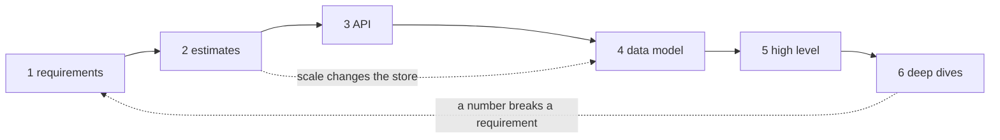
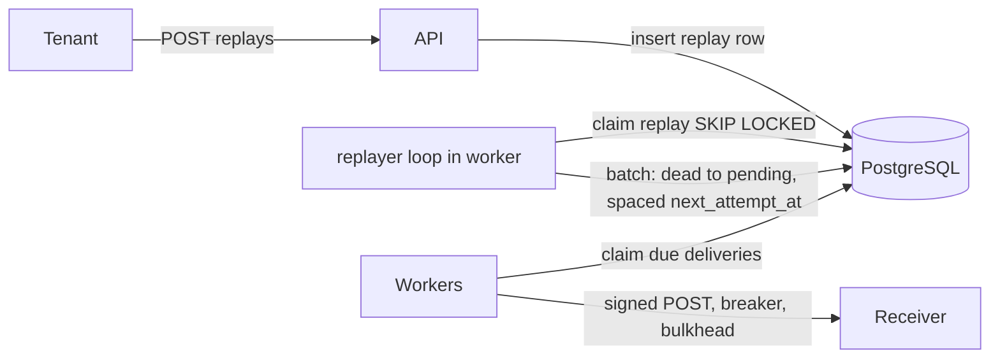
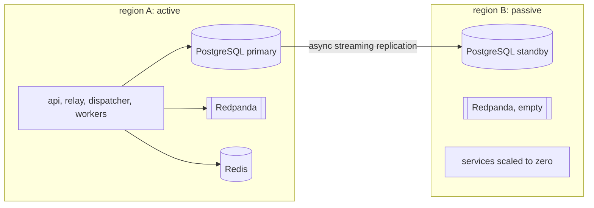

<div dir="rtl" lang="he">

# פרק 29: שיטת תכנון ומסמכי תכנון

מתכנתת בכירה נמדדת לא רק בקוד שהיא כותבת, אלא בהחלטות שהיא מקבלת לפני שיש קוד, ובאופן שבו היא כותבת אותן
כך שאחרים יוכלו לבדוק אותן. הפרק נותן שיטה אחת שחוזרת על עצמה: בראיון תכנון מערכות, במסמך תכנון בעבודה,
וברשומת החלטה קצרה. בסופו יש שני מסמכים מלאים על Hookline, ומחשבון קטן שהופך הנחות למספרים.

## מה נלמד בפרק

- שיטה בשישה צעדים: דרישות ולא־מטרות, הערכת גודל, API, מודל נתונים, תכנון כללי, וצלילה לעומק עם מצבי כשל
  ופשרות.
- הערכת גודל מהירה עם הנחות כתובות: חזקות של שתיים, שניות ביום, וסדרי הגודל של זמני תגובה.
- תבנית של מסמך תכנון, ולמה כל סעיף בה קיים.
- רשומת החלטה (ADR) בפורמט של Nygard, ומתי היא עדיפה על מסמך.
- שני מסמכים לדוגמה: הפעלה חוזרת בכמות גדולה ב־Hookline, ומעבר של Hookline לשני אזורים.

## ידע מקדים

- פרק 37: המפרט של Hookline. שני המסמכים בפרק מרחיבים אותו, וכדאי לפתוח אותו לידם.
- פרק 13, סעיף 13.7: תבנית ה־outbox. פרק 14: ניסיונות חוזרים ומצב `dead`.
- פרק 15: מפסק זרם ומחיצה אטומה. פרק 16: הגבלת קצב.
- פרק 17, סעיפים 17.2 ו־17.3: שכפול ב־PostgreSQL ופיגור שכפול.
- פרק 25, סעיף 25.1: יעדי רמת שירות.
- פרק 7: פרויקט Python עם uv והכלים שלו. המחשבון בתרגיל בנוי באותה צורה.

## 29.1 שיטה בשישה צעדים

### 29.1.1 למה שיטה

בעיית תכנון פתוחה, כמו „תכנני מערכת התראות”, מזמינה לקפוץ ישר לרכיבים: תור, מטמון, מסד. התוצאה היא בדרך
כלל תשובה טובה לשאלה אחרת. שיטה קבועה עוזרת בשני מקומות. בראיון היא מראה למראיינת שאת שולטת בתהליך, ולא
רק מכירה טכנולוגיות. בעבודה היא מבטיחה שהמסמך עונה על השאלות שהסוקרים ישאלו, לפני שהם שואלים.

הנה ששת הצעדים. כל צעד מייצר תוצר, וכל תוצר מזין את הבא:

| צעד | השאלה | התוצר |
| --- | --- | --- |
| 1. דרישות ולא־מטרות | מה המערכת עושה, בשביל מי, ומה היא לא עושה | רשימת דרישות שאפשר לבדוק, ורשימת לא־מטרות |
| 2. הערכת גודל | כמה: בקשות בשנייה, בתים, רוחב פס | מספרים עם הנחות כתובות |
| 3. API | איך מדברים עם המערכת | נתיבים או הודעות, עם דוגמה |
| 4. מודל נתונים | מה נשמר, ואיך מחפשים אותו | טבלאות, מפתחות ואינדקסים |
| 5. תכנון כללי | אילו רכיבים, ומה זורם ביניהם | תרשים, ופסקה לכל רכיב |
| 6. צלילה לעומק | איפה זה נשבר, ומה המחיר של כל בחירה | מצבי כשל, פשרות, ומה היה משנה את דעתך |

<div dir="ltr" align="left">



</div>

החצים המקווקווים חשובים לא פחות מהישרים. הערכה שמראה שני טרה־בייט בחודש משנה את מודל הנתונים. צלילה
שמגלה שאי אפשר לעמוד בדרישה מחזירה אותך לדרישות, עם שאלה למנהלת המוצר. שיטה היא לא מפל מים; היא סדר
שבו שואלים, ומותר לחזור.

### 29.1.2 דרישות ולא־מטרות

דרישה טובה היא כזו שאפשר לבדוק. „המערכת מהירה” היא משאלה; „99% מהבקשות עונות תוך 200 מילישניות בפרופיל
העומס הזה” היא דרישה, עם בדיקה. המפרט של Hookline בפרק 37 בנוי כך: לכל דרישה עמודה של איך בודקים אותה.

לא־מטרה (non-goal) היא דבר שקוראת סבירה הייתה מצפה שתעשי, ואת בכוונה לא עושה. היא לא „כל מה שלא כתוב”. היא
רשימה קצרה של ציפיות שאת מנטרלת מראש, למשל „לא נבטיח מסירה בדיוק פעם אחת” או „לא נריץ בשני אזורים בו
בזמן”. בלי הרשימה הזאת, כל סוקר מוסיף בראש את מה שחשוב לו, והמסמך גדל עד שאי אפשר לאשר אותו.

### 29.1.3 מ־API ועד צלילה לעומק

- **ה־API** בא לפני הרכיבים, כי הוא החוזה. דוגמה אחת של בקשה ותשובה מעלה מיד שאלות של מזהים, כפילויות ודפדוף (פרק 9).
- **מודל הנתונים** נגזר מהשאילתות: לכל שאילתה חמה אינדקס, ולכל כלל שאסור לשבור אילוץ במסד (פרקים 10 ו־11).
- **התכנון הכללי** הוא תרשים אחד, ופסקה לכל רכיב: מה הוא מחזיק, ומה קורה כשהוא נופל.
- **הצלילה לעומק** היא המקום שבו רואים בכירות: שניים או שלושה חלקים קשים, לעומק.

לכל פשרה יש שלושה חלקים, כמו בטבלת ההחלטות של פרק 37 (סעיף 37.5): החלופה הפשוטה, למה לא היא כאן, ומה היה
משנה את דעתך. החלק השלישי הוא זה שמבדיל תשובה בכירה. הוא מראה שההחלטה תלויה בתנאים, ושאת יודעת מהם.

> **שימי לב:** בראיון של 45 דקות אין זמן לכל הצעדים לעומק. חלוקה שעובדת היא כחמש דקות לדרישות, חמש להערכה,
> עשר ל־API ולנתונים, עשר לתכנון הכללי, וחמש־עשרה לצלילה. זו הצעה, לא כלל, ומראיינת טובה תכוון אותך לחלק
> שמעניין אותה. תני לה.

## 29.2 הערכות גודל מהירות

### 29.2.1 למה לחשב, ומה לחשב

הערכת גודל (back-of-the-envelope estimate) היא חישוב גס, בסדר גודל, שמטרתו להחליט. השאלה היא לא „כמה בדיוק”,
אלא „האם זה נכנס במכונה אחת או לא”, „האם הדיסק נגמר בחודש או בעשור”. ההבדל בין 100 בקשות בשנייה ל־100,000
הוא הבדל בין שרת אחד עם PostgreSQL לבין חלוקה למחיצות (partitioning). ההבדל בין 100 ל־200 כמעט לא משנה שום
החלטה.

שלושה מספרים חוזרים כמעט בכל תכנון:

| מה | הנוסחה | מה הוא מכריע |
| --- | --- | --- |
| בקשות בשנייה (QPS) | בקשות ביום חלקי 86,400, ואז כפול יחס השיא | כמה מכונות, איזה מסד, האם צריך תור |
| אחסון | גודל רשומה, כפול כמות ביום, כפול ימי שמירה, ועוד אינדקסים ועותקים | איזה דיסק, מתי מוחקים, האם מחלקים |
| רוחב פס | בתים לבקשה כפול בקשות בשנייה | האם הרשת היא צוואר הבקבוק, ועלות תעבורה |

### 29.2.2 מספרים לזכור בעל פה

יום הוא 86,400 שניות, כלומר בערך 10 בחזקת 5. מכאן כלל אצבע: מיליון בקשות ביום הן כ־12 בשנייה, ועשרה
מיליון ביום הן כ־116 בשנייה. בחישוב בראש מעגלים בלי היסוס, ואומרים בקול שעיגלת.

חזקות של שתיים קרובות לחזקות של עשר, וזה מה שמאפשר לחשב בראש:

| חזקה של שתיים | בערך | יחידת אחסון |
| --- | --- | --- |
| 2 בחזקת 10 | אלף | KiB |
| 2 בחזקת 20 | מיליון | MiB |
| 2 בחזקת 30 | מיליארד | GiB |
| 2 בחזקת 40 | טריליון | TiB |

אחסון מודדים בחזקות של שתיים, ורשת בחזקות של עשר ובביטים: קישור של 1 Gbit/s מעביר 10 בחזקת 9 ביטים
בשנייה, כלומר 125 מיליון בתים. בלבול בין בתים לביטים הוא טעות של פי שמונה, והיא נפוצה מאוד.

### 29.2.3 זמני תגובה: סדרי גודל

הטבלה המוכרת ביותר של זמני פעולות היא מהרצאה של Jeff Dean משנת 2009. הכתובת נבדקה באוקטובר 2026. ההרצאה
היא קובץ PDF, והטבלה בשקף 24:
[Designs, Lessons and Advice from Building Large Distributed Systems](https://www.cs.cornell.edu/projects/ladis2009/talks/dean-keynote-ladis2009.pdf).
אלה המספרים כפי שהם בשקף:

<div dir="ltr" align="left">

```text
L1 cache reference                             0.5 ns
Branch mispredict                              5 ns
L2 cache reference                             7 ns
Mutex lock/unlock                             25 ns
Main memory reference                        100 ns
Compress 1K bytes with Zippy               3,000 ns
Send 2K bytes over 1 Gbps network         20,000 ns
Read 1 MB sequentially from memory       250,000 ns
Round trip within same datacenter        500,000 ns
Disk seek                             10,000,000 ns
Read 1 MB sequentially from disk      20,000,000 ns
Send packet CA->Netherlands->CA      150,000,000 ns
```

</div>

שני דברים חשובים לגבי הטבלה. הראשון: אלה **סדרי גודל**, לא מדידות של המחשב שלך. החומרה השתנתה מאז, ובמיוחד
הדיסקים בטבלה הם דיסקים מסתובבים, לפני שכונני SSD נעשו נפוצים בשרתים. השני: מה שנשאר נכון הוא היחסים. זיכרון
מהיר ממרכז נתונים, מרכז נתונים מהיר מיבשת אחרת, וכל אחד בסדר גודל של פי מאה או יותר.

מה לוקחים מזה לתכנון:

- **קפיצה ברשת בתוך מרכז נתונים** עולה חצי מילישנייה, בערך כמו מאות קריאות מהזיכרון. שרשרת של עשר קפיצות
  כבר מורגשת.
- **הלוך וחזור בין יבשות** עולה כ־150 מילישניות. דרישה של 200 מילישניות לבקשה לא משאירה מקום לאישור כתיבה
  מיבשת אחרת. זה בדיוק השיקול של סעיף 29.6.

> **שימי לב:** בראיון, אל תצטטי ננו־שניות כאילו מדדת אותן. אמרי „בערך חצי מילישנייה להלוך וחזור בתוך מרכז
> נתונים, בסדר גודל”, והראי איך המספר משנה את ההחלטה.

### 29.2.4 המחשבון: הנחות בקובץ, חשבון בקוד

בתרגיל יש מחשבון קטן, `sizing`, שמקבל קובץ TOML של הנחות ומדפיס בקשות, כתיבות, אחסון ורוחב פס. הרעיון הוא
שההנחות כתובות, עם הסבר לידן, ונשמרות ליד מסמך התכנון. כשמישהי שואלת „למה 1.9 טרה־בייט”, התשובה היא קובץ ולא
זיכרון. הנה תחילת הקובץ `exercises/ch29-design-docs/data/hookline-baseline.toml`:

<div dir="ltr" align="left">

```toml
# Hookline in production, a year from now. Every number is an assumption, not a measurement:
# replace them with yours and keep the reason next to each one.
name = "Hookline baseline"

[traffic]
requests_per_day = 10_000_000  # ingested events: 200 tenants, 50,000 events a day each
peak_factor = 4.0              # business hours plus month-end invoicing bursts

[[records]]
name = "events"
bytes = 1_500          # 1 KiB JSON payload, ids, key, hash, tuple header
per_request = 1.0
retention_days = 30

[[records]]
name = "deliveries"
bytes = 250
per_request = 2.0      # average endpoints subscribed per event (fan-out)
retention_days = 30
```

</div>

הקובץ ממשיך עם רשומות הניסיונות, שתי תעבורות רשת, והגדרות אחסון. הפורמט TOML נבחר כי הספרייה הסטנדרטית
של Python קוראת אותו (`tomllib`), והוא תומך בהערות. החשבון עצמו קצר בכוונה. הנה שתי פונקציות מהקובץ
`exercises/ch29-design-docs/solution/src/sizing/calc.py`:

<div dir="ltr" align="left">

```python
def qps(a: Assumptions) -> Rate:
    """Requests per second, on average and at the peak."""
    average = a.traffic.requests_per_day / SECONDS_PER_DAY
    return Rate(average=average, peak=average * a.traffic.peak_factor)
```

</div>

<div dir="ltr" align="left">

```python
def retained_bytes(a: Assumptions) -> float:
    """Bytes on disk in steady state: each record kept for its retention, plus indexes, times
    the number of copies."""
    raw = sum(bytes_per_day(a, r) * r.retention_days for r in a.records)
    return raw * (1 + a.storage.index_overhead) * a.storage.replicas
```

</div>

הקוד לא חכם, וזה העיקר: הערך של הערכה נמצא בהנחות, והן צריכות להישאר גלויות. כך מריצים אותו על הקובץ:

<div dir="ltr" align="left">

```bash
uv run sizing ../data/hookline-baseline.toml
```

</div>

<div dir="ltr" align="left">

```text
== Hookline baseline
requests               average      115.7/s   peak      463.0/s
events                 average      115.7/s   peak      463.0/s   14.0 GiB/day, kept 30 days
deliveries             average      231.5/s   peak      925.9/s   4.7 GiB/day, kept 30 days
attempts               average      277.8/s   peak    1,111.1/s   2.7 GiB/day, kept 30 days
storage retained       1.9 TiB (index overhead 50%, copies 2)
network                average 4.8 Mbit/s   peak 19.0 Mbit/s
```

</div>

אלה תוצאות של חשבון על הנחות, לא מדידה. מה הן אומרות לתכנון:

- **כ־460 אירועים בשנייה בשיא, ועוד כ־1,100 ניסיונות.** זה בתחום של PostgreSQL אחד על מכונה טובה, אבל זה
  כבר מספר שצריך לבדוק בבדיקת עומס, לא להניח.
- **כ־1.9 טרה־בייט בשמירה של 30 יום.** מחיקה של שורות ישנות היא חלק מהתכנון, לא משימה לעתיד. חלוקת הטבלה
  לפי יום, ומחיקה של מחיצה שלמה, זולה בהרבה ממחיקה של מיליוני שורות.
- **הרשת זניחה.** 19 מגה־ביט בשנייה בשיא לא קרובים לגבול של כרטיס רשת. אין סיבה לדחוס, ולא כדאי להשקיע בזה.

> **טעות נפוצה:** להעריך רק את הממוצע. מערכות נופלות בשיא. יחס השיא הוא הנחה כמו כל השאר: כתבי אותה, וכתבי
> למה. „ארבע, בגלל שעות עבודה וחשבוניות של סוף חודש” עדיף על „ארבע”.

## 29.3 מסמך תכנון

### 29.3.1 בשביל מה

מסמך תכנון (design doc) הוא תיאור כתוב של בעיה, של הפתרון המוצע, ושל החלופות שנפסלו, שנכתב **לפני** הקוד
ונסקר בידי מי שיחיו איתו. יש לו שלושה תפקידים:

- **החלטה זולה.** לשנות פסקה זול יותר מלשנות שירות שרץ. סוקרת שמוצאת בעיה במסמך חוסכת חודש.
- **הסכמה.** צוותים שכנים, אבטחה, תפעול ומוצר רואים את השינוי לפני שהוא מגיע אליהם.
- **זיכרון.** בעוד שנה, מישהי תשאל למה המערכת בנויה כך. המסמך עונה, כולל מה שקלו ופסלו.

מודעות בכירות בשוק המקומי לא כותבות „design doc”, אבל מבקשות את הפעולה: להוביל תכנון טכני
(`01-market-research.md`, סעיף 1.3).

### 29.3.2 התבנית

בתרגיל יש תבנית מוכנה, `exercises/ch29-design-docs/templates/design-doc.md`. התבנית באנגלית, כי בצוותים רבים
מסמכי עבודה נכתבים באנגלית; המסמכים לדוגמה בפרק כתובים בעברית ובאותו מבנה. אלה הסעיפים, ולמה כל אחד קיים:

| סעיף | מה בו | למה הוא שם |
| --- | --- | --- |
| הקשר (Context) | מה קיים, מה הבעיה, למה עכשיו | קוראת שלא מכירה את המערכת צריכה להבין את הבעיה ממנו לבד |
| מטרות ולא־מטרות | מטרות שאפשר לבדוק, וציפיות שמנוטרלות | גבול ברור לסקירה |
| דרישות והערכות | דרישות, יעדים, ופלט המחשבון | המספרים שההחלטות נשענות עליהם |
| הצעה | ‏API, נתונים, תכנון כללי, צלילות, מצבי כשל | ששת הצעדים של סעיף 29.1, בכתב |
| חלופות | לפחות שתיים, כולל „לא לעשות כלום” | מראה שההצעה נבחרה, ולא הייתה הדבר הראשון שעלה |
| סיכונים | סבירות, השפעה, מה עושים, ומי אחראית | מה עלול להשתבש גם אם התכנון נכון |
| פריסה וחזרה לאחור | סדר הצעדים, דגלים, מה מנטרים, ומתי חוזרים | שינוי שאי אפשר לבטל הוא שינוי מסוכן |
| שאלות פתוחות | מה עוד לא הוחלט, מי מחליטה ועד מתי | כנות לגבי מה שלא ידוע |

והנה סעיף החלופות מתוך קובץ התבנית, כדי לראות את הצורה:

<div dir="ltr" align="left">

```text
## 5. Alternatives considered
| Option | Why it is attractive | Why not (here, now) | What would change my mind |
| --- | --- | --- | --- |
| Do nothing | | | |
```

</div>

השורה „Do nothing” כבר כתובה בתבנית בכוונה. „לא לעשות כלום” היא תמיד חלופה, ולפעמים היא הנכונה. אם את לא
מצליחה להסביר מה המחיר שלה, אולי הבעיה לא שווה מסמך.

### 29.3.3 איך כותבים מסמך שנקרא

- **אורך.** מספיק כדי שסוקרת תוכל לאשר בלי פגישה. מסמך של שלושה עמודים שנקרא עדיף על עשרים שלא.
- **קודם המסקנה.** פסקה ראשונה שאומרת מה מוצע, ואז הפירוט. סוקרים עסוקים קוראים את ההתחלה.
- **מספרים עם מקור.** כל מספר הוא מדידה (עם תאריך ומקום) או הנחה (עם סיבה). שום מספר לא „ידוע”.
- **סטטוס.** טיוטה, בסקירה, מאושר, או הוחלף. מסמך ישן שנראה תקף מטעה יותר ממסמך חסר.

## 29.4 ADR

### 29.4.1 רשומה של החלטה אחת

רשומת החלטה (ADR) קטנה בהרבה ממסמך תכנון: היא מתעדת **החלטה אחת**, בעמוד אחד או
שניים, ונשמרת במאגר הקוד לצד הקוד שהיא משפיעה עליו. הפורמט נוסח בידי Michael Nygard בפוסט מנובמבר 2011. הכתובת
נבדקה באוקטובר 2026:
[Documenting Architecture Decisions](https://cognitect.com/blog/2011/11/15/documenting-architecture-decisions).

החלקים לפי הפוסט:

| חלק | מה בו |
| --- | --- |
| כותרת (Title) | צירוף שמני קצר שמזהה את ההחלטה |
| הקשר (Context) | הכוחות שפועלים: טכניים, פוליטיים, חברתיים, ושל הפרויקט |
| החלטה (Decision) | התשובה, בקול פעיל: „We will…” |
| סטטוס (Status) | מוצעת, התקבלה, הוצאה משימוש, או הוחלפה |
| השלכות (Consequences) | המצב אחרי ההחלטה, הטוב והרע יחד |

עוד שלושה כללים מהפוסט: הרשומות ממוספרות ברצף, ומספר לא חוזר לשימוש. החלטה שהתהפכה לא נמחקת; הרשומה הישנה
מסומנת „הוחלפה” עם הפניה לחדשה. והרשומות נכתבות כשיחה עם מפתחת עתידית, במשפטים שלמים. בתבנית שבתרגיל,
`exercises/ch29-design-docs/templates/adr.md`, הסטטוס עלה לראש הקובץ, כדי שיהיה הדבר הראשון שרואים; זה שינוי
נפוץ, והתוכן זהה.

### 29.4.2 מסמך או רשומה

| מצב | מה לכתוב |
| --- | --- |
| שינוי שנוגע בכמה רכיבים, צריך סקירה של כמה צוותים, או לוקח שבועות | מסמך תכנון |
| בחירה אחת שמישהי תשאל עליה בעוד שנה: ספרייה, פורמט, גבול בין שירותים | ‏ADR |
| מסמך תכנון שאושר | ‏ADR לכל החלטה מרכזית בו, עם קישור למסמך |

המסמך מסביר את התכנון כולו בזמן נתון, ומתיישן. הרשומות הן יומן החלטות שנשאר נכון, כי כל שינוי הוא רשומה
חדשה. במאגר, ספרייה כמו `docs/adr/` עם קבצים ממוספרים מספיקה. רשומה מלאה לדוגמה סוגרת את סעיף 29.6. שימי לב
לפסקת ההשלכות שלה: היא אומרת מה היה גורם להחלטה להשתנות, וזה החלק שהכי עוזר לקוראת העתידית.

## 29.5 מסמך לדוגמה: הפעלה חוזרת ב־Hookline

המסמך הזה מרחיב דרישה קיימת. במפרט, הדרישה F7 נותנת הפעלה חוזרת של מסירה אחת: נתיב שמחזיר מסירה ממצב
`dead` ל־`pending`. זה הנתיב:

<div dir="ltr" align="left">

```text
POST /v1/deliveries/{id}/replay
```

</div>

המסמך מציע הפעלה חוזרת בכמות גדולה, אחרי תקלה ארוכה אצל מקבל. הוא כתוב בתבנית, בקיצור.

### 29.5.1 הקשר, מטרות ולא־מטרות

**הקשר.** כשה־endpoint של לקוחה נופל לשעות, המסירות אליו נכשלות, מגיעות למספר הניסיונות המרבי, ועוברות
ל־`dead`. כשהוא חוזר, הדיירת רוצה את כל מה שהוחמץ. עם F7 בלבד היא צריכה לדפדף ברשימת המתות ולקרוא לנתיב
פעם לכל מסירה: מאות אלפי קריאות, שכל אחת מהן נספרת במגבלת הקצב שלה.

**מטרות:**

- **G1:** דיירת מפעילה מחדש את כל המסירות המתות של endpoint אחד בחלון זמן, בבקשה אחת.
- **G2:** ההפעלה החוזרת לא מציפה את המקבל: קצב מרבי לכל endpoint, ומפסק הזרם ממשיך להגן עליו.
- **G3:** מסירות חדשות למקבלים אחרים לא נפגעות. היעד N2 (מסירה תוך 30 שניות) נשמר.
- **G4:** בקשה חוזרת עם אותו מפתח אידמפוטנטיות לא מפעילה שוב.

**לא־מטרות:**

- **NG1:** לא נפעיל מחדש מסירות שנמסרו. מי שרוצה לקבל שוב אירוע שכבר קיבל, צריך תכונה אחרת.
- **NG2:** לא נשנה את תוכן האירוע. ההפעלה החוזרת שולחת בדיוק את מה שנשלח, עם אותו `Hookline-Event-Id`.
- **NG3:** אין ממשק משתמש. ‏API בלבד.

### 29.5.2 הערכה

ההנחה למקרה הגרוע: פעם ביום, endpoint של דיירת גדולה נופל לשש שעות, ומקבל 20 מסירות בשנייה. זה
20 כפול 21,600 שניות, כלומר 432,000 מסירות מתות. ההנחות בקובץ `exercises/ch29-design-docs/data/hookline-replay.toml`,
והפלט:

<div dir="ltr" align="left">

```text
== Replay of a 6-hour outage, once a day
requests               average        5.0/s   peak       50.0/s
attempts               average        5.5/s   peak       55.0/s   54.4 MiB/day, kept 30 days
storage retained       4.8 GiB (index overhead 50%, copies 2)
network                average 70.4 kbit/s   peak 704.0 kbit/s
```

</div>

המסקנות:

- **הקצב, לא האחסון, הוא השאלה.** בקצב של 50 לשנייה, 432,000 מסירות לוקחות 8,640 שניות, כ־2.4 שעות. זה סביר
  לתקלה של שש שעות, וזה מספר שהדיירת צריכה לראות בתשובה.
- **50 לשנייה הם כעשירית מהניסיונות בשיא של הבסיס** (כ־1,100 בשנייה, סעיף 29.2.4). הפעלה חוזרת אחת לא משנה את
  גודל המערכת, אבל עשר במקביל כבר כן. מכאן גבול על מספר ההפעלות הפעילות לדיירת.
- **אחסון נוסף זניח:** פחות מ־5 GiB בשמירה של 30 יום, מול 1.9 TiB של הבסיס.

### 29.5.3 ‏API

הנתיב החדש יוצר הפעלה חוזרת, ומחזיר מיד 202 עם מזהה:

<div dir="ltr" align="left">

```text
POST /v1/endpoints/{endpoint_id}/replays
Idempotency-Key: 6f1c2a9e-replay-after-outage
{"from": "2026-10-05T02:00:00Z", "to": "2026-10-05T08:00:00Z"}

202 Accepted
Location: /v1/replays/9b0e6c1a-...
{"id": "9b0e6c1a-...", "status": "running", "total": 432000, "requeued": 0,
 "rate_per_sec": 50, "estimated_seconds": 8640}

GET /v1/replays/{id}  ->  200 {"status": "running", "total": 432000, "requeued": 120500, ...}
```

</div>

- **אסינכרוני ואידמפוטנטי.** תשובה 202 ומשאב של התקדמות, כמו בפרק 9; אותו מפתח עם גוף אחר מחזיר 422, כמו F3.
- **מוגבל ומבודד.** חלון של עד שבעה ימים ועד שתי הפעלות פעילות לדיירת, אחרת 429; ‏endpoint של דיירת אחרת מחזיר 404 (F9).

### 29.5.4 מודל נתונים

שני שינויים. טבלה חדשה:

| עמודה | טיפוס | הערה |
| --- | --- | --- |
| `id` | `uuid` | מפתח ראשי |
| `tenant_id`, `endpoint_id` | `uuid` | מפתח זר מורכב, כמו במנויים |
| `window_from`, `window_to` | `timestamptz` | החלון לפי `deliveries.created_at` |
| `idempotency_key`, `body_hash` | `text`, `bytea` | ייחודי לפי דיירת ומפתח |
| `status` | `text` | ‏`running`, ‏`paused`, ‏`done` או `canceled` |
| `total`, `requeued` | `integer` | להתקדמות |
| `cursor_id` | `uuid` | השורה האחרונה שהוחזרה, כדי להמשיך אחרי קריסה |

ועמודה חדשה ב־`deliveries`: ‏`attempt_base integer NOT NULL DEFAULT 0`. הסיבה היא בצלילה הבאה.

### 29.5.5 תכנון כללי וצלילות

אין שירות חדש. לולאה חדשה בבינארי של ה־worker לוקחת הפעלה פעילה עם `FOR UPDATE SKIP LOCKED` (פרק 11), ובכל
סבב מחזירה מנה של עד 500 מסירות מתות ל־`pending`, עם `next_attempt_at` מפוזר לפי הקצב. משם, ה־workers הרגילים
שולחים אותן כמו כל מסירה, דרך אותו מפסק ואותה מחיצה.

<div dir="ltr" align="left">



</div>

**צלילה 1: קצב.** המנה מקבלת זמני ניסיון מפוזרים: השורה ה־k במנה מתוזמנת ל־`now() + k / rate` שניות. אחרי
שהמנה תוזמנה, הלולאה ממתינה עד הזמן של השורה האחרונה בה, ורק אז לוקחת מנה חדשה. כך יש לכל היותר מנה אחת בתור
לכל endpoint, והקצב מוגבל בלי מנגנון חדש. אם המקבל עדיין חלש, המפסק של פרק 15 נפתח, הניסיונות נדחים
ב־`next_attempt_at`, והלולאה לא מוסיפה מנה עד שהקודמת נשלחה.

**צלילה 2: מספור ניסיונות.** מסירה מתה הגיעה ל־`attempts` המרבי. אם מחזירים אותה ל־`pending` כמו שהיא, הניסיון
הבא נכשל פעם אחת ומיד חוזרת ל־`dead`. אפשר לאפס את `attempts`, אבל טבלת `attempts` מחזיקה מפתח ייחודי על
`(delivery_id, n)`, והניסיון הבא היה מתנגש בניסיון מספר 1 הישן. ההצעה: לא לאפס. ההפעלה החוזרת שומרת
ב־`attempt_base` את מספר הניסיונות עד עכשיו. ה־worker מחשב את ההפרש בין שתי העמודות, ומשווה אותו למקסימום.
יומן הניסיונות נשאר רציף, והכותרת `Hookline-Attempt` ממשיכה לעלות, כך שהמקבלת רואה שזה ניסיון חוזר.

**צלילה 3: נכונות תחת כפילות ותחרות.** המעבר של מנה הוא פקודה אחת:

<div dir="ltr" align="left">

```sql
UPDATE deliveries SET status = 'pending', attempt_base = attempts, next_attempt_at = $spaced
WHERE id = ANY($batch_ids) AND status = 'dead'
```

</div>

התנאי `status = 'dead'` הופך כל צירוף לבטוח. שתי הפעלות חופפות לאותו endpoint לא מחזירות שורה פעמיים: השנייה
מוצאת אותה כבר `pending`, ומדלגת. הפעלה ישנה ש־F7 כבר החזירה משורה אחת היא אותו מקרה. והמקבלת מקבלת את אותו
`Hookline-Event-Id`, ולכן גם אם המסירה „מתה” רק כי התשובה אבדה בדרך, הסינון לפי מזהה אצלה מונע עיבוד כפול.

**מצבי כשל:**

| כשל | השפעה | טיפול | הוכחה |
| --- | --- | --- | --- |
| ה־worker קורס באמצע מנה | המנה תוזמנה חלקית | ‏`cursor_id` נשמר באותה טרנזקציה עם המנה, והמשך מאותה נקודה | בדיקת נקודת קריסה |
| המקבל עדיין למטה | ניסיונות שנכשלים שוב | המפסק נפתח; אחרי המקסימום, `dead` שוב, וההפעלה מסתיימת `done` עם ספירה | בדיקה עם ה־sink במצב `timeout` |
| דיירת מפעילה עשר פעמים | עומס על ה־workers | שתי הפעלות פעילות לכל היותר, 429 מעבר לזה | בדיקת API |

### 29.5.6 חלופות, סיכונים ופריסה

| חלופה | למה מושכת | למה לא כאן | מה היה משנה את דעתי |
| --- | --- | --- | --- |
| לא לעשות כלום: הדיירת קוראת ל־F7 בלולאה | אפס קוד | מאות אלפי בקשות, מגבלת הקצב שלה נשרפת, ואין לנו שליטה על הקצב למקבל | תקלות ארוכות נדירות מאוד אצל כל הדיירות |
| לפרסם את האירועים שוב ל־Redpanda | משתמש בצנרת הקיימת | ה־dispatcher לא ייצור מסירות חדשות בגלל הייחודיות על `(event_id, endpoint_id)`; וגם אם כן, האירוע היה נשלח לכל המנויים ולא רק ל־endpoint שנפל | אף פעם, לבעיה הזאת |
| ‏`UPDATE` אחד גדול בתוך הבקשה | פשוט, מיידי | טרנזקציה ארוכה על מאות אלפי שורות, ומבול של מסירות בבת אחת על מקבל שרק חזר | חלונות קטנים מאוד בלבד |

**סיכונים:** הפעלה חוזרת על endpoint שהדיירת לא תיקנה באמת שורפת ניסיונות. הטיפול: ההפעלה מתחילה בניסיון
אחד, ורק אם הוא מצליח ממשיכה, ומחזירה `status: "paused"` אחרת.

**פריסה:**

1. מיגרציה שמוסיפה את `attempt_base` עם ברירת מחדל 0. ב־PostgreSQL 18 זה שינוי בקטלוג בלבד, בלי שכתוב של הטבלה (פרק 30, סעיף 30.1).
2. גרסת worker שמשווה למקסימום את ההפרש בין שתי העמודות. עם ערך 0, ההתנהגות זהה לגרסה הקודמת.
3. הטבלה החדשה, הנתיב והלולאה, מאחורי דגל תכונה לפי דיירת, לשתי דיירות ראשונות.
4. מעקב: זמן מסירה של דיירות אחרות (N2), והמדד של עומק התור. חזרה לאחור: כיבוי הדגל. השורות שכבר הוחזרו ממשיכות כרגיל.

**שאלות פתוחות:** האם ההפעלה החוזרת סופרת במגבלת הקצב של הדיירת? מי מחליטה: מנהלת המוצר, לפני שלב 3.

## 29.6 מסמך לדוגמה: מעבר לשני אזורים

### 29.6.1 הקשר, מטרות ולא־מטרות

**הקשר.** נניח ש־Hookline רצה בייצור באזור (region) אחד של ספק ענן. אזור אחד הוא נקודת כשל אחת. דיירת גדולה
מבקשת התחייבות: אם האזור כולו לא זמין, המערכת חוזרת לעבוד בתוך זמן מוגדר, ומה שאושר לא הולך לאיבוד.

שני מונחים: **RTO** הוא כמה זמן מותר להיות למטה, ו־**RPO** הוא כמה נתונים, בזמן, מותר לאבד.

**מטרות (יעדים למדידה בתרגול, לא הבטחות):**

- **G1:** זמן התאוששות של 30 דקות לאובדן אזור, לפי runbook ידני.
- **G2:** אובדן של עד 10 שניות של אירועים שאושרו, בתנאי שפיגור השכפול בגבולות ההתראה.
- **G3:** אפס מסירות חסרות אחרי מעבר: כל מסירה שלא נמסרה תימסר, אולי פעמיים.
- **G4:** היעד N1 (‏200 מילישניות לקליטה) נשמר.

**לא־מטרות:**

- **NG1:** לא נריץ פעיל־פעיל (active-active). רק אזור אחד מקבל כתיבות בכל רגע.
- **NG2:** לא יהיה מעבר אוטומטי. אדם מחליט, לפי runbook, כי מעבר שגוי עולה יותר מכמה דקות של המתנה.
- **NG3:** לא ננתב דיירות לאזור הקרוב אליהן.

### 29.6.2 הערכה

השאלה הראשונה היא אם הרשת בין האזורים תעמוד בשכפול. ההנחה: כל אירוע מייצר בערך כפליים מגודל השורות שנכתבות
בגללו, ביומן הכתיבה (WAL) של PostgreSQL. ההנחות בקובץ `exercises/ch29-design-docs/data/hookline-two-regions.toml`, והפלט:

<div dir="ltr" align="left">

```text
== Two regions: cross-region replication
requests               average      115.7/s   peak      463.0/s
WAL                    average      115.7/s   peak      463.0/s   41.9 GiB/day, kept 2 days
storage retained       83.8 GiB (index overhead 0%, copies 1)
network                average 4.2 Mbit/s   peak 16.7 Mbit/s
```

</div>

המסקנות:

- **רוחב הפס לא מגביל.** כ־17 מגה־ביט בשנייה בשיא זה מעט. המחיר הוא כסף על תעבורה בין אזורים, לא יכולת.
- **זמן התגובה מגביל.** שכפול סינכרוני (synchronous replication) אומר שכל אישור כתיבה מחכה להלוך וחזור לאזור
  השני. בין יבשות זה בסדר גודל של 150 מילישניות (סעיף 29.2.3), וזה שובר את N1. בין שני אזורים באותה יבשת
  זה פחות, ואת המספר צריך למדוד בין האזורים שתבחרי. תמדדי ותרשמי: ___ מילישניות ב־p99.
- **כ־84 GiB של יומן** נשמרים על הדיסק של ה־primary, כדי שעותק שפיגר יוכל להשלים. זה חלק מגודל הדיסק.

### 29.6.3 ההצעה: פעיל־פסיבי עם שכפול אסינכרוני

<div dir="ltr" align="left">



</div>

- **PostgreSQL** הוא הרכיב היחיד שמשוכפל. באזור ב' רץ עותק בשכפול אסינכרוני (פרק 17, סעיף 17.2). עותק נוסף
  באזור א', לנפילה של מכונה אחת, הוא החלטה נפרדת.
- **Redpanda לא משוכפל.** זה הרעיון המרכזי של המסמך, והוא בצלילה הבאה.
- **‏Redis לא משוכפל.** הוא מחזיק מגבלות קצב ומטמון. אחרי מעבר הוא מתחיל ריק: המטמון נבנה מחדש מ־PostgreSQL,
  והמגבלה מתחילה מחדש, וזה מקובל.
- **השירותים באזור ב'** מותקנים ומוכנים, עם אפס עותקים. המעבר מגדיל אותם.

### 29.6.4 צלילות

**צלילה 1: מה הולך לאיבוד, ולמה ה־topic לא צריך שכפול.** בגלל תבנית ה־outbox, כל אירוע נמצא קודם במסד, ורק
אחר כך ב־topic. אחרי מעבר, האירועים שכבר פורסמו באזור א' אבל לא הפכו למסירות נעלמו יחד עם ה־topic. אבל
השורות שלהם ב־outbox שוכפלו, עם `published_at`. לכן ה־runbook מפרסם מחדש את כל שורות ה־outbox שפורסמו בחלון
האחרון: ארוך מהפיגור המרבי של ה־consumers ומפיגור השכפול יחד, נניח עשר דקות. ה־dispatcher מתעלם מכפילויות
בזכות הייחודיות על `(event_id, endpoint_id)`. ה־topic הוא נגזרת של המסד, ולכן אפשר לבנות אותו מחדש.

**צלילה 2: מסירות באמצע.** מסירות במצב `in_flight` משוכפלות עם זמן החכירה שלהן. באזור ב' החכירה פגה, והן
נשלחות שוב, וחלקן כבר נמסרו. החוזה הוא „לפחות פעם אחת” עם סינון אצל המקבלת (פרק 37), ולכן זה תקין, והמסמך אומר זאת במפורש.

**צלילה 3: RPO אמיתי.** בשכפול אסינכרוני, אירוע שאושר ב־201 ועוד לא הגיע לאזור ב' הולך לאיבוד במעבר. הדיירת
לא יודעת שהוא אבד. שלוש תגובות:

- **מדידה.** מדד של פיגור השכפול לאזור ב', והתראה כשהוא עובר 5 שניות לאורך דקה. ה־RPO שווה לפיגור ברגע הנפילה.
- **חוזה.** ה־RPO מופיע בהתחייבות לדיירות. דיירת שזה לא מספיק לה יכולה לשמור אצלה את מפתחות האידמפוטנטיות
  של הדקות האחרונות, ולשלוח שוב: הקליטה אידמפוטנטית (F3), ולכן זה בטוח.
**צלילה 4: שני מסדים ראשיים.** הסכנה הגדולה במעבר ידני היא שאזור א' חוזר לחיים בזמן שאזור ב' כבר מקבל כתיבות. אז
יש שני מסדים שמקבלים כתיבות, ושתי היסטוריות שאי אפשר לאחד. ה־runbook מתחיל בגידור (fencing): מוודאים
שאזור א' לא מקבל תעבורה ושהשירותים בו כבויים, ורק אז מקדמים את העותק באזור ב'. החזרה לאזור א' היא לא „להדליק
אותו”, אלא לבנות אותו מחדש כעותק של אזור ב', ולעשות מעבר מתוכנן חזרה.

**מצבי כשל:**

| כשל | השפעה | טיפול | הוכחה |
| --- | --- | --- | --- |
| אובדן אזור א' | אין שירות | ‏runbook: גידור, קידום העותק, הגדלת השירותים, פרסום מחדש של חלון ה־outbox, מעבר ה־DNS | תרגול רבעוני, זמן נמדד מול RTO |
| הקישור בין האזורים נופל | הפיגור גדל, ה־RPO גדל | התראה על פיגור; היומן נשמר על הדיסק של אזור א' | תרגול: לחסום את הקישור ולמדוד |
| אזור א' חוזר אחרי מעבר | סכנה של שני primaries | גידור לפני קידום; אזור א' נבנה מחדש כעותק | שלב ב־runbook, נבדק בתרגול |
| מעבר מיותר בגלל תקלה קצרה | אובדן נתונים בגודל הפיגור, בלי סיבה | אדם מחליט; קודם מחכים לפי עץ החלטה ב־runbook | סקירת תקריות |

### 29.6.5 חלופות, סיכונים ופריסה

| חלופה | למה מושכת | למה לא כאן | מה היה משנה את דעתי |
| --- | --- | --- | --- |
| לא לעשות כלום, ולשחזר מגיבוי באזור אחר | זול, פשוט | ‏RPO של שעות, ו־RTO של שעות ושחזור שלא תורגל | דיירות שמסכימות ל־RPO של שעות |
| פעיל־פעיל, כתיבה בשני האזורים | אין מעבר בכלל | מפתחות אידמפוטנטיות ייחודיים צריכים תיאום בין אזורים; סדר האירועים לדיירת נשבר; התנגשויות כתיבה | דרישה לזמן תגובה מקומי בכל יבשת |
| שכפול של Redpanda בין אזורים | ה־topic מוכן מיד אחרי מעבר | רכיב נוסף לתפעל, וה־outbox כבר נותן את אותו דבר | מקרה שבו ה־topic מחזיק נתונים שאינם במסד |

**סיכונים:** מעבר שלא תורגל הוא מעבר שלא קיים. הטיפול: תרגול רבעוני בסביבת staging, ופעם בשנה בייצור, עם זמן
שנמדד ונרשם. סיכון שני: העלות כמעט מוכפלת בגלל מכונות שמחכות. הטיפול: השירותים באזור ב' באפס עותקים, ורק
PostgreSQL רץ שם כל הזמן.

**פריסה:** עותק באזור ב', ואז מדדים והתראות על הפיגור, ואז runbook, ואז תרגול בסביבת בדיקות, ורק אז
ההתחייבות לדיירת.
אין כאן שינוי קוד מלבד פקודה לפרסום מחדש של חלון ה־outbox, וזה מה שהופך את הפרויקט לבטוח יחסית.

**ההחלטה, כרשומה:**

> **ADR-0011: שני אזורים, פעיל־פסיבי, שכפול אסינכרוני של PostgreSQL בלבד**
>
> **סטטוס:** מוצעת.
>
> **הקשר:** נדרשים RTO של 30 דקות ו־RPO של שניות לאובדן אזור. שכפול סינכרוני בין אזורים מוסיף הלוך וחזור לכל
> אישור כתיבה, ולא ידוע עדיין אם יעמוד ביעד הקליטה. ה־topic נגזר מה־outbox.
>
> **החלטה:** נשכפל את המסד באופן אסינכרוני לאזור שני. את Redpanda ואת Redis לא נשכפל. המעבר יהיה ידני,
> לפי runbook.
>
> **השלכות:** אובדן אזור עולה כמה שניות של אירועים מאושרים, והחוזה אומר זאת. אחרי מעבר יהיו כפילויות במסירה.
> נדרש תרגול קבוע. אם מדידה תראה הלוך וחזור קצר מספיק בין האזורים, נבחן שכפול סינכרוני ברשומה חדשה.

## סיכום

- שיטה בשישה צעדים: דרישות ולא־מטרות, הערכה, API, נתונים, תכנון כללי, וצלילות עם מצבי כשל ופשרות; ומותר לחזור אחורה.
- דרישה טובה נבדקת; לא־מטרה מנטרלת ציפייה סבירה מראש.
- הערכת גודל היא חשבון גס כדי להחליט. ההנחות כתובות, עם סיבה, בקובץ שנשמר ליד המסמך.
- יום הוא כ־10 בחזקת 5 שניות; אחסון בחזקות של שתיים, רשת בביטים ובחזקות של עשר.
- זמני התגובה של Dean הם סדרי גודל משנת 2009; מה שנשאר נכון הוא היחסים בין זיכרון, מרכז נתונים ויבשת.
- מסמך תכנון נכתב לפני הקוד, עם חלופות שכוללות „לא לעשות כלום”, סיכונים ופריסה הפיכה.
- רשומת החלטה מתעדת החלטה אחת, ממוספרת, ולא נמחקת כשהיא מתהפכת.
- כל פשרה כוללת את מה שהיה משנה את דעתך.

## מונחים לזכור

| מונח בעברית | באנגלית | במשפט אחד |
| --- | --- | --- |
| מסמך תכנון | design doc | תיאור כתוב של בעיה, פתרון וחלופות, שנסקר לפני הקוד |
| רשומת החלטה | ADR | עמוד על החלטה אחת: הקשר, החלטה, סטטוס והשלכות |
| לא־מטרה | non-goal | ציפייה סבירה שמנטרלים מראש |
| הערכת גודל | back-of-the-envelope estimate | חשבון בסדר גודל כדי להחליט, עם הנחות כתובות |
| יחס שיא | peak factor | הקצב בשיא חלקי הקצב הממוצע |
| צלילה לעומק | deep dive | דיון מפורט בחלק הקשה של התכנון |
| אזור | region | קבוצת מרכזי נתונים של ספק ענן במקום גיאוגרפי אחד |
| פעיל־פסיבי | active-passive | אזור אחד מקבל כתיבות, והשני מוכן להחליף אותו |
| ‏RTO | recovery time objective | כמה זמן מותר להיות למטה |
| ‏RPO | recovery point objective | כמה נתונים, בזמן, מותר לאבד |
| גידור | fencing | וידוא שהצד הישן לא יכול לכתוב לפני שהחדש מתחיל |
| שכפול סינכרוני | synchronous replication | אישור כתיבה רק אחרי שהעותק קיבל אותה |

## טעויות נפוצות

- **לקפוץ לרכיבים לפני הדרישות.** התוצאה היא תכנון טוב לבעיה אחרת. שאלי קודם מי, מה, כמה ומה מחוץ לתחום.
- **מספרים בלי הנחות.** „1.9 טרה־בייט” בלי מאיפה הוא לא ניתן לבדיקה. כתבי כל הנחה וסיבה, בקובץ.
- **לבלבל בתים וביטים.** טעות של פי שמונה ברוחב פס. אחסון בבתים, רשת בביטים.
- **מסמך בלי חלופות.** הסוקרים יציעו אותן בעצמם, בפגישה. כתבי לפחות שתיים, ואחת מהן „לא לעשות כלום”.
- **לא־מטרות ריקות או מובנות מאליהן.** „לא נכתוב מערכת הפעלה” לא מנטרל כלום. כתבי מה שקוראת סבירה הייתה מצפה לו.
- **למחוק ADR שהתהפך.** הסיבה המקורית אובדת. סמני „הוחלפה”, והפני לרשומה החדשה.

## שאלות ראיון

1. **איך את מתחילה ראיון תכנון מערכות?** בשאלות, לא ברכיבים: מי המשתמשים, מה הפעולה החשובה, כמה הם, מה
   הדרישות לזמן תגובה ולזמינות, ומה מחוץ לתחום. אחר כך אני אומרת בקול את הצעדים שאעבור, כדי שהמראיינת תוכל
   לכוון אותי. הפשרה היא בזמן: שלוש דקות של שאלות הן השקעה, עשר הן בריחה. כשאין תשובה, אני מניחה הנחה ואומרת אותה.

2. **הערכי בכמה שניות: מערכת שמקבלת 10 מיליון אירועים ביום, כל אחד 1.5 קילובייט, ושומרת 30 יום.** עשרה
   מיליון חלקי כ־10 בחזקת 5 שניות הם כ־100 בשנייה, ובשיא, נניח פי ארבעה, כ־400. אחסון: 10 מיליון כפול 1.5 קילובייט הם 15 ג'יגה
   ביום, כ־450 ג'יגה בחודש, ועם אינדקסים ועותק נוסף כ־1.3 טרה. מה זה אומר: מסד אחד מחזיק את הקצב, אבל המחיקה
   של נתונים ישנים חייבת להיות חלק מהתכנון, למשל מחיצה לכל יום. השיקול: הערכה מעוגלת מספיקה להחלטה, ואני
   אומרת איזה מספר הייתי מודדת קודם בבדיקת עומס.

   **המשך:** ואם הנתונים גדלים פי מאה? אז 10,000 בשנייה בשיא, וזה כבר שאלה של חלוקה למחיצות או של מאגר אחר;
   כאן הערכה שינתה את התכנון.

3. **מה ההבדל בין מסמך תכנון ל־ADR, ומתי כל אחד?** מסמך מתאר שינוי שלם בזמן נתון: בעיה, הצעה, חלופות, סיכונים
   ופריסה, ועובר סקירה של כמה צוותים. רשומת החלטה מתעדת החלטה אחת בעמוד, ונשמרת ליד הקוד. המסמך מתיישן, כי
   המערכת ממשיכה להשתנות; הרשומות נשארות נכונות, כי כל שינוי הוא רשומה חדשה שמחליפה ישנה. בפועל הם משלימים:
   מסמך שאושר מוליד רשומה לכל החלטה מרכזית בו.

4. **למה שכפול סינכרוני לאזור אחר הוא לא תמיד התשובה ל־RPO אפס?** כי כל אישור כתיבה מחכה להלוך וחזור לאזור
   השני. בין יבשות זה בסדר גודל של 150 מילישניות, וזה יכול לשבור את יעד זמן התגובה של הקליטה. יש גם שאלת
   זמינות: אם הקישור נופל, מסד סינכרוני מפסיק לאשר כתיבות, או שצריך להחליט לוותר על הסינכרוניות. החלופה היא
   אסינכרוני עם פיגור מנוטר, ו־RPO שכתוב בחוזה. מה היה משנה את דעתי: מדידה שמראה הלוך וחזור קצר בין שני אזורים
   קרובים, ודרישה עסקית ל־RPO אפס.

   **המשך:** ומה עם Kafka במעבר? אם כל אירוע נכתב קודם ל־outbox במסד, ה־topic נגזר ממנו, ואפשר לפרסם מחדש חלון
   אחרון אחרי מעבר במקום לשכפל אותו.

5. **מה את כותבת בסעיף החלופות כדי שהוא לא ייראה כמו קישוט?** לכל חלופה: למה היא מושכת, למה לא כאן ועכשיו, ומה
   היה משנה את דעתי. העמודה האחרונה מראה באילו תנאים ההחלטה תלויה. תמיד יש „לא לעשות כלום” עם המחיר שלו,
   וחלופה שסוקר סביר היה מציע. אם אין חלופה רצינית, כנראה שלא הבנתי את הבעיה.

## פתק Obsidian

הפתק המוכן נמצא גם כקובץ: `obsidian/29-system-design-method.md`. זה תוכנו:

- **שיטה:** דרישות ולא־מטרות, הערכה, API, נתונים, תכנון כללי, צלילות; מותר לחזור אחורה.
- **דרישה:** משהו שאפשר לבדוק, עם הבדיקה לידו.
- **לא־מטרה:** ציפייה סבירה שאני מנטרלת מראש.
- **הערכה:** סדר גודל כדי להחליט; ההנחות בקובץ, עם סיבה.
- **מספרים:** יום הוא כ־10 בחזקת 5 שניות; מיליון ביום הם כ־12 בשנייה.
- **יחידות:** אחסון בחזקות של שתיים, רשת בביטים ובחזקות של עשר.
- **זמני תגובה:** זיכרון, מרכז נתונים, יבשת; כל אחד בסדר גודל של פי מאה ויותר מהקודם.
- **מסמך תכנון:** הקשר, מטרות, הצעה, חלופות כולל לא לעשות כלום, סיכונים, פריסה, שאלות פתוחות.
- **רשומת החלטה:** החלטה אחת, ממוספרת, לא נמחקת אלא מוחלפת.
- **פשרה:** החלופה, למה לא כאן, ומה היה משנה את דעתי.
- **שאלה פתוחה:** ___

<div dir="ltr" align="left">

```text
steps     requirements+non-goals | estimates | API | data model | high level | deep dives
estimate  QPS = per_day / 86_400 ; peak = QPS * peak_factor
storage   bytes * per_request * per_day * retention_days * (1 + index_overhead) * replicas
units     KiB=2^10 MiB=2^20 GiB=2^30 TiB=2^40 ; 1 Gbit/s = 125,000,000 bytes/s
latency   datacenter round trip ~0.5 ms ; CA-Netherlands-CA ~150 ms (Dean 2009, orders of magnitude)
run       uv run sizing ../data/hookline-baseline.toml
design    context | goals/non-goals | estimates | proposal | alternatives | risks | rollout | open questions
adr       Title | Status | Context | Decision ("We will ...") | Consequences   (Nygard 2011)
regions   RTO = time down ; RPO = data lost ; fencing before promotion
my doc    topic ___  sizing file ___  decision recorded in ADR-___
```

</div>

## תרגיל

**מטרה:** להשלים מחשבון הערכת גודל ב־Python עם הבדיקות שלו, ולכתוב בעזרת התבניות מסמך תכנון אחד להרחבה של
Hookline לבחירתך, עם רשומת החלטה אחת.
**זמן:** יום לימוד אחד, יום 88, כ־55 דקות בנייה. **ידע מקדים:** הפרק, פרק 7 (פרויקט uv), ופרק 37 (המפרט).

הצעדים, קוד ההתחלה, הרמזים והפתרון נמצאים
ב־[`exercises/ch29-design-docs/README.md`](../exercises/ch29-design-docs/README.md).

**קריטריון סיום:**

- כל הבדיקות של המחשבון עוברות, ו־ruff ו־mypy נקיים.
- קובץ הנחות משלך, עם סיבה ליד כל מספר, והפלט שלו מודבק במסמך.
- המסמך כולל מטרות, לא־מטרות, הערכה, לפחות שתי חלופות וסיכונים.
- רשומת החלטה אחת עם הקשר, החלטה והשלכות, כולל מה היה משנה אותה.

## העשרה אופציונלית

- הפוסט המקורי של Michael Nygard, שלושה עמודים, שווה קריאה מלאה. הקישור בסעיף 29.4.1.
- במאמר של Peter Norvig על לימוד תכנות בעשר שנים יש טבלה דומה של זמני פעולות במחשב ביתי. הכתובת נבדקה
  באוקטובר 2026: [המאמר של Norvig](https://norvig.com/21-days.html). השווי אותה לטבלה
  של Dean, ומצאי מה השתנה בסדרי הגודל.
- כתבי את מסמך שני האזורים מחדש עם הנחה של שכפול סינכרוני, והריצי את המחשבון עם פרופיל עומס שלך. מה משתנה בהחלטה?

</div>
