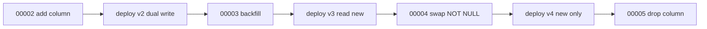
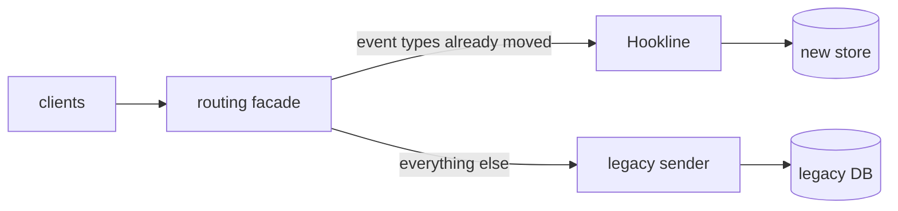

<div dir="rtl" lang="he">

# פרק 30: מערכות שמשתנות

מערכת בייצור לא נעצרת כדי שתשני אותה. הסכמה משתנה כשהקוד הישן עוד רץ, אירועים ישנים נקראים בידי צרכנים
חדשים, ומערכת ישנה מוחלפת חלק אחרי חלק. הפרק מלמד לשנות בלי השבתה: הרחבה ואז כיווץ (expand and contract)
במסד, תאימות בין גרסאות, דגלי תכונה והגירה הדרגתית של מערכת שלמה. ובסוף, איך מדברים על חוב טכני כך שמישהו
יסכים לשלם אותו.

## מה נלמד בפרק

- למה שינוי שם של עמודה בצעד אחד שובר קוד שרץ, ואיך עושים אותו בארבע מיגרציות ושלוש פריסות.
- אילו פקודות שינוי סכמה ב־PostgreSQL 18 נועלות מה, ואיך גבול זמן לנעילה מגן על הקוראים.
- תאימות לאחור ולפנים באירועים: שינוי מוסיף, קורא סובלני, וגרסה בתוך האירוע.
- דגלי תכונה: לשחרור, לתפעול ולניסוי, ולמה כל דגל הוא חוב מהיום שנוצר.
- הגירת מערכת בתבנית strangler fig.
- חוב טכני: לזהות איפה משלמים ריבית, לתמחר אותה, לשלם, ולשכנע.

## ידע מקדים

- פרק 11, סעיף 11.6: מיגרציות עם goose, ‏`NO TRANSACTION`, וההפניה לפרק הזה.
- פרק 10: ‏PostgreSQL בקונטיינר, pgx ואינדקסים.
- פרק 5: goroutines (סעיף 5.1), מונים אטומיים והמתנה לסיום (סעיף 5.5), ובדיקת מרוצים (סעיף 5.8).
- פרק 9, סעיף 9.6: גרסאות ותאימות לאחור ב־API, וקורא סובלני.
- פרק 13: אירועים ב־topic נשמרים ונקראים שוב; פרק 20, סעיף 20.4: פריסה מתגלגלת של Deployment.
- התרגיל לא מייבא קוד מתרגילים קודמים. החבילות `db` ו־`testdb` בנויות כמו בתרגיל של פרק 11.

## 30.1 מיגרציה ללא השבתה: expand ו־contract

### 30.1.1 למה צעד אחד שובר

נניח טבלת משתמשים עם עמודה `fullname`, וצריך לשנות את שמה ל־`display_name`. בצעד אחד זו פקודה קצרה:

<div dir="ltr" align="left">

```sql
ALTER TABLE users RENAME COLUMN fullname TO display_name
```

</div>

הבעיה היא לא הפקודה, אלא מה שרץ סביבה. שירות בייצור רץ בכמה עותקים, ופריסה מתגלגלת (rolling deploy) מחליפה
אותם אחד אחד. בכל רגע של הפריסה רצים יחד קוד ישן וקוד חדש. אם המיגרציה רצה לפני הפריסה, הקוד הישן מחפש
`fullname` שכבר לא קיימת. אם היא רצה אחרי, הקוד החדש מחפש `display_name` שעוד לא קיימת. אין סדר שבו שני
הצדדים מרוצים.

בתרגיל, הבדיקה `TestNaiveRenameBreaksRunningCode` מריצה שני עותקים של שירות קטן, כל אחד עם לולאת כתיבה
ולולאת קריאה, ומשנה את שם העמודה מתחתם. אלה שורות הלוג שלה; את המספר תראי בהרצה שלך:

<div dir="ltr" align="left">

```text
=== RUN   TestNaiveRenameBreaksRunningCode
    rollout_test.go:206: ___ failed requests after a one-step rename; the first: v1 old read 5: ERROR: column "fullname" does not exist (SQLSTATE 42703)
--- PASS: TestNaiveRenameBreaksRunningCode (0.41s)
```

</div>

הפתרון הוא להפריד את השינוי לצעדים, כך שכל צעד תואם גם לקוד שרץ לפניו וגם לקוד שירוץ אחריו. את התבנית הזאת
תיאר Danilo Sato בשם שינוי מקביל (parallel change), בשלושה שלבים: הרחבה, הגירה וכיווץ. הכתובת נבדקה באוקטובר 2026:
[Parallel Change](https://martinfowler.com/bliki/ParallelChange.html).

### 30.1.2 שישה צעדים, ארבע מיגרציות, שלוש פריסות

לשינוי שם של עמודה יש שישה צעדים לוגיים. חלקם שינויי סכמה, חלקם שינויי קוד:

| צעד | מה | איפה | למה בסדר הזה |
| --- | --- | --- | --- |
| 1 | להוסיף את `display_name`, ריקה | מיגרציה 00002 | הקוד הישן לא מכיר אותה ולא נפגע |
| 2 | לכתוב לשתי העמודות | פריסה של v2 | מכאן כל שורה חדשה מלאה בשתיהן |
| 3 | למלא את השורות הישנות במנות | מיגרציה 00003 | רק אחרי שאף עותק לא כותב לעמודה הישנה בלבד |
| 4 | לקרוא מהעמודה החדשה | פריסה של v3 | רק אחרי שכל השורות מלאות |
| 5 | להפסיק לכתוב לעמודה הישנה | מיגרציה 00004, ואז פריסה של v4 | קודם `NOT NULL` עובר מהישנה לחדשה |
| 6 | למחוק את `fullname` | מיגרציה 00005 | רק אחרי שאף עותק לא נוגע בה |

הכלל שמחזיק את הכול: **בין שני צעדים צריכה להסתיים פריסה.** מיגרציה 00003 בטוחה רק כשכל העותקים כבר כותבים
לשתי העמודות; 00005 בטוחה רק כשאף עותק לא קורא את `fullname`. מסד לא יודע איזה קוד רץ. את זה יודעת רק את.

<div dir="ltr" align="left">



</div>

### 30.1.3 מטריצת התאימות

כדי להשתכנע שהסדר נכון, הבדיקה `TestCompatibilityMatrix` מריצה כל גרסת קוד מול כל גרסת סכמה: הוספה, שינוי
שם וקריאה. זו הטבלה שבראש הבדיקה, בקובץ `exercises/ch30-expand-contract/tests/app/app_test.go`:

<div dir="ltr" align="left">

```go
	works := map[int64][]bool{ // schema version: Old, DualWrite, ReadNew, NewOnly
		1: {true, false, false, false},
		2: {true, true, true, false},
		3: {true, true, true, false},
		4: {false, true, true, true},
		5: {false, false, false, true},
	}
```

</div>

קראי אותה לפי עמודות. כל גרסה עובדת על רצף של גרסאות סכמה, והרצפים חופפים בזוגות: v1 ו־v2 עובדות יחד על
סכמות 2 ו־3. הגרסאות v3 ו־v4 עובדות יחד על סכמה 4. על סכמה 5 עובדת רק v4. החפיפה היא המקום שבו פריסה מתגלגלת יכולה
לקרות. שורה 4 מסבירה גם למה אסור לדלג: ‏v1 נכשלת בה, כי `display_name` כבר חובה והיא לא ממלאת אותה.

### 30.1.4 המיגרציות

ההרחבה, בקובץ `migrations/00002_add_display_name.sql`:

<div dir="ltr" align="left">

```sql
-- +goose Up
-- Step 1, expand. A nullable column without a default is a catalog change only: no rewrite,
-- no scan. It still needs a brief ACCESS EXCLUSIVE lock, which is why the migration
-- connection sets lock_timeout (see db.MigrationConfig).
ALTER TABLE users ADD COLUMN display_name text;
```

</div>

המילוי במנות, בקובץ `migrations/00003_backfill_display_name.sql`. הבלוק רץ מחוץ לטרנזקציה של goose, ולכן מותר
לו לבצע `COMMIT` אחרי כל מנה:

<div dir="ltr" align="left">

```sql
DO $$
DECLARE
    batch   constant bigint := 500;
    last_id bigint;
    from_id bigint := 0;
BEGIN
    SELECT coalesce(max(id), 0) INTO last_id FROM users;
    WHILE from_id < last_id LOOP
        UPDATE users SET display_name = fullname
        WHERE id > from_id AND id <= from_id + batch AND display_name IS NULL;
        COMMIT;
        from_id := from_id + batch;
    END LOOP;
END
$$;
```

</div>

שלוש החלטות במילוי:

- **מנות לפי טווח של מפתח ראשי.** כל `UPDATE` נוגע ב־500 שורות לכל היותר ומשתמש באינדקס, והנעילות על השורות
  משתחררות בכל `COMMIT`. ‏`UPDATE` אחד על כל הטבלה היה נועל את כל השורות עד הסוף, ומייצר טרנזקציה ארוכה
  שמעכבת את הניקוי של PostgreSQL.
- **התנאי `display_name IS NULL`** הופך הרצה חוזרת לבטוחה. אם המילוי נפל באמצע, הרצה שנייה מדלגת על מה שכבר מולא.
- **אין מרוץ עם הכותבים.** כותב של v2 שמעדכן שורה באמצע המילוי כותב לשתי העמודות. אם המילוי מגיע לשורה אחריו,
  התנאי כבר לא מתקיים, ו־PostgreSQL בודק אותו שוב אחרי שהנעילה על השורה התפנתה.

והחלפת ה־`NOT NULL`, בקובץ `migrations/00004_swap_not_null.sql`. כל פקודה רצה ומאושרת בנפרד:

<div dir="ltr" align="left">

```sql
-- +goose NO TRANSACTION
-- +goose Up
-- Step 3, make the new column the required one and the old one optional. Each statement
-- commits on its own, so no lock is held longer than one statement.
-- A NOT VALID check is only a catalog change: existing rows are not scanned.
ALTER TABLE users ADD CONSTRAINT users_display_name_not_null CHECK (display_name IS NOT NULL) NOT VALID;
-- The scan happens here, under SHARE UPDATE EXCLUSIVE: reads and writes continue.
ALTER TABLE users VALIDATE CONSTRAINT users_display_name_not_null;
-- A valid CHECK that proves there are no NULLs lets SET NOT NULL skip its own scan.
ALTER TABLE users ALTER COLUMN display_name SET NOT NULL;
ALTER TABLE users DROP CONSTRAINT users_display_name_not_null;
-- The next application version stops writing fullname, so it may no longer be required.
ALTER TABLE users ALTER COLUMN fullname DROP NOT NULL;
```

</div>

השורה האחרונה היא זו שקל לשכוח. הגרסה v4 מפסיקה לכתוב לעמודה הישנה, אבל העמודה עדיין `NOT NULL`, וכל
הוספה של v4 הייתה נכשלת. הכיווץ מתחיל בהרפיה של העמודה הישנה, הרבה לפני שמוחקים אותה. וזה הכיווץ עצמו, בקובץ
`migrations/00005_drop_fullname.sql`:

<div dir="ltr" align="left">

```sql
-- +goose Up
-- Step 4, contract. Only after no running instance reads or writes fullname. Dropping
-- a column only hides it in the catalog; the space comes back as rows are rewritten.
ALTER TABLE users DROP COLUMN fullname;
```

</div>

### 30.1.5 נעילות ב־PostgreSQL 18

כל פקודת `ALTER TABLE` לוקחת נעילה על הטבלה, ורובן את החזקה ביותר: ‏`ACCESS EXCLUSIVE`. הנעילה הזאת מתנגשת
בכל דבר, כולל `SELECT` רגיל. השאלה לגבי כל פקודה היא כמה זמן היא מחזיקה את הנעילה, ואם היא סורקת או משכתבת את הטבלה
בזמן הזה. אלה העובדות מתיעוד הגרסה 18, נכון לאוקטובר 2026 (הגרסה המקובעת בתרגיל מופיעה בנספח ג):

| פקודה | נעילה | סריקה או שכתוב | מקור |
| --- | --- | --- | --- |
| ‏`ADD COLUMN` בלי ברירת מחדל, או עם ברירת מחדל קבועה | ‏`ACCESS EXCLUSIVE`, לרגע | לא: הערך נשמר בקטלוג (מגרסה 11) | ‏ALTER TABLE, הערות |
| ‏`ADD COLUMN` עם ברירת מחדל שמשתנה, כמו `clock_timestamp()` | ‏`ACCESS EXCLUSIVE` | שכתוב של כל הטבלה | ‏ALTER TABLE, הערות |
| ‏`CREATE INDEX` | ‏`SHARE`: חוסם כתיבות | סריקה מלאה | ‏CREATE INDEX |
| ‏`CREATE INDEX CONCURRENTLY` | ‏`SHARE UPDATE EXCLUSIVE`: כתיבות ממשיכות | שתי סריקות, איטי יותר | ‏CREATE INDEX |
| ‏`ADD CONSTRAINT ... NOT VALID` | ‏`ACCESS EXCLUSIVE`, לרגע | לא | ‏ALTER TABLE |
| ‏`VALIDATE CONSTRAINT` | ‏`SHARE UPDATE EXCLUSIVE` | סריקה, בלי לחסום | ‏ALTER TABLE |
| ‏`SET NOT NULL` | ‏`ACCESS EXCLUSIVE` | סריקה, אלא אם `CHECK` תקף מוכיח שאין `NULL` | ‏ALTER TABLE |
| ‏`DROP COLUMN` | ‏`ACCESS EXCLUSIVE`, לרגע | לא: העמודה רק מוסתרת | ‏ALTER TABLE, הערות |

אלה הדפים בתיעוד:

- [ALTER TABLE](https://www.postgresql.org/docs/18/sql-altertable.html)
- [CREATE INDEX](https://www.postgresql.org/docs/18/sql-createindex.html)
- [Explicit Locking](https://www.postgresql.org/docs/18/explicit-locking.html)
- [רשימת השינויים של גרסה 11](https://www.postgresql.org/docs/release/11.0/): הגרסה שבה הוספת עמודה עם ברירת מחדל
  קבועה הפסיקה לשכתב את הטבלה.

ומה זה אומר לתכנון:

- **אינדקס חדש על טבלה חיה נבנה תמיד ב־`CONCURRENTLY`.** הפקודה לא יכולה לרוץ בתוך טרנזקציה, ולכן קובץ goose שלה
  מתחיל ב־`-- +goose NO TRANSACTION`. אם היא נכשלת באמצע, נשאר אינדקס במצב לא תקף, שלא משמש לשאילתות אבל
  מאט כתיבות. מוחקים אותו ומנסים שוב.
- **אילוץ חדש נוסף ב־`NOT VALID`, ונבדק בפקודה נפרדת.** אם שתי הפקודות באותה טרנזקציה, הנעילה החזקה של הראשונה
  נשארת עד הסוף, כולל הסריקה של השנייה. בגלל זה 00004 היא `NO TRANSACTION`.
- **‏`NOT NULL` על טבלה גדולה עובר דרך `CHECK` תקף**, כמו ב־00004, כדי שהסריקה תקרה בנעילה החלשה.

### 30.1.6 תור הנעילות ו־`lock_timeout`

נעילה רגעית נשמעת בטוחה, אבל יש מלכודת. אם טרנזקציה ארוכה כלשהי קראה מהטבלה, פקודת ה־`ALTER` מחכה לה.
ובזמן שהיא מחכה, כל שאילתה חדשה על הטבלה, גם `SELECT` פשוט, נעמדת **מאחורי** ה־`ALTER` בתור. פקודה שהייתה
אמורה לקחת מילישנייה עוצרת את כל התנועה לטבלה, למשך כל הטרנזקציה הארוכה.

ההגנה היא `lock_timeout`: לפי התיעוד, הוא מבטל פקודה שמחכה לנעילה יותר מהזמן שנקבע, והגבול חל על כל ניסיון
לקחת נעילה בנפרד. ברירת המחדל היא אפס, כלומר בלי גבול. המקור הוא
[דף הגדרות החיבור](https://www.postgresql.org/docs/18/runtime-config-client.html) בתיעוד. מיגרציה שנכשלת אחרי
שתי שניות עדיפה על מיגרציה שמקפיאה את השירות. מריצים אותה שוב, בשעה שקטה או אחרי שמצאו את הטרנזקציה הארוכה.

התיעוד לא מתאר את התור עצמו, ולכן התרגיל מדגים אותו. הבדיקה `TestWaitingDDLBlocksReaders` פותחת טרנזקציה
ארוכה ומריצה `ALTER`. אחר כך היא מוכיחה, דרך טבלת הסשנים של השרת, שגם שאילתת קריאה שבאה אחריו מחכה. מהקובץ
`tests/db/db_test.go`:

<div dir="ltr" align="left">

```go
	testdb.WaitForLockWaiters(t, appPool, 1) // the ALTER waits for the long transaction

	read := make(chan error, 1)
	go func() {
		_, err := appPool.Exec(ctx, "SELECT count(*) FROM users")
		read <- err
	}()
	testdb.WaitForLockWaiters(t, appPool, 2) // and now a plain SELECT waits behind the ALTER
```

</div>

אחר כך ה־`ALTER` מוותר עם הקוד `55P03`, והקריאה שמאחוריו ממשיכה. איפה קובעים את הגבול? בתרגיל הוא חלק
מהגדרות החיבור של המיגרציות בלבד, בקובץ `db/db.go`:

<div dir="ltr" align="left">

```go
	cfg.ConnConfig.RuntimeParams["lock_timeout"] = fmt.Sprint(LockTimeout.Milliseconds())
	cfg.ConnConfig.RuntimeParams["application_name"] = "migrator"
```

</div>

פרמטר שנשלח בפתיחת החיבור חל על כל פקודה בכל מיגרציה, בלי שאף קובץ צריך לזכור אותו. החלופה, פקודת `SET` בראש
כל קובץ, נשכחת בקובץ אחד בדיוק כשהוא המסוכן; ופקודת `SET` רגילה גם נשארת בתוקף על החיבור אחרי שהקובץ
נגמר. לחיבורים של האפליקציה אין גבול כזה, והבדיקה `TestMigrationConnectionsHaveALockTimeout` מוודאת את שני הצדדים.

### 30.1.7 הקוד שמשתנה מתחת למסד

השירות בתרגיל הוא טבלת משתמשים, עם לולאת כתיבה ולולאת קריאה בכל עותק. גרסת הקוד היא `Phase`, והיא קובעת
אילו עמודות ה־SQL נוגע בהן. מהקובץ `app/app.go`:

<div dir="ltr" align="left">

```go
const (
	PhaseOld       Phase = iota + 1 // v1: writes and reads fullname
	PhaseDualWrite                  // v2: writes both columns, reads fullname
	PhaseReadNew                    // v3: writes both columns, reads display_name
	PhaseNewOnly                    // v4: writes and reads display_name only
)
```

</div>

<div dir="ltr" align="left">

```go
func renameSQL(p Phase) string {
	switch p {
	case PhaseOld:
		return `UPDATE users SET fullname = $2 WHERE id = $1`
	case PhaseDualWrite, PhaseReadNew:
		return `UPDATE users SET fullname = $2, display_name = $2 WHERE id = $1`
	case PhaseNewOnly:
		return `UPDATE users SET display_name = $2 WHERE id = $1`
	}
	panic("unknown phase " + p.String())
}
```

</div>

שימי לב שהכתיבה הכפולה היא פקודה אחת שמעדכנת את שתי העמודות. שתי פקודות נפרדות היו יכולות להשאיר את העמודות
שונות אם השנייה נכשלת, והמילוי לא היה מתקן את זה, כי הוא ממלא רק שורות ריקות.

התוכנית עצמה היא רשימה, בקובץ `rollout/rollout.go`. כל צעד הוא מיגרציה, ואחריה הגרסה שמותר לפרוס:

<div dir="ltr" align="left">

```go
var Plan = []Step{
	{"expand: add display_name", 2, app.PhaseDualWrite},
	{"backfill in batches, then switch reads", 3, app.PhaseReadNew},
	{"swap NOT NULL, then stop writing fullname", 4, app.PhaseNewOnly},
	{"contract: drop fullname", 5, 0},
}
```

</div>

והפונקציה `Run` באותו קובץ מבצעת אותה. אחרי כל מיגרציה, ואחרי השדרוג של כל עותק, היא מחכה שכל עותק יסיים עוד
כמה עשרות בקשות. כך כל גרסת סכמה פוגשת באמת כל גרסת קוד שרצה לידה:

<div dir="ltr" align="left">

```go
		if err := db.MigrateTo(ctx, migrations, s.Migrate); err != nil {
			return reports, fmt.Errorf("%s: %w", s.Name, err)
		}
		if err := waitForOps(ctx, fleet, settle); err != nil {
			return reports, fmt.Errorf("%s: %w", s.Name, err)
		}
		if s.Deploy != 0 {
			for _, in := range fleet { // a rolling deploy: one instance at a time
				in.SetPhase(s.Deploy)
				if err := waitForOps(ctx, fleet, settle); err != nil {
					return reports, fmt.Errorf("%s: deploy %v: %w", s.Name, s.Deploy, err)
				}
			}
		}
```

</div>

### 30.1.8 ההרצה

הבדיקה `TestRenameWithZeroFailedRequests` מכניסה 5,000 משתמשים, מפעילה שני עותקים בגרסה v1, ומריצה את התוכנית.
בסוף היא בודקת שלוש טענות: אף בקשה לא נכשלה, הסכמה בגרסה 5 עם העמודות הנכונות, ולכל משתמש העמודה החדשה מחזיקה
את הכתיבה המוצלחת האחרונה שלו. כך היא נראתה בהרצה שבה נכתב הספר. מספרי הבקשות אצלך יהיו אחרים, ועמודת
הכישלונות צריכה להיות אפס:

<div dir="ltr" align="left">

```text
=== RUN   TestRenameWithZeroFailedRequests
    rollout_test.go:138: expand: add display_name                      requests=322   failed=0
    rollout_test.go:138: backfill in batches, then switch reads        requests=339   failed=0
    rollout_test.go:138: swap NOT NULL, then stop writing fullname     requests=320   failed=0
    rollout_test.go:138: contract: drop fullname                       requests=110   failed=0
    rollout_test.go:190: users at the end: 5316, of them 316 written during the rollout
--- PASS: TestRenameWithZeroFailedRequests (1.06s)
```

</div>

> **שימי לב:** בתרגיל, „פריסה” היא קריאה ל־`SetPhase`, והמעבר מיידי. בייצור, פריסה לוקחת דקות, ואת הסיום שלה
> צריך לוודא: כל ה־pods בגרסה החדשה, ואין עותק ישן שנתקע. רק אז מריצים את המיגרציה הבאה. זו הסיבה שכל שלב
> הוא בדרך כלל pull request נפרד.

## 30.2 תאימות לאחור ולפנים

### 30.2.1 שתי השאלות

פרק 9, סעיף 9.6, הציג תאימות לאחור ב־API: לקוח של אתמול עובד מול השרת של היום. כשיש שני צדדים שמתעדכנים בזמנים
שונים, יש שתי שאלות:

| תאימות | השאלה | דוגמה |
| --- | --- | --- |
| לאחור (backward) | האם הקוד החדש מבין נתונים ובקשות מהגרסה הישנה? | צרכן חדש קורא אירועים שנכתבו לפני חודש |
| לפנים (forward) | האם הקוד הישן מבין נתונים מהגרסה החדשה? | צרכן ישן מקבל אירוע מיצרן שכבר שודרג |

ב־API סינכרוני, השרת והלקוח לפחות מדברים באותו רגע. באירועים יש גם זמן: אירוע ב־topic נשמר ימים או חודשים,
וצרכן חדש שמתחיל מההתחלה, או צרכן שמשחזר אחרי תקלה, יקרא אירועים שנכתבו בכל הגרסאות. לכן באירועים צריך את
שתי התאימויות, תמיד.

### 30.2.2 שינויים מוסיפים

הדרך הפשוטה לשמור על שתיהן היא שינויים מוסיפים בלבד (additive changes): מוסיפים שדה, אף פעם לא מוחקים, לא
משנים שם ולא משנים משמעות. זו הרחבה ואז כיווץ, בתוך ההודעה. שינוי שם של שדה באירוע נראה בדיוק כמו בעמודה:

- **הרחבה:** היצרן שולח את השדה החדש וגם את הישן.
- **הגירה:** הצרכנים עוברים, אחד אחד, לקרוא את החדש, ויודעים לקרוא גם אירועים ישנים.
- **כיווץ:** כשאין יותר צרכן שקורא את הישן, היצרן מפסיק לשלוח אותו. בדיקת חוזה (contract test) או מדד
  לכל צרכן הם הדרך לדעת.

בתרגיל, החבילה `events` עושה את זה לאירוע `user.renamed`. זה המטען של גרסה 2, בקובץ `events/events.go`:

<div dir="ltr" align="left">

```go
type RenamedV2 struct {
	UserID      int64  `json:"user_id"`
	DisplayName string `json:"display_name"`
	Fullname    string `json:"fullname,omitempty"` // drop when no version 1 consumer is left
}
```

</div>

### 30.2.3 קורא סובלני וגרסה באירוע

השדה הנוסף עובד רק אם הצרכנים הישנים מתעלמים ממה שהם לא מכירים. זה הקורא הסובלני (tolerant reader), כפי
שתיאר אותו Martin Fowler ב־2011: לקחת רק את מה שצריך, ולהתעלם מהשאר. הכתובת נבדקה באוקטובר 2026:
[הדף של Fowler](https://martinfowler.com/bliki/TolerantReader.html). ב־Go זו ברירת המחדל של `encoding/json`.
צרכן שמבקש קפדנות, עם `DisallowUnknownFields`, נשבר משדה אחד שנוסף. זה מה שמראה הבדיקה
`TestStrictReaderBreaksOnAdditiveChange`.

שינוי שאי אפשר לעשות בתוספת, כמו מבנה אחר לגמרי, מקבל מספר גרסה בתוך האירוע. הצרכן בוחר לפי הגרסה ולא מנחש לפי
הצורה, ומגרסה שהוא לא מכיר הוא לא מתעלם. מהקובץ `events/events.go`:

<div dir="ltr" align="left">

```go
func Name(e Envelope) (string, error) {
	switch e.Version {
	case 1:
		var p RenamedV1
		if err := json.Unmarshal(e.Data, &p); err != nil {
			return "", fmt.Errorf("user.renamed v1: %w", err)
		}
		return p.Fullname, nil
	case 2:
		var p RenamedV2
		if err := json.Unmarshal(e.Data, &p); err != nil {
			return "", fmt.Errorf("user.renamed v2: %w", err)
		}
		return p.DisplayName, nil
	}
	return "", fmt.Errorf("user.renamed v%d: %w", e.Version, ErrUnknownVersion)
}
```

</div>

שגיאה על גרסה לא מוכרת היא החלטה. ההתנהגות הנכונה היא להעביר את האירוע לתור מתים ולהתריע, לא לדלג עליו
בשקט. אירוע שדולג נעלם; אירוע בתור מתים מחכה לגרסה שתבין אותו.

| שינוי באירוע | לאחור | לפנים | איך עושים בבטחה |
| --- | --- | --- | --- |
| להוסיף שדה אופציונלי | כן | כן, אם הצרכנים סובלניים | ישר |
| לשנות שם של שדה | לא | לא | שני השדות במקביל, ואז כיווץ |
| להפוך שדה לחובה | לא: אירועים ישנים חסרים אותו | כן | ברירת מחדל בצרכן לאירועים ישנים |
| לשנות טיפוס או משמעות | לא | לא | שדה חדש, או גרסה חדשה |
| להוסיף ערך לרשימה סגורה | כן | מסוכן: צרכן שמניח שהוא מכיר את כל הערכים נכשל | צרכנים עם ענף ברירת מחדל, קודם |

> **איך Rust עושה את זה:** ב־serde, שדה שעלול לחסור מקבל `Option<T>` או ברירת מחדל מפורשת. זה מה שמאפשר
> לצרכן חדש לקרוא אירועים ישנים. ב־Go, שדה חסר ב־JSON נשאר בערך האפס שלו, ולכן צריך להחליט במפורש אם ערך האפס
> אומר „חסר” או ערך אמיתי. בתרגיל, הפונקציה `NameV1` מחליטה כך לגבי `Fullname` ריק.

## 30.3 דגלי תכונה

### 30.3.1 ארבעה סוגים

דגל תכונה (feature flag) הוא החלטה בזמן ריצה, מחוץ לקוד, אם נתיב קוד פעיל. הוא מפריד בין **פריסה**, שבה הקוד
מגיע לשרתים, לבין **שחרור**, שבו משתמשים מקבלים אותו. המאמר של Pete Hodgson מסווג דגלים לפי כמה זמן הם חיים
וכמה דינמית ההחלטה שלהם. הכתובת נבדקה באוקטובר 2026:
[Feature Toggles](https://martinfowler.com/articles/feature-toggles.html).

| סוג | בשביל מה | כמה זמן חי | דוגמה ב־Hookline |
| --- | --- | --- | --- |
| דגל שחרור (release toggle) | להסתיר קוד שלא גמור, ולשחרר בהדרגה | ימים עד שבועות | הפעלה חוזרת בכמות גדולה לשתי דיירות (פרק 29, סעיף 29.5.6) |
| דגל תפעול (ops toggle) | לכבות התנהגות בעומס או בתקלה | קצר, או לתמיד כמתג חירום | כיבוי הלולאה של ההפעלה החוזרת כשה־workers עמוסים |
| דגל ניסוי (experiment toggle) | השוואה בין שתי גרסאות על משתמשים | כמה שבועות, עד שיש תוצאה | שתי אסטרטגיות של המתנה גדלה, לפי דיירת |
| דגל הרשאה (permissioning toggle) | תכונה לקבוצה מסוימת | שנים | תכונות לדיירות בתוכנית מסוימת |

### 30.3.2 דגל בתוך הרחבה וכיווץ

בתוכנית של סעיף 30.1, ההבדל בין v2 ל־v3 הוא רק מאיזו עמודה קוראים. זה המקום הטבעי לדגל: הקוד של v2 כבר יודע
לקרוא משתי העמודות, ודגל קובע איזו. בתרגיל זה בדיוק `SetPhase`: החלפה בזמן ריצה, בלי פריסה. מהקובץ `app/app.go`:

<div dir="ltr" align="left">

```go
// SetPhase deploys another version of the code to this instance.
func (in *Instance) SetPhase(p Phase) { in.phase.Store(int32(p)) }
```

</div>

היתרון הוא בחזרה לאחור. אם אחרי המעבר לקריאה מהעמודה החדשה מופיעות תשובות שגויות, מכבים את הדגל, והקריאה
חוזרת לעמודה הישנה בתוך שניות, בלי פריסה. ובחירה לפי דיירת מאפשרת לעבור קודם על אחוז קטן מהתנועה ולהשוות.
הגבול: דגל לא עוזר במעבר ממצב שאי אפשר לחזור ממנו. אחרי 00005 אין עמודה ישנה לחזור אליה.

### 30.3.3 כל דגל הוא חוב

לפי Hodgson, צוותים טובים מתייחסים לדגלים כמו למלאי, שיש לו עלות החזקה, ומשתדלים להחזיק ממנו מעט. העלות
אמיתית: כל דגל מכפיל את מספר המצבים של הקוד. עשרה דגלים בוליאניים הם 1,024 צירופים, ואף אחד לא בודק את כולם.
ודגל ישן שאיש לא זוכר מה הוא עושה הוא סיכון: מישהי תהפוך אותו בטעות.

- **כרטיס הסרה ביום היצירה.** דגל שחרור נולד עם משימה למחוק אותו, ועם תאריך.
- **בעלים ותאריך תפוגה.** בדיקה שנכשלת כשדגל עבר את התאריך שלו, כמו שמציע המאמר של Hodgson.
- **גבול על מספר הדגלים הפעילים.** דגל חדש מחכה עד שישן נמחק.
- **ההסרה היא חלק מהתכונה.** תכונה לא „גמורה” כשהדגל דלוק לכולם, אלא כשהוא נמחק מהקוד.

## 30.4 הגירת מערכת: strangler fig

### 30.4.1 המטפורה והתבנית

החלפה של מערכת שלמה בבת אחת, „נכתוב מחדש”, היא פרויקט מסוכן: הישנה ממשיכה להשתנות
בזמן שבונים את החדשה, והיום שבו מחליפים מגיע מאוחר, עם כל הסיכון בבת אחת. את החלופה תיאר Martin Fowler, ונתן לה
שם על שם עץ התאנה החונקת (strangler fig) שראה ביערות הגשם של קווינסלנד: צמח שנובט על עץ מארח, גדל סביבו
לאט, ובסוף עומד בעצמו. הכתובת נבדקה באוקטובר 2026, והדף עודכן ב־2024:
[Strangler Fig](https://martinfowler.com/bliki/StranglerFigApplication.html).

התבנית בונה את החדשה סביב השולים של הישנה, ומעבירה התנהגות חלק אחרי חלק. בפועל יש נקודת ניתוב אחת, ומאחוריה
שתי המערכות:

<div dir="ltr" align="left">



</div>

### 30.4.2 דוגמה: מונוליט ששולח webhooks

נניח מוצר ותיק ששולח webhooks מתוך הקוד של הבקשה, בלי ניסיונות חוזרים ובלי יומן. ההגירה ל־Hookline:

1. **נקודת ניתוב.** כל השליחות עוברות דרך פונקציה אחת במונוליט. זה תפר (seam): מקום אחד שבו אפשר להחליט לאן.
2. **סוג אירוע ראשון.** סוג אחד, עם תנועה קטנה, עובר ל־Hookline מאחורי דגל, לדיירת פנימית.
3. **השוואה.** בתקופת מעבר שתי המערכות מחשבות את מה שהיו שולחות, ורק אחת שולחת. משווים מה היה נשלח, ומתקנים פערים.
4. **התרחבות.** עוד סוגי אירועים, ועוד דיירות, לפי מדד שמראה שאין רגרסיה.
5. **מחיקה.** כשאין יותר תנועה לישנה, מוחקים אותה. זה הכיווץ של ההגירה.

שלושה סיכונים מוכרים:

- **מעבר שלא נגמר.** שתי מערכות לתמיד, ומי שמתחזקת את שתיהן. לכל שלב תאריך, והמחיקה בתוכנית מהיום הראשון.
- **נתונים בשני מקומות.** אם שתי המערכות צריכות את אותם נתונים, אחת היא המקור והשנייה מקבלת עותק. אף פעם שתיהן לא כותבות.
- **ארכיטקטורת מעבר עולה כסף.** נקודת הניתוב, ההשוואות והדגלים הם קוד שנמחק בסוף. לפי Fowler, זה מחיר ששווה
  לשלם בשביל סיכון נמוך יותר וערך מוקדם יותר, וכדאי לומר אותו במפורש בתוכנית.

## 30.5 חוב טכני: לזהות, לתמחר, לשלם

### 30.5.1 קרן וריבית

חוב טכני (technical debt) הוא מטפורה. מי שטבע אותה הוא Ward Cunningham, ב־1992. על המטפורה כתב Fowler דף שעודכן ב־2019,
עם דוגמה מספרית. הכתובת נבדקה באוקטובר 2026: [הדף של Fowler](https://martinfowler.com/bliki/TechnicalDebt.html).
נניח שבגלל מבנה גרוע, תכונה שהייתה לוקחת ארבעה ימים לוקחת שישה:

| מונח | בדוגמה | מה זה |
| --- | --- | --- |
| ריבית (interest) | יומיים | מה שמשלמים בכל פעם שעובדים באזור, כל עוד החוב קיים |
| קרן (principal) | נניח חמישה ימים | מה שעולה לתקן את המבנה פעם אחת |

תיקון משתלם רק אם עוד יבואו שינויים באזור הזה. חוב באזור שאיש לא נוגע בו לא גובה ריבית, וייתכן שנכון להשאיר
אותו. זו הנקודה שמבדילה דיבור בכיר על חוב מתלונה: לא „הקוד מכוער”, אלא „אנחנו משלמים יומיים על כל שינוי כאן,
ומתוכננים שמונה שינויים ברבעון”.

### 30.5.2 לזהות: איפה משלמים ריבית

ריבית משלמים במקום שבו שינויים קורים. כמה מקורות שקל לאסוף:

- **קבצים שמשתנים הרבה.** הפקודה הבאה סופרת, לכל קובץ, בכמה commits הוא השתנה בחצי השנה האחרונה.
- **תקריות.** תחקיר שבו „הקוד מסובך” הוא חלק מהסיבה הוא ריבית ששולמה בשעות של תורנות.
- **זמן לשינוי קטן.** כמה זמן לוקח שינוי של שורה באזור מסוים, מה־commit ועד ייצור.
- **ידע אצל אדם אחד.** אזור שרק מפתחת אחת מעזה לגעת בו הוא חוב עם ריבית משתנה.

<div dir="ltr" align="left">

```bash
git log --since="6 months ago" --format= --name-only | grep -v '^$' | sort | uniq -c | sort -rn | head -20
```

</div>

קובץ שמופיע גבוה ברשימה וגם מופיע בתחקירים הוא מועמד ראשון. קובץ מכוער שלא השתנה שנה הוא לא.

### 30.5.3 לתמחר ולשלם

התמחור הוא הערכה, כמו בפרק 29: הנחות כתובות, ומספר בסדר גודל. לדוגמה, בהנחות שאת ממלאת:

| שאלה | הערך שלך |
| --- | --- |
| כמה שינויים באזור ברבעון | ___ |
| כמה זמן נוסף כל שינוי עולה בגלל החוב | ___ |
| כמה שעות תורנות ברבעון קשורות לאזור | ___ |
| כמה עולה התיקון, פעם אחת | ___ |
| אחרי כמה רבעונים התיקון מחזיר את עצמו | ___ |

ולשלם, בדרכים שלא דורשות לעצור את הכול:

- **בשטח שנוגעים בו.** לפי Fowler, היתרון של שיפור הדרגתי הוא שהוא מתרכז באזורים שמשתנים הרבה, שם הניקוי
  נחוץ ביותר. שינוי שעובר באזור משאיר אותו קצת טוב יותר.
- **בצעדים הפיכים.** הרחבה וכיווץ, דגלים והגירה הדרגתית הם כולם דרכים לשלם קרן בלי סיכון של יום החלפה.
- **בתקציב קבוע.** חלק קבוע מכל ספרינט, במקום „פרויקט ניקוי” שנדחה תמיד לרבעון הבא.
- **לסיים את הכיווץ.** מיגרציה שנעצרה אחרי ההרחבה, דגל שלא נמחק ומערכת ישנה שעוד רצה הם חוב שיצרת היום.

### 30.5.4 איך משכנעים

מנהלת שצריכה להחליט בין תכונה לניקוי לא צריכה לשמוע על קוד יפה. היא צריכה את אותו מבנה כמו כל הצעה: מה הבעיה,
מה המחיר שלה היום, מה ההצעה, כמה היא עולה, ואיך נדע שהיא עבדה. פסקה אחת לדוגמה:

> **הצעה:** ‏„בשלושת החודשים האחרונים, 9 מתוך 14 השינויים במודול החיוב לקחו בערך פי שניים מההערכה, ושתי
> תקריות התחילו בו. אני מציעה שבועיים להפריד את חישוב המס מהקוד של ה־API, בצעדים שכל אחד מהם נפרס לבד. נמדוד את
> הזמן משינוי לייצור במודול לפני ואחרי. אם אחרי רבעון אין שיפור, נעצור.”

המספרים בפסקה הם דוגמה לצורה, לא נתונים. מה שעושה אותה משכנעת: מחיר במונחים שהמנהלת מכירה, הצעה קטנה והפיכה,
ומדד הצלחה עם נקודת עצירה. „צריך לכתוב מחדש” בלי כל אלה נשמע כמו העדפה אישית, ובצדק.

## סיכום

- שינוי שאינו תואם נעשה בשלבים: הרחבה, הגירה, כיווץ. בין שני שלבים מסתיימת פריסה.
- שינוי שם של עמודה: להוסיף, לכתוב לשתיהן, למלא במנות, לקרוא מהחדשה, להפסיק לכתוב לישנה, למחוק.
- בכיווץ, קודם מרפים את `NOT NULL` של העמודה הישנה, ורק אחרי הפריסה מוחקים אותה.
- ב־PostgreSQL 18: עמודה עם ברירת מחדל קבועה בלי שכתוב, אינדקס במקביל, ואילוץ שנוסף לא תקף ונבדק אחר כך.
- פקודת DDL שמחכה לנעילה עוצרת את כל מי שבא אחריה; ‏`lock_timeout` על חיבור המיגרציות הוא ההגנה.
- באירועים צריך תאימות לאחור וגם לפנים: שינויים מוסיפים, קורא סובלני, וגרסה בתוך האירוע.
- דגל תכונה מפריד פריסה משחרור; כל דגל נולד עם תאריך הסרה.
- הגירת מערכת נעשית סביב השולים של הישנה, חלק אחרי חלק, עם מחיקה בתוכנית מהיום הראשון.
- חוב טכני מתומחר בריבית שמשלמים, ומשכנעים עליו במחיר, בהצעה הפיכה ובמדד.

## מונחים לזכור

| מונח בעברית | באנגלית | במשפט אחד |
| --- | --- | --- |
| הרחבה ואז כיווץ | expand and contract | שינוי שאינו תואם בשלבים, כך שכל שלב תואם לקוד שרץ לידו |
| שינוי מקביל | parallel change | השם של Danilo Sato לאותה תבנית: הרחבה, הגירה, כיווץ |
| כתיבה כפולה | dual write | כתיבה לעמודה הישנה ולחדשה באותה פקודה, בתקופת המעבר |
| מילוי לאחור | backfill | העתקת ערכים לשורות ישנות, במנות קטנות |
| פריסה מתגלגלת | rolling deploy | החלפת עותקים אחד אחד, כך שגרסאות רצות יחד |
| תור נעילות | lock queue | פקודה שמחכה לנעילה חוסמת את מי שבא אחריה |
| תאימות לאחור | backward compatibility | הקוד החדש מבין נתונים מהגרסה הישנה |
| תאימות לפנים | forward compatibility | הקוד הישן מבין נתונים מהגרסה החדשה |
| שינוי מוסיף | additive change | מוסיפים שדה, לא מוחקים ולא משנים |
| קורא סובלני | tolerant reader | צרכן שלוקח את מה שהוא צריך ומתעלם מהשאר |
| דגל תכונה | feature flag | החלטה בזמן ריצה אם נתיב קוד פעיל |
| הגירה | migration (system) | העברה של התנהגות ממערכת ישנה לחדשה |
| תאנה חונקת | strangler fig | הגירה הדרגתית סביב השולים של המערכת הישנה |
| תפר | seam | מקום אחד בקוד שבו אפשר להחליט לאן בקשה הולכת |
| חוב טכני | technical debt | מבנה שמייקר כל שינוי עתידי עד שמתקנים אותו |
| ריבית | interest | המחיר הנוסף של כל שינוי בגלל החוב |

## טעויות נפוצות

- **מיגרציה ופריסה באותו צעד.** קוד ישן וחדש רצים יחד, ואחד מהם נשבר. כל שלב מסתיים בפריסה מלאה לפני הבא.
- **מילוי לפני שכל העותקים כותבים כפול.** שורות שהקוד הישן כותב אחרי המילוי נשארות ריקות, והמיגרציה הבאה נכשלת.
  קודם הפריסה, אחר כך המילוי.
- **לשכוח להרפות את העמודה הישנה.** הגרסה שמפסיקה לכתוב אליה נכשלת בכל הוספה. ‏`DROP NOT NULL` לפני הפריסה.
- **‏`CREATE INDEX` בלי `CONCURRENTLY` על טבלה חיה.** הכתיבות נחסמות לכל זמן הבנייה. ובקובץ goose צריך `NO TRANSACTION`.
- **מיגרציה בלי `lock_timeout`.** טרנזקציה ארוכה אחת, וכל התנועה לטבלה עומדת בתור. גבול של שניות, וניסיון חוזר.
- **דגל שנשאר לתמיד.** אחרי שנה איש לא יודע מה הוא עושה. תאריך הסרה ובעלים ביום שנוצר.

## שאלות ראיון

1. **איך משנים שם של עמודה בטבלה עם תנועה, בלי השבתה?** בשישה צעדים, עם פריסה שמסתיימת בין צעד לצעד. מוסיפים
   את העמודה החדשה כריקה, פורסים קוד שכותב לשתיהן, ממלאים שורות ישנות במנות, פורסים קוד שקורא מהחדשה, הופכים
   אותה לחובה ומרפים את הישנה, פורסים קוד שכותב רק לחדשה, ורק אז מוחקים את הישנה. כל צעד תואם לקוד שרץ לפניו
   ואחריו. המחיר: שבוע של עבודה במקום פקודה, וקוד כפול זמני. החלופה, חלון תחזוקה, לגיטימית כשאפשר לעצור את השירות.

   **המשך:** למה לא view בשם החדש? זה אפשרי לקריאה, אבל כתיבה דרך view מוסיפה מורכבות ולא חוסכת את הפריסות;
   ועדיין צריך למחוק את הישן בסוף.

2. **מה המלכודת ב־`ALTER TABLE` „מהיר”?** גם פקודה שלוקחת מילישנייה צריכה נעילה חזקה על הטבלה. אם טרנזקציה ארוכה
   מחזיקה נעילה חלשה, הפקודה מחכה, וכל שאילתה חדשה נעמדת מאחוריה בתור, כולל `SELECT`. התוצאה היא הקפאה של
   הטבלה למשך הטרנזקציה הארוכה. ההגנה היא `lock_timeout` של שניות בחיבור של המיגרציה וניסיון חוזר, ובדיקה
   של טרנזקציות ארוכות ב־`pg_stat_activity` לפני שמתחילים.

3. **איך מוסיפים אילוץ `NOT NULL` לטבלה של מאה מיליון שורות?** בשלושה שלבים: אילוץ `CHECK` עם `NOT VALID`, שהוא
   שינוי בקטלוג בלבד; ‏`VALIDATE CONSTRAINT`, שסורק בנעילה שלא חוסמת קריאות וכתיבות; ואז `SET NOT NULL`,
   שמדלג על הסריקה כי אילוץ תקף כבר מוכיח שאין ערכים חסרים. כל שלב בטרנזקציה משלו, אחרת הנעילה החזקה של הראשון
   נשארת לאורך הסריקה. ולפני כל זה, מילוי במנות, כי האימות ייכשל על שורה ריקה אחת.

4. **מה ההבדל בין תאימות לאחור לתאימות לפנים, ולמה באירועים צריך את שתיהן?** לאחור: הקוד החדש מבין נתונים
   ישנים. לפנים: הקוד הישן מבין נתונים חדשים. ב־API שרת ולקוח לפחות מדברים באותו זמן, אבל אירועים נשמרים, ומי
   שקורא מהתחלת ה־topic יפגוש כל גרסה שאי פעם נכתבה. ויצרנים וצרכנים נפרסים בזמנים שונים, כך שבכל רגע יש צרכן
   ישן שמקבל אירוע חדש. לכן שינויים מוסיפים, צרכנים סובלניים, וגרסה באירוע לשינויים שאי אפשר להוסיף.

   **המשך:** ומה עושה צרכן עם גרסה שהוא לא מכיר? לא מדלג: מעביר לתור מתים ומתריע, כדי שגרסה חדשה של הצרכן תוכל
   לעבד אותו אחר כך.

5. **איך היית משכנעת מנהלת להשקיע בתשלום חוב טכני?** במונחים שלה: מה החוב עולה היום, בזמן שינוי, בתקריות או
   בתורנות, עם מספרים שאפשר לבדוק. אחר כך הצעה קטנה, שנפרסת בצעדים הפיכים, עם מחיר ברור ומדד שנמדוד לפני
   ואחרי, ונקודה שבה עוצרים אם זה לא עובד. ואני בוחרת חוב באזור שמשתנה הרבה, כי שם משלמים ריבית; חוב באזור
   שאיש לא נוגע בו יכול לחכות. „צריך לכתוב מחדש” בלי כל אלה הוא העדפה, לא הצעה.

## פתק Obsidian

הפתק המוכן נמצא גם כקובץ: `obsidian/30-evolving-systems.md`. זה תוכנו:

- **הרחבה ואז כיווץ:** כל שלב תואם לקוד שרץ לפניו ואחריו; פריסה מלאה בין שלבים.
- **שינוי שם:** להוסיף, לכתוב כפול, למלא במנות, לקרוא מהחדשה, להפסיק לכתוב לישנה, למחוק.
- **כיווץ:** קודם מרפים את העמודה הישנה, ורק בסוף מוחקים אותה.
- **נעילות:** ברירת מחדל קבועה בלי שכתוב; אינדקס במקביל; אילוץ לא תקף ואז אימות.
- **תור נעילות:** פקודה שמחכה חוסמת את כל מי שאחריה; גבול זמן לנעילה בחיבור המיגרציות.
- **אירועים:** תאימות לאחור ולפנים; שינוי מוסיף; קורא סובלני; גרסה באירוע.
- **דגלים:** שחרור, תפעול, ניסוי, הרשאה; כל דגל נולד עם תאריך הסרה.
- **תאנה חונקת:** נקודת ניתוב, חלק אחרי חלק, השוואה, ומחיקה בתוכנית.
- **חוב טכני:** ריבית נמדדת באזורים שמשתנים; משכנעים במחיר, בצעד הפיך ובמדד.
- **שאלה פתוחה:** ___

<div dir="ltr" align="left">

```text
plan      00002 add column -> deploy v2 dual write -> 00003 backfill -> deploy v3 read new
          -> 00004 CHECK NOT VALID, VALIDATE, SET NOT NULL, fullname DROP NOT NULL
          -> deploy v4 new only -> 00005 DROP COLUMN
goose     -- +goose NO TRANSACTION   (CONCURRENTLY, batched backfill, one commit per statement)
locks     ADD COLUMN constant default: catalog only (since PG 11)
          CREATE INDEX CONCURRENTLY: SHARE UPDATE EXCLUSIVE, not in a transaction, invalid on failure
          VALIDATE CONSTRAINT: SHARE UPDATE EXCLUSIVE
          lock_timeout = 2s on the migration connection; SQLSTATE 55P03
long tx   SELECT pid, now() - xact_start, state, query FROM pg_stat_activity ORDER BY 2 DESC NULLS LAST;
events    additive only; tolerant reader; version in the envelope; unknown version -> dead letter
flags     release | ops | experiment | permissioning ; owner + expiry date + removal ticket
churn     git log --since="6 months ago" --format= --name-only | sort | uniq -c | sort -rn | head
test      go test -race -v -run TestRenameWithZeroFailedRequests ./rollout
my run    requests per step ___ ___ ___ ___   failed 0
```

</div>

## תרגיל

**מטרה:** לשנות שם של עמודה בטבלת המשתמשים בארבע מיגרציות goose, בזמן ששני עותקים של שירות
כותבים וקוראים בלי הפסקה, ולהוכיח בבדיקה שאף בקשה לא נכשלה; ולעשות את אותו שינוי לאירוע.
**זמן:** יום לימוד אחד, יום 89, כ־65 דקות בנייה. **ידע מקדים:** הפרק, פרק 11 (goose), פרק 10 (PostgreSQL בקונטיינר ו־pgx), ופרק 5 (מקביליות ובדיקת מרוצים).

הצעדים, קוד ההתחלה, הרמזים והפתרון נמצאים
ב־[`exercises/ch30-expand-contract/README.md`](../exercises/ch30-expand-contract/README.md).

**קריטריון סיום:**

- הבדיקה של הפריסה עוברת עם `-race`, עם אפס בקשות שנכשלו בכל ארבעת השלבים.
- מטריצת התאימות עוברת, והבדיקה של השינוי הנאיבי מראה כישלונות.
- בדיקת תור הנעילות עוברת, וההודעה של `55P03` בפתק.
- בדיקות האירועים עוברות, ובפתק משפט אחד: מתי מותר למחוק את `fullname` מהאירוע.

## העשרה אופציונלית

- הדף של Danilo Sato על שינוי מקביל קצר, ומראה את אותה תבנית לממשקים בקוד, לא רק למסדים.
- קראי את הסעיף על נעילות ברמת טבלה בתיעוד של PostgreSQL 18, ומצאי בטבלת ההתנגשויות למה `CREATE INDEX` רגיל לא
  חוסם `SELECT`.
- הוסיפי לתרגיל מיגרציה שמוסיפה אינדקס על `display_name` ב־`CONCURRENTLY`, והריצי את הפריסה שוב. מה צריך להשתנות
  בקובץ כדי ש־goose יריץ אותה?

</div>
