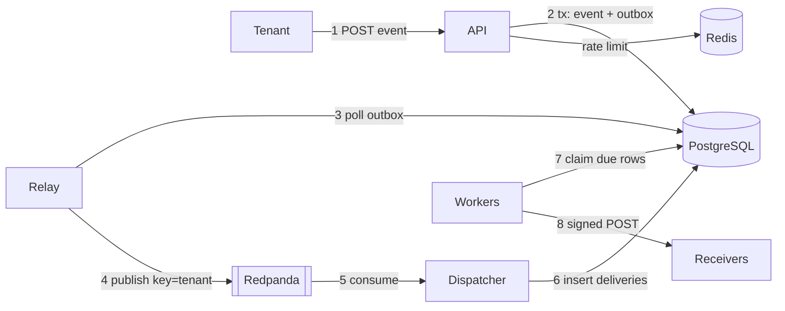
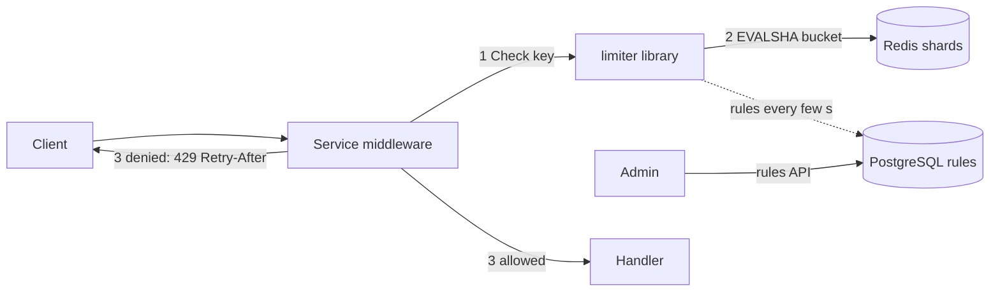
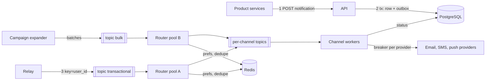
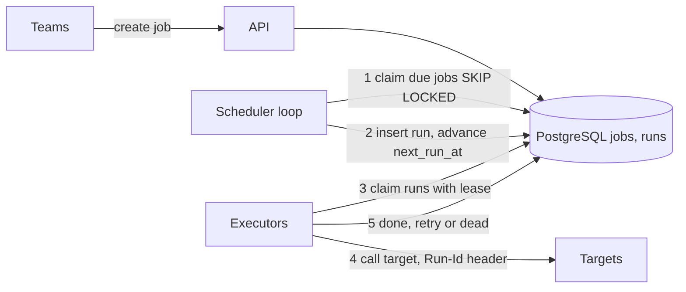
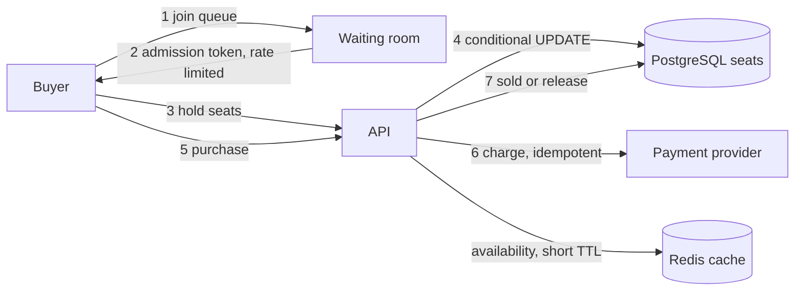
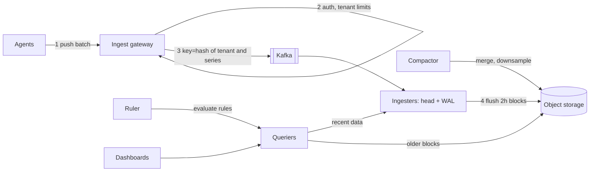

<div dir="rtl" lang="he">

# פרק 36: תכנון מערכות בראיון ומאגר השאלות

ראיון תכנון מערכות הוא שעה מול לוח, עם בעיה פתוחה ומראיינת שמחפשת איך את חושבת. פרק 29 נתן את השיטה; הפרק
הזה מתרגל אותה בתנאי ראיון: איך מחלקים את הזמן, מה אומרים בדקות הראשונות, ואיך נראית תשובה מלאה בשישה מקרים
שחוזרים בסבבים של backend. הוא נגמר במאגר של 135 שאלות על כל הספר, עם כלי קטן שבוחן אותך עליהן.

## מה נלמד בפרק

- איך מחלקים 45 או 60 דקות של ראיון תכנון, ומה כל שלב משאיר על הלוח.
- מה אומרים בחמש הדקות הראשונות, איך מציירים כך שהמראיינת תוכל לעקוב, ואיך מקבלים רמז.
- שישה מקרים מלאים: Hookline, שירות הגבלת קצב, מערכת התראות, מתזמן עבודות, הזמנת כרטיסים וקליטת מדדים.
- בכל מקרה: דרישות ולא־מטרות, הנחות וחשבון, ‏API, מודל נתונים, תרשים, צלילות, מצבי כשל ופשרות.
- איך עונים על שאלות המשך, ואיך מודדים את עצמך אחרי ראיון מדומה.
- מאגר שאלות על פרקים 3 עד 38, ו־`quiz`, כלי שמגריל ממנו שאלות ומראה את התשובה.

## ידע מקדים

- פרק 29 כולו: שיטת ששת הצעדים והערכת גודל. כל מקרה בפרק הזה עובר על הצעדים האלה, באותו סדר.
- פרק 34, סעיף 34.1: מבנה תהליך הגיוס, ואיפה סבבי התכנון נמצאים בו.
- פרק 35: שלושה מהתרגילים שם, מגביל קצב, מתזמן והזמנה, הם הגרסה של תהליך אחד למקרים 36.3, 36.5 ו־36.6.
- פרק 37: המפרט של Hookline. מקרה 36.2 הוא אותו תכנון, בגרסה של חמש דקות ושל עשרים.
- פרקים 9 עד 18, ופרקים 24, 25 ו־28: כל רכיב שמופיע במקרים נלמד שם, וכל מקרה מפנה לסעיף המדויק.
- המאגר שבסעיף 36.8 עובר על הספר כולו, ולכן הוא חזרה ולא חומר חדש.
- פרק 7: פרויקט uv. הכלי של התרגיל בנוי כמו המחשבון של פרק 29.

**על המקור.** כל טענה על איך נראים סבבי תכנון מבוססת על [מחקר השוק של הספר](../00-stage1/01-market-research.md),
שנקרא ב־5 באוקטובר 2026. מה שלא נמצא שם מסומן כשיטת עבודה, ולא כממצא.

## 36.1 הלוח והזמן

### 36.1.1 מה ידוע על הסבב

המחקר מסכם שבתהליך בכיר בישראל יש סבב תכנון מערכות אחד או שניים, ולעיתים קרובות על תחום המוצר של החברה:
התראות, SaaS עם כמה דיירות (multi-tenant), או צנרת נתונים (מחקר השוק, סעיף 3.3, ביטחון בינוני). שלושה פרטים
מהמקורות עצמם (מחקר השוק, סעיף 3.1):

| מה | המקור | ביטחון |
| --- | --- | --- |
| ראיון טכני של שעתיים עד שלוש, עם דגש על תכנון, שבו „לבעיות אין תשובה נכונה באופן אובייקטיבי” | המאגר הציבורי של צוות השרת ב־Wix, משרד ליטא | גבוה ל־Wix, בינוני כמייצג |
| תכנון מערכות לצד עבודה בזוג, עם דגש על „צווארי בקבוק ועלויות” | מדריך של חברת גיוס, 2025 | בינוני |
| שני סבבי תכנון בחברה אחת, ואחד מהם מערכת התראות | דיווח אנונימי יחיד | נמוך |

המחקר לא קובע אורך אחד לסבב. הפרק מתכנן ל־45 עד 60 דקות, כי זו המסגרת שבה שיטת פרק 29 נבנתה; זו הנחת עבודה,
לא ממצא. סבב ארוך יותר, כמו בדוגמה של Wix, הוא אותו סדר עם יותר צלילות. והציטוט „אין תשובה נכונה” הוא הסיבה
שכל מקרה כאן נגמר בפשרות, ולא בפתרון.

### 36.1.2 השעון

אותה חלוקה כמו בפרק 29, סעיף 29.1, עם שתי תוספות: דקות לסיום, ומשבצת שמתארכת כשיש שעה. זו הצעה, לא כלל:

| שלב | 45 דקות | 60 דקות | מה נשאר על הלוח |
| --- | --- | --- | --- |
| דרישות ולא־מטרות | 5 | 7 | שלוש עד חמש דרישות שאפשר לבדוק, ושתיים או שלוש לא־מטרות |
| הערכת גודל | 5 | 5 | שלושה מספרים עם ההנחות שלהם: קצב בשיא, אחסון, ומה שמפתיע |
| ‏API ומודל נתונים | 10 | 10 | שלושה עד חמישה נתיבים, וטבלה או שתיים עם המפתחות |
| תכנון כללי | 10 | 13 | תרשים אחד של מסלול הכתיבה, ואחריו של הקריאה |
| צלילות ומצבי כשל | 12 | 20 | שניים או שלושה חלקים קשים, לעומק, עם טבלת כשלים קצרה |
| סיכום | 3 | 5 | הסיכונים, מה הייתי מודדת קודם, ומה הייתי עושה עם עוד זמן |

שני כללים מחזיקים את השעון. הראשון: מסתכלים על השעון בכל מעבר בין שלבים, ואומרים בקול כשמתקדמים, למשל „יש לי
מספיק כדי להתחיל לצייר; אחזור להערכות אם משהו ישתנה”. השני: אם המראיינת מושכת לצלילה מוקדמת, הולכים איתה. היא
יודעת מה היא רוצה לבדוק, והשעון שלך משרת אותה.

### 36.1.3 חמש הדקות הראשונות

רוב מה שמראיינת לומדת על בכירות נקבע כאן: האם את שואלת על הבעיה, או קופצת לרכיבים. סדר שעובד:

1. **חוזרים על הבעיה במשפט אחד**, במילים שלך: „מערכת שמקבלת אירועים מהמוצר, ושולחת אותם ללקוחות שלו ב־HTTP”.
2. **שואלים על המשתמשות והפעולה החשובה:** מי שולחת, מי מקבלת, מה הפעולה שאסור שתיכשל.
3. **שואלים על הגודל:** כמה משתמשות, כמה פעולות ביום, האם יש שיא צפוי.
4. **שואלים על האיכויות:** זמן תגובה, זמינות, ואיזו עקביות נדרשת. „מותר לראות נתון בן חמש שניות?”
5. **כותבים לא־מטרות ומבקשים אישור:** „לא אבטיח מסירה בדיוק פעם אחת, ולא אבנה ממשק משתמש. זה בסדר?”
6. **אומרים את התוכנית:** „אעבור על דרישות, מספרים, API ונתונים, תרשים, ואז אצלול לשני החלקים הקשים”.

כשהמראיינת עונה „תחליטי את”, זו לא מלכודת. מניחים הנחה סבירה, כותבים אותה על הלוח עם הסיבה, וממשיכים. הנחה
כתובה שאפשר לתקן עדיפה על שאלה עשירית.

> **טעות נפוצה:** להפוך את השאלות לחקירה של עשר דקות. שלוש דקות של שאלות הן השקעה; עשר הן בריחה מהתכנון. אם
> אין תשובה, מניחים, ואומרים שהנחת.

### 36.1.4 הלוח

לוח שקל לעקוב אחריו נראה אותו דבר בכל ראיון, ולכן המראיינת לא צריכה לחפש. החלוקה שהפרק משתמש בה:

| אזור | מה בו | מתי נכתב |
| --- | --- | --- |
| פינה עליונה | דרישות, לא־מטרות, הנחות | בדקות הראשונות, ולא נמחק עד הסוף |
| מתחת | שלושה מספרים, עם החשבון | אחרי הדרישות |
| צד | נתיבי ה־API, וטבלאות עם מפתחות | לפני התרשים |
| מרכז | התרשים | ברוב הזמן |
| פינה תחתונה | שאלות פתוחות וסיכונים | כל פעם שעולה אחד |

כללי ציור, כדי שהתרשים יסביר את עצמו:

- **מלבן לשירות, גליל למאגר, צינור לתור או ל־topic.** שלושה סוגים מספיקים.
- **כל חץ עם תווית:** מה עובר עליו, והאם זה סינכרוני. „POST חתום” אומר יותר מחץ ריק.
- **קודם מסלול הכתיבה, מקצה לקצה**, ורק אחר כך הקריאה. ממספרים את הצעדים, 1, 2, 3, כדי שאפשר יהיה לדבר עליהם.
- **משאירים מקום.** הצלילות יוסיפו רכיבים, ותרשים צפוף מדי נמחק ומצויר מחדש באמצע הראיון.

הכללים זהים בלוח וירטואלי. בראיון מרחוק שואלים בתחילת הסבב באיזה כלי מציירים, ואם אפשר לנסות אותו דקה.

### 36.1.5 איך מקבלים רמז

רמז הוא מידע: המראיינת אומרת לך מה היא רוצה לבדוק. יש לו שלוש צורות נפוצות:

| הצורה | דוגמה | מה עושים |
| --- | --- | --- |
| הכוונה | „בואי נדבר על איך ה־worker לוקח עבודה” | עוזבים את מה שהיה באמצע, ומסמנים על הלוח לחזור |
| אתגר | „ומה קורה כשהשרת הזה נופל?” | עוברים על הכשל לפי הסדר: מה רואים, מה אובד, מה מטפל |
| שינוי הנחה | „נניח שהתנועה גדלה פי מאה” | מחשבים מחדש בקול, ואומרים איזו החלטה נשברת ראשונה |

שלושה דברים שעובדים בכל הצורות. אומרים מה הבנת, במשפט. אומרים מה משתנה בתכנון, ומעדכנים את הלוח. ואם את לא
מסכימה, אומרים למה, ומה היה משנה את דעתך, ואז הולכים בכיוון שלה. מה שלא עובד הוא להגן על התכנון בתוספת רכיבים;
רמז על כשל הוא לרוב הזמנה לפשט.

### 36.1.6 איך מסיימים

שלוש עד חמש דקות לפני הסוף, גם אם הצלילה באמצע:

- **חוזרים על המסלול הראשי** בחצי דקה, מהבקשה ועד המאגר, עם המספרים.
- **אומרים את שני הסיכונים הגדולים**, ומה הייתי מודדת קודם בבדיקת עומס.
- **אומרים מה הייתי עושה עם עוד זמן.** זו תשובה בכירה: היא מראה שאת יודעת מה חסר.
- **שואלים שאלה אחת** על איך הצוות שלהן היה פותר את זה. מעניין, ולפעמים מלמד.

### 36.1.7 איך משתמשים במקרים, ואיך מודדים את עצמך

כל מקרה בסעיפים 36.2 עד 36.7 בנוי באותו סדר: דרישות ולא־מטרות, הנחות וחשבון, ‏API, נתונים, תרשים, צלילות, מצבי
כשל, פשרות, ושתי שאלות המשך עם תשובה. זו לא התשובה היחידה. זו תשובה אחת מלאה, שאפשר להשוות אליה.

הדרך לתרגל היא ראיון מדומה בקול, עם שעון, לפני שקוראים את המקרה. אחריו נותנים לעצמך ציון לפי הטבלה הזאת.
העותק שממלאים נמצא בתרגיל, בקובץ `templates/mock-scorecard.md`:

| קריטריון | 0 | 1 | 2 |
| --- | --- | --- | --- |
| דרישות ולא־מטרות | קפצתי לרכיבים | דרישות בלי לא־מטרות | שתיהן, ובדיקה לכל דרישה |
| מספרים | בלי מספרים | מספרים בלי הנחות | הנחות כתובות, ומספר ששינה החלטה |
| ‏API ונתונים | חסר | אחד מהשניים | שניהם, עם מפתחות וייחודיות |
| תרשים | לא ברור | ברור בלי תוויות | מסלול כתיבה ממוספר, עם תוויות |
| צלילה | שטחית | אחת לעומק | שתיים לעומק, עם קוד או SQL כשצריך |
| מצבי כשל | לא עלו | עלו כשנשאלתי | הבאתי אותם בעצמי, עם טיפול |
| פשרות | „זה הכי טוב” | חלופה בלי תנאי | חלופה, למה לא, ומה היה משנה את דעתי |
| זמן ותקשורת | נגמר הזמן באמצע | הגעתי לסוף בלחץ | סיכום מסודר, ושאלות בזמן |

ציון מקסימלי הוא 16. המספר עצמו פחות חשוב משלושת התיקונים שכותבים אחריו, וזה מה שהתרגיל מבקש.

## 36.2 מקרה: Hookline

השאלה בראיון: **„תכנני מערכת שמוסרת webhooks ללקוחות של מוצר SaaS.”** זה Hookline, ולכן זה המקרה שאת אמורה
לדעת הכי טוב. הוא גם המקרה שבו קל להיכשל מביטחון יתר: לצייר את המערכת שבנית בלי לשאול שאלה אחת. התשובה כאן
מקצרת את פרק 37, ושומרת על הסדר של הראיון.

### 36.2.1 בחמש דקות

אם המראיינת שואלת „ספרי לי על Hookline בחמש דקות”, אלה חמשת המשפטים, אחד לדקה:

1. **מה:** דיירת שולחת אירוע פעם אחת, וכל endpoint מנוי מקבל אותו חתום, לפחות פעם אחת, גם כשהוא איטי או למטה.
2. **המסלול:** הקליטה כותבת אירוע ושורת outbox בטרנזקציה אחת. תהליך פרסום מעביר אותה ל־Redpanda, ותהליך
   פיזור יוצר שורת מסירה לכל מנוי. ‏workers שולחים, מנסים שוב, ומסמנים `dead`.
3. **הנכונות:** אילוצי ייחודיות מחליטים על כפילויות בכל שלב, והמקבלת מסננת לפי מזהה האירוע.
4. **הבידוד:** מגבלת קצב לכל דיירת, ומפסק זרם ומחיצה אטומה לכל endpoint, כך שמקבל אחד איטי לא מעכב אחרים.
5. **ההוכחה:** ניסוי כאוס שהורג תהליכים תחת עומס, וסקריפט שמראה „0 חסרות”.

### 36.2.2 דרישות ולא־מטרות

| דרישה | הבדיקה |
| --- | --- |
| קליטה אידמפוטנטית: אותו מפתח ואותו גוף מחזירים את אותה תוצאה | בדיקת אינטגרציה מול PostgreSQL (F3) |
| כל אירוע מגיע לכל endpoint מנוי ופעיל, לפחות פעם אחת, חתום | ספירה ייחודית ב־sink מול הצפי (F4, F5) |
| ניסיונות חוזרים עם המתנה גדלה, `dead` אחרי המקסימום, והפעלה חוזרת | בדיקות worker ו־API (F6, F7) |
| דיירת רואה רק את שלה | דיירת ב' מקבלת 404 על מזהים של א' (F9) |
| ‏99% מהמסירות למקבלים בריאים תוך 30 שניות | היסטוגרמה של זמן המסירה (N2) |

**לא־מטרות:** לא נבטיח בדיוק פעם אחת, כי מול HTTP של צד שלישי אי אפשר (פרק 13, סעיף 13.8). לא נבטיח סדר בין
אירועים אצל המקבלת. לא נשנה את תוכן האירוע, ולא נבנה ממשק משתמש.

### 36.2.3 הנחות וחשבון

אלה ההנחות של המחשבון בפרק 29, סעיף 29.2.4, והפלט שלו. כולן הנחות, לא מדידות:

<div dir="ltr" align="left">

```text
assumptions   200 tenants x 50,000 events/day = 10,000,000 events/day; peak factor 4
              fan-out 2 endpoints per event; 1.2 attempts per delivery; keep 30 days
events        10,000,000 / 86,400        ~   116/s average,   ~463/s peak
deliveries    116 x 2                    ~   231/s average,   ~926/s peak
attempts      116 x 2 x 1.2              ~   278/s average, ~1,111/s peak
storage       sizing output: 1.9 TiB retained (index overhead 50%, 2 copies)
network       sizing output: ~19 Mbit/s at peak
```

</div>

מה המספרים מכריעים: כ־2,500 שורות בשנייה בשיא, של אירועים, מסירות וניסיונות, הן בתחום של PostgreSQL אחד על
מכונה טובה. זה מספר לבדוק בבדיקת עומס ולא להניח, אבל אין סיבה לחלק את המסד היום.
‏1.9 טרה־בייט אומרים שהמחיקה של שורות ישנות היא חלק מהתכנון, למשל טבלאות מחולקות לפי יום. והרשת זניחה.

### 36.2.4 ‏API ונתונים

<div dir="ltr" align="left">

```text
POST /v1/endpoints                    {url} -> 201 {id, secret (shown once)}
POST /v1/subscriptions                {endpoint_id, event_type | "*"}
POST /v1/events                       Idempotency-Key: k  {type, payload} -> 202 {id}
GET  /v1/events/{id}/deliveries       attempts per endpoint
POST /v1/deliveries/{id}/replay       dead -> pending
```

</div>

שלוש טבלאות מחזיקות את הנכונות. האילוצים הם הלב של התשובה, ולכן אומרים אותם בקול:

| טבלה | המפתח שמחליט | למה |
| --- | --- | --- |
| `events` | ייחודי על דיירת ומפתח אידמפוטנטיות | קליטה כפולה מחזירה את המקור (פרק 9, סעיף 9.5) |
| `outbox` | אינדקס חלקי על שורות שלא פורסמו | ה־relay מוצא אותן מהר (פרק 10, סעיף 10.5) |
| `deliveries` | ייחודי על אירוע ו־endpoint | פרסום כפול או עיבוד חוזר לא יוצרים מסירה שנייה |

### 36.2.5 התרשים

<div dir="ltr" align="left">



</div>

### 36.2.6 צלילות

**צלילה 1: למה outbox ולא פרסום ישיר.** פרסום מתוך ה־API הוא כתיבה כפולה: המסד יכול להצליח והפרסום להיכשל, או
להפך. ב־outbox, השורה נכתבת באותה טרנזקציה של האירוע, וה־relay מפרסם ואז מסמן. קריסה בין שני הצעדים יוצרת
כפילות ב־topic, והאילוץ על `deliveries` בולע אותה (פרק 13, סעיף 13.7).

**צלילה 2: למה המסירות בטבלה ולא ב־topic.** כל מסירה צריכה מועד ניסיון משלה, מצב גלוי והפעלה חוזרת בודדת. בטבלה,
‏worker לוקח שורות שהגיע זמנן עם `FOR UPDATE SKIP LOCKED` וחכירה (פרק 14, סעיף 14.2), ומונה הניסיונות משמש
אסימון גידור. ב־Kafka זה היה דורש topic לכל מדרגת המתנה.

**צלילה 3: מקבל איטי אחד.** זמן קצוב לכל ניסיון, מחיצה אטומה לכל endpoint, ומפסק זרם לכל endpoint (פרק 15,
סעיפים 15.5 ו־15.6). אחרי המקסימום, `dead`, והפעלה חוזרת כשהמקבל חזר.

### 36.2.7 מצבי כשל ופשרות

| כשל | מה קורה | הטיפול |
| --- | --- | --- |
| ‏API קורס אחרי commit ולפני התשובה | הדיירת מנסה שוב | מפתח האידמפוטנטיות מחזיר את התוצאה המקורית |
| ‏worker מת עם מסירה ביד | המסירה תקועה | החכירה פגה, ו־worker אחר לוקח אותה |
| ‏Redpanda למטה | אירועים מחכים | הקליטה ממשיכה; ה־outbox מתמלא, ויש התראה על הגיל שלו |
| ‏Redis למטה | אין מגבלת קצב ומטמון | המגביל נפתח עם מדד, והמטמון נופל ל־PostgreSQL |

הפשרה שהכי כדאי להביא, מטבלת ההחלטות בפרק 37, סעיף 37.5: **Kafka לכל הדרך, עם topics של ניסיונות חוזרים.** היא
מושכת כי יש רכיב אחד לתורים. היא לא נבחרה כי היא מאבדת נראות של כל מסירה ומכפילה topics. מה היה משנה את ההחלטה:
נפח מסירות שמסד אחד כבר לא מאנדקס ומנקה בנוחות.

### 36.2.8 שאלות המשך

**„ואם דיירת אחת שולחת חצי מכל התנועה?”** המפתח לפי דיירת שולח את כל האירועים שלה לאותה partition, וזו
partition חמה (פרק 17, סעיף 17.6). כל עוד ה־dispatcher עומד בה, זה בסדר, כי הסדר לכל דיירת נשמר. אם לא, מפצלים
את המפתח שלה לדיירת ועוד מספר קטן, ומוותרים על סדר בתוך הדיירת, שממילא לא הובטח למקבלת.

**„איך תדעי שאף מסירה לא אבדה?”** במדידה, לא בטיעון: ניסוי כאוס שהורג את כל סוגי התהליכים תחת עומס, ואז
השוואה של הזוגות הצפויים לקבלות הייחודיות ב־sink. „0 חסרות” היא התוצאה שצריך לראות, וכפילויות נספרות בנפרד.

## 36.3 מקרה: שירות הגבלת קצב

השאלה בראיון: **„תכנני שירות הגבלת קצב לכל ה־APIs של החברה.”** זו גרסת המערכת של תרגיל 35.2: שם דלי אסימונים
בתהליך אחד, כאן מגבלה משותפת לעשרות שירותים ולמאות עותקים. השאלה המרכזית היא לא האלגוריתם, אלא איפה המצב יושב
ומה קורה כשהוא לא זמין.

### 36.3.1 דרישות ולא־מטרות

| דרישה | הבדיקה |
| --- | --- |
| מגבלה לפי מפתח: מפתח API, דיירת או כתובת, עם קצב ופרץ | בדיקה עם שעון מוזרק (פרק 16, סעיף 16.2) |
| המגבלה משותפת לכל העותקים של כל השירותים | בדיקה עם שלושה תהליכים מול Redis אחד |
| תשובת 429 עם `Retry-After` ושדות שמראים כמה נשאר | בדיקת API (פרק 16, סעיף 16.3) |
| הבדיקה מוסיפה לכל בקשה פחות מכמה מילישניות ב־p99 | בדיקת עומס; תמדדי ותרשמי |
| כללים משתנים בלי פריסה | בדיקה שמשנה כלל ורואה אותו תוך דקה |

**לא־מטרות:** לא נגן מפני התקפת מניעת שירות מבוזרת; זה תפקיד של שכבת רשת לפני השירות. לא נבטיח דיוק של אחוז אחד
בין אזורים. ולא נחייב לפי שימוש; מונה לחיוב צריך דיוק ויומן, וזו מערכת אחרת.

### 36.3.2 הנחות וחשבון

<div dir="ltr" align="left">

```text
assumptions   50,000 API requests/s at peak across all services; 1 limit check per request
              1,000,000 active keys per day; one bucket = small hash (tokens, last refill)
checks        50,000 checks/s at peak  ->  50,000 atomic script calls/s on the store
memory        1,000,000 keys x ~100 bytes (assumed, incl. overhead) ~ 100 MB
latency       +1 round trip per request; same datacenter ~0.5 ms (Dean 2009, order of magnitude)
network       50,000 x ~200 bytes (request + reply)  ~ 10 MB/s  ~ 80 Mbit/s
```

</div>

שלוש מסקנות. הזיכרון זניח: מאה מגה־בייט נכנסים בכל צומת Redis. ההלוך וחזור נוסף לכל בקשה בחברה, ולכן הוא הדבר
שהכי שווה למדוד. ו־50,000 קריאות בשנייה לצומת אחד הם המספר שבודקים בבדיקת עומס, כי Redis מריץ פקודה אחרי פקודה
(פרק 12, סעיף 12.1). כמה צומת אחד מחזיק עם מרווח, תמדדי ותרשמי; אם לא מספיק, מחלקים מפתחות בין צמתים לפי
גיבוב (פרק 17, סעיף 17.5).

### 36.3.3 ‏API ונתונים

ההחלטה היא קריאה אחת. היא יכולה להיות ספרייה בתוך כל שירות שמדברת ישירות עם Redis, או שירות נפרד ב־gRPC; התשובה
כאן היא ספרייה, והצלילה מסבירה למה:

<div dir="ltr" align="left">

```text
Check(key="tenant:42", rule="ingest", cost=1)
  -> {allowed: false, remaining: 0, retry_after_ms: 350}

rules (PostgreSQL)   id | scope (api_key, tenant, ip) | rate_per_sec | burst | updated_at
bucket (Redis)       rl:{rule}:{key} -> hash {tokens, ts}, expires after burst/rate x 2
```

</div>

הכללים נשמרים ב־PostgreSQL, כי הם תצורה שמשתנה לעיתים רחוקות וצריכה היסטוריה. כל עותק טוען אותם לזיכרון
ומרענן כל כמה שניות. הדליים עצמם ב־Redis, עם זמן חיים, כך שמפתח שלא נראה זמן מה נעלם לבד.

### 36.3.4 התרשים

<div dir="ltr" align="left">



</div>

### 36.3.5 צלילות

**צלילה 1: אטומיות.** קריאה של הדלי, חישוב וכתיבה הם שלושה צעדים, ושני עותקים שמבצעים אותם יחד נותנים שני
אסימונים מאחד. לכן כל הבדיקה היא סקריפט Lua אחד, שרץ ב־Redis בלי הפרעה ומשתמש בשעון של השרת, לא בשעון של כל
עותק (פרק 16, סעיף 16.3). הקריאה עוברת עם הגיבוב של הסקריפט, והספרייה שולחת את הסקריפט המלא כש־Redis לא מכיר
אותו, למשל אחרי הפעלה מחדש.

**צלילה 2: ספרייה או שירות.** שירות נפרד נותן מקום אחד לשנות לוגיקה, אבל מוסיף קפיצה ברשת ושירות שכל החברה
תלויה בזמינות שלו. ספרייה מדברת ישירות עם Redis, ולכן יש קפיצה אחת ולא שתיים. המחיר הוא שכל שינוי באלגוריתם
מחייב לעדכן את הספרייה בכל השירותים, ולכן הלוגיקה עצמה יושבת בסקריפט, שהספרייה רק טוענת.

**צלילה 3: מפתח חם.** דיירת אחת גדולה היא מפתח אחד, ומפתח אחד יושב בצומת אחד. עוד צמתים לא עוזרים לה (פרק 17,
סעיף 17.6). אפשרות אחת היא חכירה של אסימונים: כל עותק לוקח מנה, נניח עשרה אסימונים בקריאה אחת, ומחלק אותה
מקומית. זה מקטין את הקריאות פי עשרה, והמחיר הוא דיוק: בכל רגע המגבלה יכולה לחרוג בגודל המנה כפול מספר העותקים.
אומרים את המספר הזה בקול.

**צלילה 4: כש־Redis לא עונה.** המגביל הוא עכשיו תלות, ופרק 15 חל עליו: זמן קצוב קצר מאוד, ומפסק זרם. ואז החלטה
מתועדת לכל כלל, כמו בפרק 16, סעיף 16.3: פתוח בכשל כשהמגבלה היא הוגנות, וסגור בכשל כשהיא מגינה על כסף או על
אבטחה, למשל מגבלה על ניסיונות התחברות.

### 36.3.6 מצבי כשל ופשרות

| כשל | מה קורה | הטיפול |
| --- | --- | --- |
| ‏Redis איטי | כל בקשה בחברה מאטה | זמן קצוב של מילישניות בודדות, ואז ההחלטה המתועדת לכלל |
| צומת Redis נופל | הדליים שלו אובדים | הדליים נוצרים מחדש מלאים; לרגע מותר יותר, וזה מקובל להוגנות |
| כלל שגוי נפרס | לקוחות טובים מקבלים 429 | מצב „צל” לכלל חדש: סופרים מה היה נדחה, ולא דוחים |
| השעונים של העותקים לא מסונכרנים | דליים מתמלאים לא נכון | הסקריפט משתמש בשעון של Redis בלבד |

| חלופה | למה מושכת | למה לא כאן | מה היה משנה את דעתי |
| --- | --- | --- | --- |
| דלי בזיכרון של כל עותק | אפס תלויות, אפס זמן | המגבלה האמיתית גדלה עם מספר העותקים | שירות עם עותק אחד, או מגבלה שהיא רק הגנה גסה |
| חלון קבוע עם `INCR` | פקודה אחת, פשוט מאוד | פי שניים מהמגבלה סביב גבול החלון (פרק 35, סעיף 35.2) | מגבלות גסות, כמו מכסה יומית |
| שירות הגבלה נפרד | מקום אחד לכל הלוגיקה | עוד קפיצה ועוד שירות קריטי | הרבה שפות שונות שאין להן ספרייה משותפת |

### 36.3.7 שאלות המשך

**„ואם יש שני אזורים?”** מגבלה גלובלית מדויקת דורשת הלוך וחזור בין האזורים בכל בקשה, ובין יבשות זה בסדר גודל של
150 מילישניות (פרק 29, סעיף 29.2). לכן מחלקים את המכסה: כל אזור מקבל חלק לפי התנועה שלו, ומעדכנים את החלוקה כל
כמה דקות. דיירת שזזה בין אזורים תקבל לרגע מגבלה לא מדויקת, ואומרים שזה מחיר מוסכם.

**„למה לא לסמוך על `Retry-After` שהלקוחות יכבדו?”** כי לא כולם מכבדים. התשובה עדיין נשלחת, כי לקוחות טובים כן
משתמשים בה ומפסיקים להציף. אבל ההגנה האמיתית היא שהבקשה הנדחית זולה: היא נעצרת ב־middleware לפני כל עבודה, וזה
מה שמשאיר את השירות חי גם מול לקוח שמתעלם.

## 36.4 מקרה: מערכת התראות

השאלה בראיון: **„תכנני מערכת התראות: אימייל, SMS, ‏push ותיבת הודעות באפליקציה.”** זה המקרה היחיד בפרק שמופיע
בשמו במחקר, בדיווח אנונימי אחד, והוא תחום מוצר נפוץ (מחקר השוק, סעיפים 3.1 ו־3.3). הוא דומה ל־Hookline, ושני
דברים מבדילים אותו: שני סוגי תנועה עם דחיפות שונה מאוד, וספקים חיצוניים שעולים כסף ונופלים.

### 36.4.1 דרישות ולא־מטרות

| דרישה | הבדיקה |
| --- | --- |
| שירותים פנימיים שולחים התראה למשתמשת או לקבוצה, עם מפתח אידמפוטנטיות | בדיקת API: אותו מפתח, התראה אחת |
| ההעדפות של המשתמשת קובעות ערוץ, הסרה מרשימה ושעות שקטות | בדיקה עם משתמשת שהסירה את עצמה |
| התראה דחופה, כמו קוד חד־פעמי, מגיעה לספק תוך 10 שניות ב־p99, גם בזמן מבצע | מדד של זמן ההמתנה בתור, לפי סוג |
| כל התראה נמסרת לספק לפחות פעם אחת, ומצב המסירה גלוי | בדיקה עם ספק מדומה שנכשל |
| לא יותר מכמה התראות שיווקיות למשתמשת ביום | בדיקה עם מגבלה לכל משתמשת |

**לא־מטרות:** לא נבנה שרת דואר או שער SMS; משתמשים בספקים. לא נבטיח סדר בין ערוצים, ולא בדיוק פעם אחת. ולא
נבנה עורך מבצעים; הממשק מקבל פלח משתמשות שכבר הוגדר במקום אחר.

### 36.4.2 הנחות וחשבון

<div dir="ltr" align="left">

```text
assumptions   20,000,000 users; 5 notifications per user per day; transactional peak factor 3
              one campaign may target all users within 1 hour
              channel mix: push 60%, email 30%, in-app 8%, SMS 2%; 500 bytes per record, keep 30 days
daily         20,000,000 x 5 = 100,000,000/day  ->  ~1,157/s average
transactional ~1,157 x 3                        ->  ~3,500/s at peak
campaign      20,000,000 / 3,600                ->  ~5,556/s for one hour
worst case    both at once                      ->  ~9,000/s
SMS           2% of 100,000,000 = 2,000,000/day ->  ~23/s average (the costly channel)
storage       100,000,000 x 500 B = ~46.6 GiB/day; x 30 days = ~1.36 TiB; x 1.5 index x 2 copies = ~4.1 TiB
```

</div>

המספר שמשנה את התכנון הוא מבצע אחד ששולח כמעט פי חמישה מהממוצע, בדיוק כשקודים חד־פעמיים צריכים לעבור מהר.
מכאן שני מסלולים נפרדים, ולא תור אחד עם עדיפויות. וגם כאן, ארבעה טרה־בייט אומרים שהטבלה מחולקת לפי יום, ומחיקה
היא הורדה של מחיצה שלמה (פרק 29, סעיף 29.2).

### 36.4.3 ‏API ונתונים

<div dir="ltr" align="left">

```text
POST /v1/notifications     Idempotency-Key: k
     {user_id, template, params, priority: "transactional" | "bulk"}  -> 202 {id}
POST /v1/campaigns         {segment_id, template, params}            -> 202 {id, status}
GET  /v1/notifications/{id}                                          -> {status per channel}
GET  /v1/users/{id}/inbox?cursor=...                                 -> in-app messages
PUT  /v1/users/{id}/preferences                                      -> channels, opt-outs, quiet hours
```

</div>

| טבלה | מפתחות | הערה |
| --- | --- | --- |
| `notifications` | ייחודי על השולח ומפתח האידמפוטנטיות | מחולקת לפי יום; מצב לכל ערוץ |
| `preferences` | מפתח ראשי לפי משתמשת | נקראת בכל שליחה, ולכן במטמון |
| `inbox` | אינדקס על משתמשת וזמן יצירה | עימוד עם cursor (פרק 10, סעיף 10.6) |
| `campaigns` | מפתח ראשי, ועמודת התקדמות | ה־cursor של ההרחבה נשמר בה |

### 36.4.4 התרשים

<div dir="ltr" align="left">



</div>

### 36.4.5 צלילות

**צלילה 1: שני מסלולים.** תור אחד עם עדיפות לא מספיק: כשמבצע ממלא אותו, גם הודעה דחופה מחכה מאחורי מיליוני
הודעות שכבר נקראו. לכן לכל סוג topic משלו, קבוצת צרכנים משלה ו־workers משלו. זו מחיצה אטומה (פרק 15, סעיף 15.6):
המבצע יכול להאט, והקוד החד־פעמי לא מרגיש. המדד שמגן על הדרישה הוא הפיגור של הצרכנים בכל topic בנפרד.

**צלילה 2: מבצע לעשרים מיליון.** ‏API שמקבל עשרים מיליון קריאות הוא תכנון גרוע. הממשק מקבל פלח, ועבודת רקע
מרחיבה אותו: עוברת על המשתמשות במנות, לפי מפתח ולא לפי היסט, וכותבת כל מנה ל־topic. ה־cursor נשמר בשורת
המבצע אחרי כל מנה, כך שקריסה ממשיכה מאותה נקודה. מנה שנכתבה פעמיים לא מזיקה, כי למבצע ולמשתמשת יש מפתח
ייחודי.

**צלילה 3: ההעדפות נבדקות בזמן השליחה.** אם הן נבדקות רק כשההתראה נוצרת, משתמשת שהסירה את עצמה באמצע מבצע
עדיין תקבל. לכן ה־router בודק אותן מול מטמון עם זמן חיים קצר, ושינוי מוחק את המפתח אחרי ה־commit (פרק 12,
סעיף 12.2). שעות שקטות לא דוחות את ההתראה; הן מתזמנות אותה מחדש לבוקר.

**צלילה 4: ספקים.** כל ספק הוא תלות שנכשלת: זמן קצוב, ניסיונות חוזרים עם המתנה גדלה ופיזור אקראי, ומפסק זרם
לכל ספק (פרק 15). ל־SMS כדאי ספק שני, ומעבר אליו כשהמפסק של הראשון פתוח. ומה שנכשל סופית עובר לתור מתים, עם
השגיאה (פרק 14, סעיף 14.5).

### 36.4.6 מצבי כשל ופשרות

| כשל | מה קורה | הטיפול |
| --- | --- | --- |
| ספק האימייל למטה | התראות מצטברות | המפסק נפתח, הניסיונות נדחים, והפיגור מתריע |
| ‏worker קורס אחרי שליחה ולפני רישום | שליחה כפולה | מפתח אידמפוטנטיות לספק כשהוא תומך; אחרת כפילות מוצהרת |
| המבצע מוכפל בטעות | עשרים מיליון הודעות פעמיים | מפתח ייחודי לכל מבצע ומשתמשת |
| ‏Redis למטה | אין מטמון העדפות | קריאה מ־PostgreSQL, איטית יותר, עם השלת עומס במסלול השיווקי |

| חלופה | למה מושכת | למה לא כאן | מה היה משנה את דעתי |
| --- | --- | --- | --- |
| תור מסירות ב־PostgreSQL, כמו Hookline | מועד ניסיון ונראות לכל שורה | כ־9,000 שליחות בשנייה בשיא, ורוב ההודעות נשלחות פעם אחת | נפח קטן, או צורך בהפעלה חוזרת לכל הודעה |
| תור אחד עם עדיפויות | פחות רכיבים | הודעה דחופה מחכה מאחורי מבצע שכבר בתור | אין מבצעים גדולים |
| שליחה ישירה מה־API | אפס תורים | ספק איטי מאט את השירותים ששולחים | נפח זעיר ושולח אחד |

ההשוואה ל־Hookline שווה משפט בראיון. שם כל מסירה היא שורה, כי מקבל של דיירת יכול להיות למטה שעות, וכל מסירה
צריכה מועד משלה. כאן רוב ההודעות עוברות בניסיון הראשון, הנפח גבוה פי עשרה, ולכן Kafka עם ניסיונות מעטים ותור
מתים מתאימה יותר. אותה שאלה, תנאים אחרים, החלטה אחרת.

### 36.4.7 שאלות המשך

**„איך תבטיחי שקוד חד־פעמי מגיע תוך 10 שניות בזמן מבצע?”** במסלול נפרד: topic, צרכנים ו־workers משלו, ומגבלת
שליחה לספק שמחולקת כך שלמסלול הדחוף יש חלק שמור. ובמדידה: יעד רמת שירות על הזמן מיצירה ועד מסירה לספק, עם
התראה על קצב שריפה (פרק 25, סעיף 25.3).

**„משתמשת מקבלת את אותו push פעמיים. איפה תחפשי?”** בשלושה מקומות: האם השולח שלח בלי מפתח אידמפוטנטיות, האם
‏worker קרס בין השליחה לרישום, והאם הספק עצמו מסר פעמיים. מזהה ההתראה שעובר לכל אורך הדרך, ובמעקב (פרק 24,
סעיף 24.8), הוא מה שמאפשר לענות. ואם זה קורס בין שליחה לרישום, זה המחיר המוצהר של „לפחות פעם אחת”.

## 36.5 מקרה: מתזמן עבודות

השאלה בראיון: **„תכנני שירות שמריץ עבודות מתוזמנות: חד־פעמיות בזמן מסוים, וחוזרות לפי ביטוי cron.”** תרגיל 35.3
היה מתזמן בתהליך אחד, בזיכרון; כאן הוא שירות לכל החברה, שחייב לשרוד קריסות ולא להריץ פעמיים בלי סיבה.

### 36.5.1 דרישות ולא־מטרות

| דרישה | הבדיקה |
| --- | --- |
| יצירה של עבודה חד־פעמית או חוזרת, עם יעד: קריאת HTTP או הודעה לתור | בדיקת API |
| עבודה מתחילה תוך 5 שניות מהמועד ב־p99 | היסטוגרמה של העיכוב מהמועד |
| כל הרצה „לפחות פעם אחת”, עם מזהה הרצה שהיעד יכול לסנן לפיו | בדיקה שהורגת executor באמצע |
| השהיה, ביטול, והיסטוריית הרצות | בדיקת API |
| מדיניות להרצות שהוחמצו: להשלים, להריץ פעם אחת, או לדלג | בדיקה עם שעון מוזרק שקופץ שעה |

**לא־מטרות:** לא נריץ את הקוד של העבודה עצמה; אנחנו מפעילים יעד. לא נבטיח דיוק של פחות משנייה. ולא נבנה תלויות
בין עבודות, כמו גרף של צעדים; זו מערכת זרימות, ובקשה אחרת.

### 36.5.2 הנחות וחשבון

<div dir="ltr" align="left">

```text
assumptions   1,000,000 recurring jobs, mostly hourly; 30% of them scheduled at minute :00
              20,000,000 one-off delayed jobs per day; 300 bytes per run record, keep 7 days
recurring     1,000,000 / 3,600          ->  ~278 runs/s on average
top of hour   30% x 1,000,000 = 300,000 runs due in the same second
              spread over a 60 s start window  ->  5,000 runs/s for that minute
one-off       20,000,000 / 86,400        ->  ~231 runs/s
runs per day  1,000,000 x 24 + 20,000,000 = 44,000,000
storage       44,000,000 x 300 B = ~12.3 GiB/day; x 7 days = ~86 GiB; x 1.5 x 2 = ~258 GiB
```

</div>

הממוצע קטן, והשיא הוא הבעיה: שלוש מאות אלף הרצות באותה שנייה, פי אלף מהממוצע. זו התפרצות שנוצרת מבני אדם,
שאוהבים מספרים עגולים. כל הצלילה הראשונה עוסקת בה. האחסון, לעומת זאת, נכנס בנוחות במסד אחד.

### 36.5.3 ‏API ונתונים

<div dir="ltr" align="left">

```text
POST /v1/jobs   {schedule: "0 * * * *" | run_at, timezone, target, missed: "skip" | "once" | "all"}
                -> 201 {id, next_run_at}
POST /v1/jobs/{id}:pause      POST /v1/jobs/{id}:resume      DELETE /v1/jobs/{id}
GET  /v1/jobs/{id}/runs?cursor=...
```

</div>

| טבלה | מפתחות | הערה |
| --- | --- | --- |
| `jobs` | אינדקס חלקי על `next_run_at` לעבודות פעילות | מה שהמתזמן קורא בכל סבב |
| `runs` | ייחודי על עבודה ו־`scheduled_for` | הרצה אחת לכל חלון זמן, גם אם שני מתזמנים יצרו אותה (פרק 14, סעיף 14.6) |
| `runs` | חכירה: `lease_until` ומונה ניסיונות | לקיחה עם `SKIP LOCKED` (פרק 14, סעיף 14.2) |

### 36.5.4 התרשים

<div dir="ltr" align="left">



</div>

### 36.5.5 צלילות

**צלילה 1: ראש השעה.** שלוש דרכים, ואפשר לשלב. ראשית, יצירת ההרצות מראש: המתזמן יוצר את שורות ההרצה כמה דקות
לפני המועד, כך שהעבודה הכבדה במסד מתפזרת. שנית, חלון התחלה: עבודה שמוכנה לכך מקבלת היסט קבוע ואקראי בתוך
הדקה, שנגזר מהמזהה שלה, כך שאותה עבודה תמיד רצה באותה שנייה. שלישית, מגבלת קצב לכל צוות ביעד, כי שלוש מאות אלף
קריאות לאותו שירות באותה שנייה יפילו אותו, לא אותנו.

**צלילה 2: שעונים.** שלושה עותקים של המתזמן הם שלושה שעונים, ושעון יכול לקפוץ (פרק 18, סעיף 18.1). לכן ההחלטה
„הגיע הזמן” נעשית בשאילתה מול השעון של המסד, ולא מול השעון של העותק. והמפתח הייחודי על עבודה וחלון זמן אומר
ששני עותקים שהחליטו יחד יוצרים הרצה אחת. בבדיקות, השעון מוזרק, כמו בפרק 35, סעיף 35.1.

**צלילה 3: הרצה ארוכה והרצה כפולה.** ‏executor שלקח הרצה מאריך את החכירה שלה כל כמה שניות. אם הוא מת, החכירה פגה,
ואחר לוקח. כך הרצה יכולה לרוץ פעמיים, ולכן היעד מקבל את מזהה ההרצה בכותרת, ויכול לסנן לפיו. ומונה הניסיונות
הוא אסימון גידור: ‏executor ישן לא יכול לסמן את התוצאה של חדש (פרק 18, סעיף 18.4).

**צלילה 4: כשמסד אחד לא מספיק.** מחלקים את העבודות לפי גיבוב של המזהה לכמה חלקים, ולכל חלק מתזמן פעיל אחד, עם
advisory lock לחלק (פרק 18, סעיף 18.5). אפשר גם להחזיק את התור של „מה הבא” בקבוצה ממוינת ב־Redis (פרק 12, סעיף
12.1), ואת האמת במסד. אבל אז יש שני מקומות שצריכים להסכים, ולכן זה הצעד האחרון ולא הראשון.

### 36.5.6 מצבי כשל ופשרות

| כשל | מה קורה | הטיפול |
| --- | --- | --- |
| השירות למטה שעה | הרצות הוחמצו | בעלייה, המתזמן מוצא חלונות בלי הרצה, ופועל לפי המדיניות של כל עבודה |
| היעד למטה | הרצות נכשלות | ניסיונות עם המתנה גדלה ותקרה, ואז `dead` עם השגיאה, והתראה לצוות |
| ‏executor נתקע בלי למות | החכירה ממשיכה להתחדש | זמן קצוב כולל להרצה, מעבר לו מבטלים ומסמנים כשל |
| שני מתזמנים פעילים | עבודה כפולה במסד | המפתח הייחודי מונע הרצה כפולה; הנזק הוא רק בזבוז |

| חלופה | למה מושכת | למה לא כאן | מה היה משנה את דעתי |
| --- | --- | --- | --- |
| CronJob של Kubernetes לכל עבודה | קיים, בלי קוד | מיליון אובייקטים באשכול, ו־pod לכל הרצה | עשרות עבודות של צוות אחד |
| מתזמן אחד עם בחירת מנהיג | אין עבודה כפולה | שיא של 5,000 בשנייה על עותק אחד, ומעבר מנהיג משאיר פער | נפח קטן |
| תור של הודעות מושהות ב־Kafka | ‏Kafka כבר קיימת | אין ביטול, השהיה או מבט על „מה הבא” בלי לקרוא הכול | עבודות שאף פעם לא משתנות אחרי היצירה |

### 36.5.7 שאלות המשך

**„עבודה צריכה לרוץ כל יום בתשע בבוקר שעון ישראל. מה מסובך בזה?”** שעון קיץ: פעם בשנה שעה לא קיימת, ופעם אחרת
היא קורית פעמיים. לכן אזור הזמן נשמר עם העבודה, והמועד הבא מחושב בו, ולא ב־UTC. למועד שלא קיים ולמועד כפול
צריכה מדיניות כתובה, ובדיקה עם שעון מוזרק בדיוק בלילות האלה.

**„למה לא להריץ את העבודה בתוך ה־executor, במקום לקרוא ליעד?”** כי אז השירות צריך את הקוד, ההרשאות והתלויות של כל
צוות, ועבודה כבדה אחת מאטה את כל השאר. הפעלה של יעד שומרת על גבול ברור: אנחנו אחראים על הזמן ועל הניסיונות,
והצוות אחראי על מה שהעבודה עושה. המחיר הוא שהיעד חייב להיות אידמפוטנטי.

## 36.6 מקרה: הזמנת כרטיסים

השאלה בראיון: **„תכנני מערכת למכירת כרטיסים להופעות, כולל פתיחת מכירה למופע מבוקש.”** תרגיל 35.6 הראה את הליבה:
המסד אוכף שאין הזמנה כפולה. כאן מוסיפים את מה שהופך את זה לקשה: מיליון אנשים שמגיעים באותה דקה בשביל חמישים
אלף מקומות.

### 36.6.1 דרישות ולא־מטרות

| דרישה | הבדיקה |
| --- | --- |
| מושב לא נמכר פעמיים, לעולם | בדיקה מקבילית: הרבה בקשות לאותו מושב, הצלחה אחת |
| מושב נשמר למשתמשת 10 דקות בזמן התשלום, ומשתחרר אם לא שילמה | בדיקה עם שעון מוזרק |
| תשלום כפול לא יוצר שתי רכישות | מפתח אידמפוטנטיות לרכישה |
| בפתיחת מכירה, המערכת נשארת זמינה, והכניסה הוגנת | בדיקת עומס מעל הקיבולת |
| הזמינות בדף המופע עדכנית בתוך כמה שניות | בדיקה של זמן החיים במטמון |

**לא־מטרות:** לא תמחור דינמי, לא שוק משני, ולא ציור של מפת האולם. ומספר המקומות הפנויים בדף המופע לא חייב להיות
מדויק בכל רגע; הוא רמז, והאמת נבדקת ברגע השמירה.

### 36.6.2 הנחות וחשבון

<div dir="ltr" align="left">

```text
assumptions   one on-sale: 50,000 seats; 1,000,000 people arrive in the first 10 minutes
              ~10 API requests per person while trying; ~10 hold attempts per seat sold
reads         1,000,000 x 10 / 600 s     ->  ~16,700 requests/s, all for one event
holds         50,000 x 10 / 600 s        ->  ~833 hold attempts/s, at most 50,000 succeed
storage       50,000 seats x 200 B       ->  ~10 MB: the whole event fits in memory
checkout      admit 10,000 people at a time; ~5 minutes each in checkout (Little's law)
              10,000 / 300 s             ->  ~33 admissions/s; 50,000 buyers in ~25 minutes
```

</div>

זו בעיה של תחרות, לא של נפח. כל המופע הוא עשרה מגה־בייט, וכל התנועה הולכת לאותן שורות. חוק ליטל (פרק 16, סעיף
16.1) הופך את השאלה „כמה להכניס” לחשבון: אם רוצים לכל היותר עשרת אלפים אנשים בתשלום, וכל אחד שוהה חמש דקות,
מכניסים כ־33 בשנייה. מספיק להכניס עד שהמקומות נגמרים.

### 36.6.3 ‏API ונתונים

<div dir="ltr" align="left">

```text
POST /v1/events/{id}/queue                     -> 202 {position, token when admitted}
POST /v1/events/{id}/holds  (admission token)  {seats: ["A-12"] | {best_available: 2}}
                                               -> 201 {hold_id, seats, expires_at} | 409
POST /v1/holds/{id}/purchase  Idempotency-Key: k  {payment_method} -> 201 {order_id} | 410
GET  /v1/events/{id}/availability              -> cached counts per section
```

</div>

| טבלה | מפתחות | הערה |
| --- | --- | --- |
| `seats` | מפתח ראשי על מופע ומושב | מצב, מחזיקה ותוקף השמירה (`hold_until`); זו האמת |
| `orders` | ייחודי על משתמשת ומפתח אידמפוטנטיות | רכישה כפולה מחזירה את ההזמנה המקורית |
| `payments` | ייחודי על הזמנה | מצב התשלום מול הספק, לסאגה |

### 36.6.4 התרשים

<div dir="ltr" align="left">



</div>

### 36.6.5 צלילות

**צלילה 1: השמירה היא עדכון אחד.** אין `SELECT` לפני הכתיבה. הפקודה מסמנת את המושב כשמור רק אם הוא פנוי, או
ששמירה קודמת עליו פגה, ובודקים כמה שורות עודכנו: אחת היא הצלחה, אפס הוא 409. זה אותו רעיון כמו תיקון העדכון האבוד
בפרק 11, סעיף 11.3: הקריאה, הבדיקה והכתיבה הן פקודה אחת. בגלל התנאי על `hold_until`, שמירה שפגה כבר פנויה,
ואין צורך בתהליך שמנקה כדי שהמערכת תהיה נכונה; תהליך כזה קיים רק כדי שהזמינות שמוצגת תתעדכן.

**צלילה 2: „המקום הטוב ביותר” במקום מושב שנבחר.** כשאלף אנשים לוחצים על אותו מושב, 999 מקבלים 409 ומנסים שוב.
כשהשרת בוחר, הוא לוקח את המושבים הפנויים הראשונים באזור עם `FOR UPDATE SKIP LOCKED` (פרק 11, סעיף 11.4), וכל
בקשה מקבלת מושב אחר בלי לחכות. זו אותה טכניקה של תור עבודות, על שורות של מושבים. מציעים אותה למראיינת כשינוי
במוצר, ולא מחליטים לבד.

**צלילה 3: חדר ההמתנה.** בלי שער, מיליון אנשים מגיעים לנתיב השמירה, והמסד רווי. חדר ההמתנה מחלק מקומות בתור,
ומכניס בקצב קבוע עם דלי אסימונים (פרק 16, סעיף 16.2), ומי שבפנים מקבל אסימון חתום וקצר חיים לנתיבי הקנייה
(פרק 28, סעיף 28.3). מה שמעבר לקיבולת נענה מהר ב־503 עם `Retry-After`, ולא נתקע (פרק 16, סעיף 16.5).

**צלילה 4: התשלום הוא סאגה.** חיוב אצל הספק ושינוי המושב ל„נמכר” הם שני מאגרים, ואין טרנזקציה אחת. הסדר: חיוב
עם מפתח אידמפוטנטיות, ואז עדכון של המושב בתנאי שהשמירה עדיין של אותה משתמשת. אם העדכון נכשל, כי השמירה פגה
ומישהי אחרת לקחה, הפעולה המפצה היא החזר כספי (פרק 18, סעיף 18.7). מאריכים את השמירה כשהתשלום מתחיל, כדי שזה
יהיה נדיר, ומודדים כמה פעמים זה קורה.

### 36.6.6 מצבי כשל ופשרות

| כשל | מה קורה | הטיפול |
| --- | --- | --- |
| שתי בקשות לאותו מושב | אחת מצליחה | העדכון המותנה; השנייה מקבלת 409 |
| המשתמשת סוגרת את הדפדפן באמצע | המושב שמור | השמירה פגה אחרי 10 דקות, והמושב פנוי בלי ניקוי |
| הספק חייב, והתשובה אבדה | המשתמשת לוחצת שוב | אותו מפתח אידמפוטנטיות לרכישה ולספק |
| מסד המופע רווי | הכול מאט | חדר ההמתנה מאט את הכניסה; המטמון מגן על דף הזמינות |

| חלופה | למה מושכת | למה לא כאן | מה היה משנה את דעתי |
| --- | --- | --- | --- |
| שמירה ב־Redis עם `SET NX PX` | מהירה מאוד | נעילה עם תוקף טובה ליעילות, לא לנכונות (פרק 18, סעיף 18.3); מושב שנמכר פעמיים הוא בעיית נכונות | ‏Redis כמסנן לפני המסד, והמסד עדיין מחליט |
| אילוץ החרגה, כמו בתרגיל 35.6 | המסד אוכף | מושב הוא פריט בדיד ולא טווח זמן, ולכן מפתח ראשי ועדכון מותנה מספיקים | הזמנה של חדרים או מכשירים לפי שעות |
| בלי חדר המתנה, רק הגבלת קצב | פשוט | ‏429 לכל מי שלא הספיק הוא תחרות של מהירות לחיצה, ומרגיש לא הוגן | מופעים קטנים, בלי פתיחת מכירה |

### 36.6.7 שאלות המשך

**„מופע אחד מבוקש במיוחד יושב על מסד אחד. האם זו בעיה?”** זו מחיצה חמה, ועוד מחיצות לא עוזרות לה (פרק 17, סעיף
17.6). אבל החשבון אומר שהיא קטנה: כ־833 עדכונים בשנייה על עשרה מגה־בייט. מה שמגן עליה הוא חדר ההמתנה, שמגביל
את הקצב שמגיע אליה, והמטמון, שמוריד ממנה את הקריאות. מחלקים לפי מופע כדי שמופעים שונים לא יפריעו זה לזה, לא
כדי לפצל מופע אחד.

**„איך תבדקי שלעולם אין מכירה כפולה?”** בבדיקה מקבילית, כמו בתרגיל 35.6: הרבה בקשות לאותו מושב, הצלחה אחת בדיוק.
ובייצור, בשאילתת התאמה יומית שסופרת הזמנות לכל מושב ומתריעה על יותר מאחת. גם אם הקוד נכון, בדיקה כזאת תופסת את
הבאג שעוד לא נכתב.

## 36.7 מקרה: קליטת מדדים

השאלה בראיון: **„תכנני מערכת שקולטת מדדים מעשרת אלפים שרתים, שומרת אותם חודש, ומשרתת לוחות והתראות.”** זה
המקרה של צנרת נתונים, שהמחקר מונה בין תחומי המוצר הנפוצים (מחקר השוק, סעיף 3.3). פרק 24 לימד את הצד של מי שמשתמשת
ב־Prometheus; כאן מתכננים את הצד של האחסון, והמושג המרכזי הוא אותו מושג: קרדינליות (cardinality), מספר הסדרות.

### 36.7.1 דרישות ולא־מטרות

| דרישה | הבדיקה |
| --- | --- |
| קליטה של שלושת סוגי המדדים מפרק 24, מסוכנים שדוחפים כל 15 שניות | בדיקת עומס בקצב של השיא |
| שמירה של 30 יום ברזולוציה מלאה | חשבון אחסון, ובדיקה של מחיקה לפי גיל |
| שאילתה על שש השעות האחרונות עונה תוך שנייה ב־p99 | בדיקת עומס על נתיב הקריאה |
| התראות נבדקות כל דקה, גם כשיש עומס שאילתות | חוקים שרצים במסלול נפרד |
| מגבלות לכל דיירת: דגימות בשנייה וסדרות פעילות | בדיקה עם דיירת שחורגת |

**לא־מטרות:** לא לוגים ולא מעקבים; הם אחסונים אחרים (פרק 24, סעיף 24.1). לא שאילתות SQL חופשיות. לא שאילתות
שחוצות דיירות. ומעבר ל־30 יום, רק נתונים מצומצמים, וזו החלטה שנדחית.

### 36.7.2 הנחות וחשבון

<div dir="ltr" align="left">

```text
assumptions   10,000 hosts x 1,000 active series each = 10,000,000 active series; one sample per 15 s
              raw sample = 8 B timestamp + 8 B value; assumed compression to ~2 B per sample (measure it)
              ~1 KiB of labels and index per active series (assumed)
ingest        10,000,000 / 15 s           ->  ~666,667 samples/s
network       666,667 x 16 B              ->  ~10.7 MB/s  ~ 85 Mbit/s before labels and protocol overhead
per day       666,667 x 86,400            ->  ~57.6 billion samples
raw           57.6e9 x 16 B               ->  ~858 GiB/day
compressed    57.6e9 x 2 B                ->  ~107 GiB/day; x 30 days = ~3.1 TiB; x 3 copies = ~9.4 TiB
index         10,000,000 x 1 KiB          ->  ~9.5 GiB in memory, before churn
```

</div>

שלוש מסקנות. הקליטה היא כ־670 אלף דגימות בשנייה, ולכן אין מסד שורות שמכניס אותן אחת אחת; צריך מבנה שמצרף
דגימות של אותה סדרה ודוחס אותן. האחסון, אחרי דחיסה, הוא כמה טרה־בייט, ולכן הוא שייך לאחסון אובייקטים זול ולא
לדיסקים של שרתים. והזיכרון נקבע לפי מספר הסדרות ולא לפי מספר הדגימות: כל label חדש שמכפיל סדרות מכפיל את המספר
האחרון בטבלה.

### 36.7.3 ‏API ונתונים

<div dir="ltr" align="left">

```text
POST /v1/push        tenant API key; batch of {labels, samples[(ts, value)]}  -> 204 | 429 {limit, retry_after}
GET  /v1/query       ?expr=...&time=...                                        -> instant vector
GET  /v1/query_range ?expr=...&start=...&end=...&step=...                      -> matrix
```

</div>

| מבנה | מה בו | איפה |
| --- | --- | --- |
| סדרה | גיבוב של קבוצת ה־labels, דיירת, ומזהה פנימי | אינדקס בזיכרון של ה־ingester, ואינדקס בכל בלוק |
| ראש | שעתיים אחרונות של דגימות לכל סדרה, דחוסות, ויומן כתיבה | זיכרון ודיסק מקומי |
| בלוק | שעתיים של סדרות, דחוסות, עם אינדקס הפוך מ־label לסדרות | אחסון אובייקטים, לפי דיירת וזמן |

### 36.7.4 התרשים

<div dir="ltr" align="left">



</div>

### 36.7.5 צלילות

**צלילה 1: קרדינליות.** סדרה היא צירוף אחד של labels, ו־label עם ערכים לא חסומים, כמו מזהה משתמשת או נתיב מלא,
יוצר סדרה לכל ערך (פרק 24, סעיף 24.4). דיירת אחת שמוסיפה label כזה יכולה להכפיל את הזיכרון של כל ה־ingesters.
ההגנה היא מגבלה על סדרות פעילות לכל דיירת: סדרה חדשה מעבר למגבלה נדחית בשגיאה ברורה, והסדרות הקיימות ממשיכות.
וגם מדד של סדרות חדשות לדקה, כי גם pods שמתחלפים יוצרים סדרות חדשות בכל פריסה.

**צלילה 2: מפתח החלוקה.** חלוקה לפי דיירת שומרת שאילתה של דיירת במקום אחד, אבל דיירת גדולה מחממת מחיצה אחת
(פרק 17, סעיף 17.6). חלוקה לפי גיבוב של הסדרה מפזרת עומס היטב, אבל כל שאילתה פונה לכל המחיצות. הפשרה היא גיבוב
של דיירת וסדרה יחד, בתוך קבוצת מחיצות שגודלה תלוי בגודל הדיירת. כך דיירת קטנה נוגעת בכמה מחיצות, ודיירת גדולה
מתפזרת על הרבה.

**צלילה 3: עמידות.** ‏Kafka מחזיקה את מה שנקלט ועוד לא נכתב לבלוק. ‏ingester שקורס בונה את הראש מחדש מהיומן
המקומי, או קורא מחדש מה־offset האחרון שנכתב לבלוק, ולכן שמירת ה־offset קורית רק אחרי שהבלוק נשמר (פרק 13, סעיף
13.6). דגימה שנכתבה פעמיים היא אותה נקודה באותו זמן, ולכן כפילות לא מזיקה.

**צלילה 4: נתיב הכתיבה מוגן מנתיב הקריאה.** שאילתה כבדה, למשל שלושים יום של אלף סדרות, יכולה לתפוס זיכרון ומעבד.
לכן ה־queriers הם תהליכים נפרדים, עם מגבלה על מספר הסדרות והנקודות לשאילתה, ועם זמן קצוב. ה־ruler, שמריץ
התראות, מקבל מאגר queriers משלו. זו מחיצה אטומה, כך שלוח כבד לא מעכב התראה.

### 36.7.6 מצבי כשל ופשרות

| כשל | מה קורה | הטיפול |
| --- | --- | --- |
| ‏ingester קורס | הראש שלו בזיכרון אובד | בנייה מחדש מהיומן ומ־Kafka; עד שהוא חוזר, נתונים אחרונים חסרים בשאילתות |
| אחסון האובייקטים לא זמין | אי אפשר לשמור בלוקים | ‏ingesters שומרים מקומית עד גבול, ומתריעים על גיל הבלוק הישן ביותר |
| דגימות מגיעות באיחור | נקודות מחוץ לסדר | מקבלים בתוך חלון קצר, ודוחים מעבר לו עם מונה |
| דיירת שולחת פי עשרה | כולם מאטים | מגבלת קצב לכל דיירת בשער, ‏429 עם `Retry-After` (פרק 16, סעיף 16.3) |

| חלופה | למה מושכת | למה לא כאן | מה היה משנה את דעתי |
| --- | --- | --- | --- |
| ‏Prometheus אחד שמושך מכל השרתים | פשוט, ונלמד בפרק 24 | עשרה מיליון סדרות ושלושים יום הם מעבר למה ששרת אחד מחזיק בנוחות | כמה מאות שרתים |
| מסד שורות עם שורה לכל דגימה | שאילתות SQL מוכרות | ‏670 אלף הכנסות בשנייה, ואינדקס לכל שורה | קצב נמוך פי מאה |
| בלי Kafka, ‏ingesters משוכפלים | רכיב אחד פחות | כל דגימה נכתבת לכמה ingesters, וההתאוששות מורכבת יותר | צוות שלא מתפעל Kafka |

וכדאי לומר בראיון: מערכות כאלה קיימות, ובעבודה רוב הצוותים משתמשים באחת מהן. השאלה בודקת אם את מבינה למה הן
בנויות כך, ולכן אם תבחרי בכלי קיים, תדעי מה לשאול עליו.

### 36.7.7 שאלות המשך

**„איך מחשבים p99 של זמן תגובה על פני כל השרתים?”** לא ממצעים אחוזונים; ממוצע של p99 אינו p99 של כלום. מסכמים את
הדליים של ההיסטוגרמה מכל השרתים, אחרי `rate`, ורק אז מחשבים את האחוזון מהסכום (פרק 24, סעיף 24.4). זו הסיבה
שהמערכת שומרת histograms כדליים ולא כאחוזונים מוכנים.

**„דיירת פרסה גרסה שמוסיפה label של מזהה משתמשת. מה קורה, ואצל מי?”** הסדרות הפעילות שלה קופצות, והמגבלה שלה
נאכפת: סדרות חדשות נדחות, בשגיאה שאומרת למה, והדיירות האחרות לא מרגישות. במקביל, התראה לצוות התפעול על קפיצה
בסדרות חדשות לדקה. בלי המגבלה, אותו שינוי היה מפיל את ה־ingesters של כולם.

## 36.8 מאגר השאלות

המאגר הוא 135 שאלות על פרקים 3 עד 38, בעשר קטגוריות. כל שאלה באה עם תשובה שמסבירה את הנימוק והפשרה, שורת פשרה
קצרה, ולפעמים שאלת המשך. הוא מחולק לשני ימים: ביום 96 החלק הראשון, חמש הקטגוריות של פרקים 3
עד 23; ביום 97 השני, על תפעול, איכות ואבטחה, בכירות, תרגילי הקוד והפרויקט.

איך להשתמש בו:

- **אל תקראי ברצף.** הכלי `quiz` בתרגיל מגריל שאלות מהקטגוריות שבחרת, מחכה ל־Enter, ומראה את התשובה. עני בקול
  לפני שאת לוחצת.
- **השווי צורה, לא מילים.** התשובות כאן הן תשובה אחת טובה. מה שחשוב הוא שגם בתשובה שלך יש נימוק, חלופה, ומה היה
  משנה את דעתך.
- **סמני מה לא ידעת.** הכלי מסכם בסוף את השאלות שסימנת, עם הפרק שלהן, וזו רשימת החזרה שלך.

הטקסט שלמטה נוצר מהקובץ `exercises/ch36-question-bank/data/questions.jsonl` בכלי `tools/render_question_bank.py`.
מתקנים את הקובץ, לא את הטקסט.

<!-- bank:start -->

### חלק ראשון (יום 96)

#### Go (פרקים 3 עד 6)

**1. למה הוספה ל־slice בתוך פונקציה יכולה לשנות נתונים אצל מי שקראה לה?** (פרק 3)

ה־slice הוא כותרת קטנה: מצביע למערך בסיס, אורך וקיבולת, והכותרת מועתקת בקריאה. כשיש קיבולת פנויה, `append` כותבת לאותו מערך בסיס, וכל slice אחר שחולק אותו רואה את השינוי. כשאין קיבולת, נוצר מערך חדש והקשר נשבר בשקט. לכן ההתנהגות תלויה בקיבולת, וזו ההפתעה. התיקון הוא העתקה מפורשת עם `slices.Clone`, או ביטוי slice מלא שמגביל את הקיבולת.

*שורת הפשרה:* שיתוף מערך הוא זול אבל מחייב חוזה ברור; העתקה בטוחה אבל עולה הקצאה.

**המשך:** ואיך מתעדים חוזה כזה בפונקציה ציבורית? כותבים בהערה אם היא שומרת את ה־slice או משנה אותו, ומעתיקים בכניסה כשיש ספק.

**2. מה זה אומר שערך „בורח לערימה”, ואיך רואים את זה?** (פרק 3)

ב־Go הכול מועבר לפי ערך, והקומפיילר מחליט איפה הערך יחיה. כשערך חי אחרי שהפונקציה חוזרת, למשל מצביע שמוחזר או משתנה שנלכד בסגור, הוא עובר לערימה ואוסף הזבל צריך לטפל בו. הדגל `-gcflags=-m` מדפיס את ההחלטות האלה. זה משנה רק בקוד חם, ורק אחרי שפרופיל הראה שההקצאות הן הבעיה.

*שורת הפשרה:* מצביע חוסך העתקה אבל עלול להוסיף הקצאה; ערך מועתק אבל נשאר על המחסנית.

**3. מה קורה כששתי goroutines כותבות לאותו map, ולמה סדר המעבר עליו אקראי?** (פרק 3)

כתיבה מקבילה ל־map רגיל מפילה את כל התהליך בשגיאה קטלנית שאי אפשר לתפוס. ההגנה היא נעילה סביב ה־map. פרק 5 (סעיף 5.5) מלמד שתיים: `sync.Mutex`, ו־`sync.RWMutex` כשרוב הגישות הן קריאות. סדר המעבר אינו מוגדר במפרט, וזמן הריצה מערבב אותו בכוונה כדי שאף קוד לא יסתמך עליו. כשצריך סדר, ממיינים את המפתחות ועוברים לפיהם.

*שורת הפשרה:* נעילה רגילה פשוטה וצפויה; נעילת קוראים וכותבים מוסיפה מקביליות לקוראים במחיר מורכבות, ושווה רק כשהקריאות באמת רבות. בספרייה הסטנדרטית יש גם `sync.Map`, שקיימת ולא נלמדת בספר.

**4. מה מחזיר `len` על המחרוזת „שלום”, ואיך חותכים עברית בבטחה?** (פרק 3)

התשובה היא 8, כי מחרוזת היא רצף בתים ב־UTF-8, וכל אות עברית תופסת שני בתים. חיתוך לפי אינדקס של בתים יכול לחתוך אות באמצע ולהשאיר בתים לא חוקיים. מעבר עם `range` נותן runes, כלומר נקודות קוד, וזה בסיס בטוח לחיתוך. המרה לרשימת runes נוחה אבל מקצה ארבעה בתים לכל תו.

*שורת הפשרה:* מעבר עם `range` לא עולה כלום; המרה לרשימת runes נוחה ועולה זיכרון.

**המשך:** ומה עם ניקוד? אות מנוקדת היא כמה runes, ולכן גם חיתוך לפי rune יכול להפריד ניקוד מאות; לטקסט שמוצג למשתמשת צריך חיתוך לפי צירופי תווים.

**5. פונקציה מחזירה `error`, והערך שחזר הוא מצביע ריק מטיפוס שגיאה משלך. ובכל זאת הבדיקה `err != nil` מצליחה. למה?** (פרק 4)

ערך ממשק הוא זוג של טיפוס דינמי וערך, והוא `nil` רק כששניהם ריקים. מצביע ריק מטיפוס מסוים ממלא את חלק הטיפוס, ולכן הממשק אינו ריק. זה קורה בדרך כלל כשפונקציה מחזירה משתנה מטיפוס קונקרטי במקום להחזיר `nil` מפורש. הכלל: בנתיב ההצלחה מחזירים `nil` מפורש, ולא משתנה שבמקרה ריק.

*שורת הפשרה:* משתנה אחד לכל הפונקציה נוח לכתיבה, אבל מסתיר את הבאג; החזרה מפורשת ארוכה בשורה ונכונה.

**6. מתי תגדירי שגיאת sentinel, ומתי טיפוס שגיאה משלך?** (פרק 4)

שגיאת sentinel מתאימה כשהקוראת צריכה רק לזהות את המקרה, כמו „לא נמצא”, ובודקת אותה עם `errors.Is`. טיפוס שגיאה מתאים כשהשגיאה נושאת נתונים שהקוראת צריכה, כמו שם השדה שנכשל באימות. שתי הצורות הופכות לחלק מה־API הציבורי של החבילה. לכן מגדירים אותן רק כשמישהי באמת צריכה להבחין במקרה ולפעול אחרת.

*שורת הפשרה:* כל שגיאה מוגדרת היא התחייבות לטווח ארוך; שגיאה עם טקסט בלבד חופשית לשינוי אבל אי אפשר לזהות אותה.

**המשך:** ואיך שולפים טיפוס שגיאה מתוך שרשרת עטיפות? עם `errors.As`, או בגרסה הגנרית `errors.AsType`, שמחזירה את הערך מהטיפוס המבוקש.

**7. למה לעטוף שגיאה עם `%w` ולא עם `%v`, ומתי דווקא לא לעטוף?** (פרק 4)

העטיפה עם `%w` שומרת את השרשרת, כך ש־`errors.Is` מוצאת את השגיאה המקורית גם אחרי כמה שכבות. העטיפה עם `%v` הופכת אותה לטקסט, והקוראות נאלצות להשוות מחרוזות. אבל עטיפה חושפת את השגיאה הפנימית כחלק מהחוזה שלך. כשהשגיאה היא פרט מימוש, למשל שגיאה של מנהל ההתקן של המסד, מסתירים אותה בכוונה ומחזירים שגיאה משלך.

*שורת הפשרה:* חשיפה מאפשרת לקוראות להחליט; הסתרה משאירה לך חופש להחליף את המימוש.

**8. במה שונה ממשק ב־Go מהמקבילה שלו ב־Rust, ומה כל גישה מאפשרת?** (פרק 4)

ממשק ב־Go מתממש מעצמו כשיש לטיפוס את המתודות, בלי הצהרה. לכן מגדירים ממשקים קטנים אצל מי שמשתמשת בהם, ואפשר להתאים טיפוס מחבילה זרה בלי לגעת בה. ב־Rust המימוש מוצהר, וזה מאפשר מימוש לטיפוסים זרים ושיגור סטטי כברירת מחדל. המחיר של המימוש המרומז הוא שאין בדיקה שהטיפוס באמת מקיים ממשק, ולכן כותבים שורת `var _ Store = (*PG)(nil)` כבדיקת קומפילציה.

*שורת הפשרה:* גמישות של ממשק מרומז מול הכוונה המפורשת והבדיקה של trait.

**9. מה ההבדל בין goroutine ל־thread, ולמה אפשר להריץ מאות אלפים מהן?** (פרק 5)

ה־goroutine מתחילה עם מחסנית קטנה שגדלה לפי הצורך, וזמן הריצה מתזמן אותה על מעט threads של מערכת ההפעלה. קוד חוסם בתוכה בסדר, כי זמן הריצה מעביר את ה־thread לאחרת, ולכן אין חלוקה של פונקציות לרגילות ולאסינכרוניות, כמו ב־async/await. המחיר הוא שכל goroutine צריכה בעלים ודרך סיום. אחרת היא דולפת בשקט, ואין קומפיילר שיתריע.

*שורת הפשרה:* פשטות של קוד חוסם מול האחריות לסיים כל goroutine בעצמך.

**המשך:** ואיך תמצאי דליפה? בבדיקה, עם הפרופיל `goroutineleak`, שמוצא אותן כשהן חסומות לנצח. בייצור, בפרופיל שמראה שמספרן גדל לאורך זמן.

**10. איך מבטלים עבודה ב־Go, ומה קורה ל־goroutine שמתעלמת מהביטול?** (פרק 5)

מעבירים context לאורך כל השרשרת. כל המתנה ארוכה נעשית בתוך `select` עם ענף של `ctx.Done()`. הביטול שיתופי: הוא רק מסמן, והקוד צריך להקשיב לו. goroutine שמתעלמת ממשיכה לרוץ, מחזיקה משאבים, ולפעמים כותבת תוצאה שאף אחד כבר לא מחכה לה. השיטה `Err` אומרת מה קרה, ו־`Cause` אומרת למה.

*שורת הפשרה:* ביטול שיתופי זול ובטוח, אבל תלוי במשמעת של כל פונקציה בשרשרת.

**11. איך מגבילים מקביליות ל־N, ועוצרים הכול בשגיאה הראשונה?** (פרק 5)

הדרך הקצרה היא קבוצה של `errgroup` עם מגבלה. ‏`SetLimit` לא נותנת להתחיל יותר מהמספר שנקבע, וה־context המשותף מתבטל בשגיאה הראשונה ועוצר את השאר. החלופה היא worker pool: מספר קבוע של goroutines, שכל אחת קוראת עבודה מתור משותף. הוא מתאים כשכל worker מחזיק משאב יקר, כמו חיבור. בשתי הדרכים, המשימות חייבות להקשיב ל־context, אחרת העצירה לא באמת עוצרת.

*שורת הפשרה:* קבוצה עם מגבלה קצרה וברורה; worker pool נותן שליטה על משאב יקר לכל עובד.

**12. מה גלאי המרוצים מוכיח, ומה הוא לא מוכיח?** (פרק 5)

הדגל `-race` מוצא מרוץ נתונים שבאמת קרה בהרצה הזאת, עם שתי מחסניות שמראות את הגישות. הוא לא מוכיח שאין מרוצים, כי מסלול שלא רץ לא נבדק. לכן מריצים איתו את כל הבדיקות, כולל בדיקות שמפעילות goroutines במקביל בכוונה. הוא גם מאט את הריצה ומגדיל את צריכת הזיכרון, ולכן לא משאירים אותו בבינארי של ייצור.

*שורת הפשרה:* כיסוי טוב בבדיקות מקביליות מול הזמן שהגלאי מוסיף לכל הרצה.

**13. מה קורה כששירות Go מקבל SIGTERM, ומה צריך כדי שלא יאבדו בקשות?** (פרק 6)

האות הופך ל־context שמבוטל, למשל עם `signal.NotifyContext`. אז קוראים ל־`Shutdown`, שמפסיק לקבל חיבורים חדשים ומחכה לבקשות שבדרך עד זמן החסד. כשזמן החסד נגמר, `Close` סוגר את מה שנשאר. ב־Kubernetes זמן החסד של ה־pod צריך להיות ארוך מזה של השרת, אחרת התהליך נהרג באמצע.

*שורת הפשרה:* זמן חסד ארוך מציל בקשות ארוכות, אבל מאט כל פריסה.

**14. באיזה סדר תשימי middleware של מזהה בקשה, לוג גישה והתאוששות מ־panic, ולמה?** (פרק 6)

מזהה הבקשה בחוץ, כדי שכל מה שבפנים, כולל הלוג, יראה אותו. הלוג באמצע, כדי שירשום גם בקשות שנכשלו. ההתאוששות בפנים, קרוב ל־handler, כדי שתהפוך panic לתשובת 500 שהלוג רואה ורושם. סדר אחר משאיר שורות לוג בלי מזהה, או panic שמפיל את החיבור בלי שום שורה.

*שורת הפשרה:* כל שכבה נוספת היא עוד קוד בכל בקשה; הסדר הנכון חשוב יותר ממספר השכבות.

**15. איך תקראי JSON מבקשה בשירות שפתוח לאינטרנט?** (פרק 6)

קודם גבול גודל, עם `http.MaxBytesReader`, כדי שגוף ענק לא יתקע זיכרון. אחר כך פענוח קפדני: `DisallowUnknownFields`, ובדיקה שאין ערך שני אחרי האובייקט. שגיאת פענוח הופכת לתשובת 400 עם הסבר ללקוח. שגיאה פנימית לא יוצאת החוצה כמו שהיא, כי היא חושפת פרטי מימוש.

*שורת הפשרה:* פענוח קפדני תופס טעויות של לקוחות מוקדם, אבל מקשה להוסיף שדות בלי לתאם את הצד השני.

**המשך:** ואיך מוסיפים שדה בלי לשבור לקוחות ישנים? מוסיפים אותו קודם לשרת כשדה אופציונלי, ורק אחר כך הלקוחות מתחילים לשלוח אותו.

**16. שירות Go איטי תחת עומס. איך תמצאי למה?** (פרק 6)

קודם מודדים: זמני תגובה לפי אחוזונים, ובדיקה אם הזמן הולך למעבד או להמתנה. פרופיל מעבד של pprof תחת עומס מראה איפה הזמן נשרף, ופרופיל goroutines מראה מי מחכה ולמה. נקודת הקצה של pprof יושבת על מאזין פרטי בלבד, כי היא חושפת מידע. כל בנצ'מרק נרשם יחד עם המכונה שעליה רץ, אחרת אי אפשר להשוות.

*שורת הפשרה:* פרופיל בייצור נותן את התמונה האמיתית, ועולה מעט מעבד ומשטח חשיפה שצריך להגן עליו.

#### Python (פרקים 7 ו־8)

**17. מה קובץ נעילה מבטיח, ומה הוא לא מבטיח?** (פרק 7)

הוא מבטיח שחזור: כל מי שמתקינה מקבלת את אותו עץ תלויות, כולל התלויות העקיפות, עם תמציות שמוודאות את הבתים. ב־CI, הדגל `--locked` מוכיח שקובץ הפרויקט וקובץ הנעילה תואמים. הוא לא מבטיח שהתלויות נכונות או בטוחות; לשם כך יש בדיקות וסריקה. התקנה עם pip עוקפת את הנעילה ויוצרת סביבה שאף אחד אחר לא יכול לשחזר.

*שורת הפשרה:* נעילה נותנת שחזור, ומחייבת לעדכן תלויות במכוון ובאופן קבוע.

**18. מתי `Protocol` עדיף על מחלקת בסיס מופשטת?** (פרק 7)

כשהחוזה שייך לצרכנית, ובמיוחד כשאין לך שליטה על המחלקות שמממשות אותו. ‏`Protocol` בודק מבנה: כל מחלקה עם המתודות הנכונות מתאימה, בלי לרשת. מחלקה מופשטת מתאימה כשרוצים לשתף מימוש או לחייב רישום מפורש. זה אותו רעיון כמו ממשק קטן ב־Go, שמוגדר אצל מי שמשתמשת בו.

*שורת הפשרה:* התאמה מבנית גמישה; ירושה מפורשת נותנת קוד משותף ובדיקה בזמן הגדרת המחלקה.

**19. מה pydantic בודקת שרמזי טיפוס לא בודקים?** (פרק 7)

רמזי טיפוס נבדקים בידי mypy לפני הריצה, ולא עוצרים נתון רע שמגיע מבחוץ. pydantic בודקת את הקלט עצמו בזמן ריצה: טיפוסים בפועל, אילוצים כמו טווח ואורך, איחוד מובחן לפי שדה, ושגיאות שמצביעות על המיקום המדויק. המקום שלה הוא בגבול: בקשה נכנסת, קובץ תצורה, הודעה מתור. בתוך הקוד, מעבירים את האובייקט שכבר נבדק.

*שורת הפשרה:* בדיקה בגבול עולה זמן ריצה פעם אחת ונותנת ביטחון; בדיקה בכל שכבה עולה שוב ושוב.

**המשך:** ומה זה איחוד מובחן? איחוד של כמה מודלים ששדה אחד, למשל `type`, קובע מי מהם; pydantic בוחרת לפי השדה במקום לנסות את כולם.

**20. בדיקה עוברת אצלך ונכשלת אצל עמיתה. מה הדבר הראשון שתבדקי?** (פרק 7)

את מבנה הפרויקט. בלי מבנה src, הבדיקות מייבאות מתיקיית העבודה ולא מהחבילה המותקנת, וכך קובץ שלא נכלל בחבילה עובר רק אצלך. עם מבנה src והתקנה מקובץ הנעילה, שתיכן בודקות את אותו דבר. אחר כך בודקים גרסאות, משתני סביבה, ומשהו שהבדיקה לא שולטת בו, כמו זמן או סדר.

*שורת הפשרה:* מבנה src מוסיף רמה בתיקיות, ומונע סוג שלם של באגים שקטים.

**21. מה חוסם את לולאת האירועים, ואיך מזהים את זה?** (פרק 8)

כל קוד שלא מגיע ל־`await`: חישוב ארוך, `time.sleep`, או ספרייה סינכרונית של רשת או קבצים. בזמן הזה שום משימה אחרת לא רצה, וכל הבקשות של השירות מחכות. מזהים במצב הדיבוג של asyncio, שמדווח על קריאות שלקחו יותר מסף, או בעלייה בזמן התגובה של כל הנתיבים יחד. התיקון: `asyncio.to_thread` לקלט ופלט חוסם, ומאגר תהליכים לחישוב.

*שורת הפשרה:* תהליכונים פשוטים לקלט ופלט חוסם; תהליכים עוקפים את ה־GIL ועולים בזיכרון ובהעברת נתונים.

**22. מה ההבדל בין `TaskGroup` ל־`gather` כשמשימה אחת נכשלת?** (פרק 8)

עם `TaskGroup`, כישלון אחד מבטל את המשימות האחיות, והיציאה מהבלוק מחכה שכולן יסתיימו. החריגות מגיעות יחד כקבוצה, עם `except*`. עם `gather` בברירת המחדל, החריגה הראשונה עולה מיד, והאחרות ממשיכות לרוץ בלי בעלים. זו מקביליות מובנית מול משימות שנשארות יתומות.

*שורת הפשרה:* קבוצה מובנית בטוחה יותר; `gather` עם החזרת חריגות מתאים כשרוצים את כל התוצאות גם אם חלקן נכשלו.

**23. למה הזמן הקצוב צריך להיות בתוך המגבלה של `Semaphore`, ולא מחוצה לה?** (פרק 8)

הזמן הקצוב אמור למדוד את הקריאה עצמה. אם הוא עוטף גם את ההמתנה למקום פנוי, משימה שחיכתה בתור נכשלת בלי שהקריאה בכלל התחילה. כך עומס רגעי נראה כמו שירות מרוחק שלא עונה. כשרוצים גבול גם על ההמתנה, נותנים לה זמן קצוב נפרד, עם שם ומדד משלו.

*שורת הפשרה:* זמן אחד שעוטף הכול פשוט, ומערבב שני כשלים שונים לאחד.

**24. שירות FastAPI איטי תחת עומס. מה האפשרויות, ובאיזה סדר?** (פרק 8)

קודם מודדים: האם הלולאה חסומה, האם הזמן הולך לחישוב, או האם השירות מחכה לתלות. לקלט ופלט חוסם, מעבירים לתהליכונים או לספרייה אסינכרונית. לחישוב כבד, ה־GIL מגביל תהליך אחד, ולכן מוסיפים תהליכי worker. כאן יש מלכודת: מצב בזיכרון, כמו מטמון או מונה, לא משותף בין תהליכים, ולכן הוא מחייב תהליך שרת אחד או מאגר חיצוני.

*שורת הפשרה:* יותר תהליכים נותנים מעבדים, ומפרקים כל מצב שהיה בזיכרון של תהליך אחד.

**המשך:** ואיפה זה פוגש את המקבל של פרק 8? הסינון של כפילויות שלו בזיכרון, ולכן הוא רץ בתהליך אחד; עם כמה תהליכים, הסינון היה צריך לעבור למאגר משותף.

#### יסודות backend (פרקים 9 עד 14)

**25. איך תתכנני את חוזה השגיאות של API חדש?** (פרק 9)

צורה אחת לכל השגיאות, ועדיף תקן על המצאה: פרטי בעיה לפי RFC 9457. בצורה הזאת יש שדה `type` שהלקוח מחליט לפיו, ושדה `detail` לבני אדם. גם תשובות 404 ו־405 של הנתב עוברות לאותה צורה, אחרת הלקוח צריך שני מפענחים. קודי 4xx אומרים שהלקוח טעה ויכול לתקן, ו־5xx אומרים שהבעיה אצלנו. פרטים פנימיים, כמו שגיאת מסד, לא נכנסים לתשובה.

*שורת הפשרה:* תקן מוכר חוסך תיעוד וקוד אצל הלקוחות; צורה פרטית גמישה יותר ועולה בכל אינטגרציה.

**26. למה עימוד לפי היסט נשבר, ומה מחליף אותו?** (פרק 9)

היסט הוא מקום ברשימה, והמקום משתנה כשנוספות או נמחקות שורות בין שני עמודים, ולכן שורות מוכפלות או מדולגות. בנוסף, המסד קורא את כל השורות שלפני ההיסט וזורק אותן, וכך עמוד עמוק יקר. עימוד לפי cursor שומר את המפתח של השורה האחרונה, למשל זמן יצירה ומזהה, וממשיך ממנו. החיסרון הוא שאי אפשר לקפוץ לעמוד מספר 50.

*שורת הפשרה:* cursor נותן עמודים יציבים וזולים; היסט נותן קפיצה לעמוד כלשהו.

**המשך:** למה צריך גם מזהה ולא רק זמן יצירה? כי שתי שורות יכולות לקבל אותו זמן, והמזהה שובר את השוויון כך שהסדר מלא.

**27. מה מבטיח מפתח אידמפוטנטיות, ומה הוא לא מבטיח?** (פרק 9)

בתוך זמן החיים שלו, ניסיונות חוזרים של אותה בקשה מבצעים את הפעולה פעם אחת ומקבלים את התשובה המקורית. אותו מפתח עם גוף אחר הוא טעות של הלקוח, ולכן מחזירים 422 במקום לנחש. הוא לא מגן על בקשה שנשלחה בלי מפתח, ולא על ניסיון חוזר שמגיע אחרי שהמפתח פג. וכדי ששתי בקשות מקבילות עם אותו מפתח לא יבצעו פעמיים, הייחודיות צריכה להיאכף במסד ולא בבדיקה שקודמת לכתיבה.

*שורת הפשרה:* זמן חיים ארוך מכסה ניסיונות חוזרים מאוחרים, ועולה באחסון של מפתחות ותשובות.

**28. מתי תבחרי ב־gRPC, ומתי בממשק JSON רגיל?** (פרק 9)

בין שירותים פנימיים שבשליטתי, gRPC נותן חוזה קפדני עם קוד שנוצר, הזרמה, ומספרי שדות שמאפשרים להוסיף שדות בבטחה. כלפי לקוחות חיצוניים ודפדפנים, ממשק JSON פשוט יותר לדיבוג, לכלים ולמטמונים, וכל שפה מדברת אותו. המחיר של gRPC הוא כלים נוספים בכל צד וקושי לבדוק בקריאה ידנית. מה שחשוב בשתי הדרכים הוא שהחוזה כתוב בקובץ ונבדק.

*שורת הפשרה:* יעילות וחוזה מוקשח מול נגישות ופשטות דיבוג.

**29. שאילתה מהירה בפיתוח ואיטית בייצור. איך את חוקרת?** (פרק 10)

מריצה `EXPLAIN (ANALYZE, BUFFERS)` על נתונים בגודל ובהתפלגות של ייצור, כי מסד קטן ואחיד מסתיר את הבעיה. מחפשת פער גדול בין מספר השורות המשוער למספר האמיתי, ששולח את המתכנן לתוכנית שגויה. בודקת גם מספר גבוה של שורות שסוננו אחרי קריאה, ומיון שאינדקס היה חוסך. אחרי שינוי, מריצה שוב ומשווה, ולא מסתפקת בתחושה.

*שורת הפשרה:* ניסוי על נתונים מציאותיים לוקח זמן להכין, ובלעדיו התיקון הוא ניחוש.

**המשך:** ואם ההערכות שגויות? מריצים `ANALYZE` על הטבלה, ואם ההתפלגות מוטה במיוחד, מגדילים את יעד הסטטיסטיקה של העמודה.

**30. באיזה סדר תשימי עמודות באינדקס מרוכב?** (פרק 10)

עמודות השוויון קודם, ואחריהן עמודת הטווח או המיון. האינדקס ממוין לפי הסדר הזה, ולכן אחרי ששוויון קבע את התחילית, השורות כבר עומדות ברצף לפי העמודה הבאה. עמודת טווח באמצע שוברת את הרצף לכל מה שאחריה. לכן אינדקס על דיירת ואז זמן יצירה עונה גם על סינון וגם על מיון, ובסדר ההפוך לא.

*שורת הפשרה:* אינדקס שמותאם לשאילתה אחת עונה עליה מצוין, ולא עוזר לשאילתות בצורה אחרת.

**31. מתי אינדקס חלקי ומתי אינדקס מכסה?** (פרק 10)

אינדקס חלקי מתאים כשהשאילתה תמיד מסננת לאותה תת־קבוצה קטנה, כמו שורות שעוד לא פורסמו: הוא קטן, וזול לעדכן. אינדקס מכסה מוסיף עמודות ב־`INCLUDE`, כך שהשאילתה נענית מהאינדקס בלי לגשת לטבלה. סריקת אינדקס בלבד עובדת רק כשמפת הנראות עדכנית, ולכן טבלה שמתעדכנת הרבה מרוויחה ממנה פחות. בשני המקרים, כל אינדקס מאט כתיבות ותופס מקום.

*שורת הפשרה:* אינדקס חוסך קריאות, ומשלם על זה בכל כתיבה.

**32. מה זו בעיית N+1, ואיך מגלים אותה?** (פרק 10)

שאילתה אחת מביאה רשימה, ואז הקוד שולח שאילתה נוספת לכל פריט ברשימה. כל שאילתה בנפרד מהירה, ולכן התוכנית של אף אחת מהן לא מראה בעיה. מגלים אותה בספירה של שאילתות לבקשה, בבדיקה או במעקב. מתקנים בשאילתה אחת עם `= ANY($1)` על רשימת המזהים, או בחיבור של שתי הטבלאות.

*שורת הפשרה:* שאילתה מאוחדת חוסכת הלוך וחזור, ומחזירה לפעמים יותר נתונים בבת אחת.

**33. מה ההבדל בין רמות הבידוד ב־PostgreSQL, ובמה תבחרי?** (פרק 11)

ברמת Read committed כל פקודה רואה תמונת מצב משלה, ולכן שתי טרנזקציות יכולות לקרוא ערך ישן ולדרוס זו את זו. ברמת Repeatable read המסד מזהה עדכון אבוד ומבטל טרנזקציה בשגיאת סריאליזציה. אבל הוא עדיין מתיר write skew, הטיית כתיבה על פני כמה שורות. רמת Serializable עוצרת גם אותו, בתנאי שהקוד מנסה שוב טרנזקציות שבוטלו. ברירת המחדל שלי היא Read committed עם עדכונים אטומיים ונעילות במקומות הנכונים, ו־Serializable לכללים שחוצים כמה שורות.

*שורת הפשרה:* רמה גבוהה פותרת אנומליות באופן כללי, ומחייבת ניסיונות חוזרים וקוד שמוכן להם.

**המשך:** ומה מותר לעשות בתוך פונקציה שמנסים שוב? רק עבודה בתוך הטרנזקציה; שליחת מייל או קריאה חיצונית בתוכה תקרה שוב בכל ניסיון.

**34. איך תמנעי עדכון אבוד במשיכה מחשבון?** (פרק 11)

הכי פשוט: עדכון אטומי אחד שמחסר מהיתרה ובודק בתנאי שהיתרה מספיקה, ובודקים כמה שורות עודכנו. כך הקריאה, הבדיקה והכתיבה הן פקודה אחת. כשהלוגיקה מורכבת מכדי להיכנס לפקודה אחת, נועלים את השורה עם `FOR UPDATE` לפני הקריאה. הדרך השגויה היא לקרוא, לחשב באפליקציה ולכתוב, כי שתי בקשות קוראות את אותו ערך.

*שורת הפשרה:* עדכון אטומי מהיר ובלי נעילה ארוכה; נעילת שורה גמישה ומחזיקה את השורה עד סוף הטרנזקציה.

**35. איך בונים תור עבודות על PostgreSQL, ומתי זה כבר לא מתאים?** (פרק 14)

בטרנזקציה קצרה, worker בוחר שורה אחת מוכנה עם `FOR UPDATE SKIP LOCKED`, מסמן אותה כנלקחת עם זמן חכירה, ומתחייב. כך כמה workers חולקים טבלה בלי לחכות זה לזה, והעבודה עצמה רצה בלי נעילה פתוחה. היתרון הוא מצב גלוי בשאילתה, והוספה של עבודה באותה טרנזקציה של השינוי שגרם לה. זה מפסיק להתאים כשהקצב גבוה מכפי שמסד אחד מאנדקס ומנקה בנוחות, או כשצריך שידור לצרכנים רבים.

*שורת הפשרה:* תור על המסד שחוסך רכיב ונותן טרנזקציה אחת, במחיר עומס על המסד.

**36. שירות עם עשרה עותקים מקבל `too many connections`. מה קרה ומה עושים?** (פרק 11)

כנראה כל עותק פותח מאגר חיבורים בגודל ברירת המחדל, ועשרה עותקים כפול המאגר עוברים את `max_connections` של השרת. התיקון הראשון הוא `MaxConns` מפורש, כך שגודל המאגר כפול מספר העותקים, ועוד מרווח לכלים, נשאר מתחת לגבול. כש־HPA מוסיף עותקים, החשבון צריך להחזיק גם במספר המרבי. מאגר חיצוני כמו PgBouncer במצב טרנזקציה עוזר, אבל שובר כל דבר שתלוי בסשן, כמו advisory lock ברמת סשן.

*שורת הפשרה:* מאגר קטן לכל עותק מגביל מקביליות; מאגר חיצוני משחרר את הגבול ומבטל תכונות של סשן.

**37. מה ההבדל בין cache-aside ל־write-through, ומתי תבחרי בכל אחד?** (פרק 12)

ב־cache-aside האפליקציה קוראת מהמטמון, ובפספוס טוענת מהמסד וממלאת עם זמן חיים. רק מה שנקרא נכנס למטמון, וכשל של המטמון לא עוצר את השירות. ב־write-through כל כתיבה מעדכנת גם את המטמון, וכך הוא חם ועדכני, אבל כל כתיבה תלויה בשני מאגרים. אני מתחילה מ־cache-aside, כי הוא פשוט ונכשל בבטחה.

*שורת הפשרה:* מטמון חם ועדכני מול כתיבה שתלויה בשני מאגרים.

**38. למה מוחקים מהמטמון אחרי ה־commit ולא לפניו, ומה עדיין יכול להשתבש?** (פרק 12)

מחיקה לפני ה־commit פותחת חלון: קוראת אחרת מפספסת, טוענת את הערך הישן מהמסד וממלאת בו את המטמון לזמן החיים כולו. מחיקה אחרי ה־commit סוגרת את החלון הזה. עדיין נשאר מרוץ: קוראת איטית שקראה את הערך הישן לפני הכתיבה, וכותבת אותו למטמון אחרי המחיקה. זמן החיים הוא מה שחוסם את הנזק הזה בזמן.

*שורת הפשרה:* זמן חיים קצר מקטין את חלון הנתון הישן, ומוריד את יחס הפגיעות.

**המשך:** ולמה מוחקים ולא מעדכנים את המטמון בכתיבה? כי שתי כתיבות מקבילות יכולות לעדכן בסדר הפוך מהמסד, ומחיקה תמיד מתכנסת לערך מהמסד.

**39. מה זו התפרצות מטמון, ואיך מטפלים בה?** (פרק 12)

מפתח חם פג או נמחק, והרבה בקשות מפספסות יחד ושולחות את אותה שאילתה יקרה למסד. מודדים אותה בספירה של קריאות למסד לכל פספוס. בתוך תהליך, `singleflight` מאחד את כל הבקשות לאותו מפתח לקריאה אחת. בין תהליכים צריך משהו נוסף: מפתח נעילה קצר ב־Redis, או רענון מוקדם לפני התפוגה.

*שורת הפשרה:* איחוד קריאות פשוט ומקומי; תיאום בין תהליכים מוסיף תלות ומקרי קצה.

**40. איך תחליטי אם בכלל לשים מטמון?** (פרק 12)

מודדים קודם: כמה עולה השאילתה, כמה פעמים אותו מפתח נקרא בתוך זמן החיים, וכמה נתון ישן מותר. אם יחס הפגיעות הצפוי נמוך, המטמון רק מוסיף הלוך וחזור, קוד אי־תוקף ותקלות חדשות. לפעמים אינדקס או שאילתה טובה יותר פותרים את אותה בעיה בלי עקביות חלשה. ואם שמים מטמון, השירות צריך להמשיך לעבוד כש־Redis לא עונה, אולי לאט יותר.

*שורת הפשרה:* מטמון קונה זמן תגובה בנתונים שעלולים להיות ישנים, ובעוד רכיב שיכול ליפול.

**41. מה ההבדל בין יומן כמו Kafka לבין תור הודעות, ומתי תבחרי כל אחד?** (פרק 13)

יומן שומר הודעות לפי זמן או גודל, וכל consumer group זוכרת offset משלה, ולכן כמה צרכנים קוראים את אותו זרם ואפשר לקרוא שוב מנקודה בעבר. תור מוחק הודעה שטופלה, ומתאים לחלוקת עבודה עם אישור לכל הודעה. יומן מתאים לזרם אירועים שכמה מערכות צריכות, ולשחזור. תור מתאים למשימות בודדות, עם ניסיון חוזר ועיכוב לכל הודעה.

*שורת הפשרה:* שמירה ושידור חוזר מול ניהול פשוט של כל הודעה בנפרד.

**42. מה קובע את הסדר ב־Kafka, ואיך תבחרי מפתח להודעה?** (פרק 13)

הסדר מובטח רק בתוך partition, והמפתח קובע לאיזו partition ההודעה הולכת. לכן המפתח הוא ההחלטה על מה חייב להישאר בסדר: כל ההודעות של דיירת, של חשבון או של הזמנה. מפתח גס מדי יוצר partition חמה אחת, ומפתח עדין מדי מאבד סדר שהיה חשוב. וגם עם המפתח הנכון, הוספת partitions אחר כך מזיזה מפתחות ושוברת את הסדר לתקופת המעבר.

*שורת הפשרה:* מפתח גס שומר סדר רחב, ומרכז עומס במקום אחד.

**המשך:** ואיך מונעים כפילויות כשה־producer מנסה שוב? מפעילים producer אידמפוטנטי, שמוסיף מספר רץ שה־broker בודק.

**43. איך תבטיחי שאירוע יפורסם אם ורק אם הטרנזקציה במסד הצליחה?** (פרק 13)

בתבנית ה־outbox: שורת ההודעה נכתבת לטבלה במסד, באותה טרנזקציה של השינוי עצמו. תהליך נפרד, ה־relay, קורא שורות שלא פורסמו, מפרסם אותן ל־Kafka, ורק אז מסמן אותן. קריסה בין הפרסום לסימון יוצרת כפילות, ולכן הצרכן חייב להיות אידמפוטנטי. כך החלפנו כתיבה כפולה, שיכולה לאבד הודעה, בכתיבה אחת עם כפילויות אפשריות.

*שורת הפשרה:* תבנית ה־outbox מוסיפה טבלה ותהליך, וחוסכת אובדן שקט של אירועים.

**44. האם Kafka מספקת „בדיוק פעם אחת”?** (פרק 13)

בתוך Kafka, כן במידה מסוימת. טרנזקציות מחברות כתיבה לכמה partitions עם שמירת ה־offsets, ולכן זרם שקורא מהמערכת וכותב אליה לא מכפיל. ברגע שיש השפעה מחוץ ל־Kafka, כמו כתיבה למסד או בקשת HTTP, זה כבר חוזה ולא תכונה. החוזה הוא מזהה יציב שהשולח נותן, וסינון של כפילויות אצל הצרכן, באותה טרנזקציה של ההשפעה. בפועל זה „לפחות פעם אחת” ועוד אידמפוטנטיות.

*שורת הפשרה:* הבטחה חזקה בתוך המערכת מול חוזה מפורש בגבולות שלה.

**45. למה תור עבודות משתמש בחכירה ולא בנעילה שנשארת פתוחה כל זמן העבודה?** (פרק 14)

נעילה פתוחה מחזיקה טרנזקציה וחיבור כל זמן העבודה, ועבודה של דקות הופכת לטרנזקציה של דקות. חכירה היא עמודה, `locked_until`: ה־worker לוקח את השורה בטרנזקציה קצרה, ומתחייב. אם הוא מת, החכירה פגה ו־worker אחר לוקח את העבודה. המחיר הוא שעבודה יכולה לרוץ פעמיים, כשהראשון היה רק איטי, ולכן ה־handler חייב להיות אידמפוטנטי.

*שורת הפשרה:* חכירה משחררת חיבורים ומתאוששת ממוות, ומחייבת אידמפוטנטיות.

**46. worker שהחכירה שלו פגה מסיים את העבודה. איך מונעים ממנו לדרוס את התוצאה של worker אחר?** (פרק 14)

מונה הניסיונות משמש גם אסימון גידור. כשה־worker לוקח עבודה, הוא זוכר את מספר הניסיון שקיבל. העדכון של התוצאה כולל בתנאי את אותו מספר, ולכן worker שהחכירה שלו פגה, ושעבודה נלקחה ממנו, מעדכן אפס שורות. הוא רואה את זה, ומוותר בלי לדרוס.

*שורת הפשרה:* עמודה אחת ותנאי אחד בכל עדכון, במקום מנגנון נעילה נוסף.

**47. למה המתנה גדלה עם פיזור אקראי מלא, ולא המתנה מעריכית בלבד?** (פרק 14)

כשהרבה לקוחות נכשלים יחד, המתנה מעריכית בלבד מחזירה את כולם יחד, בגלים מסונכרנים שמפילים שוב את השירות שהתאושש. פיזור מלא בוחר זמן אקראי בין אפס לגבול הנוכחי, וכך הניסיונות מתפזרים לאורך כל החלון. מוסיפים תקרה, כדי שההמתנה לא תגדל בלי סוף. כפונקציה טהורה שמקבלת מקור אקראיות, היא נבדקת עד הסוף.

*שורת הפשרה:* ממוצע המתנה קצר יותר ופיזור טוב, במחיר של ניסיון שלפעמים חוזר כמעט מיד.

**48. שירות עם שלושה עותקים מריץ דוח לילי שלוש פעמים. איך מתקנים?** (פרק 14)

יש שלוש דרכים: עותק אחד שמתזמן, עם בחירת מנהיג; כל העותקים מתזמנים, אבל עם מפתח ייחודי לכל חלון זמן, כך שרק ההוספה הראשונה נוצרת; או מתזמן חיצוני כמו CronJob. הדרך השנייה פשוטה כשכבר יש תור עם מפתח ייחודי. בכל הדרכים, המתזמן רק מוסיף עבודה לתור ולא מריץ אותה בעצמו. ויש להחליט במודע מה קורה עם חלון שהוחמץ כשהשירות היה למטה: להשלים או לדלג.

*שורת הפשרה:* מפתח לכל חלון פשוט ועמיד; מנהיג אחד חוסך עבודה כפולה ומוסיף מנגנון.

#### מערכות מבוזרות (פרקים 15 עד 18)

**49. בקשה לשירות אחר נגמרה בזמן קצוב. מה את יודעת על מה שקרה?** (פרק 15)

כמעט כלום, וזה העיקר: זה כשל חלקי. ייתכן שהבקשה לא הגיעה, שהיא בוצעה והתשובה אבדה, או שהיא עוד רצה. לכן ניסיון חוזר בטוח רק כשהפעולה אידמפוטנטית, או כשהיא נושאת מפתח אידמפוטנטיות שהצד השני מכבד. לפעולה שאינה כזאת, בודקים קודם את המצב בצד השני, ורק אז מחליטים.

*שורת הפשרה:* ניסיון חוזר מעלה את סיכויי ההצלחה, ובלי אידמפוטנטיות גם את סיכויי הכפילות.

**50. איך מעבירים גבול זמן כולל בין שירותים ב־HTTP?** (פרק 15)

ה־context של Go לא חוצה רשת, ולכן שולחים בכותרת את הזמן שנשאר. כל קפיצה קוראת את הכותרת, שומרת לעצמה רזרבה לעיבוד ולתשובה, ומעבירה הלאה פחות ממה שקיבלה. שירות שמקבל בקשה שהזמן שלה כבר נגמר דוחה אותה מיד, במקום לעבוד על תשובה שאף אחד לא יקרא. וניסיון חוזר אף פעם לא חורג מהגבול הכולל.

*שורת הפשרה:* תקציב משותף מונע עבודה מבוזבזת, ודורש שכל השירותים בשרשרת יכבדו את אותה כותרת.

**51. שלוש שכבות של שירותים, וכל אחת מנסה שוב שלוש פעמים. מה קורה כשהשכבה התחתונה נופלת?** (פרק 15)

כל בקשה מלמעלה הופכת ל־27 פניות לשכבה התחתונה, בדיוק כשהיא הכי חלשה. זו סערת ניסיונות חוזרים, והיא יכולה להשאיר את השירות למטה גם אחרי שהתקלה עצמה עברה. התיקון: שכבה אחת היא הבעלים של הניסיונות, בדרך כלל הקרובה ביותר ללקוחה, והשאר מחזירות שגיאה מהר. ותקציב ניסיונות משותף מגביל את היחס בין ניסיונות חוזרים לבקשות, גם כשהכול נופל.

*שורת הפשרה:* ניסיונות בכל שכבה מסתירים תקלות קצרות, ומכפילים עומס בתקלות ארוכות.

**52. הסבירי את שלושת המצבים של מפסק זרם, ולמה הוא צריך מצב חצי־פתוח.** (פרק 15)

במצב סגור הכול עובר, והמפסק סופר כשלים. כשהם עוברים סף, הוא נפתח, וכל קריאה נכשלת מיד בלי לגעת בתלות, כדי לתת לה להתאושש. אחרי זמן המתנה הוא חצי־פתוח, ומעביר מעט קריאות ניסיון: הצלחה סוגרת אותו, וכישלון פותח אותו שוב. בלי חצי־פתוח, הוא היה נסגר בבת אחת ושולח את כל העומס לתלות שעוד לא התאוששה.

*שורת הפשרה:* מפסק מגן על התלות ועל השירות שלך, ובשעה שהוא פתוח מוותר גם על קריאות שהיו מצליחות.

**המשך:** למה המפסק בפרק 15 סופר דורות? כדי שתוצאה של קריאה ישנה, שהתחילה לפני שהמצב השתנה, לא תשפיע על המצב החדש.

**53. למה זמן התגובה מתפוצץ כשהשירות מתקרב לניצולת מלאה?** (פרק 16)

חוק ליטל אומר שמספר הבקשות בפנים שווה לקצב כפול הזמן שכל אחת שוהה. כשיש מעט זמן פנוי, כל פרץ קטן יוצר תור, והתור לא מספיק להתרוקן לפני הפרץ הבא. ההמתנה תלויה בשונות, לא רק בממוצע, ולכן ליד הרוויה היא גדלה הרבה יותר מהר מהעומס. זו הסיבה לתכנן ניצולת עם מרווח, ולשים גבול על כל תור.

*שורת הפשרה:* ניצולת גבוהה חוסכת מכונות, ומשלמת בזמן תגובה בזנב.

**54. איך עובד דלי אסימונים, ולמה לממש אותו בלי טיימר?** (פרק 16)

הדלי מתמלא בקצב קבוע עד גודל מרבי, וכל בקשה לוקחת אסימון. הקצב נותן את המגבלה לאורך זמן, וגודל הדלי מאפשר פרץ קצר. במילוי עצל, בכל בקשה מחשבים כמה אסימונים נוספו מאז הפעם הקודמת, ולכן אין טיימר לכל מפתח. כשהשעון מוזרק, הבדיקה מזיזה אותו קדימה ולא ישנה.

*שורת הפשרה:* מילוי עצל זול וקל לבדוק, ודורש שעון שאפשר לסמוך עליו.

**55. שירות רץ בעשרה עותקים. איך תאכפי מגבלת קצב משותפת לכל לקוחה?** (פרק 16)

דלי בזיכרון של כל עותק נותן פי עשרה מהמגבלה, ולכן צריך מאגר משותף. ב־Redis, הבדיקה והעדכון חייבים להיות פעולה אטומית אחת: סקריפט Lua שמשתמש בשעון של Redis ולא בשעון של כל עותק, ושם זמן חיים לכל מפתח. הקריאה עוברת עם הגיבוב של הסקריפט, והספרייה שולחת אותו מלא כש־Redis לא מכיר את הגיבוב. וצריך להחליט מראש מה קורה כש־Redis לא עונה: לפתוח או לסגור.

*שורת הפשרה:* מגבלה מדויקת לכל הצי, במחיר הלוך וחזור לכל בקשה ותלות חדשה.

**המשך:** ומה בוחרים כש־Redis למטה? כשהמגבלה היא הוגנות, פותחים עם מדד ולוג; כשהיא מגינה על כסף או על אבטחה, סוגרים.

**56. מה ההבדל בין הגבלת קצב, השלת עומס ולחץ חוזר?** (פרק 16)

הגבלת קצב היא חוזה עם לקוחה: כמה מותר לה לשלוח, ותשובה 429 עם `Retry-After` כשהיא עוברת אותו. השלת עומס מגינה על השירות עצמו: כשהמקביליות מלאה, הוא עונה 503 מהר לכולם, במקום לתת לתור לגדול. לחץ חוזר מעביר את המגבלה אחורה: בתוך תהליך זו חסימה של היצרן, ובין שירותים זה סירוב מהיר שהצד השני מכבד. שלושתם צריכים גבול ידוע ותשובה שאומרת מתי לנסות שוב.

*שורת הפשרה:* כל מנגנון עונה על שאלה אחרת, ושירות אמיתי צריך את שלושתם.

**57. משתמשת מעדכנת פרופיל, ואחרי ריענון רואה את הגרסה הישנה. מה קרה, ואיך תתקני?** (פרק 17)

הכתיבה הלכה לשרת הראשי, והקריאה הגיעה לעותק שעוד לא קיבל אותה. זה פיגור שכפול, והמשתמשת צריכה הבטחה של „לקרוא את מה שכתבת”. אפשר לקרוא מהראשי לזמן קצר אחרי כתיבה של אותה משתמשת, או לשמור את מיקום היומן שהכתיבה החזירה ולקרוא רק מעותק שכבר הגיע אליו. שכפול סינכרוני נותן את ההבטחה לכולם, במחיר בכל כתיבה.

*שורת הפשרה:* הבטחה לסשן היא זולה ומקומית; שכפול סינכרוני נותן הבטחה כללית ועולה בכל כתיבה.

**58. איך מודדים פיגור שכפול, ומה המלכודת בכל מדד?** (פרק 17)

בשרשרת יש שלושה מקומות: בראשי, שרואה כמה מהיומן כל עותק אישר; בעותק, שיודע מתי הוחלה הטרנזקציה האחרונה; ובלקוח, שכותב ערך ומודד מתי הוא מופיע בעותק. המלכודת הנפוצה היא בגיל של הטרנזקציה האחרונה בעותק: כשהראשי שקט, הגיל עולה בלי שיש פיגור. מדידה מהצד של הלקוח היא היחידה שמודדת את מה שהמשתמשת חווה.

*שורת הפשרה:* מדד פנימי זול ותמיד זמין; מדידה מהלקוח מדויקת ודורשת כתיבות ניסיון.

**59. איך תבחרי מפתח חלוקה לאירועים של פלטפורמת SaaS, ומה יקרה עם דיירת אחת גדולה?** (פרק 17)

מתחילים מהשאילתה החמה: אם כמעט כל שאילתה היא בתוך דיירת אחת, הדיירת היא מפתח טבעי, וכל שאילתה פוגעת במחיצה אחת. אבל גיבוב מפזר מפתחות ולא עומס, ודיירת אחת גדולה מחממת מחיצה אחת, ועוד מחיצות לא יעזרו לה. הפתרון הוא לפצל את המפתח של הדיירות הגדולות, למשל דיירת ועוד מספר קטן, ולשלם על זה בשאילתות שצריכות לאסוף מכמה מחיצות.

*שורת הפשרה:* מפתח שמתאים לשאילתות מרכז עומס; מפתח מפוצל מפזר עומס ומפצל שאילתות.

**המשך:** ולמה גיבוב עקבי? כי כשמוסיפים שרת הוא מזיז בערך חלק אחד מתוך N של המפתחות, ולא כמעט את כולם.

**60. הסבירי CAP ו־PACELC בלי המיתוסים.** (פרק 17)

‏CAP עוסק רק בזמן פיצול רשת: אז מערכת שמשוכפלת צריכה לבחור בין עקביות, כלומר ליניאריזביליות, לבין זמינות. הוא לא אומר כלום על היום הרגיל, ולכן „בחרנו AP” אינו תיאור מלא. ‏PACELC מוסיף את המחיר של היום הרגיל: גם בלי פיצול, יש בחירה בין זמן תגובה לעקביות. שכפול אסינכרוני ב־PostgreSQL בוחר זמן תגובה, ולכן עותק יכול להחזיר ערך ישן.

*שורת הפשרה:* עקביות חזקה עולה בזמן תגובה תמיד, ובזמינות בזמן פיצול.

**61. נעילה עם TTL של 30 שניות. איך היא יכולה להיות מוחזקת בידי שני תהליכים בבת אחת?** (פרק 18)

התוקף נמדד בזמן, והמחזיקה לא יודעת מתי הוא פג. תהליך שנעצר לאיסוף זבל ארוך, שעון שקופץ, או רשת שמאחרת, וכל אלה גורמים לכך שהנעילה פגה בזמן שהמחזיקה בטוחה שהיא עדיין שלה. בינתיים תהליך אחר לוקח אותה, ושניהם כותבים. לכן שואלים קודם אם זו נעילת יעילות, שבה עבודה כפולה רק עולה כסף, או נעילת נכונות, שבה היא שוברת נתונים.

*שורת הפשרה:* נעילה עם תוקף מתאוששת ממוות של מחזיקה, ולכן אינה יכולה להבטיח בלעדיות.

**62. מה זה אסימון גידור, ולמה נעילה לבדה לא מספיקה לנכונות?** (פרק 18)

אסימון גידור הוא מספר שעולה בכל פעם שהנעילה ניתנת מחדש. המחזיקה מעבירה אותו עם כל כתיבה, והאחסון בודק אותו באותה פעולה עם הכתיבה ודוחה מספר ישן. כך מחזיקה לשעבר שהתעוררה לא יכולה לכתוב, גם אם היא בטוחה שהנעילה שלה. הבדיקה חייבת להיות בצד האחסון, כי רק שם יש ודאות על הסדר.

*שורת הפשרה:* גידור נותן נכונות, ומחייב אחסון שיודע לבדוק מספר בכתיבה.

**63. מה המלכודת ב־advisory lock של PostgreSQL כשמשתמשים במאגר חיבורים?** (פרק 18)

נעילה ברמת סשן שייכת לחיבור אחד. אם לוקחים אותה דרך המאגר, החיבור חוזר למאגר עם הנעילה, והשחרור עלול לצאת על חיבור אחר ולא לשחרר כלום. לכן לוקחים חיבור ייעודי ומחזיקים בו כל זמן הנעילה, כמו בבחירת מנהיג. כשהנעילה צריכה לחיות רק בתוך טרנזקציה, הגרסה של טרנזקציה משתחררת לבד ב־commit.

*שורת הפשרה:* נעילת סשן מחזיקה זמן רב ומחייבת חיבור משלה; נעילת טרנזקציה בטוחה וקצרה.

**המשך:** ומה קורה כשהמנהיג מת? החיבור שלו נסגר, הנעילה משתחררת, ומנהיג חדש לוקח אותה; בין המוות להשתלטות עלולים לפעול שניים לרגע, ולכן גם כאן צריך גידור.

**64. מתי סאגה, ומתי טרנזקציה?** (פרק 18)

אם כל הנתונים במסד אחד, טרנזקציה: היא נותנת אטומיות ובידוד בלי עבודה. סאגה מתאימה כשהפעולה חוצה שירותים שלכל אחד מסד משלו: שרשרת צעדים מקומיים, ולכל צעד פעולה מפצה שרצה בסדר הפוך כשמשהו נכשל. הפיצויים חייבים להיות אידמפוטנטיים, כי גם הם עלולים לרוץ פעמיים. וצעד שאי אפשר לבטל, כמו שליחת מייל, בא אחרון.

*שורת הפשרה:* סאגה נותנת עצמאות לשירותים, ומוותרת על בידוד: אחרים רואים מצבי ביניים.

#### Cloud-native (פרקים 19 עד 23)

**65. באיזה סדר תכתבי Dockerfile לשירות Go, ולמה הסדר חשוב?** (פרק 19)

כל `COPY` ו־`RUN` הוא שכבה, ופספוס אחד במטמון בונה מחדש את כל מה שאחריו. לכן הסדר הוא מהיציב לנדיף: בסיס, קובצי התלויות, הורדת התלויות, ורק אז הקוד והקומפילציה. כך שינוי בקוד לא מוריד שוב את כל התלויות. הקובץ `.dockerignore` שומר על המטמון, ומונע מסודות ומתיקיות גדולות להיכנס להקשר הבנייה.

*שורת הפשרה:* סדר שמנצל מטמון מאיץ בנייה, ודורש לחשוב על כל שורה.

**66. מה image של distroless חוסך, ומה הוא עולה לך?** (פרק 19)

הוא חוסך מעטפת, מנהל חבילות וכלים: פחות חבילות לסרוק, ופחות כלים לתוקפת שנכנסה. עם בינארי סטטי של Go ומשתמש מספרי שאינו root, נשאר כמעט רק הקוד שלך. המחיר הוא דיבוג: אין מעטפת להיכנס אליה, ולכן משתמשים בקונטיינר דיבוג זמני מבחוץ. ובשפות שצריכות ספריות מערכת, הבחירה מורכבת יותר.

*שורת הפשרה:* משטח תקיפה קטן מול נוחות של דיבוג מבפנים.

**67. מה ההבדל בין תגית ל־digest, ומה תפרסי לייצור?** (פרק 19)

תגית היא שם שאפשר להזיז, ולכן אותה תגית יכולה להצביע על בתים שונים מחר. ‏digest הוא תמצית של התוכן, ומזהה בדיוק את אותם בתים. לייצור פורסים תגית שלא זזה, עם גרסה ומזהה commit, וכשצריך ודאות מלאה, נועלים ב־digest. ‏`latest` לא מתאים, כי אי אפשר לדעת מה רץ ולחזור לגרסה קודמת.

*שורת הפשרה:* digest נותן ודאות ונוח פחות לקריאה; תגית קבועה נותנת שם ברור ותלויה במשמעת.

**המשך:** ולמה לשמור SBOM לכל image אם כבר סורקים? כי פגיעות חדשות מתפרסמות אחרי הסריקה, ועם SBOM אפשר לשאול מחר אילו images כבר רצים מכילים חבילה מסוימת.

**68. מה ההבדל בין pod, ReplicaSet ו־Deployment?** (פרק 20)

ה־pod הוא הקונטיינרים שרצים יחד, והוא בן חלוף: אף אחד לא מחזיר pod בודד שמת. ה־ReplicaSet מחזיק מספר עותקים של pod לפי תבנית, ויוצר חדשים כשחסר. ה־Deployment מחזיק ReplicaSets ומנהל מעבר ביניהם בגרסה חדשה, כולל חזרה לאחור. הקשר ביניהם הוא תוויות ו־selectors, לא שמות.

*שורת הפשרה:* שכבות של בקרים נותנות התאוששות ופריסה הדרגתית, ומוסיפות אובייקטים שצריך להבין בדיבוג.

**69. מה ההבדל בין בדיקת מוכנות לבדיקת חיות, ומה תשימי בכל אחת?** (פרק 20)

כשבדיקת חיות נכשלת, הקונטיינר מופעל מחדש. לכן היא בודקת רק שהתהליך עצמו תקין, ולא תלויות: אם המסד נפל, הפעלה מחדש של כל ה־pods רק מחמירה. כשבדיקת מוכנות נכשלת, ה־pod יוצא מהתעבורה של ה־Service בלי שיופעל מחדש. בה אפשר לבדוק שהשירות מוכן לעבוד, כולל תלויות חיוניות.

*שורת הפשרה:* בדיקת חיות אגרסיבית מתקנת תקיעות, ויכולה להפוך תקלה של תלות להפעלות מחדש בשרשרת.

**70. האם Secret ב־Kubernetes מוצפן?** (פרק 20)

לא מעצמו. הערכים מקודדים ב־base64, וזה קידוד ולא הצפנה: כל מי שרשאי לקרוא את האובייקט קורא את הסוד. ההגנה מגיעה משלושה מקומות: הרשאות שמגבילות מי קורא, הצפנה של האחסון של האשכול, ומקור חיצוני לסודות. וגם אז, סוד שנכנס ללוג או למשתנה סביבה שמודפס כבר דלף.

*שורת הפשרה:* Secret פשוט לשימוש ומשולב באשכול, ומחייב הקשחה כדי להיות מאובטח.

**71. מה ההבדל בין חריגה מתקרת מעבד לחריגה מתקרת זיכרון?** (פרק 21)

מעבד אפשר לחלק בזמן, ולכן קונטיינר שחרג מהתקרה שלו נחנק: הוא ממשיך לרוץ, לאט, וזמני התגובה עולים. זיכרון אי אפשר לקחת בחזרה, ולכן חריגה ממנו הורגת את התהליך, והסטטוס הוא `OOMKilled` עם קוד יציאה 137. ה־requests הם הבטחה למתזמן של האשכול, וה־limits הם תקרה. מחלקת השירות, QoS, נגזרת מהיחס ביניהם וקובעת מי מפונה ראשון כשה־node בלחץ.

*שורת הפשרה:* תקרה נמוכה מגינה על השכנים, ומסכנת את השירות בחניקה או בהריגה.

**המשך:** ואיך מזהים חניקה? במדד של מספר התקופות שבהן הקונטיינר נחנק, ולא בניצולת הממוצעת, שיכולה להיראות נמוכה.

**72. איך HPA מחליט כמה עותקים להריץ, ומה יכול להשתבש?** (פרק 21)

הוא מחלק את הצריכה ב־request, משווה ליעד, ומכפיל את מספר העותקים ביחס. לכן בלי request למעבד אין לו בסיס, ו־request לא מציאותי נותן החלטות לא מציאותיות. כשיש HPA, הוא הבעלים של מספר העותקים. לכן ה־manifest לא כותב `replicas`, אחרת כל פריסה מחזירה את המספר אחורה. והוא איטי מטבעו: עומס פתאומי יגיע לפני העותקים החדשים.

*שורת הפשרה:* גדילה אוטומטית חוסכת עותקים בשקט, ומגיבה באיחור לעומס פתאומי.

**73. למה פריסה מתגלגלת עם `maxUnavailable: 0` ובדיקת מוכנות מגינה על המשתמשות?** (פרק 21)

הבקר מוחק pod ישן רק אחרי ש־pod חדש עבר את בדיקת המוכנות. אם הגרסה החדשה שבורה, היא לא נעשית מוכנה, והפריסה נתקעת בלי שאף משתמשת נפגעה, כי הישנים עדיין משרתים. אחרי זמן מוגדר, הסטטוס `ProgressDeadlineExceeded` מודיע על הכישלון, ו־`rollout undo` חוזר אחורה. בלי בדיקת מוכנות אמיתית, ההגנה הזאת לא קיימת.

*שורת הפשרה:* פריסה בטוחה יותר ואיטית יותר, ודורשת מקום לעותק נוסף בזמן המעבר.

**74. מה ה־state של Terraform, ולמה לאבד אותו מסוכן?** (פרק 22)

זה הקישור בין כל כתובת בתצורה לאובייקט אמיתי אצל הספק, עם המאפיינים שלו. בלעדיו, Terraform חושב שהאובייקטים לא קיימים ומנסה ליצור אותם שוב, או מאבד שליטה על מה שכבר רץ. הוא לא נכנס ל־Git, כי יש בו סודות ואין בו נעילה. בצוות שומרים אותו ב־backend מרוחק עם נעילה, ומריצים apply ממקום אחד.

*שורת הפשרה:* state מרוחק נותן אמת אחת ונעילה, ומוסיף תשתית שצריך להגן עליה.

**75. איך תקראי plan של Terraform לפני שאת מאשרת אותו?** (פרק 22)

קודם השורה התחתונה: כמה משאבים נוספים, משתנים ונמחקים, והאם זה תואם את מה שהשינוי אמור לעשות. אחר כך מחפשים החלפות, `-/+`, כי החלפה של מסד או של אשכול היא מחיקה. שינוי שלא ביקשת הוא בדרך כלל סטייה: מישהי שינתה ידנית, וה־apply יחזיר את התצורה. ורק אחרי זה קוראים את הפרטים.

*שורת הפשרה:* קריאה זהירה של plan לוקחת דקות, ומונעת מחיקה שאי אפשר לבטל.

**המשך:** ומתי כדאי לכתוב מודול? כשאותה החלטה חוזרת יותר מפעם אחת ואפשר לתת לה ממשק צר: מעט משתנים, outputs ברורים, ובלי הגדרת providers בתוכו.

**76. מתי release של Helm צריך להיות חלק מקוד התשתית, ומתי לא?** (פרק 22)

כן, לרכיבי תשתית שנפרסים יחד עם האשכול ותלויים במשאבים ש־Terraform יוצר, כמו מערכת ניטור שצריכה namespace וסודות. כך סדר היצירה נקבע בגרף, והכול נוצר ונמחק יחד. לא, לשירותים של הצוות שמשתנים כמה פעמים ביום, כי אז כל פריסה עוברת דרך plan ו־apply. וחשוב לדעת שה־provider לא רואה סטייה בתוך release. שינוי ידני באובייקט שה־chart יצר לא יופיע ב־plan.

*שורת הפשרה:* מקום אחד לכל התשתית מול מחזור פריסה מהיר ונפרד לשירותים.

**77. למה להגדיר `permissions` בכל workflow? ואיך ה־CI צריך להתחבר לענן?** (פרק 23)

האסימון של ה־workflow יכול לעשות בדיוק מה שההרשאות מתירות, ו־action שנפרץ ירוץ עם האסימון הזה. לכן מתחילים מקריאה בלבד, ונותנים הרשאת כתיבה רק ל־job שבאמת דוחף. לענן מתחברים עם OIDC: ה־workflow מקבל אסימון קצר חיים לפי זהות, במקום מפתח קבוע ששמור כסוד. וסודות של environment זמינים רק אחרי אישור של מבקר חובה.

*שורת הפשרה:* מינימום הרשאות דורש הגדרה בכל קובץ, ומקטין את הנזק של כל פריצה.

**78. האם להצמיד actions לגרסה ראשית או ל־SHA מלא?** (פרק 23)

גרסה ראשית נוחה ומקבלת תיקונים לבד, אבל מי ששולט ב־action יכול להזיז אותה, וכך קוד אחר רץ אצלך בלי שינוי במאגר. ‏SHA מלא קבוע, ואי אפשר להזיז אותו. הפשרה המקובלת: ב־workflow שכותב, דוחף או ניגש לסודות, מצמידים ל־SHA עם התגית כהערה. כלי עדכון אוטומטי מציע את השינויים, וכך ההצמדה לא הופכת לגרסה שמתיישנת.

*שורת הפשרה:* בטיחות של הצמדה מול נוחות של עדכונים אוטומטיים.

**79. ה־CI ירוק, ובייצור השירות לא עולה. מה חסר ב־CI?** (פרק 23)

כנראה ה־CI בדק את הקוד, ולא את מה שנפרס. ה־image עצמו לא נבנה ולא הורץ, או שהתצורה של הסביבה, כמו משתני סביבה וסודות, לא נבדקה. בדיקת עשן שמריצה את ה־image, ופריסה לאשכול kind זמני, סוגרות את רוב הפער. ובדיקת התצורה בעלייה, שמדווחת על כל הבעיות יחד, הופכת „לא עולה” להודעה ברורה.

*שורת הפשרה:* כל בדיקה נוספת מאריכה את ה־CI, ותופסת בעיה לפני המשתמשות.

### חלק שני (יום 97)

#### תצפיתיות ותפעול (פרקים 24 ו־25)

**80. מה ההבדל בין מדדים, לוגים ומעקבים, ואיך הם עובדים יחד?** (פרק 24)

מדד אומר שיש בעיה: מספרים זולים לאורך זמן, שמתאימים להתראות וללוחות. מעקב אומר איפה: עץ של spans שמראה כמה זמן לקח כל שלב בבקשה אחת. לוג אומר למה: אירוע מפורט עם הקשר. מה שקושר ביניהם הוא מזהה המעקב, שנכתב לכל שורת לוג, ודוגמאות שמחברות נקודה בהיסטוגרמה למעקב מסוים.

*שורת הפשרה:* כל אות עולה באחסון אחר; בלי הקישור ביניהם, כל חקירה מתחילה מאפס.

**81. למה לשלוח טלמטריה ל־collector, ולא ישירות מהשירותים לאחסון?** (פרק 24)

השירותים שולחים OTLP ליעד אחד, וה־collector מפצל לשלושה אחסונים: מדדים, לוגים ומעקבים. כך החלפה של אחסון, דגימה או סינון של שדות רגישים קורים במקום אחד, בלי לפרוס מחדש את כל השירותים. ה־collector גם מאגד ושולח במנות, ומחזיק חוצץ קצר כשהאחסון איטי. המחיר הוא רכיב נוסף שצריך לנטר, ושאם הוא נופל, הטלמטריה נעצרת.

*שורת הפשרה:* שכבת ביניים נותנת גמישות במקום אחד, ומוסיפה רכיב שיכול להיכשל.

**82. מה זו קרדינליות, ואיך מונעים פיצוץ שלה?** (פרק 24)

קרדינליות היא מספר הצירופים השונים של labels, כלומר מספר הסדרות שהאחסון מחזיק. label שהערכים שלו לא חסומים, כמו מזהה משתמשת או נתיב מלא עם מזהה, יוצר סדרה חדשה לכל ערך. לכן מתייגים בתבנית של הנתיב ולא בנתיב עצמו, ומזהים ייחודיים שולחים ללוגים ולמעקבים. במעקב ובלוג הם זולים, ושם מחפשים לפיהם.

*שורת הפשרה:* label עשיר נותן חיתוכים נוחים, ומכפיל זיכרון ועלות בכל ערך חדש.

**המשך:** ואיך מחשבים אחוזון מהיסטוגרמה ב־PromQL? קודם `rate` על הדליים, ואחריו סכימה שמשאירה את `le`. רק אז `histogram_quantile`, וסכימה שמאבדת את הדליים שוברת את החישוב.

**83. מה RED ומה USE, ולמה צריך את שניהם?** (פרק 24)

‏RED הוא לשירות: קצב הבקשות, השגיאות, ומשך הבקשות. הוא עונה על השאלה אם המשתמשות סובלות. ‏USE הוא למשאב: ניצולת, רוויה ושגיאות של מעבד, דיסק, חיבורים או תור. הוא עונה על השאלה למה. שירות שזמני התגובה שלו עלו ומאגר החיבורים שלו רווי מספר את כל הסיפור רק כשרואים את שתי השיטות יחד.

*שורת הפשרה:* שתי שיטות הן יותר לוחות לתחזק, ובלי אחת מהן החקירה עיוורת בחצי.

**84. איך תגדירי SLO לשירות חדש?** (פרק 25)

מתחילים ממה שהמשתמשת חווה: SLI שהוא יחס של בקשות טובות לבקשות תקפות, למשל בקשות שהצליחו מתחת לסף זמן. הסף צריך להיות גבול של דלי בהיסטוגרמה, כדי שיחושב בדיוק, ובדיקות בריאות לא נספרות. היעד נקבע לפי מה שנמדד ולפי מה שהמשתמשות צריכות, ולא „כמה תשיעיות שאפשר”. ויעד גבוה מדי משאיר תקציב שגיאות שלא מאפשר לשנות כלום.

*שורת הפשרה:* יעד מחמיר מגן על המשתמשות, ומאט כל שינוי.

**85. מה זה תקציב שגיאות, ולמה הוא שימושי מעבר להתראות?** (פרק 25)

התקציב הוא אחד פחות היעד: ביעד של 99.9% לחודש, מותר שאחת מכל אלף בקשות תיכשל. הוא הופך ויכוח על זהירות להחלטה עם מספר. כשנשאר תקציב, פורסים ומנסים; כשהוא נגמר, מדיניות מוסכמת מראש מקפיאה שינויים מסוכנים ומפנה זמן לאמינות. כך מוצר והנדסה מחליטים יחד, לפי אותו נתון.

*שורת הפשרה:* מדיניות תקציב נותנת כלל ברור, ודורשת הסכמה מראש של כל הצדדים.

**86. למה התראות על קצב שריפה בכמה חלונות עדיפות על „שגיאות מעל 1% במשך 5 דקות”?** (פרק 25)

סף קבוע מעיר על רעש קצר שלא מאיים על היעד, ומפספס דליפה איטית שתשרוף את כל התקציב בשבוע. קצב שריפה מודד כמה מהר התקציב נגמר, ולכן הוא קשור ישירות ליעד. בכל התראה יש שני חלונות: הארוך מוכיח שהבעיה גדולה, והקצר מוכיח שהיא עדיין קורה ומאפשר איפוס מהיר. הקצבים 14.4, 6 ו־1 מתאימים להוצאה של 2%, 5% ו־10% מהתקציב בשעה, בשש שעות ובשלושה ימים.

*שורת הפשרה:* כמה חלונות מורכבים יותר לכתוב ולבדוק, ומעירים רק כשיש סיבה.

**המשך:** ואיך בודקים שחוק כזה לא מעיר על רעש? עם `promtool test rules`, בבדיקה שמזינה סדרה עם רעש קצר ומוודאת שאין התראה.

**87. את מפקדת התקרית. מה את עושה ב־15 הדקות הראשונות?** (פרק 25)

מכריזה מוקדם, ופותחת ערוץ אחד. מחלקת תפקידים: מפקדת, מי שמתקנת, ומי שמתקשרת. קודם עוצרים את הדימום: חזרה לגרסה קודמת, כיבוי דגל או העברת תעבורה, עוד לפני שמבינים את הסיבה. ובמקביל נכתב ציר זמן, ועדכון ראשון יוצא עם ההשפעה, מה ידוע, ומתי העדכון הבא.

*שורת הפשרה:* עצירה מהירה לפני הבנה מצילה משתמשות, ולפעמים מוחקת ראיות שצריך לשמור קודם.

**88. מה עושה תחקיר לטוב, ולמה ללא האשמה?** (פרק 25)

תחקיר טוב מסביר איך המערכת אפשרה לטעות לקרות, ולא מי טעתה. הוא בנוי מציר זמן, מהשפעה, מגורמים שתרמו, ומפעולות. כל פעולה צריכה בעלים ותאריך, והיא משנה את המערכת: בדיקה, התראה, הגבלה, ולא „להיזהר יותר”. ללא האשמה, אנשים מספרים מה באמת קרה, ובלי זה התחקיר בנוי על גרסה מעוגלת.

*שורת הפשרה:* תחקיר מלא לוקח שעות של אנשים, ומונע את התקרית הבאה מאותו סוג.

#### איכות ואבטחה (פרקים 26 עד 28)

**89. יש לך בדיקה שנכשלת פעם בעשרים הרצות ב־CI. מה עושים?** (פרק 26)

לא מתעלמים ולא מוסיפים ניסיון חוזר אוטומטי שמסתיר אותה. בודקים קודם מה הבדיקה לא שולטת בו: זמן אמיתי, סדר של goroutines או של בדיקות, אקראיות, או סביבה משותפת. מריצים אותה הרבה פעמים, עם `-race` ועם `-count`, כדי לשחזר. כשהיא לא נכונה, מבודדים אותה עם בעלים ותאריך, כדי שהאדום לא יאבד משמעות לכל השאר.

*שורת הפשרה:* בידוד מהיר שומר על אמון ב־CI, ומשאיר זמנית חור בכיסוי.

**90. מה בדיקת חוזה מוצאת שבדיקת אינטגרציה לא מוצאת?** (פרק 26)

בדיקת חוזה היא קובץ אחד של כללים ודוגמאות, ששני הצדדים מריצים, כל אחד בשפה שלו. היא מוצאת מקום שבו שני מימושים מבינים את אותו כלל אחרת. בפרק 26 היא תפסה פער אמיתי: הסימן `$` בביטוי רגולרי מתנהג אחרת בשתי השפות של התרגיל. בדיקת אינטגרציה של צד אחד לא רואה את הצד השני, ולכן לא תופסת את זה.

*שורת הפשרה:* קובץ חוזה משותף דורש תיאום בין הצדדים, וחוסך גילוי של אי־התאמה בייצור.

**המשך:** ומה ההבדל בין בדיקת תכונה ל־fuzzing? בדיקת תכונה מתארת מה נכון לכל קלט ומקטינה כשל לדוגמה קטנה; fuzzing מחפש קלטים שמפילים את הקוד, ושומר אותם כבדיקות קבועות.

**91. הצוות מדווח „ממוצע 4 מילישניות ב־2,000 בקשות בשנייה, הכול טוב”. מה תשאלי?** (פרק 26)

מה האחוזונים, כי ממוצע מסתיר את הזנב שהמשתמשות מרגישות. האם הבדיקה במודל פתוח, שבו בקשות מגיעות בקצב קבוע גם כשהשירות מאט, או במודל סגור שמאט את עצמו ומסתיר רוויה. כמה איטרציות הושמטו, כי זה חלק מהתוצאה. ואיפה זה רץ: מספר ממחשב נייד טוב להשוואה ולצורת העקומה, לא כתחזית לייצור.

*שורת הפשרה:* בדיקת עומס מדויקת לוקחת זמן להכין, ובלעדיה המספר מטעה.

**92. איך את מחליטה איפה להתחיל בסקירה של diff גדול?** (פרק 27)

לפי סיכון ולא לפי סדר הקבצים. שואלת מה יכול להישבר, מה רדיוס הפגיעה, והאם אפשר לבטל. הזמן הולך קודם לגבולות אמון, לשינויים בנתונים ובסכמה, ולמה שאי אפשר להחזיר אחורה. אחר כך התיאור: מה ה־PR טוען, ומה חסר כדי שזה יהיה נכון, כמו בדיקת הרשאה, סגירת משאב, או בדיקה למקרה המסוכן.

*שורת הפשרה:* סקירה לפי סיכון לא מכסה הכול באותה רמה, ומשקיעה איפה שטעות עולה הכי הרבה.

**93. איך נראית הערה טובה בסקירת קוד?** (פרק 27)

יש בה תווית חומרה, כך שהכותבת יודעת מה חוסם ומה הצעה. יש בה נימוק: מה ישתבש ובאיזה מקרה, ולא רק „זה לא טוב”. ויש בה הצעה, או לפחות כיוון לתיקון. שבח ספציפי שייך לסקירה גם הוא, וכל הסקירה נגמרת בסיכום אחד עם החלטה.

*שורת הפשרה:* הערות מלאות לוקחות זמן לכתוב, וחוסכות סבבים של שאלות.

**94. במה govulncheck שונה מסורק תלויות רגיל?** (פרק 27)

סורק תלויות אומר שהגרסה שלך מכילה פגיעות ידועה. ‏govulncheck בודק אם הקוד שלך באמת קורא לפונקציה הפגיעה, ומפריד בין שני המקרים. כך רשימה של ארבעים ממצאים הופכת לשניים שדורשים תיקון היום. את השאר עדיין מעדכנים, אבל בקצב רגיל, עם החלטה כתובה.

*שורת הפשרה:* ניתוח של מסלולי קריאה מדויק יותר, ועובד רק על קוד Go.

**95. למה חייבים לנעול את האלגוריתם באימות JWT?** (פרק 28)

הכותרת של האסימון אומרת באיזה אלגוריתם הוא חתום, והיא בשליטת מי ששלח אותו. אם המאמתת מקבלת כל אלגוריתם, תוקפת יכולה לבחור אחד שהיא יכולה לזייף. לכן האלגוריתם מגיע מהתצורה, המפתח נבחר לפי `kid` מתוך JWKS ובסוג שמתאים לאלגוריתם, ובודקים במדויק את המנפיק ואת הקהל. גם `exp` הוא חובה, עם מרווח קטן לסטיית שעונים.

*שורת הפשרה:* תצורה קפדנית דוחה אסימונים של ספקים שהוגדרו אחרת, ומונעת זיוף.

**96. מה זה BOLA, ולמה הוא בראש הרשימה של OWASP?** (פרק 28)

משתמשת מאומתת וחוקית שולחת מזהה של משאב ששייך למישהי אחרת, והשרת מחזיר אותו. אין כאן בקשה פגומה, ולכן אף כלי סריקה כללי לא תופס את זה. התיקון הוא לשים את הדיירת במפתח החיפוש עצמו, ובחתימה של כל פונקציה במאגר הנתונים, כך שאי אפשר לשכוח. התשובה היא 404 זהה למשאב שלא קיים, ולכל נתיב יש בדיקה עם שתי דיירות.

*שורת הפשרה:* דיירת בכל חתימה מסרבלת את הקוד, והופכת את הבאג לקשה לכתיבה.

**המשך:** למה 404 ולא 403? כי 403 מאשר שהמשאב קיים, וזו כבר דליפה.

**97. למה בדיקה של מחרוזת הכתובת לא מספיקה נגד SSRF?** (פרק 28)

שם מתחם יכול להצביע על כתובת פרטית, ההצבעה יכולה להשתנות בין הבדיקה לחיבור, והפניה יכולה לשלוח לכתובת אחרת. לכן הבדיקה של המחרוזת נותנת הודעת שגיאה טובה, אבל הביטחון מגיע מה־`Control` של ה־dialer, שבודק את הכתובת שאליה באמת מתחברים. הלקוח לא משתמש ב־proxy, וכל הפניה נבדקת מחדש. כך כתובות פרטיות, מקומיות ושל ספק הענן חסומות ברמת החיבור.

*שורת הפשרה:* בדיקה ברמת החיבור בטוחה, ודורשת לקוח HTTP ייעודי לבקשות יוצאות.

**98. איך היית בונה מודל איומים לשירות חדש?** (פרק 28)

מתחילים מתרשים של זרימת הנתונים, עם גבולות האמון: איפה נתון עובר ממי שלא סומכים עליה למי שכן. על כל רכיב וכל זרימה עוברים לפי STRIDE: התחזות, שינוי, הכחשה, חשיפת מידע, מניעת שירות והעלאת הרשאות. לכל שורה כותבים טיפול, בדיקה שמוכיחה אותו, ובעלים. מודל בלי בדיקות הוא מסמך, ומודל עם בדיקות הוא הגנה.

*שורת הפשרה:* שיטה מלאה לוקחת זמן, ומוצאת איומים שאינטואיציה מפספסת.

#### אומנות הבכירות והגיוס (פרקים 29 עד 34)

**99. מה ההבדל בין דרישה, משאלה ולא־מטרה, ולמה הלא־מטרות חשובות כל כך?** (פרק 29)

דרישה היא משהו שאפשר לבדוק, עם הבדיקה לידה; „מהיר” היא משאלה, ו„99% מתחת ל־200 מילישניות בפרופיל הזה” היא דרישה. לא־מטרה היא ציפייה סבירה שמנטרלים מראש, כמו „לא נבטיח בדיוק פעם אחת”. בלי לא־מטרות, כל סוקר או מראיינת מוסיפים את מה שחשוב להם, והתכנון גדל עד שאי אפשר לסיים אותו. לא־מטרה שאיש לא היה מצפה לה, כמו „לא נכתוב מערכת הפעלה”, לא מנטרלת כלום.

*שורת הפשרה:* לא־מטרות מצמצמות את ההיקף בכוונה, ולפעמים מאכזבות מישהי שציפתה ליותר.

**100. הערכת רוחב פס יצאה פי שמונה מהמציאות. מה כנראה קרה?** (פרק 29)

בלבול בין בתים לביטים: רשת מודדים בביטים ובחזקות של עשר, ואחסון בבתים ובחזקות של שתיים. קישור של ג'יגה־ביט בשנייה מעביר כ־125 מיליון בתים בשנייה, לא מיליארד. לכן במחשבון של פרק 29 יש שתי פונקציות הדפסה נפרדות, ושתיהן נבדקות. וההנחות כתובות בקובץ, כך שכל מי שקוראת יכולה למצוא את הטעות.

*שורת הפשרה:* הקפדה על יחידות לוקחת שנייה, וחוסכת החלטה שגויה על רשת או דיסק.

**101. במעבר לשני אזורים, למה לא לשכפל גם את Kafka?** (פרק 29)

כי בתבנית ה־outbox, כל אירוע נמצא קודם במסד, וה־topic הוא נגזרת שלו. אחרי מעבר, מפרסמים מחדש את שורות ה־outbox של החלון האחרון, והצרכן מתעלם מכפילויות בזכות אילוץ ייחודי. כך יש רכיב אחד משוכפל, המסד, במקום שניים. זה נכון רק כל עוד ה־topic לא מחזיק נתונים שאינם במסד.

*שורת הפשרה:* פחות רכיבים לשכפל ולתרגל, במחיר פרסום מחדש וכפילויות אחרי מעבר.

**102. איך משנים שם של עמודה בטבלה עם תנועה, בלי השבתה?** (פרק 30)

בשישה צעדים, עם פריסה שמסתיימת בין צעד לצעד: מוסיפים עמודה חדשה, כותבים לשתיהן, ממלאים לאחור את השורות הקיימות במנות, עוברים לקרוא מהחדשה, מפסיקים לכתוב לישנה, ומוחקים אותה. בכל רגע, הגרסה הקודמת של הקוד עדיין עובדת מול הסכמה, ולכן אפשר לחזור אחורה. לפני המחיקה מרפים את `NOT NULL` של הישנה, ורק בפריסה הבאה מוחקים. זו הרחבה ואז כיווץ (expand and contract).

*שורת הפשרה:* שישה צעדים לוקחים ימים במקום דקה, ואף פעם לא משאירים מצב שאי אפשר לחזור ממנו.

**המשך:** ולמה פקודת `ALTER TABLE` מהירה יכולה להשבית? כי היא צריכה נעילה חזקה, וכשהיא מחכה לטרנזקציה ארוכה, כל השאילתות שאחריה מחכות לה; `lock_timeout` על חיבור המיגרציה הוא ההגנה.

**103. מה ההבדל בין תאימות לאחור לתאימות לפנים, ולמה באירועים צריך את שתיהן?** (פרק 30)

תאימות לאחור: קוד חדש מבין נתונים והודעות ישנים. תאימות לפנים: קוד ישן מבין הודעות חדשות, בלי ליפול על שדה שהוא לא מכיר. באירועים צריך את שתיהן, כי יצרנים וצרכנים נפרסים בזמנים שונים, ו־topic מחזיק הודעות של כמה גרסאות. לכן שינויים מוסיפים שדות ולא משנים אותם, הצרכן סובלני, וגרסה כתובה בתוך האירוע.

*שורת הפשרה:* קורא סובלני מאפשר פריסה עצמאית, ומסתיר לפעמים שדה שנשלח בטעות.

**104. מתי דגל תכונה עוזר, ומתי הוא הופך לחוב?** (פרק 30)

דגל מפריד פריסה משחרור: הקוד בייצור, וההתנהגות נדלקת לפי דיירת או אחוז, וכיבוי הוא חזרה לאחור מהירה. הוא הופך לחוב כשהוא נשאר אחרי שהשחרור הסתיים: כל דגל מכפיל את מספר המסלולים בקוד ובבדיקות. לכן כל דגל נולד עם בעלים ותאריך הסרה. דגל שאיש לא יודע מה הוא עושה הוא סיכון, לא תכונה.

*שורת הפשרה:* שחרור מבוקר והדרגתי מול מסלולים נוספים שצריך לבדוק ולהסיר.

**105. איך את מעריכה תכונה שמעולם לא עשית דבר כמוה?** (פרק 31)

אומרת בכנות שהביטחון נמוך, ומראה שיטה. מגדירה מה זה גמור, מפרקת למשימות של עד יומיים, ומסמנת את מה שלא ידוע. על הנעלם הגדול ביותר עושה בדיקה קצרה ותחומה בזמן, ומעדכנת את ההערכה אחריה. התשובה היא טווח עם רמת ביטחון והנחות, וימי עבודה מומרים לתאריך עם מקדם מיקוד מוצהר.

*שורת הפשרה:* טווח כן מאכזב מי שרצתה מספר אחד, ומונע הבטחה שתישבר.

**106. את בתורנות, ויש תקרית. מה את כותבת בעדכון הראשון?** (פרק 31)

השפעה במונחים של המשתמשות, ומתי היא התחילה. מצב: חוקרים, מצאנו סיבה, או מתקנים. מה כבר נעשה, ומה ידוע עד עכשיו, עם עובדות בלבד ובלי ניחושים על הסיבה. ומתי יגיע העדכון הבא, גם אם אין חדש.

*שורת הפשרה:* עדכון מוקדם עם מעט מידע עדיף על עדכון שלם שמגיע אחרי שכולם כבר שאלו.

**107. ספרי על פעם שהובלת שינוי בצוות שלא היית בו. מה המראיינת בודקת?** (פרק 31)

היא בודקת השפעה בלי סמכות. תשובה טובה מתחילה בבעיה, עם נתון שמראה אותה, ולא בדעה. אחר כך הצעה כתובה, ומה עשית כדי להוריד את המחיר של „כן” לצוות השני, למשל לכתוב בעצמך את הצעד הראשון. וסוף עם תוצאה, ומה למדת, כולל הסלמה משותפת כשהיא הייתה נחוצה.

*שורת הפשרה:* השקעה שלך בעבודה של צוות אחר מזיזה דברים, ועולה בזמן של המשימות שלך.

**108. מה את מאצילה לכלי AI, ומה לא?** (פרק 32)

לפי סיכון, ולא לפי קושי: לפי מחיר הטעות, ולפי כמה קל לתפוס אותה. שלד של קוד, בדיקות לפי מפרט, ומיגרציות מכניות הם מועמדים טובים, כי הבדיקות תופסות טעות. גבולות אבטחה וקוד מקבילי בלי בדיקות לא, כי טעות שם שקטה ויקרה. ובכל מקרה, מה שנכנס למאגר עבר את אותה סקירה כמו קוד שאני כתבתי.

*שורת הפשרה:* האצלה חוסכת זמן כתיבה, ומעבירה את הזמן לסקירה.

**109. סוכן פתח PR שכל הבדיקות בו עוברות. איך את סוקרת אותו?** (פרק 32)

קודם הכלים: `-race`, ניתוח סטטי, והאם הבדיקות עצמן השתנו. אחר כך אותה סקירה לפי סיכון, ועוד חמישה סוגי כשל שאופייניים לסוכן: API שלא קיים, דגלים וגרסאות מומצאים, שינוי שקט בהתנהגות, שינוי רחב ממה שביקשתי, ובדיקות שנחלשו כדי לעבור. הסיכום שלי הוא רשימה של מקומות לבדוק בידיים. בדיקות ירוקות אומרות רק שהבדיקות עוברות.

*שורת הפשרה:* סקירה מעמיקה של קוד שנראה גמור לוקחת זמן, ותופסת בדיוק את מה שהבדיקות לא רואות.

**המשך:** ומה עושים אחרי שני ניסיונות תיקון של הסוכן שלא עזרו? מקטינים את המשימה, מוסיפים הקשר, או כותבים את החלק הזה בעצמך.

**110. סבב ראיון מתיר שימוש ב־AI. מה המראיינת בודקת?** (פרק 32)

שיקול דעת מול הפלט, לא מהירות הקלדה. היא רוצה לראות שאת מפרקת את הבעיה בעצמך, נותנת לכלי משימה מוגדרת, וקוראת את מה שחזר לפני שאת מקבלת אותו. היא בודקת שאת מוצאת את הטעות בקוד שהכלי כתב, ומסבירה בקול למה את משנה אותו. ולפני הסבב שואלים מה הכללים: בלי AI זה בלי AI.

*שורת הפשרה:* שימוש בכלי מאיץ, וחושף מיד מי שלא מבינה את מה שהוא כתב.

**111. מתי היית בוחרת Rust לרכיב תשתית, ומתי לא?** (פרק 33)

מתחילים בצירים ולא בשפה: יעד זמן התגובה בזנב, האם הרכיב מפענח קלט לא מהימן בגבול, מהירות הצוות, והאקוסיסטם שהרכיב צריך. ‏Rust מתאימה לרכיב שבו זנב צפוי ובטיחות זיכרון בגבול שווים את זמן הפיתוח. לשירות רגיל, בצוות שכותב Go מהר ויש לו את הספריות, Go עדיפה. ותמיד אומרים מה היה הופך את ההחלטה.

*שורת הפשרה:* ביצועים ובטיחות בגבול מול מהירות הצוות ועלות התחזוקה.

**112. איך מציגים ניסיון ב־Rust בראיון לצוות שכותב Go?** (פרק 33)

כראיה ליכולת, לא כהצעה לשכתב. בקורות החיים, השפה של המשרה קודם, ותוצאות ולא רשימת שפות. בשיחה מתרגמים: מה שהקומפיילר של Rust אוכף, ב־Go הוא משמעת, למשל נתונים בתוך נעילה מול נעילה לצד הנתונים, או ביטול בהפלה מול ביטול שיתופי. כך הניסיון נשמע כמו הבנה עמוקה של אותן בעיות.

*שורת הפשרה:* הבלטה של Rust מבדלת, ועלולה להישמע כמו חוסר עניין בשפה של הצוות.

**113. איך בונים סיפור התנהגותי שמחזיק שאלות המשך?** (פרק 34)

מצב, משימה, פעולה ותוצאה, ועוד שלב: מה הייתי עושה אחרת. רוב הזמן בפעולה, בגוף ראשון, עם ההחלטות שלך ולא של הצוות, ועד כשלוש דקות. מכינים חמישה סיפורים שמכסים היקף, עמימות, קונפליקט, כישלון והשפעה, כך שכל סימן מכוסה פעמיים. ומתרגלים בקול, כי שאלות ההמשך שואלות בדיוק על מה שעיגלת.

*שורת הפשרה:* סיפור מוכן נשמע חלק, והופך למסוכן כשמשננים אותו במקום לספר.

**114. איך תציגי את Hookline בראיון, אם הוא נבנה בקורס?** (פרק 34)

כפרויקט לימוד שבניתי לפי מפרט, עם מה שכתבתי בעצמי לפני שהסתכלתי בפתרון, ועם ההחלטות שהיו שלי. מספרים רק עם הקשר: „על המחשב הנייד שלי, ב־kind, מדדתי”. לא אומרים „בייצור” ולא „תכננתי את המערכת”. כלל הכנות הוא לא טוענים לדבר שלא עשית, כי שאלת ההמשך השנייה או השלישית תמצא את זה.

*שורת הפשרה:* דיוק נשמע צנוע יותר, ובונה אמון שאף טענה מנופחת לא בונה.

**המשך:** ומה עושים אם כבר אמרת משהו לא מדויק? מתקנים באותה שיחה, במשפט אחד; זה עולה מעט ומראה בדיוק את התכונה שמחפשים.

#### תרגילי קוד (פרק 35)

**115. בסבב קוד מבקשים מגביל קצב. למה דלי אסימונים ולא חלון קבוע?** (פרק 35)

חלון קבוע מאפשר פי שניים מהמגבלה סביב הגבול בין שני חלונות: מלוא המכסה בסוף אחד ומלוא המכסה בתחילת הבא. דלי אסימונים מאפשר פרץ בגודל שמוגדר מראש, ומחליק את הקצב אחריו. חלון נע עם יומן מדויק, אבל זוכר כל בקשה, וזה זיכרון שגדל עם הקצב. בסבב אומרים את זה בקול לפני שכותבים, ונותנים לבדיקות להגדיר מה זה „מותר”.

*שורת הפשרה:* דיוק של יומן מלא מול זיכרון קבוע של דלי.

**המשך:** ואם יש שלושה עותקים של השירות? כל אחד נותן את המגבלה, וביחד פי שלושה; מגבלה משותפת צריכה מאגר משותף, כמו סקריפט Lua ב־Redis.

**116. למה כל תרגיל קוד בפרק 35 מקבל שעון מוזרק?** (פרק 35)

כי קוד שתלוי בזמן נבדק או בשינה אמיתית, שהיא איטית ושבירה, או בשעון שהבדיקה שולטת בו. כשהשעון הוא פרמטר, הבדיקה מזיזה אותו קדימה ובודקת מה קרה, בלי לחכות ובלי מרוץ. בבדיקות של מתזמן, גם הטיימר עצמו מזויף, כדי שהבדיקה תדע מתי הקוד מחכה. בראיון, הצעה להזריק שעון בדקה הראשונה מראה שאת חושבת על בדיקות לפני הקוד.

*שורת הפשרה:* עוד פרמטר בממשק, בתמורה לבדיקות מהירות ודטרמיניסטיות.

**117. במתזמן המשימות של פרק 35, למה מיון בכל התעוררות, ומה משמעות ההשהיה?** (פרק 35)

מיון בכל שינוי הוא מיון מלא של הרשימה, וזה בסדר לאלפי משימות. ערימה, עם `container/heap`, הופכת כל שינוי לעבודה לוגריתמית, במחיר קוד מסובך יותר; אומרים מתי היית עוברת אליה. השהיה כאן פירושה שאין התחלות חדשות, וניסיונות שכבר רצים ממשיכים. החלופה, לבטל אותם, הופכת השהיה לביטול, ולכן זו שאלת הבהרה שכדאי לשאול בהתחלה.

*שורת הפשרה:* קוד פשוט ונכון עכשיו מול מבנה נתונים מהיר שקשה יותר לבדוק.

**המשך:** ואם התהליך קורס? כל המשימות בזיכרון אובדות; מתזמן עמיד שומר אותן במסד, כמו התור של פרק 14.

**118. במטמון עם זמן חיים, למה גם פינוי עצל וגם פינוי פעיל?** (פרק 35)

פינוי עצל בודק תפוגה רק כשקוראים את המפתח, ולכן משאיר בזיכרון ערכים שאיש לא יקרא, עד שה־LRU ידחוף אותם. פינוי פעיל סורק מדי פעם, אבל לבד הוא מחזיר ערך שפג בין שתי סריקות. לכן שניהם: העצל מבטיח נכונות, והפעיל מחזיר זיכרון. הסריקה רצה תחת נעילה ועולה לפי מספר הערכים, ולמיליונים עוברים לדגימה אקראית או לאינדקס לפי תפוגה.

*שורת הפשרה:* שני מנגנונים מוסיפים קוד, ונותנים גם נכונות וגם זיכרון חסום.

**119. מקבל webhooks מקבל חמישים משלוחים של אותו אירוע באותו רגע. איך מבטיחים עיבוד אחד?** (פרק 35)

בדיקה של „האם ראיתי” ואחריה רישום הן שני צעדים, ושני משלוחים עוברים ביניהם יחד. לכן הרישום של המזהה והבדיקה הם צעד אחד תחת נעילה, והמשלוח הראשון מסמן שהוא בטיפול. משלוח כפול שמגיע בזמן הזה מחכה לתוצאה של הראשון, ולא חוזר מיד, כי תשובת הצלחה לפני שהעיבוד הסתיים היא שקר. כפילות מקבלת 200 ולא 409, כי מבחינת השולח זו הצלחה.

*שורת הפשרה:* המתנה לראשון מאטה כפילויות, ומבטיחה שהתשובה אמיתית.

**המשך:** ואם יש שלושה עותקים של המקבל? הזיכרון של כל אחד לא רואה את האחרים; צריך אילוץ ייחודי במסד שבו נכתבת ההשפעה, באותה טרנזקציה.

**120. הזמנה של חדר בלי הזמנה כפולה: למה אילוץ החרגה ולא בדיקה באפליקציה?** (פרק 35)

בדיקה של חפיפה ואחריה הכנסה פותחת חלון שבו שתי בקשות רואות חדר פנוי. אפשר לנעול את שורת החדר, או לעבוד ברמת Serializable, ושתי הדרכים נכונות, אבל כל קוד שכותב הזמנה צריך לזכור אותן. אילוץ החרגה על המשאב ועל הטווח הופך את הכלל לחלק מהסכמה: המסד מסרב לחפיפה, ואי אפשר לשכוח. המחיר הוא ההרחבה `btree_gist`, וקשירה של הלוגיקה ל־PostgreSQL.

*שורת הפשרה:* הכלל החזק ביותר, במחיר תלות במסד מסוים ובהרשאה ליצור הרחבה.

**121. בבדיקה של 40 הזמנות מקבילות לאותו חדר, מה בדיוק צריכה להיות התוצאה, ולמה דווקא הבדיקה הזאת?** (פרק 35)

הצלחה אחת בדיוק, ו־39 התנגשויות. הבדיקה מריצה את כל הבקשות יחד, ולכן היא תופסת מימוש שבודק ואז כותב, שבדיקה סדרתית לא תתפוס לעולם. היא רצה על שני המימושים, בזיכרון ובמסד, עם אותו חוזה, וכך מוכיחה ששניהם מקיימים אותו כלל. ועם `-race`, היא תופסת גם גישה לא מוגנת למבנה המשותף.

*שורת הפשרה:* בדיקה מקבילית לוקחת יותר זמן לכתוב ולהריץ, והיא היחידה שמוכיחה את הכלל.

**122. בסבב סקירת קוד יש 20 עד 30 דקות ו־PR עם בעיות שתולות. איך תעבדי?** (פרק 35)

קוראת את התיאור ורושמת מה ה־PR טוען, ומה צריך להיות נכון כדי שזה יהיה נכון. מסדרת את הקבצים לפי סיכון לפני שאני קוראת שורה, וקוראת לפי הסדר הזה. לכל בעיה: מקום, חומרה, והערה עם כיוון לתיקון. הציון, לפי העדות היחידה שנמצאה, ניתן על דירוג לפי חומרה ולא על מספר הממצאים, ולכן שלושת הראשונים צריכים להיות החוסמים.

*שורת הפשרה:* סדר לפי סיכון מוותר על כיסוי מלא, ומבטיח שהבעיות החשובות נמצאות קודם.

#### „ספרי לי על הפרויקט שלך” (פרקים 37 עד 39)

**123. ספרי על המסלול של אירוע אחד ב־Hookline.** (פרק 37)

הדיירת שולחת אירוע עם מפתח אידמפוטנטיות, וה־API כותב את האירוע ואת שורת ה־outbox בטרנזקציה אחת. ה־relay, עותק פעיל אחד, מפרסם את השורה ל־Redpanda עם מפתח לפי דיירת, ומסמן אותה. ה־dispatcher צורך את האירוע ויוצר שורת מסירה לכל מנוי מתאים, עם אילוץ ייחודי על אירוע ועל endpoint. ה־workers לוקחים מסירות שהגיע זמנן, שולחים בקשה חתומה, ורושמים כל ניסיון.

*שורת הפשרה:* ארבעה תהליכים ושלושה אחסונים במקום אחד, בתמורה לכך שאף שלב לא מאבד אירוע כשהוא קורס.

**המשך:** ואיפה יכולות להיווצר כפילויות? בין פרסום לסימון ב־relay, ובין שליחה לרישום אצל ה־worker; האילוצים בצד שלנו והסינון אצל המקבלת מטפלים בהן.

**124. למה Hookline מבטיח „לפחות פעם אחת” ולא „בדיוק פעם אחת”?** (פרק 37)

כשבקשת HTTP למקבל נגמרת בזמן קצוב, אי אפשר לדעת אם הוא עיבד אותה. אפשר לנסות שוב ולהסתכן בכפילות, או לוותר ולהסתכן באובדן, ואין דרך שלישית מול צד שלישי. לכן החוזה מפורש: כל מסירה מגיעה לפחות פעם אחת, עם `Hookline-Event-Id` יציב, והמקבלת מסננת כפילויות לפיו. הבטחה של בדיוק פעם אחת הייתה הבטחה שאי אפשר לקיים.

*שורת הפשרה:* חוזה כן מעביר עבודה למקבלת, ונותן לה הבטחה שאפשר לסמוך עליה.

**125. למה תור המסירות ב־PostgreSQL ולא ב־Kafka?** (פרק 37)

כל מסירה צריכה מועד ניסיון משלה, מצב שאפשר לשאול עליו, הרצה מחדש של מסירה בודדת, ורשימה של מסירות מתות לפי דיירת. בשורות עם `next_attempt_at` כל אלה הם שאילתה ואינדקס. ב־Kafka זה היה דורש topics של ניסיונות חוזרים לכל מדרגת המתנה, ומאבד את הנראות של כל מסירה. מה שהיה משנה את ההחלטה הוא נפח מסירות שמסד אחד לא מאנדקס ומנקה בנוחות.

*שורת הפשרה:* גמישות ונראות לכל מסירה, במחיר עומס כתיבה על המסד.

**126. איך מבטיחים ב־Hookline שדיירת אחת לא רואה משאבים של אחרת?** (פרק 37)

שלוש שכבות. הדיירת נקבעת רק מהמפתח שבכותרת, ואף פרמטר בבקשה לא יכול לשנות אותה. כל שאילתה במאגר מקבלת את הדיירת בחתימה, והיא חלק ממפתח החיפוש. ומפתח זר מורכב, מהמנוי ל־endpoint לפי דיירת ומזהה, אוכף את הבעלות במסד עצמו. לכל נתיב יש בדיקה שבה דיירת ב' מקבלת 404 על מזהה של דיירת א'.

*שורת הפשרה:* דיירת בכל חתימה ואילוץ מורכב הם יותר קוד, ומונעים את הבאג שבראש הרשימה של OWASP.

**המשך:** מה גילתה אבן הדרך M2? שעם אילוץ ייחודי על endpoint וסוג אירוע בלבד, דיירת ב' קיבלה 409 על endpoint של דיירת א', כי בדיקת הייחודיות רצה לפני המפתח הזר, וכך נחשף שהוא קיים.

**127. למה מפתחות ה־API נשמרים בגיבוב מהיר, ולא בגיבוב איטי כמו argon2?** (פרק 37)

גיבוב איטי נועד להאט ניחוש של סיסמאות שבני אדם בוחרים, שיש להן מעט אקראיות. מפתח של Hookline הוא 32 בתים אקראיים, ואין מה לנחש: גם גיבוב מהיר לא נותן לתוקפת שום יתרון. גיבוב מהיר מאפשר לבדוק כל בקשה בלי לשרוף מעבד, ולחפש את הדיירת לפי הגיבוב באינדקס ייחודי. אם המפתחות היו נבחרים בידי אנשים, ההחלטה הייתה מתהפכת.

*שורת הפשרה:* מהירות בכל בקשה מול הגנה שמתאימה רק לסודות חלשים.

**128. למה relay אחד פעיל, ומה היה גורם לך לשנות את זה?** (פרק 37)

relay אחד, שמחזיק advisory lock ברמת סשן ב־PostgreSQL, שומר על סדר הפרסום לכל דיירת בצורה פשוטה. כמה relays עם `SKIP LOCKED` היו מהירים יותר, אבל היו מפרסמים שורות של אותה דיירת בסדר לא צפוי. אם ה־relay נופל, השני מחכה לנעילה ולוקח אותה כשהחיבור של הראשון נסגר. אם התפוקה שלו תהיה צוואר הבקבוק, הצעד הבא הוא לחלק את ה־outbox לפי גיבוב של דיירת, ו־relay לכל חלק.

*שורת הפשרה:* סדר ופשטות מול תפוקה של כמה מפרסמים במקביל.

**129. מקבל אחד עונה אחרי 30 שניות על כל בקשה. איך זה לא פוגע במקבלים אחרים?** (פרק 37)

לכל ניסיון יש זמן קצוב, כך שאף worker לא נתקע לאורך זמן. לכל endpoint יש מחיצה אטומה, שמגבילה כמה workers יכולים לחכות לו בבת אחת, ולכן השאר ממשיכים לשרת אחרים. מפסק זרם לכל endpoint נפתח אחרי סדרת כשלים, והניסיונות נדחים עם המתנה גדלה. הדרישה N3 בודקת את זה בניסוי כאוס: sink אחד במצב `timeout`, וזמן המסירה למקבלים הבריאים נשאר בתוך היעד.

*שורת הפשרה:* בידוד לכל endpoint מוסיף מצב בכל worker, ומגן על כל המקבלים מאחד.

**המשך:** למה המפסק מקומי בכל worker ולא משותף ב־Redis? מצב מקומי פשוט ונכשל בבטחה, וכל worker לומד מהר; מה שהיה משנה זאת הוא הרבה workers שמכים ב־endpoint מת לפני שהמפסקים שלהם נפתחים.

**130. מה Hookline עושה כש־Redis לא זמין?** (פרק 37)

‏Redis מחזיק את מגבלת הקצב לכל דיירת ואת מטמון המנויים. המגביל נפתח בכשל: הבקשה עוברת, עם מדד ולוג, כי מגביל שלא זמין לא אמור להפיל את קליטת האירועים. המטמון נופל חזרה ל־PostgreSQL, איטי יותר אבל נכון. זו החלטה מתועדת ולא תקלה, ויש לה בדיקה שמריצה את המערכת כש־Redis עצור.

*שורת הפשרה:* זמינות של הקליטה מול הגנה של ההוגנות בזמן התקלה.

**131. איך מוכיחים ש־Hookline לא מאבד מסירות?** (פרק 37)

בניסוי כאוס: עומס קבוע, ובאמצעו הורגים את שלושת סוגי התהליכים, ומפעילים sink שנכשל. בסוף, סקריפט משווה את קבוצת הזוגות הצפויה, אירוע ו־endpoint, לקבלות הייחודיות שה־sink רשם. התוצאה צריכה להיות „0 חסרות”, וכפילויות מותרות ונספרות. זה המבחן של ההבטחה המרכזית, ואת מריצה אותו ורושמת את התוצאה בעצמך.

*שורת הפשרה:* ניסוי כאוס לוקח זמן להכין ולהריץ, והוא הדרך היחידה להפוך הבטחה לראיה.

**132. איך עובדת החתימה של Hookline, ולמה יש בה זמן?** (פרק 37)

הכותרת `Hookline-Signature` מכילה זמן בשניות וחתימת HMAC-SHA256. החתימה מחושבת על הזמן ועל הגוף הגולמי, במפתח הסודי של ה־endpoint. המקבלת מחשבת את החתימה על הבתים שהגיעו, ומשווה בזמן קבוע, כדי לא לחשוף מידע דרך זמני תגובה. הזמן בחתימה מאפשר לה לדחות בקשה ישנה מחמש דקות, וכך הקלטה של בקשה חתומה לא שווה הרבה. שתי השפות נבדקות על אותן דוגמאות, כי חתימה שנבנית קצת אחרת בצד אחד שוברת הכול.

*שורת הפשרה:* סובלנות זמן ארוכה סולחת על שעונים לא מסונכרנים, ומשאירה חלון ארוך יותר לשידור חוזר.

**133. ניסיון מסירה קיבל 400. האם Hookline מנסה שוב?** (פרק 37)

לא. תשובות 4xx אומרות שהבקשה עצמה לא תתקבל, וניסיון חוזר רק ישרוף ניסיונות ויעמיס על המקבל. יוצאות מן הכלל 408 ו־429, שאומרות „לא עכשיו”, ולכן מנסים שוב, עם המתנה גדלה ופיזור מלא. שגיאות רשת, זמנים קצובים ו־5xx גם הם זמניים. אחרי מספר הניסיונות המרבי המסירה עוברת ל־`dead`, ואפשר להריץ אותה מחדש בנתיב ייעודי.

*שורת הפשרה:* פחות ניסיונות מבוזבזים, במחיר מסירה שלא תגיע אם המקבל החזיר 4xx בטעות.

**134. Hookline צריך לגדול פי מאה. מה ישתנה קודם?** (פרק 37)

קודם מעריכים, עם המחשבון של פרק 29: בבסיס יש כ־460 אירועים בשנייה בשיא, ופי מאה הם עשרות אלפים. אז כנראה הכתיבות לטבלת המסירות ולטבלת הניסיונות, והניקוי שלהן, יהיו צוואר הבקבוק הראשון, ולכן חלוקה של הטבלאות לפי יום ומחיקה של מחיצות שלמות. ה־relay היחיד יהיה הבא, ולכן חלוקה של ה־outbox לפי גיבוב של דיירת. ובשלב מסוים מסד אחד לא יספיק לתור המסירות, וזה התנאי שכתוב בטבלת ההחלטות כמשנה את ההחלטה.

*שורת הפשרה:* חלוקה מוקדמת מסבכת היום, ודחייה שלה מסבכת את ההגירה מחר.

**135. דיירת שולחת את אותו אירוע פעמיים במקביל, עם אותו מפתח. מה קורה?** (פרק 38)

שתי הבקשות מנסות להכניס שורה, והאילוץ הייחודי על דיירת ומפתח אידמפוטנטיות נותן לאחת להצליח. השנייה מחכה לאינדקס הייחודי עד שהראשונה מתחייבת, ואז מוצאת את השורה הקיימת ומחזירה את אותה תוצאה. לכן אין צורך בתשובת 409. אם הגוף שונה, לפי תמצית הגוף, התשובה היא 422, כי זו טעות של הלקוח.

*שורת הפשרה:* אכיפה במסד מבטיחה נכונות תחת תחרות, ומאטה את הבקשה הכפולה לרגע.

<!-- bank:end -->

## סיכום

- המחקר מצא סבב תכנון אחד או שניים בתהליך בכיר, לעיתים קרובות על תחום המוצר של החברה, ובלי „תשובה נכונה”.
- השעון: כחמש דקות לדרישות, חמש למספרים, עשר ל־API ולנתונים, עשר לתרשים, והשאר לצלילות ולסיכום.
- בדקות הראשונות שואלים על משתמשות, גודל ואיכויות, כותבים לא־מטרות, ואומרים את התוכנית בקול.
- הלוח מסודר תמיד באותה צורה; כל חץ עם תווית; קודם מסלול הכתיבה, ממוספר.
- רמז הוא מידע: אומרים מה הבנת, מה משתנה, ומעדכנים את הלוח. מחלוקת מגיעה עם נימוק ועם תנאי.
- בכל מקרה, מספר אחד שינה החלטה: שיא של מבצע, ראש השעה, תחרות על אותן שורות, קרדינליות.
- המנגנונים חוזרים: outbox, תור על המסד עם חכירה, מפתחות ייחודיים, מחיצות אטומות, מגבלות לכל דיירת, ושעון של
  מקום אחד.
- כל פשרה נגמרת במה שהיה משנה את דעתך, וזו צורת התשובה בכל שאלת המשך.

## מונחים לזכור

| מונח בעברית | באנגלית | במשפט אחד |
| --- | --- | --- |
| ראיון תכנון מערכות | system design interview | סבב שבו מתכננים מערכת פתוחה בקול, מול מראיינת |
| ראיון מדומה | mock interview | תרגול בתנאי ראיון, עם שעון וציון עצמי אחריו |
| מסלול כתיבה | write path | מה קורה מהבקשה ועד שהנתון שמור, צעד אחרי צעד |
| מסלול קריאה | read path | איך נתון שמור מגיע חזרה לבקשה |
| התפרצות בראש השעה | top-of-the-hour spike | הרבה עבודות שנקבעו לאותו מועד עגול, ורצות יחד |
| חדר המתנה | waiting room | תור לפני נתיב עמוס, שמכניס בקצב שהמערכת עומדת בו |
| שמירה זמנית | hold | מושב שמור למשתמשת לזמן קצוב, עד שתשלם |
| חכירת אסימונים | token lease | עותק לוקח מנה של אסימונים בבת אחת, ומוותר על דיוק |
| קרדינליות | cardinality | מספר הצירופים השונים של labels, כלומר מספר הסדרות |
| סדרה פעילה | active series | סדרה שקיבלה דגימה לאחרונה, ותופסת זיכרון באינדקס |
| ‏ingester | ingester | תהליך שמחזיק את הנתונים האחרונים בזיכרון וכותב אותם לבלוקים |
| אחסון אובייקטים | object storage | אחסון זול של קבצים גדולים לפי מפתח, כמו בלוקים של מדדים |

## טעויות נפוצות

- **לצייר את Hookline לכל שאלה.** הוא תכנון טוב לבעיה שלו. במערכת התראות הנפח והדחיפות שונים, וההחלטות משתנות.
- **מספרים שלא משנים כלום.** הערכה שווה משהו רק אם אומרים איזו החלטה היא הכריעה. „ולכן מסד אחד מספיק” הוא החלק החשוב.
- **לענות על רמז בתוספת רכיבים.** רמז על כשל מבקש בדרך כלל פשטות או אילוץ במסד, לא עוד מטמון ועוד תור.
- **להבטיח בדיוק פעם אחת.** בכל מקרה שיש בו צד שלישי, ההבטחה היא „לפחות פעם אחת” עם מזהה יציב, ואומרים זאת בקול.
- **להשאיר את מצבי הכשל לשאלה של המראיינת.** בכירה מביאה אותם בעצמה, עם טבלה קצרה, לפני שנשאלה.
- **לא להשאיר דקות לסיום.** ראיון שנגמר באמצע צלילה משאיר את המראיינת בלי סיכום. שלוש דקות לפני הסוף, מסכמים.

## שאלות ראיון

1. **המראיינת אומרת „תכנני מערכת התראות” ושותקת. מה המשפט הראשון שלך?** משפט שחוזר על הבעיה במילים שלי, ואחריו
   שאלה על המשתמשות והפעולה החשובה: מי שולחת, למי, ואיזו התראה אסור שתתעכב. אחר כך גודל ואיכויות, ושתי לא־מטרות
   לאישור. הפשרה היא בזמן: שלוש דקות של שאלות הן השקעה, ואחריהן מניחים ואומרים שהנחת. משפט ראשון על Kafka אומר
   למראיינת שקפצתי לפתרון לפני שהבנתי את הבעיה.

2. **איך מחלקים 45 דקות בראיון תכנון?** כחמש לדרישות, חמש למספרים, עשר ל־API ולנתונים, עשר לתרשים, ושתים־עשרה
   לצלילות, ועוד שלוש לסיכום. זו הצעה ולא כלל: אם המראיינת מושכת לצלילה מוקדמת, הולכים איתה, כי היא יודעת מה היא
   בודקת. מה שלא מוותרים עליו הוא הסיכום, כי בלעדיו היא נשארת עם חצי תכנון. בסבב ארוך יותר, הזמן הנוסף הולך
   לצלילות.

3. **המראיינת אומרת „נניח שהתנועה גדלה פי מאה”. מה את עושה?** מחשבת מחדש בקול, עם אותן הנחות, ואומרת איזו החלטה
   נשברת ראשונה. ב־Hookline, למשל, כ־460 אירועים בשנייה בשיא הופכים לעשרות אלפים, וטבלת המסירות במסד אחד היא
   הראשונה שנשברת, ולכן מחלקים אותה. השאלה בודקת אם התכנון שלי תלוי בתנאים ואם אני יודעת מהם. התשובה החלשה היא
   „נוסיף עוד שרתים” בלי לומר לאיזה רכיב.

   **המשך:** ומה אם היא אומרת „נניח שהתנועה קטנה פי מאה”? אז שואלים מה אפשר להוריד: אולי relay ו־topic מיותרים,
   ותור על המסד מספיק לכל הדרך. גם פישוט הוא החלטה, והוא מראה שלא בחרתי רכיבים מהרגל.

4. **את לא מסכימה עם רמז של המראיינת. מה עושים?** אומרים בקצרה למה, ומה היה משנה את דעתי, ואז הולכים בכיוון
   שלה. היא אולי בודקת איך אני מגיבה ללחץ, ואולי יודעת משהו שלא אמרה. מחלוקת עם נימוק ועם תנאי היא סימן בכירות;
   ויכוח שלוקח חמש דקות מהצלילה הוא לא. ואם בסוף התברר שהיא צדקה, אומרים את זה במשפט.

5. **למה מתזמן עבודות, הזמנת כרטיסים ומגביל קצב מופיעים גם כתרגילי קוד וגם כשאלות תכנון?** כי אותה בעיה נבחנת
   בשני גדלים. בסבב קוד בודקים תהליך אחד: נעילה, שעון מוזרק ובדיקה מקבילית. בסבב תכנון בודקים את מה שקורה כשיש
   הרבה עותקים: איפה המצב יושב, מי אוכף, ומה קורה כשהמאגר נופל. מי שתרגלה את שניהם יודעת לעבור ביניהם, למשל
   לומר „בזיכרון זה עובד לעותק אחד, ובשלושה עותקים צריך אילוץ במסד”.

   **המשך:** ואיזו גרסה מראיינת תבקש? לרוב זו שמתאימה לסבב, אבל שאלת המשך יכולה להעביר מאחת לשנייה; לכן כדאי לסיים
   כל תרגיל קוד במשפט על הגרסה המבוזרת.

## פתק Obsidian

הפתק המוכן נמצא גם כקובץ: `obsidian/36-system-design-interviews.md`. זה תוכנו:

- **הסבב:** אחד או שניים בתהליך, לעיתים על תחום המוצר; אין תשובה נכונה, יש פשרות.
- **השעון:** 5 דרישות, 5 מספרים, 10 ‏API ונתונים, 10 תרשים, 12 צלילות, 3 סיכום.
- **הפתיחה:** לחזור על הבעיה, לשאול מי ומה, כמה, ואיזו איכות; לכתוב לא־מטרות; לומר את התוכנית.
- **הלוח:** דרישות בפינה, מספרים מתחת, ‏API בצד, תרשים במרכז, שאלות פתוחות למטה.
- **רמז:** מידע. מה הבנתי, מה משתנה, עדכון הלוח; מחלוקת עם נימוק ותנאי.
- **הסיום:** המסלול הראשי בחצי דקה, שני סיכונים, מה הייתי מודדת, מה עם עוד זמן.
- **המספר שמכריע:** מבצע בהתראות, ראש השעה במתזמן, תחרות בכרטיסים, קרדינליות במדדים.
- **המנגנונים:** outbox, תור על המסד עם חכירה, מפתח ייחודי, מחיצה אטומה, מגבלה לכל דיירת.
- **המאגר:** שאלות מגורלות עם `quiz`, תשובה בקול לפני Enter, ורשימת חזרה בסוף.
- **שאלה פתוחה:** ___

<div dir="ltr" align="left">

```text
clock      45 min: reqs 5 | numbers 5 | API+data 10 | diagram 10 | deep dives 12 | wrap-up 3
open       restate -> who/what -> how many -> latency/availability/consistency -> non-goals -> plan aloud
board      top-left reqs | numbers | API+tables | diagram center (write path, numbered) | risks bottom
hint       redirect | challenge | changed assumption -> restate, what changes, update board
cases      hookline | rate limiter | notifications | scheduler | tickets | metrics ingestion
numbers    1e7/day ~ 116/s ; 1M users x 5/day ~ 1,157/s ; 10M series / 15 s ~ 666,667 samples/s
quiz       uv run quiz check ../data/questions.jsonl
           uv run quiz ask ../data/questions.jsonl -n 10 -c distributed -c backend
mock 1     case ___  score ___/16  fixes ___ ___ ___
mock 2     case ___  score ___/16  fixes ___ ___
weak       chapters ___
```

</div>

## תרגיל

**מטרה:** שני ראיונות תכנון מדומים, בקול ועם שעון, עם ציון עצמי ותיקונים; ואחר כך הפקה של מאגר השאלות ומבחן
עצמי עליו עם הכלי `quiz`, עד שיש לך רשימה של נושאים חלשים.
**זמן:** שני ימי לימוד, ימים 96 ו־97, כ־65 דקות של תרגול ביום הראשון וכ־85 בשני. **ידע מקדים:** הפרק, פרק 29 (השיטה
והמחשבון), ופרק 7 (פרויקט uv).

הצעדים, תבנית הציון והכלי נמצאים
ב־[`exercises/ch36-question-bank/README.md`](../exercises/ch36-question-bank/README.md).

**קריטריון סיום:**

- ראיון מדומה אחד על מערכת ההתראות, לפני קריאת סעיף 36.4, עם ציון ושלושה תיקונים כתובים.
- ראיון מדומה שני על מקרה שלא תרגלת: מתזמן, כרטיסים או מדדים, עם ציון ושני תיקונים.
- המאגר הופק לתוך הפרק, והבדיקות של הכלי עוברות, ו־ruff ו־mypy נקיים.
- סבב מבחן עצמי אחד לפחות, ורשימה של הנושאים החלשים, עם החלופה והמחיר לכל אחד.

## העשרה אופציונלית

- תכנני מקרה שביעי בעצמך, על תחום המוצר של חברה שאת מתכוונת להתראיין בה, באותו מבנה: דרישות, חשבון, ‏API,
  נתונים, תרשים, שתי צלילות ושתי שאלות המשך.
- הריצי את המחשבון של פרק 29 על ההנחות של אחד המקרים כאן, ובדקי שהחשבון שלך יוצא כמו הבלוק בפרק. אם לא, מצאי
  איזו הנחה שונה.
- תרגלי ראיון מדומה עם חברה, כשהיא מחזיקה את הפרק ומשמשת מראיינת. בקשי ממנה לתת לפחות רמז אחד מכל אחת משלוש
  הצורות של סעיף 36.1.5.

</div>
