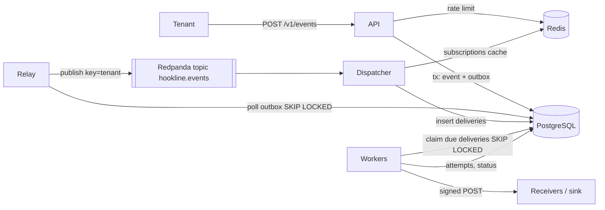

<div dir="rtl" lang="he">

# פרק 37: Hookline: מפרט וארכיטקטורה

פרויקט הגמר של הספר הוא Hookline: פלטפורמה שמוסרת webhooks ללקוחות של מוצר SaaS, בחתימה, לפחות פעם אחת,
גם כשהשרתים שלהם איטיים או למטה. הפרק הזה הוא המפרט: מה המערכת מבטיחה, איך כל הבטחה נבדקת, ממה היא בנויה,
אילו החלטות התקבלו ולמה, ומה קורה כשכל רכיב נופל. בראיון לתפקיד בכיר זה בדיוק מה שמבקשים ממך להסביר על פרויקט:
לא רק „מה בנית”, אלא מה הבטחת, מה בחרת לא לעשות, ואיך את יודעת שזה עובד.

## מה נלמד בפרק

- לקרוא סיפור משתמשת ולתרגם אותו לדרישות שלכל אחת יש בדיקה.
- להבחין בין דרישה פונקציונלית לבין יעד (target), ולמה את היעדים מודדים בעצמך ולא מעתיקים.
- את הארכיטקטורה של Hookline: ארבעה תהליכי Go, שירות Python אחד, והמסלול של אירוע אחד מהקליטה ועד המקבל.
- את מודל הנתונים: שבע טבלאות, ואילו כללים המסד עצמו אוכף.
- לנמק החלטה בכל שורה: החלופה הפשוטה, למה לא היא, ומה היה משנה את דעתך.
- לעבור על מצבי הכשל לפני שכותבים קוד, ולקשור כל אחד לבדיקה שמוכיחה את הטיפול בו.
- לעבוד עם ה־starter: עץ מלא שמתקמפל מהיום הראשון, ובדיקות שמוריקות חבילה אחר חבילה.

## ידע מקדים

- פרק 6 כולו: שירות HTTP ב־Go, עם הגדרות מהסביבה, לוגים מובנים וכיבוי מסודר. אבן הדרך הראשונה מתחילה
  מהקוד הזה.
- פרק 9, סעיפים 9.3 עד 9.5: פרטי בעיה (problem details), עימוד ומפתחות אידמפוטנטיות.
- פרקים 10 ו־11: PostgreSQL, אינדקסים, טרנזקציות ומיגרציות עם goose. אבן הדרך השנייה נשענת עליהם.
- פרק 8, סעיף 8.8: המקבל המדומה ב־FastAPI. הוא חוזר בפרויקט בתור ה־sink.
- את הפרקים 12 עד 28 את עוד לא צריכה. הפרק מזכיר אותם כדי שתראי לאן כל חלק של המערכת יגיע.

## 37.1 סיפור המשתמשת

כל המפרט נגזר מפסקה אחת. כך היא כתובה במסמך התכנון של הפרויקט, באנגלית כמו כל מסמך תכנון בצוות:

<div dir="ltr" align="left">

```text
I run a SaaS product. My customers want to be notified when things happen in their accounts (an invoice
is paid, a shipment moves). I want to send each event once from my code and know that every subscribed
customer endpoint will receive it, signed, at least once, even when their servers are slow or down,
without one bad customer slowing everyone else, and with a way to see and replay what failed.
```

</div>

כדאי לקרוא אותה לאט, כי כל חלק בה הוא הבטחה שצריך לקיים:

| ביטוי בסיפור | מה הוא מחייב |
| --- | --- |
| „לשלוח כל אירוע פעם אחת” | קליטה עם מפתח אידמפוטנטיות (idempotency key): ניסיון חוזר של הלקוח לא יוצר אירוע שני |
| „כל endpoint מנוי” | מנויים לפי סוג אירוע, והפצה של אירוע אחד להרבה מקבלים |
| „חתום” | חתימת HMAC על כל בקשה, כדי שהמקבל יידע שהיא באמת מ־Hookline |
| „לפחות פעם אחת” | אחריות מסירה „לפחות פעם אחת” (at-least-once), ולא „בדיוק פעם אחת”; המקבל מסנן כפילויות |
| „גם כשהשרתים איטיים או למטה” | ניסיונות חוזרים עם המתנה גדלה, זמנים קצובים, ומצב סופי „מת” |
| „בלי שלקוח רע אחד יאט את כולם” | בידוד בין מקבלים: מפסק זרם ומחיצה אטומה לכל endpoint |
| „לראות ולהריץ שוב את מה שנכשל” | רשימת מסירות מתות, היסטוריית ניסיונות, ופעולת הרצה מחדש |

יש שלושה שחקנים. **הדיירת** (tenant) היא מוצר ה־SaaS. היא קוראת ל־API עם מפתח משלה. **המקבל** (receiver) הוא
ה־endpoint של לקוח של הדיירת, שמקבל את ה־webhooks. **המפעילה** (operator) מריצה את Hookline, מסתכלת בלוחות
הבקרה, ועושה תורנות. בפרויקט את משחקת את שלושתם: המקבל הוא ה־sink מפרק 8, והמפעילה היא את עם Grafana.

> **שימי לב:** המילה „לפחות” היא החלטה, לא פשרה. אי אפשר להבטיח מסירה „בדיוק פעם אחת” לשרת HTTP של מישהו
> אחר: אם התשובה שלו אבדה ברשת, אין דרך לדעת אם הוא עיבד את הבקשה. מה שאפשר הוא חוזה ברור: Hookline שולח
> עד שהוא מקבל 2xx, והמקבל מסנן לפי `Hookline-Event-Id`.

## 37.2 דרישות ובדיקות

כל דרישה במפרט באה עם הבדיקה שמוכיחה אותה. דרישה בלי בדיקה היא משאלה. זו הטבלה הפונקציונלית; העמודה
האחרונה אומרת באיזו אבן דרך (פרק 38) הבדיקה נכתבת:

| מזהה | דרישה | בדיקה | אבן דרך |
| --- | --- | --- | --- |
| F1 | דיירת רושמת endpoints עם סוד חתימה שנוצר אצלנו ומוצג פעם אחת; רק `https`, ו־`http` במצב פיתוח | בדיקות API: יצירה, רשימה עם cursor, השבתה | M1 |
| F2 | דיירת מנה endpoint לסוג אירוע מדויק או לכל הסוגים (`*`) | בדיקת API | M1 |
| F3 | קליטת אירוע עם `Idempotency-Key`: אותו מפתח ואותו גוף מחזירים את האירוע המקורי; גוף אחר מחזיר 422 | בדיקת אינטגרציה מול PostgreSQL | M2 |
| F4 | כל אירוע נמסר לפחות פעם אחת לכל endpoint פעיל ומתאים, כבקשת POST עם ארבע כותרות קבועות | בדיקה מקצה לקצה מול ה־sink | M5 |
| F5 | החתימה היא HMAC-SHA256 על חותמת הזמן והגוף; מקבל דוחה חתימה ישנה מחמש דקות | וקטורי בדיקה משותפים ל־Go ול־Python | M5 |
| F6 | כשל זמני (זמן קצוב, חיבור, 5xx, 429) מנוסה שוב עם המתנה גדלה ופיזור אקראי, עד תקרה | בדיקת תכונה על ההמתנה; בדיקות worker | M5 |
| F7 | אחרי הניסיון האחרון המסירה „מתה”; אפשר להריץ אותה שוב ולרשום את המתות בעמודים | בדיקת אינטגרציה | M5 |
| F8 | כל ניסיון נרשם: התחלה, משך, קוד תשובה או שגיאה | בדיקת אינטגרציה | M5 |
| F9 | דיירת רואה ונוגעת רק במשאבים שלה | בדיקות BOLA: דיירת ב' מקבלת 404 על מזהים של א' | M1 |

ארבע הכותרות של F4 הן:

<div dir="ltr" align="left">

```text
Hookline-Event-Id      the event's id; receivers deduplicate by it
Hookline-Delivery-Id   one per (event, endpoint)
Hookline-Attempt       1, 2, 3, ...
Hookline-Signature     t=<unix seconds>,v1=<hex HMAC-SHA256(secret, "<t>.<raw body>")>
```

</div>

הטבלה השנייה היא של דרישות לא פונקציונליות. כאן כל שורה היא **יעד**: מספר שאת מכוונת אליו, לא תוצאה שמישהו
מדד בשבילך. הפרויקט מספק את הכלים למדידה (ספים לבדיקת העומס, היסטוגרמות, ומונים ב־sink), ואת התוצאות את רושמת
בעצמך בקובץ `docs/EVALUATION.md`, עם התאריך והמחשב.

| מזהה | יעד | איך בודקים |
| --- | --- | --- |
| N1 | ‏99% מבקשות הקליטה מחזירות 2xx בפחות מ־200 מילישניות, בפרופיל העומס של הפרויקט, על המחשב שלך | ספי k6 והיסטוגרמת זמני הבקשות |
| N2 | ‏99% מהמסירות למקבלים בריאים מגיעות תוך 30 שניות מהקליטה | היסטוגרמת פיגור המסירה, והתראות קצב שריפה |
| N3 | מקבל שכל בקשה אליו נתקעת לא מעלה את הפיגור של המקבלים הבריאים מעל N2 | ניסוי כאוס: sink אחד במצב timeout |
| N4 | הריגה של relay, ‏dispatcher או worker בכל רגע לא מאבדת אף מסירה | ניסוי כאוס: השוואת הסט הצפוי למה שה־sink קיבל |
| N5 | דיירת מעל מגבלת הקצב שלה מקבלת 429 עם `Retry-After`; האחרות לא מושפעות | בדיקת אינטגרציה ותרחיש k6 של שתי דיירות |
| N6 | בעומס יתר, הקליטה משילה עומס עם 503 במקום לצבור תור בלי גבול | בדיקת עומס מעל הקיבולת |
| N7 | מפתחות API שמורים כגיבוב; סודות חתימה לא נכתבים ללוג; כתובות פרטיות נדחות | בדיקות יחידה על הגנת SSRF; סריקת לוגים |
| N8 | לכל בקשה ומסירה יש מעקב; לוחות RED; runbook לכל התראה | בדיקה ידנית ב־Grafana באבן דרך M8 |
| N9 | הכול רץ על מחשב נייד אחד | צריכת המשאבים שתרשמי |

> **טעות נפוצה:** לכתוב בקורות החיים „p99 מתחת ל־200 מילישניות” כי זה כתוב במפרט. המספר במפרט הוא היעד. מה
> שמותר לכתוב הוא מה שמדדת, עם התנאים שבהם מדדת. פרק 39 עוסק בזה.

## 37.3 ארכיטקטורה

זה המבנה המלא, כפי שיהיה אחרי אבן הדרך השישית. בשבוע הראשון יש בו רק תיבה אחת, ה־API, וכל השאר נבנה סביבה:

<div dir="ltr" align="left">



</div>

מודול Go אחד בונה ארבעה קבצי הרצה, ולצידם שירות Python אחד:

| רכיב | תיקייה | תפקיד | אבן דרך |
| --- | --- | --- | --- |
| api | `cmd/api` | HTTP, אימות, הגבלת קצב לכל דיירת, השלת עומס, קליטה אידמפוטנטית | M1, M2, M6 |
| relay | `cmd/relay` | מופע פעיל אחד; מפרסם שורות outbox ל־Redpanda לפי הסדר ומסמן אותן | M4 |
| dispatcher | `cmd/dispatcher` | צרכן ב־consumer group; פורש כל אירוע לשורת מסירה לכל מנוי מתאים | M4 |
| worker | `cmd/worker` | תופס מסירות שהגיע זמנן, שולח חתום, רושם ניסיון, מתזמן ניסיון חוזר | M5, M6 |
| sink | `sink/` | המקבל המדומה מפרק 8: מאמת חתימות, מסנן כפילויות, סופר, ומתקלקל לפי פקודה | M3 |
| hookline-admin | `cmd/hookline-admin` | כלי המפעילה: מיגרציות ויצירת דיירת | M1, M2 |

והתשתית, כולה מקומית. הגרסאות המדויקות, נכון לאוקטובר 2026, נמצאות בנספח ג ובקובץ ה־compose של הפרויקט.

| תפקיד | רכיב |
| --- | --- |
| מסד הנתונים | PostgreSQL 18 |
| ה־broker | Redpanda, מימוש של פרוטוקול Kafka בקובץ הרצה אחד |
| מטמון והגבלת קצב | Redis 8 |
| איסוף טלמטריה | ה־collector של OpenTelemetry |
| מדדים, לוגים ומעקבים | Prometheus, ‏Loki ו־Tempo |
| לוחות בקרה | Grafana |

### 37.3.1 המסלול של אירוע אחד

כדאי לדעת לספר את המסלול הזה בעל פה, כי זו השאלה הראשונה בכל ראיון על הפרויקט:

1. הדיירת שולחת `POST /v1/events` עם מפתח אידמפוטנטיות. ה־API בודק את המפתח, ובטרנזקציה אחת כותב את שורת
   האירוע ואת שורת ה־outbox שלו. רק אחרי ה־`COMMIT` הוא מחזיר 202.
2. ה־relay הוא המופע היחיד שמחזיק נעילה מייעצת (advisory lock). הוא קורא שורות outbox שלא פורסמו, ומפרסם
   אותן ל־topic בשם `hookline.events` עם מפתח לפי דיירת. אחר כך הוא מסמן אותן כמפורסמות.
3. ה־dispatcher צורך את ה־topic, מוצא את המנויים שמתאימים לסוג האירוע, ומכניס שורת מסירה לכל אחד. אילוץ ייחודיות
   על הזוג אירוע ו־endpoint הופך עיבוד חוזר של אותה הודעה לחסר נזק. רק אחר כך הוא מאשר את ה־offset.
4. ‏worker תופס מסירה שהגיע זמנה עם `FOR UPDATE SKIP LOCKED` וחכירה, חותם את הגוף, ושולח. הוא רושם את הניסיון,
   ומסמן „נמסר”, מתזמן ניסיון חוזר, או מסמן „מת”.
5. ה־sink מאמת את החתימה, מסנן לפי מזהה האירוע, וסופר. ספירת הייחודיים שלו היא ההוכחה של N4.

> **איך Rust עושה את זה:** את ההפרדה הזאת בין „נכתב” ל„נשלח” את מכירה מערוצי `mpsc` עם חוצץ: השולח לא מחכה
> לצרכן. כאן החוצץ הוא טבלה במסד וטופיק ב־Kafka, ולכן הוא שורד קריסה של כל תהליך. המחיר הוא שכל צרכן חייב להיות
> אידמפוטנטי, כי אחרי קריסה הוא יקבל שוב הודעות שכבר ראה.

## 37.4 מודל נתונים

שבע טבלאות ב־PostgreSQL, כולן במיגרציות בתיקייה `migrations/`. אבן הדרך השנייה יוצרת את כולן
בבת אחת, גם את אלה שישמשו רק באבן הדרך החמישית, כדי שאף אבן דרך מאוחרת לא תצטרך לשכתב טבלה.

| טבלה | עמודות מרכזיות | הכלל שהמסד אוכף |
| --- | --- | --- |
| `tenants` | מזהה, שם, גיבוב מפתח ה־API, קצב ופרץ | גיבוב ייחודי באורך 32 בתים |
| `endpoints` | מזהה, דיירת, כתובת, סוד, פעיל, זמן יצירה | הזוג דיירת ומזהה ייחודי, כדי שמנויים יפנו אליו |
| `subscriptions` | מזהה, דיירת, endpoint, סוג אירוע | מפתח זר מורכב לאותה דיירת; זוג endpoint וסוג ייחודי |
| `events` | מזהה (uuid), דיירת, סוג, גוף (jsonb), מפתח אידמפוטנטיות, גיבוב הגוף | הזוג דיירת ומפתח ייחודי |
| `outbox` | מזהה רץ, אירוע, זמן יצירה, זמן פרסום | אינדקס חלקי על שורות שלא פורסמו |
| `deliveries` | מזהה, דיירת, אירוע, endpoint, מצב, ניסיונות, מועד הניסיון הבא, חכירה | הזוג אירוע ו־endpoint ייחודי; ארבעה מצבים בלבד |
| `attempts` | מזהה רץ, מסירה, מספר, התחלה, משך, קוד, שגיאה | רק הוספה; הזוג מסירה ומספר ייחודי |

זו המיגרציה של האירועים וה־outbox, מהקובץ `migrations/00003_events_outbox.sql`. שימי לב לאילוץ הייחודיות: הוא,
ולא קוד ב־Go, מחליט שבקשה חוזרת היא כפילות.

<div dir="ltr" align="left">

```sql
-- +goose Up
CREATE TABLE events (
    id              uuid PRIMARY KEY,
    tenant_id       uuid NOT NULL REFERENCES tenants (id) ON DELETE CASCADE,
    type            text NOT NULL CHECK (length(type) BETWEEN 1 AND 128),
    payload         jsonb NOT NULL,
    idempotency_key text NOT NULL CHECK (length(idempotency_key) BETWEEN 1 AND 255),
    body_hash       bytea NOT NULL CHECK (length(body_hash) = 32),
    created_at      timestamptz NOT NULL DEFAULT now(),
    -- The constraint, not application code, decides that a retried request is a duplicate.
    UNIQUE (tenant_id, idempotency_key)
);

-- The transactional outbox (chapter 13): written in the same transaction as the event, read by the relay
-- (milestone M4), which publishes each row to Redpanda and then sets published_at.
CREATE TABLE outbox (
    id           bigint GENERATED ALWAYS AS IDENTITY PRIMARY KEY,
    event_id     uuid NOT NULL REFERENCES events (id) ON DELETE CASCADE,
    created_at   timestamptz NOT NULL DEFAULT now(),
    published_at timestamptz
);
-- The relay only ever looks for unpublished rows, in id order; published rows leave the index.
CREATE INDEX outbox_unpublished_idx ON outbox (id) WHERE published_at IS NULL;
```

</div>

אבן הדרך החמישית מוסיפה לטבלה `deliveries` עמודה אחת, `attempt_base`, במיגרציה `00005`. היא מאפשרת להפעיל שוב
מסירה מתה בלי לאפס את מונה הניסיונות (פרק 38, סעיף 38.5). זה השינוי היחיד בסכמה אחרי אבן הדרך השנייה.

שלוש החלטות קטנות במודל שכדאי לדעת לנמק:

- **מזהים הם UUID גרסה 7.** ‏48 הביטים הראשונים הם זמן במילישניות, ולכן מזהה חדש נכנס בקצה הימני של אינדקס
  ה־B-tree ולא בעמוד אקראי. הפונקציה `domain.NewID` מייצרת אותם, בלי ספרייה חיצונית.
- **מפתח זר מורכב בין מנוי ל־endpoint.** המנוי מפנה לזוג של דיירת ו־endpoint. לכן דיירת לא יכולה
  להירשם ליעד של דיירת אחרת, גם אם באג בקוד ישכח לבדוק. ההגנה מפני BOLA יושבת גם במסד.
- **מזהה רץ ל־outbox ול־attempts.** הסדר שלהם חשוב (הפרסום הולך לפי הסדר), ואף אחד מבחוץ לא מבקש אותם לפי
  מזהה, אז מספר עולה מספיק וזול יותר.

## 37.5 החלטות וחלופות

לכל החלטה במפרט יש שלוש עמודות: החלופה הפשוטה יותר, למה לא היא כאן, ומה היה משנה את ההחלטה. העמודה האחרונה
היא מה שמבדיל תשובה של בכירה בראיון: היא מראה שההחלטה תלויה בהקשר, ושאת יודעת באיזה.

| החלטה | החלופה הפשוטה | למה לא כאן | מה היה משנה את דעתי |
| --- | --- | --- | --- |
| ‏outbox טרנזקציוני ו־relay ל־Redpanda | פרסום ל־Kafka ישירות מה־API | כתיבה כפולה: האירוע נשמר והפרסום אבד, או ההפך | מסד שכבר יש לו CDC מובנה, כמו Debezium |
| ‏Kafka בין ה־relay ל־dispatcher, תור PostgreSQL למסירות | ‏Kafka לכל דבר, עם topics לניסיונות חוזרים | ניסיון מתוזמן והרצה מחדש לכל מסירה טבעיים כשורה עם מועד; topics לניסיונות מתרבים ומסתירים מצב של שורה | נפח מסירות שמסד אחד לא מאנדקס ומנקה בנוחות |
| ‏relay פעיל יחיד בנעילה מייעצת | הרבה relays עם `SKIP LOCKED` | שומר על סדר פרסום לכל דיירת בפשטות | ה־relay נעשה צוואר בקבוק; אז מחלקים את ה־outbox לפי דיירת |
| „לפחות פעם אחת” וסינון במקבל | הבטחה של „בדיוק פעם אחת” | אי אפשר להבטיח אותה מול HTTP של צד שלישי; חוזה ברור הוא חוזה כן | אף פעם, מול HTTP של צד שלישי |
| מפסק זרם ומחיצה אטומה לכל endpoint בכל worker | מפסק משותף ב־Redis | מצב מקומי פשוט יותר ונכשל בבטחה | הרבה workers שפוגעים ב־endpoint מת לפני שהמפסקים המקומיים נפתחים |
| דלי אסימונים ב־Redis לכל דיירת | מגביל בזיכרון בכל עותק של ה־API | עותקים מכפילים את המגבלה בפועל | פריסה עם עותק יחיד |
| גיבוב SHA-256 למפתחות API | ‏bcrypt או argon2 | המפתחות הם 32 בתים אקראיים; גיבוב איטי מגן על סיסמאות חלשות, לא על מפתחות אקראיים | מפתחות שבני אדם בוחרים |
| ‏Go לשירותים, Python ל־sink | שפה אחת | הספר מלמד את שתיהן; ה־sink הוא כלי, לא המוצר | צוות שמכיר רק אחת |

ההחלטה על גיבוב המפתחות מופיעה בקוד, בקובץ `internal/domain/apikey.go`, יחד עם הנימוק שלה:

<div dir="ltr" align="left">

```go
// NewAPIKey returns a fresh API key and its hash. The key is shown to the operator once; the hash goes to
// the database. 32 random bytes are 256 bits of entropy, so a fast hash is enough: nobody can guess the
// preimage, which is what a slow hash such as argon2 protects for low-entropy passwords.
func NewAPIKey() (string, APIKeyHash) {
	key := APIKeyPrefix + random32()
	return key, HashAPIKey(key)
}
```

</div>

הקידומת `hk_` לא נועדה לאבטחה. היא הופכת מפתח שדלף למשהו שסורקי סודות מזהים, ומבדילה אותו מסוד החתימה,
שמתחיל ב־`whsec_`.

## 37.6 מצבי כשל

לפני שכותבים שורת קוד, עוברים על כל רכיב ושואלים: מה קורה אם הוא נופל בדיוק עכשיו? הטבלה הזאת היא התשובה,
וכל שורה בה קשורה לבדיקה. כך גם נראה הסעיף „מצבי כשל” במסמך תכנון אמיתי (פרק 29).

| כשל | התוצאה בלי טיפול | הטיפול | ההוכחה |
| --- | --- | --- | --- |
| ה־API קורס אחרי ה־`COMMIT` ולפני התשובה | הדיירת מנסה שוב | מפתח האידמפוטנטיות מחזיר את האירוע המקורי | הבדיקה של F3 |
| ה־relay קורס אחרי פרסום ולפני סימון | אירוע כפול ב־topic | ההכנסה של ה־dispatcher אידמפוטנטית (אילוץ ייחודיות) | בדיקה עם נקודת קריסה מאולצת |
| שני relays עולים | פרסום כפול או לא לפי הסדר | נעילה מייעצת: רק אחד מחזיק, השני מחכה | בדיקת המנהיג: הורגים אחד |
| ה־dispatcher קורס לפני אישור ה־offset | האירוע מעובד שוב | הזוג אירוע ו־endpoint ייחודי | בדיקת הצרכן |
| ‏worker מת כשהוא מחזיק מסירה | המסירה תקועה במצב „בשליחה” | החכירה פגה והמסירה חוזרת להמתנה | בדיקת החכירה |
| מקבל למטה שעות | ניסיונות נערמים, ה־workers עסוקים | המפסק נפתח, ההמתנה מוגבלת בתקרה, „מת” אחרי הניסיון האחרון, הרצה מחדש אחר כך | ניסוי הכאוס של N3 |
| מקבל איטי | ה־workers חסומים, אחרים מורעבים | זמן קצוב לכל ניסיון ומחיצה אטומה לכל endpoint | ניסוי הכאוס של N3 |
| הצפה מדיירת אחת | כולם מאטים | הגבלת קצב לכל דיירת, והשלת עומס כללית | ‏N5 ו־N6 |
| ‏Redis למטה | אין הגבלת קצב ואין מטמון | המגביל נכשל פתוח, עם מדד ולוג (החלטה מתועדת); המטמון חוזר ל־PostgreSQL | בדיקה עם Redis עצור |
| ‏Redpanda למטה | אירועים מחכים ב־outbox | ה־relay מנסה שוב עם המתנה גדלה; הקליטה ממשיכה; התראה על גיל ה־outbox | בדיקה עם ה־broker עצור |

שתי שורות בטבלה דורשות מחשבה נוספת. „המגביל נכשל פתוח” פירושו שכש־Redis למטה, דיירות לא מוגבלות. זו בחירה:
החלופה, להיכשל סגור, הייתה הופכת תקלה ב־Redis לתקלה בקליטה של כולם. השורה הראשונה מסבירה למה הקליטה כותבת
את האירוע ואת ה־outbox באותה טרנזקציה: אם ה־API קורס בין שתי כתיבות נפרדות, אירוע נשמר ולא יימסר לעולם.

## 37.7 איך מודדים הצלחה

ארבע שאלות, ולכל אחת מדידה שאפשר לחזור עליה:

| שאלה | המדידה | איפה |
| --- | --- | --- |
| הקוד עושה מה שהוא אומר? | ‏`go test ./...` ובדיקות ה־sink ירוקות, כולל אינטגרציה מול PostgreSQL אמיתי | מקומית, ומאבן הדרך השביעית גם ב־CI |
| ההבטחה של „לפחות פעם אחת” מחזיקה? | הסקריפט `scripts/verify-delivery.sh` משווה את הסט הצפוי למה שה־sink קיבל אחרי ניסוי כאוס | אבן הדרך העשירית |
| היעדים מתקיימים? | ספי k6 עבור N1, והיסטוגרמת הפיגור עבור N2, לאורך ההרצה | ‏`docs/EVALUATION.md`, עם תאריך ומחשב |
| אפשר להפעיל את זה? | ‏runbook לכל התראה, ותחקיר אחד על גרסה שבורה בכוונה | אבן הדרך השמינית |

התוצאה של השאלה השנייה צריכה להיות „0 חסרות”. כפילויות מותרות, ונספרות: הן המחיר של „לפחות פעם אחת”, ומספר
גבוה שלהן מצביע על בעיה (למשל, חכירה קצרה מדי). הקובץ `docs/EVALUATION.md` מגיע עם מקומות ריקים ולא עם
מספרים. כל מספר שייכנס אליו הוא מספר שאת מדדת.

## 37.8 איך עובדים עם ה־starter

הפרויקט מגיע בשתי גרסאות, זו לצד זו, בתיקייה `exercises/project-hookline/`:

| תיקייה | מה בה |
| --- | --- |
| `hookline/` | המימוש המלא, אבן דרך אחר אבן דרך. לקרוא כשנתקעת, לא להעתיק |
| `hookline-starter/` | אותו עץ בדיוק: אותן בדיקות, מיגרציות, חוזה OpenAPI, קובץ compose ו־Makefile. גוף של כל פונקציה שהיא עבודה שלך הוחלף ב־`panic("TODO: see chapter 38")` |

ה־starter נוצר אוטומטית מהמימוש המלא, ולכן הוא תמיד מתאים לו. מה שנשאר בו שלם הוא תשתית: ההגדרות, השרת
וה־middleware מפרק 6, החבילות של פרטי הבעיה והעימוד מפרק 9, החיבור למסד ממפרק 11, טיפוסי התחום, חיווט
הנתיבים, ופונקציות ה־`main`. מה שהוחלף הוא מה שכל אבן דרך מלמדת: ה־handlers, המאגרים, והלוגיקה.

### 37.8.1 ההתקנה

מעתיקים את ה־starter לתיקיית העבודה שלך, ובודקים שהוא מתקמפל:

<div dir="ltr" align="left">

```bash
mkdir -p ~/senior-course/hookline
cp -r $COURSE/exercises/project-hookline/hookline-starter/. ~/senior-course/hookline/
cd ~/senior-course/hookline
go build ./...
go vet ./...
make test-unit
```

</div>

הפקודות `go build` ו־`go vet` מצליחות מהיום הראשון. הפקודה `make test-unit` נכשלת, וזה המצב הנכון:

<div dir="ltr" align="left">

```text
--- FAIL: TestCreateTenantStoresOnlyTheHash (0.00s)
panic: TODO: see chapter 38 [recovered, repanicked]
FAIL	example.com/hookline/internal/admin	0.944s
--- FAIL: TestHealthNeedsNoKey (0.00s)
panic: TODO: see chapter 38 [recovered, repanicked]
FAIL	example.com/hookline/internal/api	0.870s
ok  	example.com/hookline/internal/config	2.675s
ok  	example.com/hookline/internal/db	3.612s
ok  	example.com/hookline/internal/domain	2.991s
```

</div>

החבילות שעוברות כבר הן התשתית שקיבלת שלמה. החבילות שנכשלות הן המפה של העבודה: כל אבן דרך בפרק 38 אומרת אילו
מהן היא מוריקה, ובאיזו פקודה בודקים.

### 37.8.2 כללי העבודה

- **הבדיקות הן המפרט.** אל תשני קובץ בדיקה כדי שיעבור. אם בדיקה נראית לך שגויה, קראי את הסעיף בפרק 38, ואז
  השווי לבדיקה באותו מקום בתיקייה `hookline/`.
- **קומיט לכל אבן דרך.** בסוף כל אבן דרך, כשהבדיקות שלה ירוקות, עושים קומיט עם הודעה כמו `M1: API skeleton`.
  ההיסטוריה הזאת היא חלק ממה שתציגי בסוף.
- **מקודם לפני מחדש.** חלק מהקוד כבר כתבת בפרקים 6, 9 ו־11. כשאבן דרך אומרת „מהפרק הקודם”, פתחי את הפתרון שלך
  והתאימי אותו, במקום לכתוב מאפס.
- **הרגע של „תקועה”.** אחרי חצי שעה בלי התקדמות, פתחי את הקובץ המקביל ב־`hookline/`, קראי את הפונקציה האחת שחסרה
  לך, סגרי אותו, וכתבי אותה בעצמך.

> **שימי לב:** החבילה `internal/store/storetest` היא חבילת בדיקות התאמה, ולא קוד ייצור. אותן בדיקות רצות על
> המאגר שבזיכרון ועל המאגר ב־PostgreSQL. זה המנגנון שמבטיח ש„להחליף את המאגר” לא ישבור אף handler.

## סיכום

- ‏Hookline מוסר webhooks חתומים „לפחות פעם אחת” לכל מקבל מנוי, עם בידוד בין מקבלים והרצה מחדש של כשלים.
- כל דרישה פונקציונלית באה עם בדיקה, וכל דרישה לא פונקציונלית היא יעד שאת מודדת ורושמת בעצמך.
- ארבעה תהליכים ב־Go ושירות אחד ב־Python, מעל מסד אחד, מתווך הודעות אחד ומטמון אחד.
- המסלול: קליטה בטרנזקציה עם outbox, פרסום, פריסה לשורות מסירה, ושליחה חתומה.
- שבע טבלאות. אילוצי ייחודיות הם שמחליטים על כפילויות, ומפתח זר מורכב אוכף בעלות של דיירת.
- לכל החלטה יש חלופה פשוטה ותנאי שהיה משנה אותה. זו צורת התשובה שמראיינים מחפשים.
- לכל כשל יש טיפול ובדיקה. „0 חסרות” אחרי כאוס היא ההוכחה של ההבטחה המרכזית.
- ה־starter הוא העץ המלא עם גופי פונקציות ריקים. הבדיקות הן המפרט, ואבן דרך נגמרת כשהן ירוקות.

## מונחים לזכור

| מונח בעברית | באנגלית | במשפט אחד |
| --- | --- | --- |
| דיירת | tenant | לקוחה של המערכת שמשאביה מבודדים משל לקוחות אחרות |
| מקבל | receiver | ה־endpoint של לקוח הדיירת שאליו נמסרים ה־webhooks |
| „לפחות פעם אחת” | at-least-once | אחריות מסירה שמבטיחה שאף הודעה לא תאבד, במחיר של כפילויות אפשריות |
| מפתח אידמפוטנטיות | idempotency key | ערך שהלקוח שולח כדי שניסיון חוזר של אותה בקשה לא ייצור תוצאה שנייה |
| תבנית ה־outbox | outbox pattern | כתיבת ההודעה לטבלה באותה טרנזקציה של השינוי, ופרסום שלה אחר כך |
| נעילה מייעצת | advisory lock | נעילה ב־PostgreSQL על מספר שהיישום בוחר; כאן היא בוחרת relay פעיל יחיד |
| חכירה | lease | בעלות זמנית על שורה שפגה מעצמה אם הבעלים מת |
| תור מתים | dead-letter queue | המקום של מסירות שמיצו את הניסיונות שלהן; כאן מצב `dead` בטבלה |
| מפסק זרם | circuit breaker | רכיב שמפסיק לשלוח ליעד שנכשל שוב ושוב, ובודק אותו מחדש אחרי זמן |
| מחיצה אטומה | bulkhead | מגבלה על משאבים לכל יעד, כדי שיעד אחד לא יתפוס את כולם |
| הגנת BOLA | broken object level authorization | בדיקה שמשתמש ניגש רק לאובייקטים שלו, גם כשהוא יודע מזהה של אחר |
| יעד | target | מספר שמכוונים אליו ומודדים מולו, ולא תוצאה שכבר נמדדה |
| חלופה פשוטה | simpler alternative | הפתרון הקל יותר שנשקל ונדחה, יחד עם הסיבה |

## טעויות נפוצות

- **להתחיל מהקוד ולא מהבדיקה.** בפרויקט הזה הבדיקות כבר כתובות; מתחילים מלקרוא אותן, ורק אז ממלאים פונקציה.
- **להבטיח „בדיוק פעם אחת”.** מול HTTP של צד שלישי זה בלתי אפשרי. מבטיחים „לפחות פעם אחת” ונותנים למקבל מזהה
  לסינון.
- **לכתוב את האירוע ואז לפרסם ל־Kafka מתוך ה־handler.** זו כתיבה כפולה: קריסה בין שתיהן מאבדת אירוע או
  מפרסמת אירוע שלא נשמר. לשם כך יש outbox.
- **לבדוק כפילות בקוד לפני ההכנסה.** שתי בקשות במקביל יעברו את הבדיקה שתיהן. אילוץ ייחודיות במסד הוא שמכריע.
- **להחזיר 403 על משאב של דיירת אחרת.** 403 מגלה שהמזהה קיים. התשובה הנכונה היא אותו 404 שמזהה לא קיים מקבל.
- **להעתיק את היעדים לתוצאות.** מספר במפרט הוא כוונה. מה שנכנס לקובץ ההערכה ולקורות החיים הוא מה שמדדת.
- **לשנות קובץ בדיקה ב־starter כדי שיעבור.** זה משנה את המפרט. אם בדיקה לא מסתדרת, קוראים שוב את הסעיף בפרק 38.

## שאלות ראיון

1. **ספרי לי על המסלול של אירוע אחד במערכת שבנית.** הדיירת שולחת אירוע עם מפתח אידמפוטנטיות, וה־API כותב את
   האירוע ואת שורת ה־outbox בטרנזקציה אחת, ורק אז מחזיר 202. תהליך relay יחיד מפרסם את שורות ה־outbox, עם מפתח
   לפי דיירת. ה־dispatcher פורש כל אירוע לשורת מסירה לכל מנוי, עם אילוץ ייחודיות שהופך עיבוד חוזר לחסר נזק.
   ‏Workers תופסים מסירות עם `SKIP LOCKED` וחכירה, שולחים חתום, ורושמים כל ניסיון. בכל שלב אומרים מה קורה אם
   הוא נופל, כי זה מה שהמראיין ישאל אחר כך.
   **המשך:** למה לא לפרסם ל־Kafka ישירות מה־API? כי אז יש שתי כתיבות לשתי מערכות בלי טרנזקציה משותפת, וקריסה
   ביניהן משאירה אותן לא עקביות; ה־outbox הופך אותן לכתיבה אחת ועוד פרסום שאפשר לחזור עליו.

2. **למה „לפחות פעם אחת” ולא „בדיוק פעם אחת”?** כי כשבקשת HTTP למקבל נגמרת בזמן קצוב, אי אפשר לדעת אם הוא
   עיבד אותה. כדי לא לאבד, שולחים שוב, וזו כפילות אפשרית. הבטחה של „בדיוק פעם אחת” דורשת שיתוף פעולה מהצד השני
   בכל מקרה: מזהה יציב וסינון אצלו. לכן החוזה הכן הוא „לפחות פעם אחת” עם `Hookline-Event-Id`. בתוך המערכת עצמה
   אפשר להתקרב ל„בדיוק פעם אחת” עם אילוצים ואידמפוטנטיות, אבל הגבול עם העולם נשאר „לפחות”.

3. **למה תור המסירות ב־PostgreSQL ולא ב־Kafka?** כל מסירה צריכה מועד ניסיון משלה, מצב שאפשר לשאול עליו, הרצה
   מחדש, והיסטוריה. בשורה עם `next_attempt_at` כל אלה הם עמודה ושאילתה. ב־Kafka צריך topics לכל רמת השהיה, ואין
   דרך פשוטה לראות מסירה אחת. המחיר: המסד נושא את העומס של השורות, האינדקסים והניקוי. כשהנפח יעבור את מה שמסד
   אחד מנקה בנוחות, אחלק לפי דיירת, או אעבור לתורים ייעודיים.

4. **איך מבטיחים שדיירת אחת לא רואה משאבים של אחרת?** שלוש שכבות. הדיירת נקבעת רק מהמפתח שבכותרת, ואף פרמטר
   בבקשה לא בוחר אותה. כל שאילתה מסננת לפי מזהה הדיירת, ומשאב של אחרת מחזיר את אותו 404 כמו מזהה לא קיים. ובמסד,
   מפתח זר מורכב מונע ממנוי להפנות ל־endpoint של דיירת אחרת. הבדיקות שולחות את המזהים של דיירת א' עם המפתח של
   דיירת ב' לכל נתיב, ומצפות ל־404.

5. **למה גיבוב מהיר למפתחות API ולא argon2?** גיבוב איטי נועד להאט ניחוש של סיסמאות שבני אדם בוחרים, שיש להן
   מעט אנטרופיה. מפתח של 32 בתים אקראיים הוא 256 ביטים; אין מה לנחש. גיבוב מהיר מאפשר חיפוש לפי אינדקס בכל
   בקשה, בלי לשלם עשרות מילישניות. אם המפתחות היו נבחרים בידי אנשים, הייתי בוחרת אחרת.

## פתק Obsidian

הפתק המוכן נמצא גם כקובץ: `obsidian/37-hookline-spec.md`. זה תוכנו:

- **ההבטחה:** כל אירוע נמסר חתום, „לפחות פעם אחת”, לכל endpoint מנוי ופעיל; המקבל מסנן לפי מזהה האירוע.
- **שחקנים:** דיירת שולחת, מקבל מקבל, מפעילה מפעילה.
- **מסלול:** קליטה עם outbox, פרסום, פריסה למסירות, שליחה חתומה, וספירה ב־sink.
- **דרישה מול יעד:** דרישה נבדקת בבדיקה; יעד נמדד על המחשב שלי ונרשם עם תאריך.
- **כפילויות:** אילוצי ייחודיות במסד מחליטים, לא קוד שבודק לפני הכנסה.
- **בידוד:** הדיירת מגיעה מהמפתח בלבד; משאב של אחרת הוא 404; מפתח זר מורכב במסד.
- **החלטה טובה:** החלופה הפשוטה, למה לא כאן, ומה היה משנה את דעתי.
- **starter:** הבדיקות הן המפרט; קומיט לכל אבן דרך; „תקועה” היא חצי שעה.
- **שאלה פתוחה:** ___

<div dir="ltr" align="left">

```text
setup     cp -r $COURSE/exercises/project-hookline/hookline-starter/. ~/senior-course/hookline/
build     go build ./... && go vet ./...
tests     make test-unit            (red at first; green package by package)
headers   Hookline-Event-Id  Hookline-Delivery-Id  Hookline-Attempt  Hookline-Signature
signature t=<unix>,v1=<hex HMAC-SHA256(secret, "<t>.<raw body>")>   tolerance 5 min
tables    tenants endpoints subscriptions events outbox deliveries attempts
unique    events(tenant_id, idempotency_key)   deliveries(event_id, endpoint_id)
statuses  pending -> in_flight -> delivered | dead     replay: dead -> pending
binaries  cmd/api  cmd/relay  cmd/dispatcher  cmd/worker  cmd/hookline-admin   sink/ (Python)
proof     scripts/verify-delivery.sh -> "0 missing"; duplicates allowed and counted
my path   ingest -> ___ -> ___ -> ___ -> receiver
```

</div>

## תרגיל

**מטרה:** להכין את סביבת הפרויקט מה־starter, להכיר את העץ ואת הבדיקות, ולהתחיל את אבן הדרך הראשונה מהקוד של פרק 6.
**זמן:** יום לימוד אחד, יום 22, כ־55 דקות קריאה וכ־55 דקות בנייה; אבן הדרך עצמה ממשיכה ביום 23.
**ידע מקדים:** הפרק; פרק 6 (השרת, ה־middleware והכיבוי המסודר); פרק 9, סעיפים 9.3 עד 9.5.

ההוראות המלאות של הפרויקט, ההתקנה ורשימת אבני הדרך נמצאות ב־
[`exercises/project-hookline/README.md`](../exercises/project-hookline/README.md). הצעדים של אבן הדרך הראשונה
נמצאים בפרק 38, סעיף 38.1.

**קריטריון סיום:**

- ה־starter מועתק לתיקיית העבודה, והבנייה והבדיקה הסטטית עוברות.
- הרצת `make test-unit` נכשלת רק בחבילות של אבני הדרך, וכל חבילות התשתית ירוקות.
- את יודעת לספר את המסלול של אירוע אחד בחמישה משפטים, ולומר מה קורה כשכל רכיב בו נופל.
- הבדיקה `TestHealthNeedsNoKey` עוברת, אחרי שהתחלת את אבן הדרך הראשונה לפי סעיף 38.1.

## העשרה אופציונלית

- טיוטת ה־IETF על הכותרת `Idempotency-Key`: החוזה שהקליטה בפרויקט מממשת.
- המפרט הפתוח Standard Webhooks לכותרות ולחתימה. השווי אותו לכותרות של F4.
- המאמר הקלאסי של Pat Helland על מערכות בלי טרנזקציות מבוזרות, משנת 2007: למה מערכות גדולות בונות על
  אידמפוטנטיות ולא על תיאום בין מסדים.
- נסי לכתוב לבד, לפני שאת ממשיכה, את שורת מצב הכשל של „PostgreSQL למטה”: מה התוצאה, מה הטיפול, ואיזו בדיקה
  תוכיח אותו.

</div>
