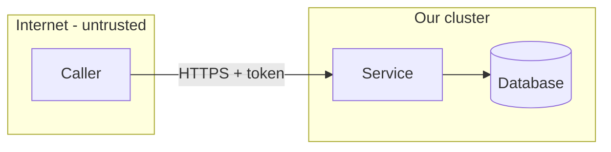

# Threat model: <service name>

Date: <YYYY-MM-DD> · Author: <name> · Reviewed by: <name> · Revisit when: <trigger, e.g. a new external dependency>

## 1. What we are building
One paragraph: what the service does, who calls it, what data it holds.

## 2. Data-flow diagram
Draw every actor, process, data store and external system, and every arrow between them.
Mark each **trust boundary** (where data crosses from less trusted to more trusted) with a dashed box.

## 3. Assets
| Asset | Why an attacker wants it | Where it lives |
| --- | --- | --- |
| | | |

## 4. Threats (STRIDE per element that crosses a boundary)
| # | Element | STRIDE | Threat (attacker, action, result) | Mitigation in place | Test or evidence | Residual risk | Owner |
| --- | --- | --- | --- | --- | --- | --- | --- |
| T1 | | S | | | | | |
| T2 | | T | | | | | |
| T3 | | R | | | | | |
| T4 | | I | | | | | |
| T5 | | D | | | | | |
| T6 | | E | | | | | |

STRIDE: **S**poofing (pretending to be someone), **T**ampering (changing data or code),
**R**epudiation (denying an action because nothing proves it), **I**nformation disclosure (reading what you should not),
**D**enial of service (making it unavailable), **E**levation of privilege (doing what your role should not allow).

## 5. Decisions and accepted risks
| Decision | Alternative | Why | What would change it |
| --- | --- | --- | --- |
| | | | |

## 6. Follow-ups
- [ ] <action> (owner, due date)
