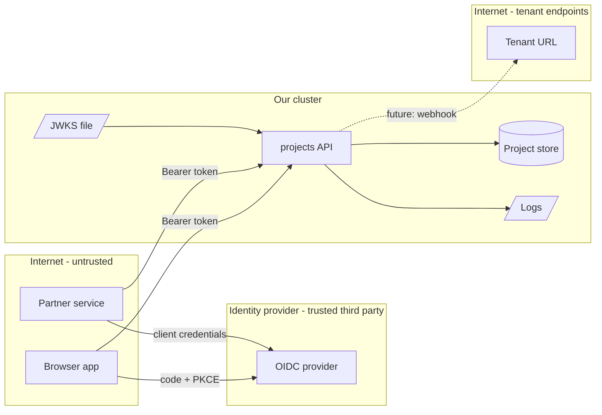

# Threat model: projects API (chapter 28 exercise)

Date: 2026-10-05 · Author: reference solution · Revisit when: a new caller type, a new data store, or outbound calls are added

## 1. What we are building
A small HTTP API (`cmd/projects`) that lets each tenant read its own projects. Callers are browser apps acting for a
user (OIDC authorization code with PKCE) and backend services (OIDC client credentials); both present a JWT access
token from one identity provider. The service holds tenant project data in a store, keeps the provider's public keys
(JWKS) in a file, and logs JSON to stdout. A later version will call tenant-supplied URLs (webhooks), which is why the
SSRF guard exists.

## 2. Data-flow diagram

Trust boundaries: internet to API (every request), API to identity provider (keys we trust), API to tenant URLs
(outbound to addresses an attacker chooses), API to logs (read by more people than the data).

## 3. Assets
| Asset | Why an attacker wants it | Where it lives |
| --- | --- | --- |
| Tenant project data | Competitor intelligence; the thing customers pay us to protect | Project store |
| Access tokens | Act as a user or service until expiry | In flight; must never reach logs |
| JWKS (public keys) | Replacing it lets an attacker mint accepted tokens | File mounted into the pod |
| API keys (future) | Long-lived tenant credentials | Store, as SHA-256 hashes only |
| Internal network | Metadata service credentials, admin endpoints | Reachable from the pod |

## 4. Threats
| # | Element | STRIDE | Threat (attacker, action, result) | Mitigation in place | Test or evidence | Residual risk | Owner |
| --- | --- | --- | --- | --- | --- | --- | --- |
| T1 | API ingress | S | Anyone sends a token signed with `alg: none` or HS256 keyed with our public key and is accepted | Algorithm allow-list (RS256, ES256); key type must match alg; `NewVerifier` refuses `none`/HS* | `TestVerify` cases "alg none", "alg confusion", "kid of an EC key" | Low | service team |
| T2 | API ingress | S | A token issued for another service (other `aud`) or by another issuer is replayed here | `iss` exact match, `aud` required and matched | `TestVerify` "wrong issuer", "token for another audience", "no audience" | Low | service team |
| T3 | API ingress | S | A stolen token is used long after theft | `exp` required; 30 s leeway only; short-lived tokens from the provider | `TestVerify` "expired beyond the leeway", "no exp at all" | Medium: valid until expiry, no revocation check | service team |
| T4 | Project store | I | Tenant B requests tenant A's project id (BOLA) | Tenant from the verified token is part of every store lookup; same 404 for missing and foreign | `TestTenantCannotReadAnotherTenantsProject`, `TestListIsScopedToTenant` | Low for these routes; every new route needs the same test | service team |
| T5 | Logs | I | Tokens, API keys or secrets end up in logs readable by operators and log vendors | `redact.ReplaceAttr` on the logger; `redact.Secret` type; token never logged by middleware | `TestReplaceAttrRedactsSecrets`, `TestSecretNeverPrints` | Medium: maps logged with `slog.Any` are not covered (documented test) | service team |
| T6 | Outbound calls | E | A tenant registers `http://169.254.169.254/...` or a name resolving to 10.x and makes us fetch it (SSRF) | `ssrf.Policy`: URL check, dialer `Control` on the resolved address, redirects re-checked, no proxy | `TestClientChecksResolvedAddress`, `TestRedirectsAreRechecked` | Low; IPv6 ranges list must be kept current | service team |
| T7 | JWKS file | T | Someone with write access to the config replaces the JWKS | File comes from a read-only ConfigMap; changes go through code review | Review process; deployment manifests | Medium: insider with deploy rights | platform team |
| T8 | API ingress | D | Huge headers or slow clients exhaust connections | Server timeouts and `MaxHeaderBytes` in `cmd/projects` | Code review; load test in chapter 26 | Medium: no rate limit yet (chapter 16) | service team |
| T9 | API ingress | R | A tenant denies having read or changed data | Access logs with subject and tenant, no tokens | Log format | Medium: logs are not tamper-evident | service team |
| T10 | Dependencies | T | A vulnerable or malicious module ships in the image | Pinned `go.mod`/`go.sum`, govulncheck in CI, SBOM with Syft, Grype scan | CI job output | Medium: zero-days | service team |

## 5. Decisions and accepted risks
| Decision | Alternative | Why | What would change it |
| --- | --- | --- | --- |
| Validate JWTs locally against a JWKS | Token introspection call per request | No per-request dependency on the provider; latency | A need for instant revocation |
| 404 for objects of other tenants | 403 | Does not confirm that the id exists | Never for tenant data |
| SHA-256 for API keys | bcrypt or argon2 | Keys have 256 random bits; slow hashes protect low-entropy passwords and would cost CPU on every request | Keys chosen by people |
| Static JWKS file | go-oidc discovery with key refresh | Simpler for the exercise; no network at startup | Production: provider rotates keys, so use discovery and cache |

## 6. Follow-ups
- [ ] Rate limit per tenant before going public (chapter 16).
- [ ] Switch to OIDC discovery with cached, refreshed JWKS (go-oidc).
- [ ] Add a BOLA test to the checklist for every new route.
