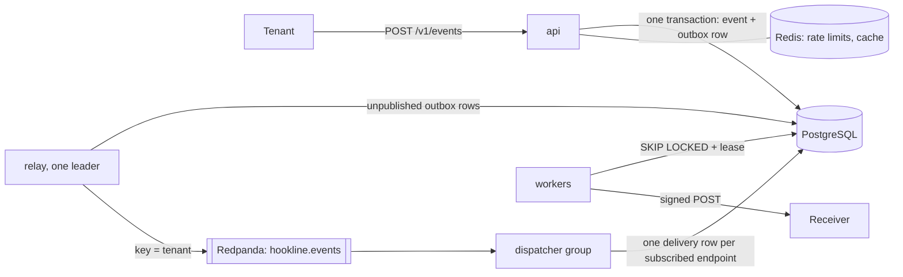

# Hookline

A multi-tenant webhook delivery platform. A tenant sends each event once, with an idempotency key; Hookline
delivers it, signed, **at least once**, to every endpoint subscribed to its type, retries what is worth
retrying, and keeps one slow or failing receiver from hurting the others.

> A learning project, built milestone by milestone from a written specification (the course's chapters 37
> and 38). What was measured, how, and what is not proven is in [`docs/EVALUATION.md`](docs/EVALUATION.md).

## Architecture

<div dir="ltr" align="left">



</div>

| Process | Does | Survives its own crash because |
| --- | --- | --- |
| `cmd/api` | auth by hashed API key, idempotent ingest, endpoints, subscriptions, replay | the event and its outbox row commit together |
| `cmd/relay` | publishes the outbox in order | an advisory lock elects one leader; a re-publish is harmless downstream |
| `cmd/dispatcher` | fans each event out to delivery rows | `UNIQUE (event_id, endpoint_id)`; the offset is committed after the insert |
| `cmd/worker` | signs and sends, retries with backoff, breaker and bulkhead per endpoint | a lease expires and the attempt number fences the old holder |

Receivers verify `Hookline-Signature` (`t=<unix>,v1=<HMAC-SHA256 of "<t>.<body>">`) and dedupe by
`Hookline-Event-Id`. The body is specified in [`contract/webhook-event.schema.json`](contract/webhook-event.schema.json).

## Run it

Needs Docker, Go 1.27, Python 3.14 with uv, and k6 for the load tests.

<div dir="ltr" align="left">

```bash
make up                 # PostgreSQL, Redis, Redpanda and two test receivers in compose
make test               # every Go test, integration tests included
make sink-test          # the Python receiver's tests
make obs-up             # the same plus the OpenTelemetry collector, Prometheus, Loki, Tempo and Grafana (:3000)
make chaos              # load, random SIGKILLs and a misbehaving receiver; ends with the delivery proof
make load-ingest        # N1; also load-two-tenants (N5) and load-overload (N6)
make images supply-chain    # the images, govulncheck, an SBOM per image and a Grype scan
make obs-down
```

</div>

On Kubernetes: `KEEP=1 make kind-smoke` installs the chart on a local kind cluster; `deploy/terraform`
installs the same chart with Terraform.

## Evidence

| Claim | Proof |
| --- | --- |
| No delivery lost when a process dies | `scripts/chaos.sh` then `scripts/verify-delivery.sh`: 0 missing (`docs/EVALUATION.md`, N4) |
| Ingest p99 under 200 ms at the load profile | `loadtest/ingest.js` thresholds (N1) |
| One noisy tenant does not slow the others | `loadtest/two-tenants.js` (N5) |
| Overload is shed, not queued | `loadtest/overload.js` (N6) |
| Tenants cannot see each other's data | `TestTenantIsolation` |
| No secrets in logs; no private addresses fetched | the log-scan and SSRF tests; [`docs/threat-model.md`](docs/threat-model.md) |
| Operable | one runbook per alert in `docs/runbooks/`, a postmortem in `docs/` |

## Limits

- Measured on one laptop, with the numbers and conditions in `docs/EVALUATION.md`; not a production benchmark.
- Single-node PostgreSQL and Redpanda; no multi-region story.
- Signing secrets are stored in plain text, and neither keys nor secrets can be rotated yet (threat model, T11 and
  the follow-ups).

## Supply chain

Go modules are pinned in `go.mod` and `go.sum`; the Go image is distroless. The receiver's base image is pinned by
digest in `sink/Dockerfile`, so a rebuild is the image that was scanned. When a scan reports a fixable finding
in it, take the newer base deliberately: the comment in `sink/Dockerfile` has the steps.

## Layout

`cmd/` binaries · `internal/` packages · `migrations/` schema · `api/openapi.yaml` API contract · `contract/`
webhook contract · `sink/` test receiver (Python) · `deploy/` compose, observability, Helm, kind, Terraform ·
`loadtest/` k6 · `scripts/` labs, chaos, verification · `docs/` evaluation, demo, threat model, runbooks.
