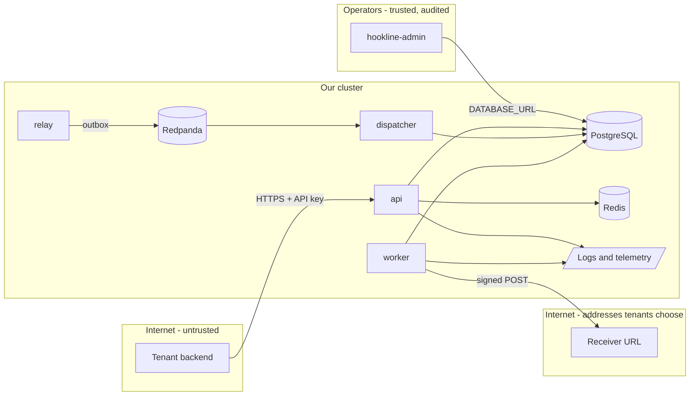

# Threat model: Hookline

Date: ___ · Author: ___ · Reviewed by: ___ · Revisit when: a new caller type (an admin UI, OIDC), a new outbound
call, a new data store, or a change to how endpoints are registered

> Milestone M9 (chapter 38). Built from `exercises/ch28-security/data/stride-template.md` and the chapter 28
> example. Every mitigation names the test or the evidence that proves it; a row without one is a follow-up.
> Fill in the header with your name and date when you review it.

## 1. What we are building
Hookline is a multi-tenant webhook delivery service. Tenants call the HTTP API with a long-lived API key
(`Authorization: Bearer hk_...`) to register endpoints and subscriptions and to ingest events. Hookline stores each
event, publishes it through an outbox to Redpanda, fans it out to one delivery per matching endpoint, and a worker
POSTs it to the tenant's URL, signed with that endpoint's HMAC secret (`Hookline-Signature: t=...,v1=...`). It holds
tenant data (events, endpoints, attempts) in PostgreSQL, rate-limit buckets and a subscription cache in Redis, and
event records in Redpanda; it logs JSON to stdout and exports telemetry over OTLP. The operator CLI
`hookline-admin` creates tenants and prints each API key once.

## 2. Data-flow diagram

Trust boundaries: internet to API (every request), worker to receiver URLs (outbound to addresses an attacker
chooses), services to logs and telemetry (read by more people than the data), broker to dispatcher (a record is
input, even from our own topic), operators to the database.

## 3. Assets
| Asset | Why an attacker wants it | Where it lives |
| --- | --- | --- |
| API keys | Act as a tenant: ingest, read events, register endpoints | Only SHA-256 hashes in `tenants.api_key_hash`; the key itself is shown once |
| Signing secrets (`whsec_`) | Forge webhooks a receiver will trust | `endpoints.secret` in plain text (the worker needs it to sign); shown once at create |
| Tenant events and payloads | Business data of every tenant | `events`, Redpanda topic, receivers |
| Internal network | Metadata service credentials, admin ports, the database | Reachable from the worker's pod |
| Delivery capacity | Starving other tenants is a denial of service | Workers, database, Redpanda |

## 4. Threats
| # | Element | STRIDE | Threat (attacker, action, result) | Mitigation in place | Test or evidence | Residual risk | Owner |
| --- | --- | --- | --- | --- | --- | --- | --- |
| T1 | Worker to receiver | E | A tenant registers `https://169.254.169.254/...`, a private address, or a name that resolves to one, and makes the worker fetch it (SSRF) | At create: `ssrf.Policy.CheckResolved`, URL plus every resolved address, generic error to the caller. At send: the dialer `Control` checks the address actually dialled (DNS rebinding), no proxy, no redirects. Production allows https only and no private range; dev mode allows the compose and kind ranges | `TestCheckResolved`, `TestDevAllowStaysNarrow`, `TestEndpointResolvingToAPrivateAddressIsRefused`, `TestSendRefusesPrivateAddressesAtConnectTime`, ch28 `TestClientChecksResolvedAddress` | Low; the blocked-range list must follow new IANA special ranges | service team |
| T2 | API, every tenant route | I | Tenant B reads, replays or subscribes to tenant A's endpoint, event or delivery by id (BOLA) | Tenant from the verified key is part of every store query; 404 for missing and foreign alike; a subscription's foreign key is `(tenant_id, endpoint_id)` | `TestTenantIsolation`, `TestReplayIsTenantScoped`, storetest suites | Low for today's routes; every new route needs a row in `TestTenantIsolation` | service team |
| T3 | Receiver | S | Someone who captured a signed webhook resends it later, or forges one | HMAC-SHA256 over `timestamp.body`; receivers reject a timestamp outside 300 s and compare in constant time; every attempt carries `Hookline-Event-Id` so receivers dedupe | `TestSignMatchesSharedVectors`, sink `test_verify_vectors`, `test_duplicate_event_is_recorded_once`, `test_comparison_is_constant_time` | Medium: a replay inside the 300 s window is stopped only by the receiver's dedupe, which we document but cannot enforce | service team, receivers |
| T4 | Logs and telemetry | I | API keys or signing secrets end up in logs that operators and log vendors read | `redact.Handler` in front of every output (JSON lines and the OTLP bridge): keys by name, values by shape (`hk_`, `whsec_`, bearer), message by shape, maps by printed form; `redact.Secret` type; the secret leaves the API only in the create response | `TestHandlerRedactsForEveryOutput`, `TestLogsNeverContainKeysOrSecrets`, `TestWorkerLogsNeverContainTheSigningSecret` | Low; a secret of another shape logged under an innocent key is still possible | service team |
| T5 | API ingest | D | One tenant floods ingest and slows everyone (noisy neighbour) | Per-tenant token bucket in Redis, 429 with `Retry-After`; global shedding with 503 on in-flight limit; per-endpoint bulkhead and breaker in the worker | `TestTenantOverItsLimitGets429OthersDoNot`, `TestOverloadShedsV1ButNotHealth`, `TestBulkheadKeepsASlowEndpointFromStarvingOthers`, `loadtest/two-tenants.js` (N5) | Medium: the limiter fails open when Redis is down, by design (`TestLimiterFailureFailsOpenAndIsReported`) | service team |
| T6 | Broker to dispatcher | T | A malformed or hostile record on the topic (a bug, a tool, a compromised producer) crashes the dispatcher or blocks its partition | `outbox.Decode` validates every record; an undecodable record is logged with its topic, partition and offset and skipped instead of retried forever; only the relay produces, with credentials the API does not hold | `TestPoisonRecordIsSkipped`, `TestMatcherFailureIsReturnedForRetry` | Medium: skipped records are visible only in logs, with no metric and no dead-letter topic yet | service team |
| T7 | API ingress | S | An API key is stolen (laptop, CI log, chat) and used to act as the tenant | Keys have 256 random bits and a recognisable `hk_` prefix (secret scanners find them); stored as SHA-256 only; never logged | `TestCreateTenantStoresOnlyTheHash`, `TestAPIKeys`, T4 tests | Medium: no rotation or revocation command yet | service team |
| T8 | Dependencies and image | T | A vulnerable or malicious module or base image ships | Pinned `go.mod` and `go.sum`, a distroless base for the Go image, govulncheck in CI, Syft SBOM per image, Grype scan that fails on fixable high findings | `scripts/supply-chain.sh`, the CI `govulncheck` step and `sbom-*` artifacts | Medium: zero-days, and base-image packages with no fix yet (the sink's Debian base) | service team |
| T9 | Deliveries | R | A tenant says "you never sent it", or an operator replays and denies it | Every attempt is a row in `delivery_attempts` (status, error, duration, time); replay keeps counting attempts; access logs carry the request id and tenant | `TestReplayKeepsCountingAttempts`, `TestEventDeliveriesDeadListAndReplay` | Medium: the attempts log is not tamper-evident | service team |
| T10 | API ingress | D | Huge bodies or slow clients exhaust memory and connections | `MaxBytesReader` on every body (413), server timeouts including `ReadHeaderTimeout` | `internal/api/decode.go`, `internal/platform/server.go`, ingest tests for 413 | Low | service team |
| T11 | PostgreSQL | I | Someone who reads a database backup gets every signing secret | Backups stay in the cluster's trust zone; secrets are random per endpoint so one leak does not reveal others | none (process) | High until secrets are encrypted at rest; see follow-ups | platform team |

STRIDE: **S**poofing, **T**ampering, **R**epudiation, **I**nformation disclosure, **D**enial of service,
**E**levation of privilege.

## 5. Decisions and accepted risks
| Decision | Alternative | Why | What would change it |
| --- | --- | --- | --- |
| Keep M1's API keys: `hk_` and 43 base64url characters, SHA-256, lookup by hash | ch28's `apikey` package with a key id and a constant-time compare | The key has 256 random bits, so the hash is the lookup key and nothing secret is compared in Go; one format for every existing tenant, no migration | Keys chosen by people, or a need for a key id in logs |
| Check SSRF twice: at create and at dial | Only at create | A name can resolve to a public address at create and to 10.x at send (DNS rebinding); only the dial sees the address used | Never: the dial check is the one that matters |
| Generic "must resolve to a public address" to the caller | Echo the policy's reason | Does not teach an attacker our ranges; the reason goes to our logs | None |
| Signing secrets in plain text | Encrypt with a KMS key | The worker must compute HMAC with them; a KMS is out of scope for a laptop project | Production deployment |
| No JWT or OIDC surface | ch28's `jwtauth` for an admin API | Hookline has no admin HTTP API; operators use `hookline-admin` against the database | An admin UI or a dashboard for tenants |
| Limiter fails open | Fail closed | A Redis outage should not stop every tenant's ingest; shedding still caps the total | A tenant abusing outages |

## 6. Follow-ups
- [ ] API key rotation and revocation in `hookline-admin` (two valid hashes during a window).
- [ ] Signing-secret rotation per endpoint: sign with both during a window (`v1=` twice).
- [ ] Encrypt `endpoints.secret` at rest (T11).
- [ ] A counter and a dead-letter topic for poison records (T6).
- [ ] Add a `TestTenantIsolation` case to the checklist for every new route (T2).
